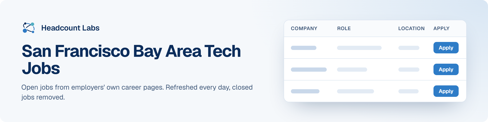

# San Francisco Bay Area Tech Jobs

Software, data, AI, product and design jobs in the San Francisco Bay Area, sorted by field.

**400 open jobs** · 233 new since the last update · 233 removed because they closed or left the employer's board · updated November 12, 2026 at 5:12 AM EST

This list is built and refreshed every day by [Headcount Labs](https://headcountlabs.com/?utm_source=github&utm_medium=job-list&utm_campaign=bay-area-tech-jobs), which reads jobs straight from employers' own career pages and job boards. Every job here was still listed on its source board when we last read that board, within the past 3 days, and was posted in the past 30 days. Copies of the same job are merged into one row, and jobs that close are removed at the next update.

Want this data in your own app or agent? Use the [Headcount Labs jobs API](https://headcountlabs.com/docs/?utm_source=github&utm_medium=job-list&utm_campaign=bay-area-tech-jobs) (free tier), the [MCP server](https://headcountlabs.com/mcp/?utm_source=github&utm_medium=job-list&utm_campaign=bay-area-tech-jobs) for Claude, ChatGPT and other AI assistants, or the [public dataset subsets](https://huggingface.co/HeadcountLabs) on Hugging Face (the full dataset is coming soon).

**Full dataset.** A bigger, one-off snapshot dated 2026-10-19 (all matching jobs, not only the open jobs below) is on Hugging Face: [Tech and software jobs](https://huggingface.co/datasets/HeadcountLabs/tech-jobs). It loads with `datasets.load_dataset` and is under the Open Database License (ODbL) 1.0.

**Jump to:** [Software engineering (208)](#software-engineering) · [Data, AI and machine learning (109)](#data-ai-and-machine-learning) · [Product and design (67)](#product-and-design) · [Hardware and engineering (16)](#hardware-and-engineering)

**Columns.** *Apply* opens the original posting on the employer's site. *Details* opens the job on Headcount Labs, with every posting we found for it. *Remote* shows what the employer states; a dash means the posting doesn't say. *Pay* is the range the employer published.

## Software engineering

| Company | Role | Location | Remote | Pay | Posted | Apply | Details |
| --- | --- | --- | --- | --- | --- | :---: | :---: |
| **ServiceNow, Inc.** | Senior Staff Software Engineer, Agentic Systems - Moveworks | Mountain View, CA | — | $201k–$352k/yr | Nov 12 |  | <a href="https://headcountlabs.com/catalog/jobs/fa2c9efe-343b-473d-a02f-6a501af1f62e?utm_source=github&utm_medium=job-list&utm_campaign=bay-area-tech-jobs">via Headcount Labs</a> |
| **Oracle** | Lead Principal Software Engineer, Core Infrastructure | 

4 locations
Seattle, WA Santa Clara, CA Austin, TX Nashville, TN
 | On-site | $146k–$306k/yr | Nov 12 |  | <a href="https://headcountlabs.com/catalog/jobs/1cf9ef55-032f-45d5-871a-55011a1ebc80?utm_source=github&utm_medium=job-list&utm_campaign=bay-area-tech-jobs">via Headcount Labs</a> |
| **Netapp** | Lead Software Engineer - Cloud &amp; Software Defined Storage Solutions (C++) | 

3 locations
California San Jose, CA Waltham, MA
 | On-site | $170k–$253k/yr | Nov 12 |  | <a href="https://headcountlabs.com/catalog/jobs/daca3d01-1a2c-4e6a-9417-c60acc3d95ba?utm_source=github&utm_medium=job-list&utm_campaign=bay-area-tech-jobs">via Headcount Labs</a> |
| **Zscaler** | Principal Software Development Engineer | Santa Clara, CA | Hybrid | $185k–$265k/yr | Nov 11 |  | <a href="https://headcountlabs.com/catalog/jobs/96d53855-8477-408b-86f5-eb6bd3afa449?utm_source=github&utm_medium=job-list&utm_campaign=bay-area-tech-jobs">via Headcount Labs</a> |
| **Weekday AI** | Agentic Full-Stack Engineer | 

3 locations
Albuquerque, NM San Jose, CA New Mexico
 | Remote | — | Nov 11 |  | <a href="https://headcountlabs.com/catalog/jobs/dab9fa23-bc07-4c3b-a182-efda670b30d3?utm_source=github&utm_medium=job-list&utm_campaign=bay-area-tech-jobs">via Headcount Labs</a> |
| **Twitch** | Software Engineer II, Fintech | San Francisco, CA | — | $165k–$224k/yr | Nov 11 |  | <a href="https://headcountlabs.com/catalog/jobs/7999c7b0-69c9-4f4c-8788-f75e587132bc?utm_source=github&utm_medium=job-list&utm_campaign=bay-area-tech-jobs">via Headcount Labs</a> |
| **True Talent Solutions Partners** | Full Stack Engineer | San Francisco, CA | On-site | — | Nov 11 |  | <a href="https://headcountlabs.com/catalog/jobs/b9620309-7974-4fde-81da-36cff161d436?utm_source=github&utm_medium=job-list&utm_campaign=bay-area-tech-jobs">via Headcount Labs</a> |
| **True Talent Solutions Partners** | Senior Software Engineer | San Francisco, CA | On-site | — | Nov 11 |  | <a href="https://headcountlabs.com/catalog/jobs/49a11c67-d0e3-4cab-9837-f0d1c308d34b?utm_source=github&utm_medium=job-list&utm_campaign=bay-area-tech-jobs">via Headcount Labs</a> |
| **True Talent Solutions Partners** | Senior Security Engineer | San Francisco, CA | On-site | — | Nov 11 |  | <a href="https://headcountlabs.com/catalog/jobs/1905b1c4-6750-4f59-9303-0e4fda2b0f52?utm_source=github&utm_medium=job-list&utm_campaign=bay-area-tech-jobs">via Headcount Labs</a> |
| **True Talent Solutions Partners** | Founding Full-Stack Engineer | San Francisco, CA | On-site | — | Nov 11 |  | <a href="https://headcountlabs.com/catalog/jobs/fd3f3bb0-0821-4a47-9677-ea76af33a6a0?utm_source=github&utm_medium=job-list&utm_campaign=bay-area-tech-jobs">via Headcount Labs</a> |
| **True Talent Solutions Partners** | Staff Full-Stack Engineer, Core Application | Oakland, CA | On-site | — | Nov 11 |  | <a href="https://headcountlabs.com/catalog/jobs/31039719-5b61-4857-a6e2-923dcb3b7ee8?utm_source=github&utm_medium=job-list&utm_campaign=bay-area-tech-jobs">via Headcount Labs</a> |
| **TMS LLC** | Hiring &#124; Lead Software Developer (with OutSystems &amp; Alteryx) &#124; 10+ Years &#124; Canada (Remote) &#124; Independent Visa | Menlo Park, CA | Hybrid | — | Nov 11 |  | <a href="https://headcountlabs.com/catalog/jobs/77658501-bdab-4cad-be2a-db0cd112786a?utm_source=github&utm_medium=job-list&utm_campaign=bay-area-tech-jobs">via Headcount Labs</a> |
| **Snowflake** | SENIOR SOFTWARE ENGINEER | Menlo Park, CA | On-site | $221k–$288k/yr | Nov 11 |  | <a href="https://headcountlabs.com/catalog/jobs/52e740a5-db53-4fd5-9e13-193e6ec47d03?utm_source=github&utm_medium=job-list&utm_campaign=bay-area-tech-jobs">via Headcount Labs</a> |
| **ServiceNow, Inc.** | Principal Software Engineer | Santa Clara, CA | — | $221k–$387k/yr | Nov 11 |  | <a href="https://headcountlabs.com/catalog/jobs/41c7b36b-1974-4757-9827-ff9a81725ee1?utm_source=github&utm_medium=job-list&utm_campaign=bay-area-tech-jobs">via Headcount Labs</a> |
| **ServiceNow, Inc.** | Senior Staff Software Engineer | Santa Clara, CA | — | $172k–$301k/yr | Nov 11 |  | <a href="https://headcountlabs.com/catalog/jobs/be142146-bc42-4730-bdf9-fffee538c62b?utm_source=github&utm_medium=job-list&utm_campaign=bay-area-tech-jobs">via Headcount Labs</a> |
| **ServiceNow, Inc.** | Staff Site Reliability Engineer - Federal | Santa Clara, CA | — | $146k–$256k/yr | Nov 11 |  | <a href="https://headcountlabs.com/catalog/jobs/9f8f80e6-6d8d-4bdd-99cd-ab9c1285dc95?utm_source=github&utm_medium=job-list&utm_campaign=bay-area-tech-jobs">via Headcount Labs</a> |
| **ServiceNow, Inc.** | Principal Software Engineer - Ai | Santa Clara, CA | — | $221k–$387k/yr | Nov 11 |  | <a href="https://headcountlabs.com/catalog/jobs/9dd81716-d156-458a-9f3b-c92caaac9bc1?utm_source=github&utm_medium=job-list&utm_campaign=bay-area-tech-jobs">via Headcount Labs</a> |
| **Salesforce, Inc.** | Senior Software Engineer, Data Ingestion | 

4 locations
Atlanta, GA San Francisco, CA Bellevue, WA Seattle, WA
 | — | $172k–$260k/yr | Nov 11 |  | <a href="https://headcountlabs.com/catalog/jobs/4a2596d5-34da-4e20-9fff-a08f4c58ff36?utm_source=github&utm_medium=job-list&utm_campaign=bay-area-tech-jobs">via Headcount Labs</a> |
| **Salesforce, Inc.** | Senior (SMTS) Enterprise Application Engineer (Enterprise Security - Security AI) | 

10 locations
San Francisco, CA Palo Alto, CA Denver, CO Indianapolis, IN California Dallas, TX Herndon, VA Mclean, VA Bellevue, WA Seattle, WA
 | — | $148k–$224k/yr | Nov 11 |  | <a href="https://headcountlabs.com/catalog/jobs/afe28936-cb04-400f-8a02-1cfaed98cddf?utm_source=github&utm_medium=job-list&utm_campaign=bay-area-tech-jobs">via Headcount Labs</a> |
| **Salesforce, Inc.** | Software Engineering AMTS (College Grad) | 

7 locations
San Francisco, CA Palo Alto, CA Indianapolis, IN California Dallas, TX Bellevue, WA Seattle, WA
 | — | $114k–$153k/yr | Nov 11 |  | <a href="https://headcountlabs.com/catalog/jobs/e2a3392f-3645-40d1-8617-6c0a7e7aabf9?utm_source=github&utm_medium=job-list&utm_campaign=bay-area-tech-jobs">via Headcount Labs</a> |
| **Rubrik Job Board** | Software Engineer - Virtual Platform | Palo Alto, CA | — | $131k–$197k/yr | Nov 11 |  | <a href="https://headcountlabs.com/catalog/jobs/472f2214-a959-464c-9da2-575d97e8eab5?utm_source=github&utm_medium=job-list&utm_campaign=bay-area-tech-jobs">via Headcount Labs</a> |
| **Rippling** | Software Engineer, Fintech Platform | San Francisco, CA | On-site | — | Nov 11 |  | <a href="https://headcountlabs.com/catalog/jobs/fbae269b-2214-4ad1-90ed-0220c3fb8856?utm_source=github&utm_medium=job-list&utm_campaign=bay-area-tech-jobs">via Headcount Labs</a> |
| **Rhoda AI** | Software QA Engineer | Mountain View, CA | — | — | Nov 11 |  | <a href="https://headcountlabs.com/catalog/jobs/1db8642b-8367-4720-b560-316a7dd43dad?utm_source=github&utm_medium=job-list&utm_campaign=bay-area-tech-jobs">via Headcount Labs</a> |
| **Recruiting From Scratch** | Software Engineer - ML Infrastructure | San Francisco, CA | On-site | $250k/yr | Nov 11 |  | <a href="https://headcountlabs.com/catalog/jobs/9bb085ab-b5aa-4519-97e6-1fe2b3d773be?utm_source=github&utm_medium=job-list&utm_campaign=bay-area-tech-jobs">via Headcount Labs</a> |
| **Pivotal** | Embedded Software Engineer II | Palo Alto, CA | On-site | $132k–$153k/yr | Nov 11 |  | <a href="https://headcountlabs.com/catalog/jobs/bd700fb2-18cc-436d-b936-04214db433e9?utm_source=github&utm_medium=job-list&utm_campaign=bay-area-tech-jobs">via Headcount Labs</a> |
| **People Culture Talent** | Software Engineer – ML Infrastructure | San Francisco, CA | On-site | $150k–$350k/yr | Nov 11 |  | <a href="https://headcountlabs.com/catalog/jobs/c16c259a-479c-4827-ad9b-08a7e516d44d?utm_source=github&utm_medium=job-list&utm_campaign=bay-area-tech-jobs">via Headcount Labs</a> |
| **Parallel Web Systems** | Member of Technical Staff, Developer Productivity | 

3 locations
San Francisco, CA New York, NY Palo Alto, CA
 | On-site | $150k–$300k/yr | Nov 11 |  | <a href="https://headcountlabs.com/catalog/jobs/7cf63980-de38-4c08-a8ff-e23f70eaaa0e?utm_source=github&utm_medium=job-list&utm_campaign=bay-area-tech-jobs">via Headcount Labs</a> |
| **Palo Alto Networks** | Sr Principal / Architect Engineer, Software - Backend, Alerting (Chronosphere) | 

9 locations
San Francisco, CA Austin, TX Boston, MA Bridgeport, CT Hartford, CT Jacksonville, FL New York, NY Portland, OR Seattle, WA
 | Remote | $184k–$297k/yr | Nov 11 |  | <a href="https://headcountlabs.com/catalog/jobs/c6fb88e1-c25a-41ac-9319-5e5f96e618d1?utm_source=github&utm_medium=job-list&utm_campaign=bay-area-tech-jobs">via Headcount Labs</a> |
| **Palo Alto Networks** | Principal Software Engineer (Prisma Access) | Santa Clara, CA | — | $156k–$253k/yr | Nov 11 |  | <a href="https://headcountlabs.com/catalog/jobs/6e1726bd-6eb5-4055-b707-716b5c75bdf6?utm_source=github&utm_medium=job-list&utm_campaign=bay-area-tech-jobs">via Headcount Labs</a> |
| **Palo Alto Networks** | Principal Software Engineer (PAN OS) | Santa Clara, CA | — | $156k–$253k/yr | Nov 11 |  | <a href="https://headcountlabs.com/catalog/jobs/1d3a1cac-006f-48e8-85fe-d245b8ac9d65?utm_source=github&utm_medium=job-list&utm_campaign=bay-area-tech-jobs">via Headcount Labs</a> |
| **Oracle** | Principal Network Developer - Seattle or Bay area | 

4 locations
Seattle, WA Redwood City, CA Santa Clara, CA United States
 | On-site | $102k–$210k/yr | Nov 11 |  | <a href="https://headcountlabs.com/catalog/jobs/ee9d9ea5-7eb3-41a4-808c-3e90f3faa5fe?utm_source=github&utm_medium=job-list&utm_campaign=bay-area-tech-jobs">via Headcount Labs</a> |
| **Molecular Devices, LLC** | Sr. Software QA Engineer | San Jose, CA | On-site | $135k–$150k/yr | Nov 11 |  | <a href="https://headcountlabs.com/catalog/jobs/c2b6aa44-cefe-4fb6-a733-4c5d3d560ca2?utm_source=github&utm_medium=job-list&utm_campaign=bay-area-tech-jobs">via Headcount Labs</a> |
| **Mintive** | Software Engineer | 

2 locations
San Mateo, CA San Francisco, CA
 | Hybrid | — | Nov 11 |  | <a href="https://headcountlabs.com/catalog/jobs/55da167a-6507-4ab7-9027-f8b86f218247?utm_source=github&utm_medium=job-list&utm_campaign=bay-area-tech-jobs">via Headcount Labs</a> |
| **Mecka** | Data &amp; Infrastructure Engineer | 

3 locations
Toronto GTA New York San Francisco, CA
 | Hybrid | — | Nov 11 |  | <a href="https://headcountlabs.com/catalog/jobs/98b2ba1f-8cc1-471d-b566-1edc84995ccf?utm_source=github&utm_medium=job-list&utm_campaign=bay-area-tech-jobs">via Headcount Labs</a> |
| **Lightship** | Senior Hardware/Software Integration Engineer | South San Francisco, CA | Hybrid | $160k–$180k/yr | Nov 11 |  | <a href="https://headcountlabs.com/catalog/jobs/da1a6684-d639-4652-993d-0f5245b54c1c?utm_source=github&utm_medium=job-list&utm_campaign=bay-area-tech-jobs">via Headcount Labs</a> |
| **IntelliPro Group Inc.** | Embedded Software Engineer/Developer | Sunnyvale, CA | On-site | $90/hr | Nov 11 |  | <a href="https://headcountlabs.com/catalog/jobs/aebb7313-357d-4a24-8a8c-c6df773b54ca?utm_source=github&utm_medium=job-list&utm_campaign=bay-area-tech-jobs">via Headcount Labs</a> |
| **HP** | Software Development Graduate Roles | 

4 locations
Spring, TX Corvallis, OR Palo Alto, CA Vancouver, WA
 | — | $76k–$114k/yr | Nov 11 |  | <a href="https://headcountlabs.com/catalog/jobs/839884f5-8ddc-471e-8547-8e02b9234811?utm_source=github&utm_medium=job-list&utm_campaign=bay-area-tech-jobs">via Headcount Labs</a> |
| **Ginas Tech Jobs** | Android Software Engineer, Artificial Intelligence (AI) Required, Work From Home | San Francisco, CA | Remote | $120k–$175k/yr | Nov 11 |  | <a href="https://headcountlabs.com/catalog/jobs/26ce4332-f86b-4526-a231-801548fa97f4?utm_source=github&utm_medium=job-list&utm_campaign=bay-area-tech-jobs">via Headcount Labs</a> |
| **General Motors LLC** | Senior Software Engineer (Manipulation) | Mountain View, CA | — | $129k–$234k/yr | Nov 11 |  | <a href="https://headcountlabs.com/catalog/jobs/45872539-ec48-434a-b5f4-0bace4623017?utm_source=github&utm_medium=job-list&utm_campaign=bay-area-tech-jobs">via Headcount Labs</a> |
| **Genentech** | Senior Scientific Software Engineer, Analytics and Workflows | South San Francisco, CA | — | $142k–$265k/yr | Nov 11 |  | <a href="https://headcountlabs.com/catalog/jobs/566f902c-66e6-492e-9c56-3584abf70006?utm_source=github&utm_medium=job-list&utm_campaign=bay-area-tech-jobs">via Headcount Labs</a> |
| **Danaher** | Sr. Software QA Engineer | San Jose, CA | On-site | $135k–$150k/yr | Nov 11 |  | <a href="https://headcountlabs.com/catalog/jobs/e66f024d-fdc7-45a9-8b23-d1216106bc3f?utm_source=github&utm_medium=job-list&utm_campaign=bay-area-tech-jobs">via Headcount Labs</a> |
| **d-Matrix** | Head of Platform Software | Santa Clara, CA | Hybrid | $220k–$330k/yr | Nov 11 |  | <a href="https://headcountlabs.com/catalog/jobs/d3396c4b-c67b-4887-a2eb-bfd564575497?utm_source=github&utm_medium=job-list&utm_campaign=bay-area-tech-jobs">via Headcount Labs</a> |
| **ClickHouse** | Head of Developer Relations | 

16 locations
United States Detroit, MI Charlotte, NC Denver, CO Chicago, IL Austin, TX Minneapolis, MN Phoenix, AZ Atlanta, GA Los Angeles, CA Nashville, TN Houston, TX +4 more
 | Remote | $216k–$300k/yr | Nov 11 |  | <a href="https://headcountlabs.com/catalog/jobs/6c49a953-2271-4c19-a9ed-0dda56379d50?utm_source=github&utm_medium=job-list&utm_campaign=bay-area-tech-jobs">via Headcount Labs</a> |
| **Circle** | Manager, Software Engineering, Data Platform | 

51 locations
San Francisco, CA Montgomery, AL Anchorage, AK Phoenix, AZ Little Rock, AR Sacramento, CA Denver, CO Hartford, CT Dover, DE Washington D.C., DC Tallahassee, FL Atlanta, GA +39 more
 | — | $195k–$237k/yr | Nov 11 |  | <a href="https://headcountlabs.com/catalog/jobs/ddb10319-79da-44c6-b2c9-39bfe23a3e6c?utm_source=github&utm_medium=job-list&utm_campaign=bay-area-tech-jobs">via Headcount Labs</a> |
| **Cadence Design Systems, Inc.** | Software Engineer II | San Jose, CA | — | $105k–$195k/yr | Nov 11 |  | <a href="https://headcountlabs.com/catalog/jobs/d9303646-2b73-4537-9146-fa680b3a349e?utm_source=github&utm_medium=job-list&utm_campaign=bay-area-tech-jobs">via Headcount Labs</a> |
| **Brex** | Software Engineer, Intern (Summer 2027) | San Francisco, CA | Hybrid | $55/hr | Nov 11 |  | <a href="https://headcountlabs.com/catalog/jobs/f7548891-f20b-41f6-9b9d-109c128e5f5e?utm_source=github&utm_medium=job-list&utm_campaign=bay-area-tech-jobs">via Headcount Labs</a> |
| **ATOMS Careers page** | Senior Software Engineer - Cloud &amp; Platform Security | San Francisco, CA | On-site | $167k–$230k/yr | Nov 11 |  | <a href="https://headcountlabs.com/catalog/jobs/d8ebcf1a-8152-4a03-a967-9ad28ae28756?utm_source=github&utm_medium=job-list&utm_campaign=bay-area-tech-jobs">via Headcount Labs</a> |
| **ATOMS Careers page** | Physical &amp; Facility Security Engineer | San Francisco, CA | On-site | $167k–$230k/yr | Nov 11 |  | <a href="https://headcountlabs.com/catalog/jobs/ac7bd0b0-6ddf-471f-a00a-b6f6f16fe48a?utm_source=github&utm_medium=job-list&utm_campaign=bay-area-tech-jobs">via Headcount Labs</a> |
| **ATOMS Careers page** | Staff Software Engineer - Vehicle &amp; Hardware Security | San Francisco, CA | On-site | $224k–$284k/yr | Nov 11 |  | <a href="https://headcountlabs.com/catalog/jobs/3962b32d-75f0-4a75-bbb3-281c77f80640?utm_source=github&utm_medium=job-list&utm_campaign=bay-area-tech-jobs">via Headcount Labs</a> |
| **Atoms** | Staff Software Engineer - Vehicle &amp; Hardware Security | San Francisco, CA | On-site | $224k–$284k/yr | Nov 11 |  | <a href="https://headcountlabs.com/catalog/jobs/68b8db90-9af0-4811-9750-bec53bc8a346?utm_source=github&utm_medium=job-list&utm_campaign=bay-area-tech-jobs">via Headcount Labs</a> |
| **Atoms** | Senior Software Engineer - Cloud &amp; Platform Security | San Francisco, CA | On-site | $167k–$230k/yr | Nov 11 |  | <a href="https://headcountlabs.com/catalog/jobs/59dc5da1-8fed-411d-9e32-b5203b3b7e4d?utm_source=github&utm_medium=job-list&utm_campaign=bay-area-tech-jobs">via Headcount Labs</a> |
| **Airbyte** | Staff Backend Engineer, Agent Infrastructure | San Francisco, CA | Hybrid | $250k–$280k/yr | Nov 11 |  | <a href="https://headcountlabs.com/catalog/jobs/0b998d6a-fc34-4145-97af-2af62f44a08d?utm_source=github&utm_medium=job-list&utm_campaign=bay-area-tech-jobs">via Headcount Labs</a> |
| **Advanced Micro Devices, Inc** | HPC &amp; AI Infrastructure Engineer | San Jose, CA | — | — | Nov 11 |  | <a href="https://headcountlabs.com/catalog/jobs/bfbc822e-0c80-48a4-8ba1-db7f0f0bebad?utm_source=github&utm_medium=job-list&utm_campaign=bay-area-tech-jobs">via Headcount Labs</a> |
| **Advanced Micro Devices, Inc** | Software Development Test Engineer Lead AI Platform | Santa Clara, CA | — | — | Nov 11 |  | <a href="https://headcountlabs.com/catalog/jobs/34e8e782-e30e-4a4c-ae9a-3e0300bb2f30?utm_source=github&utm_medium=job-list&utm_campaign=bay-area-tech-jobs">via Headcount Labs</a> |
| **Wispr Flow** | Mobile Product Engineer, iOS++ | 

2 locations
San Francisco, CA United States
 | Hybrid | $220k–$330k/yr | Nov 10 |  | <a href="https://headcountlabs.com/catalog/jobs/311276fd-7a7f-460a-bc2c-6d8f49cfc70c?utm_source=github&utm_medium=job-list&utm_campaign=bay-area-tech-jobs">via Headcount Labs</a> |
| **True Talent Solutions Partners** | Mid/Senior Full Stack AI Engineer | San Francisco, CA | On-site | — | Nov 10 |  | <a href="https://headcountlabs.com/catalog/jobs/34b0e079-4cfc-4d75-8b15-03eb23cadd00?utm_source=github&utm_medium=job-list&utm_campaign=bay-area-tech-jobs">via Headcount Labs</a> |
| **Trellix Public Sector LLC** | Senior Software Engineer | San Jose, CA | Remote | — | Nov 10 |  | <a href="https://headcountlabs.com/catalog/jobs/6b0806d5-7e71-4e4d-8ac7-b3157d48a0d3?utm_source=github&utm_medium=job-list&utm_campaign=bay-area-tech-jobs">via Headcount Labs</a> |
| **Tenstorrent** | Product Manager - Developer Systems | 

2 locations
Santa Clara, CA Toronto
 | — | — | Nov 10 |  | <a href="https://headcountlabs.com/catalog/jobs/108685ec-f595-4d7e-9fc0-35c319e0a94b?utm_source=github&utm_medium=job-list&utm_campaign=bay-area-tech-jobs">via Headcount Labs</a> |
| **Technacity Group** | Senior Software Engineer | San Francisco, CA | — | — | Nov 10 |  | <a href="https://headcountlabs.com/catalog/jobs/f9823385-9127-48a4-b0bf-e50fb856c116?utm_source=github&utm_medium=job-list&utm_campaign=bay-area-tech-jobs">via Headcount Labs</a> |
| **Stellarus** | Full Stack Engineer, Consultant | 

9 locations
Oakland, CA United States Long Beach, CA El Dorado Hills, CA Lodi, CA Rancho Cordova, CA Redding, CA San Diego, CA Woodland Hills, CA
 | Hybrid | $123k–$185k/yr | Nov 10 |  | <a href="https://headcountlabs.com/catalog/jobs/4a96ea4b-f418-42bc-abb4-06dd327f52aa?utm_source=github&utm_medium=job-list&utm_campaign=bay-area-tech-jobs">via Headcount Labs</a> |
| **Stellarus** | Full Stack Engineer, Senior | 

9 locations
Oakland, CA United States Long Beach, CA El Dorado Hills, CA Lodi, CA Rancho Cordova, CA Redding, CA San Diego, CA Woodland Hills, CA
 | Hybrid | $103k–$154k/yr | Nov 10 |  | <a href="https://headcountlabs.com/catalog/jobs/731c577e-ba8c-4414-b20c-ac8682c99e9e?utm_source=github&utm_medium=job-list&utm_campaign=bay-area-tech-jobs">via Headcount Labs</a> |
| **Specs Inc.** | Software Engineer, Augmented Reality, Level 4 | 

3 locations
Los Angeles, CA Palo Alto, CA San Francisco, CA
 | — | $157k–$235k/yr | Nov 10 |  | <a href="https://headcountlabs.com/catalog/jobs/ebda0904-25bb-48d2-95c7-315c8c8b6fa0?utm_source=github&utm_medium=job-list&utm_campaign=bay-area-tech-jobs">via Headcount Labs</a> |
| **Specs Inc.** | Software Engineer, Specs Lenses C++, Level 5 | 

4 locations
Los Angeles, CA Bellevue, WA Palo Alto, CA San Francisco, CA
 | — | $209k–$313k/yr | Nov 10 |  | <a href="https://headcountlabs.com/catalog/jobs/88f0fa07-a4d9-4bac-8a67-2a22970e9975?utm_source=github&utm_medium=job-list&utm_campaign=bay-area-tech-jobs">via Headcount Labs</a> |
| **Specs Inc.** | Software Engineer, Specs C++, Level 5 | 

3 locations
Los Angeles, CA Bellevue, WA Palo Alto, CA
 | — | $209k–$313k/yr | Nov 10 |  | <a href="https://headcountlabs.com/catalog/jobs/832c3a2a-1325-4b47-a2ee-8a1be66f2b05?utm_source=github&utm_medium=job-list&utm_campaign=bay-area-tech-jobs">via Headcount Labs</a> |
| **SpaceX** | Sr. Software Engineer (Starlink Mobile) | 

2 locations
Palo Alto, CA Redmond, WA
 | — | $175k–$280k/yr | Nov 10 |  | <a href="https://headcountlabs.com/catalog/jobs/97695b33-fca5-4ddc-b61c-0910e3fce8d8?utm_source=github&utm_medium=job-list&utm_campaign=bay-area-tech-jobs">via Headcount Labs</a> |
| **Snap Inc.** | Staff Software Engineer, Android, Content | 

5 locations
Bellevue, WA Palo Alto, CA Los Angeles, CA San Francisco, CA New York, NY
 | — | $229k–$343k/yr | Nov 10 |  | <a href="https://headcountlabs.com/catalog/jobs/a1b2435f-58d1-47fb-83e7-e320a6409894?utm_source=github&utm_medium=job-list&utm_campaign=bay-area-tech-jobs">via Headcount Labs</a> |
| **Snap Inc.** | Principal Software Engineer, Business Experience | 

6 locations
Palo Alto, CA Bellevue, WA Los Angeles, CA New York, NY San Francisco, CA Seattle, WA
 | — | $276k–$414k/yr | Nov 10 |  | <a href="https://headcountlabs.com/catalog/jobs/fd07de08-8607-43dd-b746-2190fea3e5d3?utm_source=github&utm_medium=job-list&utm_campaign=bay-area-tech-jobs">via Headcount Labs</a> |
| **Snap Inc.** | Software Engineer, Android, Level 5 | 

5 locations
Los Angeles, CA Bellevue, WA New York, NY Palo Alto, CA San Francisco, CA
 | — | $209k–$313k/yr | Nov 10 |  | <a href="https://headcountlabs.com/catalog/jobs/46d3b654-1504-482c-b310-8ef15eb97007?utm_source=github&utm_medium=job-list&utm_campaign=bay-area-tech-jobs">via Headcount Labs</a> |
| **ServiceNow, Inc.** | Staff Software Engineer, Frontend/Fullstack - Moveworks | Mountain View, CA | — | $166k–$291k/yr | Nov 10 |  | <a href="https://headcountlabs.com/catalog/jobs/d6da6080-c993-483c-9bcb-c2fb818e5009?utm_source=github&utm_medium=job-list&utm_campaign=bay-area-tech-jobs">via Headcount Labs</a> |
| **ServiceNow, Inc.** | Senior Software Engineer | Santa Clara, CA | — | $143k–$243k/yr | Nov 10 |  | <a href="https://headcountlabs.com/catalog/jobs/2b7485b0-da7c-4f1d-a1da-33f9be9ffccf?utm_source=github&utm_medium=job-list&utm_campaign=bay-area-tech-jobs">via Headcount Labs</a> |
| **SAP IT Business Systeme** | SAP iXp Intern - AI Developer | Palo Alto, CA | Hybrid | $36–$59/hr | Nov 10 |  | <a href="https://headcountlabs.com/catalog/jobs/f1b652dd-6b19-4b7b-b15e-a60e8174af14?utm_source=github&utm_medium=job-list&utm_campaign=bay-area-tech-jobs">via Headcount Labs</a> |
| **SAP IT Business Systeme** | SAP iXp Intern - Full-Stack Software Engineer | Palo Alto, CA | Hybrid | $36–$65/hr | Nov 10 |  | <a href="https://headcountlabs.com/catalog/jobs/84ebf1fa-702d-417b-a7c8-93cb4eee7510?utm_source=github&utm_medium=job-list&utm_campaign=bay-area-tech-jobs">via Headcount Labs</a> |
| **Rubrik** | Application Security Engineer | Palo Alto, CA | — | $124k–$186k/yr | Nov 10 |  | <a href="https://headcountlabs.com/catalog/jobs/c45d76fd-6cea-48a2-abc2-15e368eb960b?utm_source=github&utm_medium=job-list&utm_campaign=bay-area-tech-jobs">via Headcount Labs</a> |
| **Rippling** | Software Engineer, Financial AI Product | San Francisco, CA | On-site | — | Nov 10 |  | <a href="https://headcountlabs.com/catalog/jobs/de54fae2-1840-4192-9e50-3cd1099e0951?utm_source=github&utm_medium=job-list&utm_campaign=bay-area-tech-jobs">via Headcount Labs</a> |
| **Recruiting From Scratch** | Full Stack Engineer | San Francisco, CA | On-site | $230k/yr | Nov 10 |  | <a href="https://headcountlabs.com/catalog/jobs/a3bfc6b8-4eae-4ba4-9dcf-5622b132a048?utm_source=github&utm_medium=job-list&utm_campaign=bay-area-tech-jobs">via Headcount Labs</a> |
| **Raydar** | Founding Full-Stack Engineer | San Francisco, CA | On-site | — | Nov 10 |  | <a href="https://headcountlabs.com/catalog/jobs/e7301c12-d3bf-4a2b-958c-81e0b1dc17dc?utm_source=github&utm_medium=job-list&utm_campaign=bay-area-tech-jobs">via Headcount Labs</a> |
| **Raydar** | Senior Software Engineer | San Francisco, CA | On-site | — | Nov 10 |  | <a href="https://headcountlabs.com/catalog/jobs/a13fa28d-ff68-47fb-8e68-7b9e13e92af2?utm_source=github&utm_medium=job-list&utm_campaign=bay-area-tech-jobs">via Headcount Labs</a> |
| **Plaud** | Senior SRE Engineer - San Francisco | San Francisco, CA | Hybrid | — | Nov 10 |  | <a href="https://headcountlabs.com/catalog/jobs/dc183424-f04e-4227-8540-0110a3f3844c?utm_source=github&utm_medium=job-list&utm_campaign=bay-area-tech-jobs">via Headcount Labs</a> |
| **PayPal, Inc.** | Software Engineer | 

2 locations
San Jose, CA Scottsdale, AZ
 | — | $144k–$213k/yr | Nov 10 |  | <a href="https://headcountlabs.com/catalog/jobs/90a8bb9c-2b76-4c15-b65b-796bbaef66d1?utm_source=github&utm_medium=job-list&utm_campaign=bay-area-tech-jobs">via Headcount Labs</a> |
| **Pattern Energy Group LP** | Senior DevOps Automation Engineer | 

2 locations
Houston, TX San Francisco, CA
 | — | $102k–$128k/yr | Nov 10 |  | <a href="https://headcountlabs.com/catalog/jobs/a1a1999c-8e09-4db7-8b13-78ce6dce9895?utm_source=github&utm_medium=job-list&utm_campaign=bay-area-tech-jobs">via Headcount Labs</a> |
| **Palo Alto Networks** | Principal DevOps Engineer (Prisma Browser Platform) | Santa Clara, CA | — | $151k–$244k/yr | Nov 10 |  | <a href="https://headcountlabs.com/catalog/jobs/f13023ba-793f-4779-a283-5f75f041dad2?utm_source=github&utm_medium=job-list&utm_campaign=bay-area-tech-jobs">via Headcount Labs</a> |
| **Oracle** | Principal Software Engineer, Core Infrastructure | 

3 locations
Seattle, WA Santa Clara, CA Burlington, MA
 | On-site | $115k–$235k/yr | Nov 10 |  | <a href="https://headcountlabs.com/catalog/jobs/a369e52a-d669-4bff-b73a-9e0a880be3a0?utm_source=github&utm_medium=job-list&utm_campaign=bay-area-tech-jobs">via Headcount Labs</a> |
| **Oracle** | Software Developer 4 | 

2 locations
Seattle, WA Santa Clara, CA
 | On-site | $115k–$235k/yr | Nov 10 |  | <a href="https://headcountlabs.com/catalog/jobs/2cb4b9ab-e009-4d3d-9e17-7745ac137f66?utm_source=github&utm_medium=job-list&utm_campaign=bay-area-tech-jobs">via Headcount Labs</a> |
| **MaxIT Consulting - Max Corporate Group** | Software Engineer, Applied AI – AI-Native Accounting Platform | San Francisco, CA | — | — | Nov 10 |  | <a href="https://headcountlabs.com/catalog/jobs/7a17b383-fefb-43f0-9061-d691e422c17d?utm_source=github&utm_medium=job-list&utm_campaign=bay-area-tech-jobs">via Headcount Labs</a> |
| **MaxIT Consulting - Max Corporate Group** | Software Engineer, Developer Infrastructure – Fintech Platform | San Francisco, CA | — | — | Nov 10 |  | <a href="https://headcountlabs.com/catalog/jobs/53cad7a6-b153-4175-ad2b-99e716f3bff7?utm_source=github&utm_medium=job-list&utm_campaign=bay-area-tech-jobs">via Headcount Labs</a> |
| **MaxIT Consulting - Max Corporate Group** | Software Engineer, Product – Financial Data Platform | San Francisco, CA | — | — | Nov 10 |  | <a href="https://headcountlabs.com/catalog/jobs/c901cbb8-257f-4146-98da-f52ee3a2da30?utm_source=github&utm_medium=job-list&utm_campaign=bay-area-tech-jobs">via Headcount Labs</a> |
| **MaxIT Consulting - Max Corporate Group** | Full-Stack AI Engineer – LLM Products for Finance &amp; Accounting | San Francisco, CA | — | — | Nov 10 |  | <a href="https://headcountlabs.com/catalog/jobs/3039d5ea-f0f2-42a1-b9fe-6e69701af867?utm_source=github&utm_medium=job-list&utm_campaign=bay-area-tech-jobs">via Headcount Labs</a> |
| **MaxIT Consulting - Max Corporate Group** | Senior Full-Stack Software Engineer – Fintech SaaS (SF or NYC) | San Francisco, CA | — | — | Nov 10 |  | <a href="https://headcountlabs.com/catalog/jobs/2318e655-55fb-4366-8533-31cd8193a273?utm_source=github&utm_medium=job-list&utm_campaign=bay-area-tech-jobs">via Headcount Labs</a> |
| **MaxIT Consulting - Max Corporate Group** | Platform / DevOps Engineer – AWS, Terraform &amp; CI/CD (Fintech) | San Francisco, CA | — | — | Nov 10 |  | <a href="https://headcountlabs.com/catalog/jobs/4b334be5-56f5-4108-9258-b222bb6c1a91?utm_source=github&utm_medium=job-list&utm_campaign=bay-area-tech-jobs">via Headcount Labs</a> |
| **JPMorganChase** | Senior Lead Software Engineer - Agentic AI Architecture | 

3 locations
Seattle, WA Palo Alto, CA Jersey City, NJ
 | On-site | — | Nov 10 |  | <a href="https://headcountlabs.com/catalog/jobs/a540c560-d02c-458c-bc61-aa3d79ff3ed4?utm_source=github&utm_medium=job-list&utm_campaign=bay-area-tech-jobs">via Headcount Labs</a> |
| **iSoftStone** | Junior Full Stack Software Engineer | Palo Alto, CA | — | $38–$42/hr | Nov 10 |  | <a href="https://headcountlabs.com/catalog/jobs/a4c44b27-4e6c-4da0-8d00-8b5721d7ef5f?utm_source=github&utm_medium=job-list&utm_campaign=bay-area-tech-jobs">via Headcount Labs</a> |
| **Intuitive** | Staff Software Engineer Platform Networking | Sunnyvale, CA | — | — | Nov 10 |  | <a href="https://headcountlabs.com/catalog/jobs/45976df9-461c-45e6-8feb-99879d47201b?utm_source=github&utm_medium=job-list&utm_campaign=bay-area-tech-jobs">via Headcount Labs</a> |
| **Intuitive** | Sr Software Test Automation Engineer | Sunnyvale, CA | — | — | Nov 10 |  | <a href="https://headcountlabs.com/catalog/jobs/af93f082-c64a-48ee-bdcc-e795affe5bbd?utm_source=github&utm_medium=job-list&utm_campaign=bay-area-tech-jobs">via Headcount Labs</a> |
| **GRAM** | Robotics Software Lead | Palo Alto, CA | — | — | Nov 10 |  | <a href="https://headcountlabs.com/catalog/jobs/9393aaba-1c61-4309-901e-516bb8b0e9f7?utm_source=github&utm_medium=job-list&utm_campaign=bay-area-tech-jobs">via Headcount Labs</a> |
| **Google** | Staff Software Engineer, Mobile and On-Device Agentic AI, XR | 

2 locations
San Jose, CA San Francisco, CA
 | — | $207k–$300k/yr | Nov 10 |  | <a href="https://headcountlabs.com/catalog/jobs/dbeb7bc3-1232-4e8f-a36c-92f825f5a6bb?utm_source=github&utm_medium=job-list&utm_campaign=bay-area-tech-jobs">via Headcount Labs</a> |
| **Google** | Staff Software Engineer, Data Processing Platform | San Francisco, CA | — | $207k–$300k/yr | Nov 10 |  | <a href="https://headcountlabs.com/catalog/jobs/fcec0901-e26e-46cc-9c87-93067e18b5b2?utm_source=github&utm_medium=job-list&utm_campaign=bay-area-tech-jobs">via Headcount Labs</a> |
| **Google** | Senior Staff Software Engineer, Agentic AI for XR | 

2 locations
San Jose, CA San Francisco, CA
 | — | $262k–$364k/yr | Nov 10 |  | <a href="https://headcountlabs.com/catalog/jobs/4ae6a23b-e1c2-4f8a-97e1-7c4de8f34ba4?utm_source=github&utm_medium=job-list&utm_campaign=bay-area-tech-jobs">via Headcount Labs</a> |
| **Google** | Technical Program Manager III, Software Tools | 

7 locations
Austin, TX Addison, TX New York, NY Reston, VA Seattle, WA San Francisco, CA Sunnyvale, CA
 | — | $163k–$236k/yr | Nov 10 |  | <a href="https://headcountlabs.com/catalog/jobs/08a715a4-c12b-4ac8-ae1c-4dff0cb9b2a0?utm_source=github&utm_medium=job-list&utm_campaign=bay-area-tech-jobs">via Headcount Labs</a> |
| **General Motors LLC** | Staff DevOps Engineer - CI/CD, Build Automation, Edge &amp; Robotics | Sunnyvale, CA | Hybrid | $189k–$291k/yr | Nov 10 |  | <a href="https://headcountlabs.com/catalog/jobs/36d808dc-a420-4756-b736-920e9442113a?utm_source=github&utm_medium=job-list&utm_campaign=bay-area-tech-jobs">via Headcount Labs</a> |
| **General Motors LLC** | Staff Software Engineer, Imitation Learning - Behavior Planning, Embodied AI | Sunnyvale, CA | — | $189k–$280k/yr | Nov 10 |  | <a href="https://headcountlabs.com/catalog/jobs/0f6295aa-a580-4548-8247-5f9ab99a1eb1?utm_source=github&utm_medium=job-list&utm_campaign=bay-area-tech-jobs">via Headcount Labs</a> |
| **Fortinet** | Principal Embedded Software Developer | Sunnyvale, CA | On-site | $166k–$203k/yr | Nov 10 |  | <a href="https://headcountlabs.com/catalog/jobs/038c3858-e245-4378-b84f-870027d7d405?utm_source=github&utm_medium=job-list&utm_campaign=bay-area-tech-jobs">via Headcount Labs</a> |
| **Ford Motor Company** | Staff Android HAL / AIDL Engineer | 

2 locations
Palo Alto, CA Long Beach, CA
 | Hybrid | — | Nov 10 |  | <a href="https://headcountlabs.com/catalog/jobs/fe16f6fe-993b-4b00-93f1-3de774a1b7c3?utm_source=github&utm_medium=job-list&utm_campaign=bay-area-tech-jobs">via Headcount Labs</a> |
| **Ford Motor Company** | Software &amp; Embedded Engineering (Talent Pipeline) - Early Career Program, Advanced EV | Palo Alto, CA | Hybrid | — | Nov 10 |  | <a href="https://headcountlabs.com/catalog/jobs/2aae7251-9e47-466b-aa6b-20d716654627?utm_source=github&utm_medium=job-list&utm_campaign=bay-area-tech-jobs">via Headcount Labs</a> |
| **Ford Global** | Embedded Application Developer - Early Career Program, Advanced EV | Palo Alto, CA | Hybrid | — | Nov 10 |  | <a href="https://headcountlabs.com/catalog/jobs/a6395d7c-f034-4ce9-abf0-b3634de2cfbc?utm_source=github&utm_medium=job-list&utm_campaign=bay-area-tech-jobs">via Headcount Labs</a> |
| **Factory** | Software Engineer, Mobile | San Francisco, CA | On-site | — | Nov 10 |  | <a href="https://headcountlabs.com/catalog/jobs/2c687c0f-eefa-4df5-807c-58cfef118336?utm_source=github&utm_medium=job-list&utm_campaign=bay-area-tech-jobs">via Headcount Labs</a> |
| **Factory** | Developer Relations | San Francisco, CA | On-site | — | Nov 10 |  | <a href="https://headcountlabs.com/catalog/jobs/97fa2307-a15d-4348-89b8-717dba0e90a2?utm_source=github&utm_medium=job-list&utm_campaign=bay-area-tech-jobs">via Headcount Labs</a> |
| **Etched** | Chip Simulation Software Intern | San Jose, CA | On-site | — | Nov 10 |  | <a href="https://headcountlabs.com/catalog/jobs/64171535-8e1f-445e-8a32-3ed197f270db?utm_source=github&utm_medium=job-list&utm_campaign=bay-area-tech-jobs">via Headcount Labs</a> |
| **DQQ Cohesity Inc.** | Staff Software Engineer | Santa Clara, CA | — | $210k–$233k/yr | Nov 10 |  | <a href="https://headcountlabs.com/catalog/jobs/97222131-0024-4c4a-b0f0-442f9cac64e6?utm_source=github&utm_medium=job-list&utm_campaign=bay-area-tech-jobs">via Headcount Labs</a> |
| **Cupertino Electric** | Senior Full Stack Developer | 

2 locations
San Jose, CA United States
 | Remote | $128k–$168k/yr | Nov 10 |  | <a href="https://headcountlabs.com/catalog/jobs/e7a3c855-5bf6-45a9-bef4-b28649b0ecd8?utm_source=github&utm_medium=job-list&utm_campaign=bay-area-tech-jobs">via Headcount Labs</a> |
| **COGNIZANT TECH SOLUTIONS A** | Java Backend Developer | Sunnyvale, CA | Hybrid | $90k–$130k/yr | Nov 10 |  | <a href="https://headcountlabs.com/catalog/jobs/bc9eb6f0-fbed-4fcb-98fa-f5d92e134700?utm_source=github&utm_medium=job-list&utm_campaign=bay-area-tech-jobs">via Headcount Labs</a> |
| **Clockwork.io** | Senior Software Engineer – Network Observability | Palo Alto, CA | — | $140k–$210k/yr | Nov 10 |  | <a href="https://headcountlabs.com/catalog/jobs/cb994838-e66c-4aaf-ae99-4495ce9a2e22?utm_source=github&utm_medium=job-list&utm_campaign=bay-area-tech-jobs">via Headcount Labs</a> |
| **Adaption** | Developer Community Associate (6 Month Contract) | 

3 locations
United States New York San Francisco, CA
 | Remote | — | Nov 10 |  | <a href="https://headcountlabs.com/catalog/jobs/98a858d6-4038-49af-a938-10312dae059b?utm_source=github&utm_medium=job-list&utm_campaign=bay-area-tech-jobs">via Headcount Labs</a> |
| **Zscaler** | Sr. Staff Software Development Engineer | 

2 locations
San Jose, CA Santa Clara, CA
 | Hybrid | $180k–$225k/yr | Nov 9 |  | <a href="https://headcountlabs.com/catalog/jobs/4b5a23d6-9726-46ec-a3ca-9926a799d8cf?utm_source=github&utm_medium=job-list&utm_campaign=bay-area-tech-jobs">via Headcount Labs</a> |
| **ZipRecruiter** | Staff Software Engineer, Job Seeker Apps | 

7 locations
Santa Monica, CA Seattle, WA Miami, FL Austin, TX New York, NY San Francisco, CA Chicago, IL
 | Remote | $195k–$255k/yr | Nov 9 |  | <a href="https://headcountlabs.com/catalog/jobs/ba1864e3-529e-412a-996b-127f6512d0cc?utm_source=github&utm_medium=job-list&utm_campaign=bay-area-tech-jobs">via Headcount Labs</a> |
| **Zipline** | Senior/Staff Cloud Infrastructure Engineer | South San Francisco, CA | — | $180k–$240k/yr | Nov 9 |  | <a href="https://headcountlabs.com/catalog/jobs/2b105770-c333-429a-91d3-2a2d438ec890?utm_source=github&utm_medium=job-list&utm_campaign=bay-area-tech-jobs">via Headcount Labs</a> |
| **Waymo** | Staff Software Technical Program Manager, OEM Software | 

2 locations
Mountain View, CA San Francisco, CA
 | — | $230k–$284k/yr | Nov 9 |  | <a href="https://headcountlabs.com/catalog/jobs/cea05a76-ce70-4785-8c66-2fe2c61863cb?utm_source=github&utm_medium=job-list&utm_campaign=bay-area-tech-jobs">via Headcount Labs</a> |
| **Veeam Software** | Senior Software Engineer | San Jose, CA | Remote | $235k–$436k/yr | Nov 9 |  | <a href="https://headcountlabs.com/catalog/jobs/d1bfa1e6-9fbc-49be-92fd-893f7c18ddeb?utm_source=github&utm_medium=job-list&utm_campaign=bay-area-tech-jobs">via Headcount Labs</a> |
| **Trimble Military And Advanced Systems Inc.** | Tools and Automation Software Engineer | Sunnyvale, CA | On-site | $139k–$191k/yr | Nov 9 |  | <a href="https://headcountlabs.com/catalog/jobs/b69440a2-4dbb-44b3-ab89-ff340ef5c826?utm_source=github&utm_medium=job-list&utm_campaign=bay-area-tech-jobs">via Headcount Labs</a> |
| **Trimble Military And Advanced Systems Inc.** | Embedded Software Engineer | Sunnyvale, CA | — | $120k–$164k/yr | Nov 9 |  | <a href="https://headcountlabs.com/catalog/jobs/fa9d1502-c5d3-40c0-8b54-7656c37b663d?utm_source=github&utm_medium=job-list&utm_campaign=bay-area-tech-jobs">via Headcount Labs</a> |
| **Traba** | Senior Software Engineer (Applied AI) | 

2 locations
New York City, NY San Francisco, CA
 | — | $200k–$240k/yr | Nov 9 |  | <a href="https://headcountlabs.com/catalog/jobs/52c42cf7-092b-40fd-8a7a-ae2d521bd3a6?utm_source=github&utm_medium=job-list&utm_campaign=bay-area-tech-jobs">via Headcount Labs</a> |
| **Traba** | Senior Software Engineer (AI Agents) | 

2 locations
New York City, NY San Francisco, CA
 | — | $200k–$240k/yr | Nov 9 |  | <a href="https://headcountlabs.com/catalog/jobs/8e921b2c-71cb-45f7-829f-ee694e42bb74?utm_source=github&utm_medium=job-list&utm_campaign=bay-area-tech-jobs">via Headcount Labs</a> |
| **Traba** | Staff Software Engineer (AI Agents) | 

2 locations
New York City, NY San Francisco, CA
 | — | $240k–$300k/yr | Nov 9 |  | <a href="https://headcountlabs.com/catalog/jobs/8d81a042-fe69-47e6-a588-c8a4e2a484aa?utm_source=github&utm_medium=job-list&utm_campaign=bay-area-tech-jobs">via Headcount Labs</a> |
| **Traba** | Staff Software Engineer (Applied AI) | 

2 locations
New York City, NY San Francisco, CA
 | — | $240k–$300k/yr | Nov 9 |  | <a href="https://headcountlabs.com/catalog/jobs/a8eccb1b-95d2-4719-b364-aadeee0aa81e?utm_source=github&utm_medium=job-list&utm_campaign=bay-area-tech-jobs">via Headcount Labs</a> |
| **SBT Global, Inc.** | Temporary DevOps/System Engineer (Sr.staff) | San Jose, CA | — | $8k/mo | Nov 9 |  | <a href="https://headcountlabs.com/catalog/jobs/49fbc6db-38af-42a1-a584-2d95919ffdb4?utm_source=github&utm_medium=job-list&utm_campaign=bay-area-tech-jobs">via Headcount Labs</a> |
| **Rubrik Job Board** | Application Security Engineer | Palo Alto, CA | — | $124k–$186k/yr | Nov 9 |  | <a href="https://headcountlabs.com/catalog/jobs/329b0504-5142-4197-9d89-2f4833223120?utm_source=github&utm_medium=job-list&utm_campaign=bay-area-tech-jobs">via Headcount Labs</a> |
| **Rivian** | Staff Software AI Engineer | Palo Alto, CA | — | $206k–$258k/yr | Nov 9 |  | <a href="https://headcountlabs.com/catalog/jobs/570ebdaa-b1ff-4f5a-bc51-16d132269eca?utm_source=github&utm_medium=job-list&utm_campaign=bay-area-tech-jobs">via Headcount Labs</a> |
| **Postman, Inc.** | Software Engineer, Observability | San Francisco, CA | Hybrid | $170k–$190k/yr | Nov 9 |  | <a href="https://headcountlabs.com/catalog/jobs/a733e882-762e-40f5-9819-a507d4ddbe4c?utm_source=github&utm_medium=job-list&utm_campaign=bay-area-tech-jobs">via Headcount Labs</a> |
| **Plug Technologies Inc** | Principal Software Engineer, Fintech | 

2 locations
Los Angeles, CA San Francisco, CA
 | On-site | — | Nov 9 |  | <a href="https://headcountlabs.com/catalog/jobs/18789176-8d36-466d-b285-2117e2e6f0ad?utm_source=github&utm_medium=job-list&utm_campaign=bay-area-tech-jobs">via Headcount Labs</a> |
| **Pivotal** | Internship, Software Engineering (Summer 2027) | Palo Alto, CA | On-site | — | Nov 9 |  | <a href="https://headcountlabs.com/catalog/jobs/a729ae63-dd01-4db5-80b8-09d69ecf3e92?utm_source=github&utm_medium=job-list&utm_campaign=bay-area-tech-jobs">via Headcount Labs</a> |
| **Pinterest** | Staff Software Engineer | 

4 locations
San Francisco, CA Los Angeles, CA Seattle, WA New York, NY
 | — | $208k–$365k/yr | Nov 9 |  | <a href="https://headcountlabs.com/catalog/jobs/740915ae-605b-4e53-95b1-13e3c7c621eb?utm_source=github&utm_medium=job-list&utm_campaign=bay-area-tech-jobs">via Headcount Labs</a> |
| **Pantograph** | Member of Technical Staff, Software Engineer, Platform | San Francisco, CA | On-site | — | Nov 9 |  | <a href="https://headcountlabs.com/catalog/jobs/2d817ef0-7162-477f-8a62-4fe0ba5bf1b7?utm_source=github&utm_medium=job-list&utm_campaign=bay-area-tech-jobs">via Headcount Labs</a> |
| **Pantograph** | Member of Technical Staff, Robotics Software Engineer | San Francisco, CA | On-site | — | Nov 9 |  | <a href="https://headcountlabs.com/catalog/jobs/d957bd0d-370f-48e1-8182-b04c49e12ccd?utm_source=github&utm_medium=job-list&utm_campaign=bay-area-tech-jobs">via Headcount Labs</a> |
| **Oracle** | Senior Platform Software Engineer | Santa Clara, CA | On-site | $88k–$210k/yr | Nov 9 |  | <a href="https://headcountlabs.com/catalog/jobs/dc3710c9-c02a-41c4-8a45-3dd29a9eb839?utm_source=github&utm_medium=job-list&utm_campaign=bay-area-tech-jobs">via Headcount Labs</a> |
| **Oracle** | Senior Principal Software Engineer, Core Infrastructure | 

3 locations
Santa Clara, CA Seattle, WA Burlington, MA
 | On-site | $136k–$306k/yr | Nov 9 |  | <a href="https://headcountlabs.com/catalog/jobs/ed8f4404-7aef-4ec0-8fac-a9f74ee7d766?utm_source=github&utm_medium=job-list&utm_campaign=bay-area-tech-jobs">via Headcount Labs</a> |
| **Netapp** | Sr. Java Backend Developer, Server Side Technologies | San Jose, CA | On-site | $170k–$253k/yr | Nov 9 |  | <a href="https://headcountlabs.com/catalog/jobs/737daa79-caca-403c-9eef-c37013c25dcb?utm_source=github&utm_medium=job-list&utm_campaign=bay-area-tech-jobs">via Headcount Labs</a> |
| **Mercor** | Software Engineer, Applied AI- Evals | San Francisco, CA | On-site | $220k–$250k/yr | Nov 9 |  | <a href="https://headcountlabs.com/catalog/jobs/6ff9abc5-2fa7-42d8-965d-6c61b1fb3ef5?utm_source=github&utm_medium=job-list&utm_campaign=bay-area-tech-jobs">via Headcount Labs</a> |
| **Mercor** | Software Engineer, Applied AI - Systems | San Francisco, CA | On-site | $220k–$500k/yr | Nov 9 |  | <a href="https://headcountlabs.com/catalog/jobs/48e47d54-8da5-4815-b072-5507e86fe65a?utm_source=github&utm_medium=job-list&utm_campaign=bay-area-tech-jobs">via Headcount Labs</a> |
| **Loft Orbital Solutions** | Backend Software Engineer - Mission Planning Strategy | San Francisco, CA | On-site | $150k–$195k/yr | Nov 9 |  | <a href="https://headcountlabs.com/catalog/jobs/e282a3be-a939-4625-aad0-17a7d4b9d5c0?utm_source=github&utm_medium=job-list&utm_campaign=bay-area-tech-jobs">via Headcount Labs</a> |
| **LinkedIn** | Staff Software Engineer | Mountain View, CA | Hybrid | $156k–$255k/yr | Nov 9 |  | <a href="https://headcountlabs.com/catalog/jobs/6ca3d559-7024-4c7b-a335-cae86b750470?utm_source=github&utm_medium=job-list&utm_campaign=bay-area-tech-jobs">via Headcount Labs</a> |
| **Intuitive** | Software Engineer, Manufacturing Automation &amp; Test | Sunnyvale, CA | — | — | Nov 9 |  | <a href="https://headcountlabs.com/catalog/jobs/64c29a5f-a491-41c4-af3f-feb72a33c53c?utm_source=github&utm_medium=job-list&utm_campaign=bay-area-tech-jobs">via Headcount Labs</a> |
| **Intuitive** | Senior Embedded Software Engineer - Product Security | Sunnyvale, CA | — | — | Nov 9 |  | <a href="https://headcountlabs.com/catalog/jobs/1c52c463-39bd-45d8-a780-7a34649c7a3d?utm_source=github&utm_medium=job-list&utm_campaign=bay-area-tech-jobs">via Headcount Labs</a> |
| **Hewlett Packard Enterprise** | Kernel Developer | 

2 locations
Fort Collins, CO San Jose, CA
 | Hybrid | $116k–$220k/yr | Nov 9 |  | <a href="https://headcountlabs.com/catalog/jobs/cfc17f8e-59ca-41b4-814b-ebbd6fdf7c1d?utm_source=github&utm_medium=job-list&utm_campaign=bay-area-tech-jobs">via Headcount Labs</a> |
| **Hewlett Packard Enterprise** | Site Reliability Engineer | Sunnyvale, CA | Hybrid | $126k–$253k/yr | Nov 9 |  | <a href="https://headcountlabs.com/catalog/jobs/9ecde20b-8875-4731-9735-02ecb6bde0ba?utm_source=github&utm_medium=job-list&utm_campaign=bay-area-tech-jobs">via Headcount Labs</a> |
| **Happen Bank, N.A.** | Lead Software Engineer | San Francisco, CA | Hybrid | $190k–$215k/yr | Nov 9 |  | <a href="https://headcountlabs.com/catalog/jobs/da987c95-bc84-4f9a-93e5-fbcf7447ba23?utm_source=github&utm_medium=job-list&utm_campaign=bay-area-tech-jobs">via Headcount Labs</a> |
| **Gusto, Inc.** | Software Engineer, Financial Data &amp; Payments | 

4 locations
Denver, CO New York, NY San Francisco, CA Seattle, WA
 | Remote | $183k–$200k/yr | Nov 9 |  | <a href="https://headcountlabs.com/catalog/jobs/f40d86de-e41d-4411-8a90-669dc300aa4e?utm_source=github&utm_medium=job-list&utm_campaign=bay-area-tech-jobs">via Headcount Labs</a> |
| **FlowGen Labs** | Staff Software Engineer | San Francisco, CA | On-site | $225k–$450k/yr | Nov 9 |  | <a href="https://headcountlabs.com/catalog/jobs/37a7a88e-bf0d-4828-8754-50e3ee58a457?utm_source=github&utm_medium=job-list&utm_campaign=bay-area-tech-jobs">via Headcount Labs</a> |
| **Crunchyroll, LLC** | Senior Software Engineer, EDGE Discovery | San Francisco, CA | Hybrid | $203k–$235k/yr | Nov 9 |  | <a href="https://headcountlabs.com/catalog/jobs/5c18db8e-6605-408a-b1f8-0620dde6d62c?utm_source=github&utm_medium=job-list&utm_campaign=bay-area-tech-jobs">via Headcount Labs</a> |
| **Cohere** | Staff Software Engineer, Agentic Analytics | 

6 locations
United States San Francisco, CA New York, NY Ottawa Toronto Montreal
 | Hybrid | $270k–$325k/yr | Nov 9 |  | <a href="https://headcountlabs.com/catalog/jobs/48d17573-d993-4d53-945c-cdcc265df479?utm_source=github&utm_medium=job-list&utm_campaign=bay-area-tech-jobs">via Headcount Labs</a> |
| **Cisco** | Software Engineer Full-Stack / Backend I (Intern) – United States | 

3 locations
San Jose, CA Austin, TX Research Triangle Park, NC
 | Hybrid | $44k–$185k/yr | Nov 9 |  | <a href="https://headcountlabs.com/catalog/jobs/4ca78383-846b-4942-ba04-d77c3401a6de?utm_source=github&utm_medium=job-list&utm_campaign=bay-area-tech-jobs">via Headcount Labs</a> |
| **Checkr** | Senior Software Engineer (Ruby/Rails), MVR | San Francisco, CA | Remote | $185k–$218k/yr | Nov 9 |  | <a href="https://headcountlabs.com/catalog/jobs/2b6f8f63-dff7-4fd0-8b15-54501607486c?utm_source=github&utm_medium=job-list&utm_campaign=bay-area-tech-jobs">via Headcount Labs</a> |
| **Chase-** | Senior Lead Software Engineer- AI Platform engineer | 

3 locations
Seattle, WA Palo Alto, CA San Francisco, CA
 | Hybrid | — | Nov 9 |  | <a href="https://headcountlabs.com/catalog/jobs/09cb95f3-8684-49a4-9f0a-1ccdd98e3f72?utm_source=github&utm_medium=job-list&utm_campaign=bay-area-tech-jobs">via Headcount Labs</a> |
| **Autodesk** | Senior Software Applications Engineer | 

5 locations
San Francisco, CA Atlanta, GA Portland, OR Texas, TX Novi, MI
 | Remote | $105k–$188k/yr | Nov 9 |  | <a href="https://headcountlabs.com/catalog/jobs/b5505826-36a7-4659-a497-63e536ab902b?utm_source=github&utm_medium=job-list&utm_campaign=bay-area-tech-jobs">via Headcount Labs</a> |
| **Aurora Innovation** | Sr Full Stack UX Engineer | 

3 locations
Pittsburgh, PA Mountain View, CA Seattle, WA
 | Hybrid | — | Nov 9 |  | <a href="https://headcountlabs.com/catalog/jobs/50e8ec08-7cdc-4be4-a34f-29a339e0e0b4?utm_source=github&utm_medium=job-list&utm_campaign=bay-area-tech-jobs">via Headcount Labs</a> |
| **AgileEngine** | Software Architect ID92707 | San Francisco, CA | — | — | Nov 9 |  | <a href="https://headcountlabs.com/catalog/jobs/edc464b2-91ef-49f6-9ee5-0422763a1ca5?utm_source=github&utm_medium=job-list&utm_campaign=bay-area-tech-jobs">via Headcount Labs</a> |
| **Advanced Micro Devices, Inc** | Devops Platform Engineer | San Jose, CA | — | — | Nov 9 |  | <a href="https://headcountlabs.com/catalog/jobs/258d2f9d-bb90-4602-b192-f34954c8ec67?utm_source=github&utm_medium=job-list&utm_campaign=bay-area-tech-jobs">via Headcount Labs</a> |
| **Cisco** | Principal Engineer Software Security Hybrid | 

4 locations
Research Triangle Park, NC Austin, TX Chicago, IL San Jose, CA
 | Hybrid | $202k–$272k/yr | Nov 8 |  | <a href="https://headcountlabs.com/catalog/jobs/f3967596-b9dd-4ebf-a41e-b4e8ddd8e0d8?utm_source=github&utm_medium=job-list&utm_campaign=bay-area-tech-jobs">via Headcount Labs</a> |
| **Circle** | Manager, Software Engineering, Identity &amp; Access Platform | San Francisco, CA | — | $195k–$237k/yr | Nov 8 |  | <a href="https://headcountlabs.com/catalog/jobs/a17680ea-b773-4117-89ed-63469ad63463?utm_source=github&utm_medium=job-list&utm_campaign=bay-area-tech-jobs">via Headcount Labs</a> |
| **Altera Corporation** | Senior Cloud Security Engineer | San Jose, CA | — | $149k–$216k/yr | Nov 8 |  | <a href="https://headcountlabs.com/catalog/jobs/19cfd27e-c8cf-4579-9952-063eb8feb994?utm_source=github&utm_medium=job-list&utm_campaign=bay-area-tech-jobs">via Headcount Labs</a> |
| **Sift Stack, Inc.** | Senior Software Engineer, Backend (Agentic AI) | San Francisco, CA | Hybrid | $180k–$230k/yr | Nov 7 |  | <a href="https://headcountlabs.com/catalog/jobs/311f0537-d5ad-4d19-8ac4-47f65295a8e3?utm_source=github&utm_medium=job-list&utm_campaign=bay-area-tech-jobs">via Headcount Labs</a> |
| **Sift Stack, Inc.** | Staff Backend Engineer | San Francisco, CA | Hybrid | $200k–$260k/yr | Nov 7 |  | <a href="https://headcountlabs.com/catalog/jobs/24097b00-3286-4adc-95b1-eefbb203b87b?utm_source=github&utm_medium=job-list&utm_campaign=bay-area-tech-jobs">via Headcount Labs</a> |
| **Modern Family Law** | Senior Frontend React Engineer | 

5 locations
Bellevue, WA Everett, WA Oakland, CA San Jose, CA Seattle, WA
 | Hybrid | — | Nov 7 |  | <a href="https://headcountlabs.com/catalog/jobs/0bb388d3-994f-4bcf-b04e-6fe2643386b6?utm_source=github&utm_medium=job-list&utm_campaign=bay-area-tech-jobs">via Headcount Labs</a> |
| **Everpure** | Principal Software Engineer | 

2 locations
Bellevue, WA Santa Clara, CA
 | — | $180k–$300k/yr | Nov 7 |  | <a href="https://headcountlabs.com/catalog/jobs/797092f3-4686-4ac8-b37f-9b9716a9c281?utm_source=github&utm_medium=job-list&utm_campaign=bay-area-tech-jobs">via Headcount Labs</a> |
| **Cisco** | Executive Communications Manager, Americas Software and Services Sales (West Coast) | 

6 locations
San Jose, CA Austin, TX Chicago, IL Denver, CO Research Triangle Park, NC Seattle, WA
 | Remote | $145k–$184k/yr | Nov 7 |  | <a href="https://headcountlabs.com/catalog/jobs/d29e49d3-3f0b-497f-a29a-83a6874ea3a3?utm_source=github&utm_medium=job-list&utm_campaign=bay-area-tech-jobs">via Headcount Labs</a> |
| **Capgemini** | Android Platform Engineer | Santa Clara, CA | — | $82k–$193k/yr | Nov 7 |  | <a href="https://headcountlabs.com/catalog/jobs/dd0f8093-7a49-4b8f-b03a-7645ae5d3d94?utm_source=github&utm_medium=job-list&utm_campaign=bay-area-tech-jobs">via Headcount Labs</a> |
| **Altera Corporation** | Network Security Engineer | San Jose, CA | — | $133k–$193k/yr | Nov 7 |  | <a href="https://headcountlabs.com/catalog/jobs/b459edbd-4108-40e7-9126-a6e2de61fa8d?utm_source=github&utm_medium=job-list&utm_campaign=bay-area-tech-jobs">via Headcount Labs</a> |
| **Waymo** | 2027 Summer Intern, BS/MS, Software Engineer, Multiverse | San Francisco, CA | — | $60/hr | Nov 6 |  | <a href="https://headcountlabs.com/catalog/jobs/b0326ce8-0ab7-486f-9804-8315fbab0ba4?utm_source=github&utm_medium=job-list&utm_campaign=bay-area-tech-jobs">via Headcount Labs</a> |
| **Wafer** | Developer Advocate | San Francisco, CA | On-site | — | Nov 6 |  | <a href="https://headcountlabs.com/catalog/jobs/545bb0fa-3508-4907-9edc-9271c31bb2f4?utm_source=github&utm_medium=job-list&utm_campaign=bay-area-tech-jobs">via Headcount Labs</a> |
| **SpaceXSI** | Sr. Mobile iOS Engineer | 

2 locations
New York, NY Palo Alto, CA
 | — | $180k–$330k/yr | Nov 6 |  | <a href="https://headcountlabs.com/catalog/jobs/fb27ac98-82ad-45e6-a0fd-146165349c9b?utm_source=github&utm_medium=job-list&utm_campaign=bay-area-tech-jobs">via Headcount Labs</a> |
| **SpaceXSI** | Sr. Software Engineer, Training/Inference (C++) | Palo Alto, CA | — | $220k–$357k/yr | Nov 6 |  | <a href="https://headcountlabs.com/catalog/jobs/c4e45661-5994-43e7-b151-406b14a97562?utm_source=github&utm_medium=job-list&utm_campaign=bay-area-tech-jobs">via Headcount Labs</a> |
| **SpaceXSI** | Sr. Mobile Android Engineer | 

2 locations
New York, NY Palo Alto, CA
 | — | $180k–$330k/yr | Nov 6 |  | <a href="https://headcountlabs.com/catalog/jobs/df1ffa7b-a41c-4b79-820c-32f8bc0a9915?utm_source=github&utm_medium=job-list&utm_campaign=bay-area-tech-jobs">via Headcount Labs</a> |
| **SpaceXSI** | Sr. Software Engineer, Ads Product | Palo Alto, CA | — | $180k–$330k/yr | Nov 6 |  | <a href="https://headcountlabs.com/catalog/jobs/bab53aee-294e-449b-aabf-36e17443dd6b?utm_source=github&utm_medium=job-list&utm_campaign=bay-area-tech-jobs">via Headcount Labs</a> |
| **SpaceXSI** | Sr. Software Engineer, Kernels/CUDA (C++) | Palo Alto, CA | — | $220k–$357k/yr | Nov 6 |  | <a href="https://headcountlabs.com/catalog/jobs/78cb880e-f28e-4bce-be6b-6720379085d1?utm_source=github&utm_medium=job-list&utm_campaign=bay-area-tech-jobs">via Headcount Labs</a> |
| **SpaceXSI** | Sr. Software Engineer, Data Engineering (X) | Palo Alto, CA | — | $180k–$330k/yr | Nov 6 |  | <a href="https://headcountlabs.com/catalog/jobs/13d6d98c-71c5-42af-90f0-fb745960b117?utm_source=github&utm_medium=job-list&utm_campaign=bay-area-tech-jobs">via Headcount Labs</a> |
| **Salesforce, Inc.** | Senior Director, Software Engineering - Slack Application Architecture and Systems | 

3 locations
San Francisco, CA California New York City Metro, NY
 | — | $218k–$365k/yr | Nov 6 |  | <a href="https://headcountlabs.com/catalog/jobs/64efa011-b0fd-4646-9234-b20560553cce?utm_source=github&utm_medium=job-list&utm_campaign=bay-area-tech-jobs">via Headcount Labs</a> |
| **Rivian and Volkswagen Group Technologies** | Sr. Software Systems Validation Engineers | Palo Alto, CA | On-site | $160k–$175k/yr | Nov 6 |  | <a href="https://headcountlabs.com/catalog/jobs/f74b0738-e8b8-470c-8da9-0499c2f8f234?utm_source=github&utm_medium=job-list&utm_campaign=bay-area-tech-jobs">via Headcount Labs</a> |
| **Rivian and Volkswagen Group Technologies** | Sr. Embedded Software Engineers | Palo Alto, CA | On-site | $188k–$220k/yr | Nov 6 |  | <a href="https://headcountlabs.com/catalog/jobs/ac5ac0ae-2da1-4050-afdd-d3c38ef6134b?utm_source=github&utm_medium=job-list&utm_campaign=bay-area-tech-jobs">via Headcount Labs</a> |
| **Rivian and Volkswagen Group Technologies** | Staff Embedded Software Engineers | Palo Alto, CA | On-site | $222k–$279k/yr | Nov 6 |  | <a href="https://headcountlabs.com/catalog/jobs/561d62e8-4d70-4f2e-b90d-e5266976d005?utm_source=github&utm_medium=job-list&utm_campaign=bay-area-tech-jobs">via Headcount Labs</a> |
| **Revamp Engineering** | Project Engineer II - Developer Services | 

2 locations
United States Oakland, CA
 | Remote | — | Nov 6 |  | <a href="https://headcountlabs.com/catalog/jobs/236f4c9a-ce6e-436f-8924-ec936125c34f?utm_source=github&utm_medium=job-list&utm_campaign=bay-area-tech-jobs">via Headcount Labs</a> |
| **Rethink recruit** | Software Engineer, Systems | San Francisco, CA | — | — | Nov 6 |  | <a href="https://headcountlabs.com/catalog/jobs/96e52f96-da57-455f-be38-269d1be4f3a3?utm_source=github&utm_medium=job-list&utm_campaign=bay-area-tech-jobs">via Headcount Labs</a> |
| **Recruiting From Scratch** | Midlevel Frontend Engineer (SEO) | Mountain View, CA | Hybrid | $155k–$185k/yr | Nov 6 |  | <a href="https://headcountlabs.com/catalog/jobs/2ff5f38e-1283-457b-ae1c-26b2f233ea61?utm_source=github&utm_medium=job-list&utm_campaign=bay-area-tech-jobs">via Headcount Labs</a> |
| **PayPal, Inc.** | Sr Software Engineer | San Jose, CA | — | $144k–$213k/yr | Nov 6 |  | <a href="https://headcountlabs.com/catalog/jobs/c094a9f6-df1a-4334-b63b-ea278081ed81?utm_source=github&utm_medium=job-list&utm_campaign=bay-area-tech-jobs">via Headcount Labs</a> |
| **Novalink Solutions LLC** | Application Developer - Public Safety and Justice Projects | San Jose, CA | — | — | Nov 6 |  | <a href="https://headcountlabs.com/catalog/jobs/83f09417-b03a-4379-9a51-3a81d0e64111?utm_source=github&utm_medium=job-list&utm_campaign=bay-area-tech-jobs">via Headcount Labs</a> |
| **Nokia Corporation** | Principal Systems Architect – Layer0 NE Software | 

3 locations
United States San Jose, CA Ottawa
 | Hybrid | — | Nov 6 |  | <a href="https://headcountlabs.com/catalog/jobs/b5fa15d5-9c06-44b0-9974-0362d7bddf97?utm_source=github&utm_medium=job-list&utm_campaign=bay-area-tech-jobs">via Headcount Labs</a> |
| **Nokia** | Optical AI Software Engineer | 

3 locations
United States Ottawa San Jose, CA
 | Hybrid | — | Nov 6 |  | <a href="https://headcountlabs.com/catalog/jobs/9e49e21f-9645-4e0b-9133-0372abdaabd2?utm_source=github&utm_medium=job-list&utm_campaign=bay-area-tech-jobs">via Headcount Labs</a> |
| **Netapp** | Sr Director, Software Engineer | San Jose, CA | On-site | $266k–$396k/yr | Nov 6 |  | <a href="https://headcountlabs.com/catalog/jobs/25c65873-5f5a-4267-99ad-1fbd0ed95618?utm_source=github&utm_medium=job-list&utm_campaign=bay-area-tech-jobs">via Headcount Labs</a> |
| **Muon Space** | Senior Software Engineer, Ground Station Platform | San Jose, CA | Hybrid | $213k–$237k/yr | Nov 6 |  | <a href="https://headcountlabs.com/catalog/jobs/3fc9a1b6-ad89-41c0-b059-f5cb4d2a818a?utm_source=github&utm_medium=job-list&utm_campaign=bay-area-tech-jobs">via Headcount Labs</a> |
| **Muon Space** | Senior Software Technical Program Manager | San Jose, CA | Hybrid | $206k–$232k/yr | Nov 6 |  | <a href="https://headcountlabs.com/catalog/jobs/0cc6f5f6-988e-480a-85df-7d65c07bcc75?utm_source=github&utm_medium=job-list&utm_campaign=bay-area-tech-jobs">via Headcount Labs</a> |
| **Mixpanel** | Security Engineer | San Francisco, CA | Remote | $194k–$228k/yr | Nov 6 |  | <a href="https://headcountlabs.com/catalog/jobs/2958e2e3-18b7-4391-baa8-919ded3d8eb8?utm_source=github&utm_medium=job-list&utm_campaign=bay-area-tech-jobs">via Headcount Labs</a> |
| **Mixpanel** | Staff Security Engineer | San Francisco, CA | Remote | $274k–$342k/yr | Nov 6 |  | <a href="https://headcountlabs.com/catalog/jobs/1141f5a2-a772-4155-84b6-0763a4373cf8?utm_source=github&utm_medium=job-list&utm_campaign=bay-area-tech-jobs">via Headcount Labs</a> |
| **Match Group** | Backend Engineer Intern | 

2 locations
Palo Alto, CA Los Angeles, CA
 | Hybrid | $47/hr | Nov 6 |  | <a href="https://headcountlabs.com/catalog/jobs/4fb8fe06-80b4-478e-9c9c-24cbe4246908?utm_source=github&utm_medium=job-list&utm_campaign=bay-area-tech-jobs">via Headcount Labs</a> |
| **Match Group** | iOS Engineer Intern | 

2 locations
Los Angeles, CA Palo Alto, CA
 | Hybrid | $47/hr | Nov 6 |  | <a href="https://headcountlabs.com/catalog/jobs/00d8679d-e138-48ea-8de7-c3aea1cd7bbe?utm_source=github&utm_medium=job-list&utm_campaign=bay-area-tech-jobs">via Headcount Labs</a> |
| **Intuitive** | Senior Embedded Software Engineer - Platform Software | Sunnyvale, CA | — | — | Nov 6 |  | <a href="https://headcountlabs.com/catalog/jobs/0d57b73d-9391-4c3f-8855-2c43c95b8dba?utm_source=github&utm_medium=job-list&utm_campaign=bay-area-tech-jobs">via Headcount Labs</a> |
| **INTEGRATED DNA TECHNOLOGIES, INC.** | Sr. Software Product Manager, NGS | 

10 locations
Boulder, CO Coralville, IA Denver, CO Englewood, CO Fort Collins, CO Golden, CO Loveland, CO Niwot, CO San Diego, CA Sunnyvale, CA
 | — | — | Nov 6 |  | <a href="https://headcountlabs.com/catalog/jobs/33702c6d-e7cf-4ddc-ab4f-5e48e2b46d0e?utm_source=github&utm_medium=job-list&utm_campaign=bay-area-tech-jobs">via Headcount Labs</a> |
| **Gridware** | Staff Software Engineer, Full Stack | San Francisco, CA | Hybrid | $245k–$260k/yr | Nov 6 |  | <a href="https://headcountlabs.com/catalog/jobs/ab0be74b-ac28-48f1-9e57-93e1f1e92d25?utm_source=github&utm_medium=job-list&utm_campaign=bay-area-tech-jobs">via Headcount Labs</a> |
| **General Motors LLC** | Senior Robotics Software Engineer – AI-Enabled Manipulation &amp; Industrial Automation | Mountain View, CA | On-site | $153k–$234k/yr | Nov 6 |  | <a href="https://headcountlabs.com/catalog/jobs/bcac96f7-29ad-497a-936e-a68c5f40362a?utm_source=github&utm_medium=job-list&utm_campaign=bay-area-tech-jobs">via Headcount Labs</a> |
| **Fortinet** | Staff Applications Security Engineer | Sunnyvale, CA | Hybrid | $170k–$240k/yr | Nov 6 |  | <a href="https://headcountlabs.com/catalog/jobs/7ff90ebf-4c49-47da-9e3c-362c3bea25f3?utm_source=github&utm_medium=job-list&utm_campaign=bay-area-tech-jobs">via Headcount Labs</a> |
| **Fortinet** | Software Development Engineer | Sunnyvale, CA | Hybrid | $123k–$151k/yr | Nov 6 |  | <a href="https://headcountlabs.com/catalog/jobs/7b232a9b-440a-4e47-a623-41aff3627822?utm_source=github&utm_medium=job-list&utm_campaign=bay-area-tech-jobs">via Headcount Labs</a> |
| **ELLIPSIS HEALTH, INC.** | Senior Software Engineer, Agents | 

2 locations
New York, NY San Francisco, CA
 | Hybrid | $160k–$210k/yr | Nov 6 |  | <a href="https://headcountlabs.com/catalog/jobs/133b38f1-8f42-4faa-8ec7-e77d757bd458?utm_source=github&utm_medium=job-list&utm_campaign=bay-area-tech-jobs">via Headcount Labs</a> |
| **Cloudflare** | Software Engineer - Load Balancing | 

3 locations
Austin, TX New York, NY San Francisco, CA
 | Hybrid | — | Nov 6 |  | <a href="https://headcountlabs.com/catalog/jobs/b75e254a-28cd-492a-818a-d108cfa7b397?utm_source=github&utm_medium=job-list&utm_campaign=bay-area-tech-jobs">via Headcount Labs</a> |
| **Chase-** | Senior Lead Software Engineer- AI/ML Training Infrastructure | 

2 locations
Seattle, WA Palo Alto, CA
 | On-site | — | Nov 6 |  | <a href="https://headcountlabs.com/catalog/jobs/f076c14a-759c-414e-ad96-36fc31ee535c?utm_source=github&utm_medium=job-list&utm_campaign=bay-area-tech-jobs">via Headcount Labs</a> |
| **Chase-** | Lead Software Engineer | 

2 locations
Jersey City, NJ Palo Alto, CA
 | Hybrid | — | Nov 6 |  | <a href="https://headcountlabs.com/catalog/jobs/97d286cc-6105-45fd-a4f2-d6cb6b2946fa?utm_source=github&utm_medium=job-list&utm_campaign=bay-area-tech-jobs">via Headcount Labs</a> |
| **Boeing** | Flight Software Engineer (Experienced/Senior) | 

3 locations
El Segundo, CA Mountain View, CA Los Angeles, CA
 | — | $135k–$183k/yr | Nov 6 |  | <a href="https://headcountlabs.com/catalog/jobs/50c6ce5b-5a8e-4d43-a8c8-445b63dfe9bb?utm_source=github&utm_medium=job-list&utm_campaign=bay-area-tech-jobs">via Headcount Labs</a> |
| **BlackRock** | ETF Product Developer, Vice President – ETF Platform | San Francisco, CA | — | — | Nov 6 |  | <a href="https://headcountlabs.com/catalog/jobs/bf0a4fad-7a99-47f1-bc71-f1d46feb35ec?utm_source=github&utm_medium=job-list&utm_campaign=bay-area-tech-jobs">via Headcount Labs</a> |
| **Apptronik** | Staff Software Engineer, ML | Sunnyvale, CA | — | $285k–$340k/yr | Nov 6 |  | <a href="https://headcountlabs.com/catalog/jobs/a7c7bf93-481c-45e4-8f4f-9b2071d42fe4?utm_source=github&utm_medium=job-list&utm_campaign=bay-area-tech-jobs">via Headcount Labs</a> |
| **Advanced Micro Devices, Inc** | PMTS Software Development Engineer | 

2 locations
San Jose, CA Santa Clara, CA
 | — | — | Nov 6 |  | <a href="https://headcountlabs.com/catalog/jobs/e4a34333-1b4f-45bd-bf98-c634eaacd92b?utm_source=github&utm_medium=job-list&utm_campaign=bay-area-tech-jobs">via Headcount Labs</a> |
| **Advanced Micro Devices, Inc** | Sr. Software Development Engineer | 

2 locations
San Jose, CA Santa Clara, CA
 | — | — | Nov 6 |  | <a href="https://headcountlabs.com/catalog/jobs/86bfa26b-52a7-4bcf-8840-77c08281fbff?utm_source=github&utm_medium=job-list&utm_campaign=bay-area-tech-jobs">via Headcount Labs</a> |
| **Advanced Micro Devices, Inc** | SMTS Software Development Engineer | 

2 locations
San Jose, CA Santa Clara, CA
 | — | — | Nov 6 |  | <a href="https://headcountlabs.com/catalog/jobs/0e5d8cf0-e1d0-4424-b7c6-7c67e0ddea4c?utm_source=github&utm_medium=job-list&utm_campaign=bay-area-tech-jobs">via Headcount Labs</a> |
| **Advanced Micro Devices, Inc** | Sr. Software System Designer | Santa Clara, CA | — | — | Nov 6 |  | <a href="https://headcountlabs.com/catalog/jobs/f8c6f0a1-99fa-4c73-9bd6-3253f70ded1f?utm_source=github&utm_medium=job-list&utm_campaign=bay-area-tech-jobs">via Headcount Labs</a> |

## Data, AI and machine learning

| Company | Role | Location | Remote | Pay | Posted | Apply | Details |
| --- | --- | --- | --- | --- | --- | :---: | :---: |
| **The San Francisco Compute Company** | HPC Data Center Ops Engineer | San Francisco, CA | — | — | Nov 12 |  | <a href="https://headcountlabs.com/catalog/jobs/54e5f25d-ebac-499b-9266-6103972df321?utm_source=github&utm_medium=job-list&utm_campaign=bay-area-tech-jobs">via Headcount Labs</a> |
| **Costar Group** | Account Executive, CoStar Data &amp; Analytics - San Francisco, CA | San Francisco, CA | On-site | $80k–$100k/yr | Nov 12 |  | <a href="https://headcountlabs.com/catalog/jobs/5ab86fc9-f956-4295-8811-fcb5bf3b3f29?utm_source=github&utm_medium=job-list&utm_campaign=bay-area-tech-jobs">via Headcount Labs</a> |
| **Zscaler** | Principal GenAI Data Engineer | 

2 locations
Bellevue, WA Santa Clara, CA
 | Hybrid | $186k–$265k/yr | Nov 11 |  | <a href="https://headcountlabs.com/catalog/jobs/67a93b43-f793-4dcc-a028-91cb2b935083?utm_source=github&utm_medium=job-list&utm_campaign=bay-area-tech-jobs">via Headcount Labs</a> |
| **Zscaler** | Senior Staff AI Engineer | Santa Clara, CA | Hybrid | $180k–$225k/yr | Nov 11 |  | <a href="https://headcountlabs.com/catalog/jobs/e9bd2355-d100-4a0b-bba5-b0c0f0659739?utm_source=github&utm_medium=job-list&utm_campaign=bay-area-tech-jobs">via Headcount Labs</a> |
| **UCSF** | Data Scientist | San Francisco, CA | On-site | $120k–$125k/yr | Nov 11 |  | <a href="https://headcountlabs.com/catalog/jobs/fd28e99c-8222-4a18-9400-3da000730199?utm_source=github&utm_medium=job-list&utm_campaign=bay-area-tech-jobs">via Headcount Labs</a> |
| **True Talent Solutions Partners** | Founding AI Agent Engineer | San Francisco Bay Area, CA | On-site | — | Nov 11 |  | <a href="https://headcountlabs.com/catalog/jobs/42ed3f34-21cb-4242-9398-500d88b29f8a?utm_source=github&utm_medium=job-list&utm_campaign=bay-area-tech-jobs">via Headcount Labs</a> |
| **True Talent Solutions Partners** | Senior/Staff Product Engineer, Applied AI | San Francisco, CA | On-site | — | Nov 11 |  | <a href="https://headcountlabs.com/catalog/jobs/cd5459db-828e-4ce9-b8ad-650629b75591?utm_source=github&utm_medium=job-list&utm_campaign=bay-area-tech-jobs">via Headcount Labs</a> |
| **ServiceNow, Inc.** | Staff Machine Learning Engineer | Santa Clara, CA | — | $176k–$308k/yr | Nov 11 |  | <a href="https://headcountlabs.com/catalog/jobs/896968e1-4cb5-4e2b-af43-f1c17a590e48?utm_source=github&utm_medium=job-list&utm_campaign=bay-area-tech-jobs">via Headcount Labs</a> |
| **Raydar** | Data Operations Lead | San Francisco, CA | On-site | — | Nov 11 |  | <a href="https://headcountlabs.com/catalog/jobs/cdf14daa-106f-45ba-b8fe-3812041cadcc?utm_source=github&utm_medium=job-list&utm_campaign=bay-area-tech-jobs">via Headcount Labs</a> |
| **OpenAI** | Partner Applied AI Engineer, Google Cloud | San Francisco, CA | Hybrid | $197k–$278k/yr | Nov 11 |  | <a href="https://headcountlabs.com/catalog/jobs/8128997c-f2eb-483c-b60f-b49d3ca88245?utm_source=github&utm_medium=job-list&utm_campaign=bay-area-tech-jobs">via Headcount Labs</a> |
| **OpenAI** | Partner Applied AI Engineer, Oracle and Cloud ISV | San Francisco, CA | — | $197k–$278k/yr | Nov 11 |  | <a href="https://headcountlabs.com/catalog/jobs/4ef940ce-c927-4465-ba61-c826372f912c?utm_source=github&utm_medium=job-list&utm_campaign=bay-area-tech-jobs">via Headcount Labs</a> |
| **OKX** | Machine Learning Engineer — Risk &amp; AI | San Jose, CA | Hybrid | $215k–$322k/yr | Nov 11 |  | <a href="https://headcountlabs.com/catalog/jobs/e148ec2d-220f-4bb7-bfba-556db003b553?utm_source=github&utm_medium=job-list&utm_campaign=bay-area-tech-jobs">via Headcount Labs</a> |
| **LiteLLM** | ML Engineer | San Francisco, CA | On-site | $200k–$250k/yr | Nov 11 |  | <a href="https://headcountlabs.com/catalog/jobs/13b3d947-5b20-495f-bed6-042261cd891a?utm_source=github&utm_medium=job-list&utm_campaign=bay-area-tech-jobs">via Headcount Labs</a> |
| **IREN Limited** | Technical Lead – Planning Systems &amp; Data | San Francisco, CA | — | — | Nov 11 |  | <a href="https://headcountlabs.com/catalog/jobs/c367da24-2742-4d7e-8eec-4ef6fccd3bcd?utm_source=github&utm_medium=job-list&utm_campaign=bay-area-tech-jobs">via Headcount Labs</a> |
| **IntelliPro Group Inc.** | Forward Deployed Engineer (FDE) – Robotics / Embodied AI | Santa Clara, CA | On-site | — | Nov 11 |  | <a href="https://headcountlabs.com/catalog/jobs/c4529c78-c5d3-4c32-91e5-4d4abe6429de?utm_source=github&utm_medium=job-list&utm_campaign=bay-area-tech-jobs">via Headcount Labs</a> |
| **Hanley Wood** | Account Executive, CoStar Data &amp; Analytics - San Francisco, CA | San Francisco, CA | On-site | $80k–$100k/yr | Nov 11 |  | <a href="https://headcountlabs.com/catalog/jobs/5a01ed91-16ee-4051-8799-1dea40fe834c?utm_source=github&utm_medium=job-list&utm_campaign=bay-area-tech-jobs">via Headcount Labs</a> |
| **Genentech** | 2027 Summer Intern - Biostatistics and Analytical Data Sciences | South San Francisco, CA | — | $34–$52/hr | Nov 11 |  | <a href="https://headcountlabs.com/catalog/jobs/4fb304ea-ad8b-41fa-b320-17df1ea3f243?utm_source=github&utm_medium=job-list&utm_campaign=bay-area-tech-jobs">via Headcount Labs</a> |
| **Frontier Medicines** | Machine Learning Scientist I - Generative &amp; Agentic AI for Drug Discovery | South San Francisco, CA | On-site | — | Nov 11 |  | <a href="https://headcountlabs.com/catalog/jobs/eb0dafa8-3e06-4996-b263-fbcb78fe577f?utm_source=github&utm_medium=job-list&utm_campaign=bay-area-tech-jobs">via Headcount Labs</a> |
| **Earnest** | Staff Data Scientist | San Francisco, CA | Remote | $216k–$262k/yr | Nov 11 |  | <a href="https://headcountlabs.com/catalog/jobs/51f541d0-bc08-41fd-a271-27fc0627ebd0?utm_source=github&utm_medium=job-list&utm_campaign=bay-area-tech-jobs">via Headcount Labs</a> |
| **Circle** | Senior Data Scientist - Payments | San Francisco, CA | — | $195k–$258k/yr | Nov 11 |  | <a href="https://headcountlabs.com/catalog/jobs/4d390026-73d0-4011-b476-9a79ae5ffc5d?utm_source=github&utm_medium=job-list&utm_campaign=bay-area-tech-jobs">via Headcount Labs</a> |
| **Charles Schwab Inc.** | Manager, Data Scientist | 

4 locations
Southlake, TX Omaha, NE Orlando, FL San Francisco, CA
 | — | $100k–$140k/yr | Nov 11 |  | <a href="https://headcountlabs.com/catalog/jobs/24e82eb0-8b0b-46e9-b3b7-39f183d3c58f?utm_source=github&utm_medium=job-list&utm_campaign=bay-area-tech-jobs">via Headcount Labs</a> |
| **AbbVie** | Associate Scientist II - Biologics Drug Product Development | San Francisco, CA | — | $59k–$110k/yr | Nov 11 |  | <a href="https://headcountlabs.com/catalog/jobs/8fbfec1d-bbe9-4660-98ef-05ce43f8fdd3?utm_source=github&utm_medium=job-list&utm_campaign=bay-area-tech-jobs">via Headcount Labs</a> |
| **X** | Senior Staff Machine Learning Engineer, Tapestry | Mountain View, CA (HQ), San Francisco, CA | — | $262k–$361k/yr | Nov 10 |  | <a href="https://headcountlabs.com/catalog/jobs/7859eea7-10fa-4ef4-8422-eac38cc15f98?utm_source=github&utm_medium=job-list&utm_campaign=bay-area-tech-jobs">via Headcount Labs</a> |
| **Tapestry** | Senior Staff Machine Learning Engineer | Mountain View, CA (HQ), San Francisco, CA | — | $262k–$361k/yr | Nov 10 |  | <a href="https://headcountlabs.com/catalog/jobs/72c57a4b-3a89-48ea-b28c-bec3562b0268?utm_source=github&utm_medium=job-list&utm_campaign=bay-area-tech-jobs">via Headcount Labs</a> |
| **Snap Inc.** | Director, Machine Learning Engineer, Content | 

4 locations
Los Angeles, CA Bellevue, WA Palo Alto, CA San Francisco, CA
 | — | $334k–$500k/yr | Nov 10 |  | <a href="https://headcountlabs.com/catalog/jobs/db4a2055-1e16-49d5-83ec-e29b5b760100?utm_source=github&utm_medium=job-list&utm_campaign=bay-area-tech-jobs">via Headcount Labs</a> |
| **Snap Inc.** | Machine Learning Engineer, Level 5 | 

5 locations
Palo Alto, CA Bellevue, WA Los Angeles, CA New York, NY San Francisco, CA
 | — | $209k–$313k/yr | Nov 10 |  | <a href="https://headcountlabs.com/catalog/jobs/e9b1dbc2-cdc1-4e43-b608-8c551aa9adf2?utm_source=github&utm_medium=job-list&utm_campaign=bay-area-tech-jobs">via Headcount Labs</a> |
| **Snap Inc.** | Machine Learning Engineer, Level 4 | 

5 locations
Palo Alto, CA Bellevue, WA Los Angeles, CA New York, NY San Francisco, CA
 | — | $173k–$259k/yr | Nov 10 |  | <a href="https://headcountlabs.com/catalog/jobs/7d75c263-a1ce-485c-9473-2c8296e23c95?utm_source=github&utm_medium=job-list&utm_campaign=bay-area-tech-jobs">via Headcount Labs</a> |
| **Schwab** | Sr. AI Platform Product Manager, AI.x | San Francisco, CA | — | $220k–$280k/yr | Nov 10 |  | <a href="https://headcountlabs.com/catalog/jobs/c15a9bc8-c505-4a83-8a17-82f5a4cbfa71?utm_source=github&utm_medium=job-list&utm_campaign=bay-area-tech-jobs">via Headcount Labs</a> |
| **Salesforce, Inc.** | Senior Data Scientist - GTM | 

5 locations
San Francisco, CA Atlanta, GA California Bellevue, WA Seattle, WA
 | — | $148k–$224k/yr | Nov 10 |  | <a href="https://headcountlabs.com/catalog/jobs/9ed50f9e-c69f-469d-b0b6-774f88135248?utm_source=github&utm_medium=job-list&utm_campaign=bay-area-tech-jobs">via Headcount Labs</a> |
| **Royalty Hospitality Staffing** | Robot Data Collection Operator | Sunnyvale, CA | On-site | — | Nov 10 |  | <a href="https://headcountlabs.com/catalog/jobs/2a80e21f-a2c7-4866-a415-9b9a15f02e76?utm_source=github&utm_medium=job-list&utm_campaign=bay-area-tech-jobs">via Headcount Labs</a> |
| **Rippling** | Data Scientist, Strategic Finance | 

2 locations
San Francisco, CA New York, NY
 | On-site | — | Nov 10 |  | <a href="https://headcountlabs.com/catalog/jobs/e239acbf-9511-4a14-9aea-531d1985e9e9?utm_source=github&utm_medium=job-list&utm_campaign=bay-area-tech-jobs">via Headcount Labs</a> |
| **Rambus** | Forward Deployed Engineer Intern - AI &amp; Enterprise Systems | San Jose, CA | — | $25.80–$47.80/hr | Nov 10 |  | <a href="https://headcountlabs.com/catalog/jobs/3391b2e5-92dc-420d-bdff-8eb6b32d5fef?utm_source=github&utm_medium=job-list&utm_campaign=bay-area-tech-jobs">via Headcount Labs</a> |
| **Procore Technologies, Inc.** | Senior/Staff 3D Reconstruction Engineer, Spatial AI – DroneDeploy | San Francisco, CA | — | $141k–$194k/yr | Nov 10 |  | <a href="https://headcountlabs.com/catalog/jobs/935bd2ff-6824-4c92-8c3e-c52cdece6b35?utm_source=github&utm_medium=job-list&utm_campaign=bay-area-tech-jobs">via Headcount Labs</a> |
| **Pivotal Solutions, Inc.** | Head of AI &amp; Machine Learning | San Francisco, CA | — | — | Nov 10 |  | <a href="https://headcountlabs.com/catalog/jobs/599702df-e212-4071-b4c7-08365f9461f2?utm_source=github&utm_medium=job-list&utm_campaign=bay-area-tech-jobs">via Headcount Labs</a> |
| **Pivotal Solutions, Inc.** | Staff Machine Learning Engineer | San Francisco, CA | — | — | Nov 10 |  | <a href="https://headcountlabs.com/catalog/jobs/52c99ab4-cf92-464f-a92e-2d7094a0bf5d?utm_source=github&utm_medium=job-list&utm_campaign=bay-area-tech-jobs">via Headcount Labs</a> |
| **Pika** | Forward Deployed Engineer, Applied AI | Palo Alto, CA | On-site | — | Nov 10 |  | <a href="https://headcountlabs.com/catalog/jobs/421e274b-bf0b-44fe-828d-ecb16b0ea893?utm_source=github&utm_medium=job-list&utm_campaign=bay-area-tech-jobs">via Headcount Labs</a> |
| **Pika** | Applied AI Engineer, Creative Experiences | Palo Alto, CA | On-site | — | Nov 10 |  | <a href="https://headcountlabs.com/catalog/jobs/6075ac06-b035-4d54-a1b4-890e24d84b13?utm_source=github&utm_medium=job-list&utm_campaign=bay-area-tech-jobs">via Headcount Labs</a> |
| **PayPal, Inc.** | Sr Data Scientist | San Jose, CA | — | $175k–$244k/yr | Nov 10 |  | <a href="https://headcountlabs.com/catalog/jobs/a4f30444-4f50-40e0-8f5a-d4764d81b53e?utm_source=github&utm_medium=job-list&utm_campaign=bay-area-tech-jobs">via Headcount Labs</a> |
| **PayPal, Inc.** | Staff Machine Learning Engineer | San Jose, CA | — | $197k–$334k/yr | Nov 10 |  | <a href="https://headcountlabs.com/catalog/jobs/b4cf0331-133c-4468-9dc0-f6c5f57b14ff?utm_source=github&utm_medium=job-list&utm_campaign=bay-area-tech-jobs">via Headcount Labs</a> |
| **Oracle** | Senior Machine Learning Engineer | 

4 locations
Seattle, WA Santa Clara, CA Redwood City, CA United States
 | On-site | $88k–$210k/yr | Nov 10 |  | <a href="https://headcountlabs.com/catalog/jobs/a9a42daf-ae38-4faf-8ef1-c4e13c4ab6b3?utm_source=github&utm_medium=job-list&utm_campaign=bay-area-tech-jobs">via Headcount Labs</a> |
| **Lyten, Inc.** | Staff Battery Data Scientist | San Jose, CA | — | $141k–$212k/yr | Nov 10 |  | <a href="https://headcountlabs.com/catalog/jobs/ea47974c-12d6-4217-8228-270e273b92ff?utm_source=github&utm_medium=job-list&utm_campaign=bay-area-tech-jobs">via Headcount Labs</a> |
| **Kaiser Permanente** | Data Reporting and Analytics Consultant III | 

2 locations
Hyattsville, MD Oakland, CA
 | — | — | Nov 10 |  | <a href="https://headcountlabs.com/catalog/jobs/5885337d-2b47-4b8e-a435-39ba940e7900?utm_source=github&utm_medium=job-list&utm_campaign=bay-area-tech-jobs">via Headcount Labs</a> |
| **Hark** | Member of Technical Staff, Multimodal Pretraining Data | San Jose, CA | — | $180k–$450k/yr | Nov 10 |  | <a href="https://headcountlabs.com/catalog/jobs/d80066cc-7eec-4b11-865f-44ca54af553a?utm_source=github&utm_medium=job-list&utm_campaign=bay-area-tech-jobs">via Headcount Labs</a> |
| **Google** | Data Center Controls Engineer | 

5 locations
Chicago, IL Boulder, CO San Francisco, CA Sunnyvale, CA Thornton, CO
 | — | $144k–$208k/yr | Nov 10 |  | <a href="https://headcountlabs.com/catalog/jobs/15fb9e94-3b53-41e8-ad57-fd7670de15d8?utm_source=github&utm_medium=job-list&utm_campaign=bay-area-tech-jobs">via Headcount Labs</a> |
| **Google** | Business Data Scientist, AI Foundations | San Jose, CA | — | $138k–$197k/yr | Nov 10 |  | <a href="https://headcountlabs.com/catalog/jobs/82f3c45a-b1c3-4e54-a2e4-e54c5cd1c97e?utm_source=github&utm_medium=job-list&utm_campaign=bay-area-tech-jobs">via Headcount Labs</a> |
| **General Motors LLC** | 2027 Summer Intern - Machine Learning Engineer, Embodied AI | Sunnyvale, CA | Hybrid | $10k–$12k/mo | Nov 10 |  | <a href="https://headcountlabs.com/catalog/jobs/2b7608b9-a7a4-4f16-b95a-9f56dfe2d247?utm_source=github&utm_medium=job-list&utm_campaign=bay-area-tech-jobs">via Headcount Labs</a> |
| **Genentech** | Senior Data Scientist, Gen AI Application | South San Francisco, CA | — | $177k–$329k/yr | Nov 10 |  | <a href="https://headcountlabs.com/catalog/jobs/c9f5e669-f2e0-4173-a3fc-d185dc5b5428?utm_source=github&utm_medium=job-list&utm_campaign=bay-area-tech-jobs">via Headcount Labs</a> |
| **FactSet Research Systems Inc.** | Product Manager, Data Management &amp; Services | 

5 locations
Norwalk, CT Chicago, IL New York, NY San Francisco, CA United States
 | — | $108k–$135k/yr | Nov 10 |  | <a href="https://headcountlabs.com/catalog/jobs/6e2225f2-abd9-44bc-888f-89a62ae7517a?utm_source=github&utm_medium=job-list&utm_campaign=bay-area-tech-jobs">via Headcount Labs</a> |
| **Expedia Group** | Senior Machine Learning Scientist - Agentic Experience | 

3 locations
San Jose, CA United States California
 | — | $187k–$262k/yr | Nov 10 |  | <a href="https://headcountlabs.com/catalog/jobs/972b8bed-9330-4d1f-8626-8ca0fb16c21f?utm_source=github&utm_medium=job-list&utm_campaign=bay-area-tech-jobs">via Headcount Labs</a> |
| **Dealpath** | Data Products Lead | San Francisco, CA | — | $190k–$215k/yr | Nov 10 |  | <a href="https://headcountlabs.com/catalog/jobs/0f8a5d95-624f-43a7-97f8-9cf08bcb22c2?utm_source=github&utm_medium=job-list&utm_campaign=bay-area-tech-jobs">via Headcount Labs</a> |
| **Charles Schwab Inc.** | Sr. AI Platform Product Manager, AI.x | San Francisco, CA | — | $220k–$280k/yr | Nov 10 |  | <a href="https://headcountlabs.com/catalog/jobs/7bf38b57-131b-4882-8beb-53be609f916d?utm_source=github&utm_medium=job-list&utm_campaign=bay-area-tech-jobs">via Headcount Labs</a> |
| **Armanino Advisory LLC** | Enterprise Analytics Data Engineer | 

17 locations
Denver, CO Austin, TX Bellevue, WA Boise, ID Century City, CA Chicago, IL Dallas, TX Downtown Los Angeles, CA El Segundo, CA Irvine, CA San Francisco, CA San Jose, CA +5 more
 | — | $90k–$125k/yr | Nov 10 |  | <a href="https://headcountlabs.com/catalog/jobs/8f4c0ebe-b1db-4511-b530-98101f7e487a?utm_source=github&utm_medium=job-list&utm_campaign=bay-area-tech-jobs">via Headcount Labs</a> |
| **Actalent** | Data Center Energy Marshal 5 | San Jose, CA | On-site | $90–$105/hr | Nov 10 |  | <a href="https://headcountlabs.com/catalog/jobs/9c42f674-e713-4ca8-9203-c5e571631642?utm_source=github&utm_medium=job-list&utm_campaign=bay-area-tech-jobs">via Headcount Labs</a> |
| **ZipRecruiter** | Engineering Manager, Big Data, Job Understanding | 

7 locations
Austin, TX Seattle, WA New York, NY Miami, FL Santa Monica, CA San Francisco, CA Chicago, IL
 | Remote | $200k–$265k/yr | Nov 9 |  | <a href="https://headcountlabs.com/catalog/jobs/f1ea1370-2f67-438e-ac5a-8960f69317c2?utm_source=github&utm_medium=job-list&utm_campaign=bay-area-tech-jobs">via Headcount Labs</a> |
| **Supermicro** | Staff Data Center Controls Engineer | San Jose, CA | — | — | Nov 9 |  | <a href="https://headcountlabs.com/catalog/jobs/96a8ea05-2319-4cd5-8136-80c321a11f54?utm_source=github&utm_medium=job-list&utm_campaign=bay-area-tech-jobs">via Headcount Labs</a> |
| **Supermicro** | Staff Data Center Solutions Architect | San Jose, CA | — | — | Nov 9 |  | <a href="https://headcountlabs.com/catalog/jobs/789d9b51-4455-4871-bf8b-465949ffe582?utm_source=github&utm_medium=job-list&utm_campaign=bay-area-tech-jobs">via Headcount Labs</a> |
| **Salesforce, Inc.** | SMB Account Executive – Data Foundation (MuleSoft + Informatica) AE or Informatica Specialist AE (San Francisco) | San Francisco, CA | — | $59k–$104k/yr | Nov 9 |  | <a href="https://headcountlabs.com/catalog/jobs/be8a8078-35da-4ffb-ab85-b0acc192ce8a?utm_source=github&utm_medium=job-list&utm_campaign=bay-area-tech-jobs">via Headcount Labs</a> |
| **PayPal, Inc.** | Senior Data Scientist | San Jose, CA | — | $145k–$244k/yr | Nov 9 |  | <a href="https://headcountlabs.com/catalog/jobs/8059d234-0a14-469f-b704-b3533902edbc?utm_source=github&utm_medium=job-list&utm_campaign=bay-area-tech-jobs">via Headcount Labs</a> |
| **Maxinsights** | Machine Learning Engineer Intern - Video Foundation Models &amp; Agentic AI | Santa Clara, CA | On-site | — | Nov 9 |  | <a href="https://headcountlabs.com/catalog/jobs/5c01a070-012f-4d49-97bc-cc0b5aba356f?utm_source=github&utm_medium=job-list&utm_campaign=bay-area-tech-jobs">via Headcount Labs</a> |
| **LiteLLM** | Staff Engineer, AI | San Francisco, CA | On-site | $250k–$350k/yr | Nov 9 |  | <a href="https://headcountlabs.com/catalog/jobs/d30e12bf-e6f9-4b7b-a561-a094e41662b4?utm_source=github&utm_medium=job-list&utm_campaign=bay-area-tech-jobs">via Headcount Labs</a> |
| **GSK** | AI/ML Engineer | 

2 locations
San Francisco, CA Seattle, WA
 | Hybrid | $136k–$227k/yr | Nov 9 |  | <a href="https://headcountlabs.com/catalog/jobs/9eb392b8-93e8-4978-b910-6980973e9e05?utm_source=github&utm_medium=job-list&utm_campaign=bay-area-tech-jobs">via Headcount Labs</a> |
| **GlaxoSmithKline LLC** | AI/ML Engineer | 

2 locations
San Francisco, CA United States
 | Hybrid | $136k–$227k/yr | Nov 9 |  | <a href="https://headcountlabs.com/catalog/jobs/dfd237fd-a870-42a1-992d-a7d7f6575eda?utm_source=github&utm_medium=job-list&utm_campaign=bay-area-tech-jobs">via Headcount Labs</a> |
| **General Motors LLC** | Senior Machine Learning Engineer - ML Training Infrastructure | Sunnyvale, CA | — | $170k–$241k/yr | Nov 9 |  | <a href="https://headcountlabs.com/catalog/jobs/0c3566d2-83bd-47ad-8528-fd885cceda03?utm_source=github&utm_medium=job-list&utm_campaign=bay-area-tech-jobs">via Headcount Labs</a> |
| **Everpure** | Principal Product Manager, Data Protection | Santa Clara, CA | On-site | $198k–$297k/yr | Nov 9 |  | <a href="https://headcountlabs.com/catalog/jobs/62f6a47b-9a5e-4f22-9f9e-535989795db7?utm_source=github&utm_medium=job-list&utm_campaign=bay-area-tech-jobs">via Headcount Labs</a> |
| **EOS** | Data Center FieldOps Technician | 

2 locations
San Francisco, CA Santa Clara, CA
 | — | $26.45–$36.06/hr | Nov 9 |  | <a href="https://headcountlabs.com/catalog/jobs/c7d28ea6-2ede-4729-9069-edc8bb97687b?utm_source=github&utm_medium=job-list&utm_campaign=bay-area-tech-jobs">via Headcount Labs</a> |
| **ELLIPSIS HEALTH, INC.** | Senior AI Engineer | San Francisco, CA | Hybrid | $160k–$210k/yr | Nov 9 |  | <a href="https://headcountlabs.com/catalog/jobs/41506471-14c4-49f7-b6db-c014a5c487f3?utm_source=github&utm_medium=job-list&utm_campaign=bay-area-tech-jobs">via Headcount Labs</a> |
| **COGNIZANT TECH SOLUTIONS A** | Sr. Data QA Tester (Snowflake &amp; AWS) | 

2 locations
San Francisco, CA CA-MissionSt, CA
 | Hybrid | $110k–$115k/yr | Nov 9 |  | <a href="https://headcountlabs.com/catalog/jobs/3f963f1d-0706-4a18-8e66-06e90bc35c03?utm_source=github&utm_medium=job-list&utm_campaign=bay-area-tech-jobs">via Headcount Labs</a> |
| **COGNIZANT TECH SOLUTIONS A** | Data Collection Team Manager | Mountain View, CA | On-site | $65k–$86k/yr | Nov 9 |  | <a href="https://headcountlabs.com/catalog/jobs/a47d2341-62ab-44b3-8a78-4fd9a5a5061c?utm_source=github&utm_medium=job-list&utm_campaign=bay-area-tech-jobs">via Headcount Labs</a> |
| **Checkr** | Senior Machine Learning Engineer | San Francisco, CA | Remote | $207k–$244k/yr | Nov 9 |  | <a href="https://headcountlabs.com/catalog/jobs/c897fff6-479d-4489-ba92-21a788e659cf?utm_source=github&utm_medium=job-list&utm_campaign=bay-area-tech-jobs">via Headcount Labs</a> |
| **Bosch Group** | Research Engineer - Robotics AI | Sunnyvale, CA | Hybrid | $160k–$180k/yr | Nov 9 |  | <a href="https://headcountlabs.com/catalog/jobs/7919060b-c79d-4cab-996e-b69be8b080f1?utm_source=github&utm_medium=job-list&utm_campaign=bay-area-tech-jobs">via Headcount Labs</a> |
| **BMC** | Senior Data Scientist - Hybrid in San Jose | Santa Clara, CA | Hybrid | — | Nov 9 |  | <a href="https://headcountlabs.com/catalog/jobs/80f54785-de60-4718-86c3-2d25cf0bb8ef?utm_source=github&utm_medium=job-list&utm_campaign=bay-area-tech-jobs">via Headcount Labs</a> |
| **Ami Arroyo, Inc.** | $25-$30/hr - Data Collection Operator | Santa Clara, CA | On-site | $25–$30/hr | Nov 9 |  | <a href="https://headcountlabs.com/catalog/jobs/01005cc1-13a3-4c1e-8107-8c3302925721?utm_source=github&utm_medium=job-list&utm_campaign=bay-area-tech-jobs">via Headcount Labs</a> |
| **American Express** | Senior AI Engineer II - Forward Deployment - Enterprise AI Platforms | 

3 locations
Sunnyvale, CA New York, NY Phoenix, AZ
 | Hybrid | $123k–$215k/yr | Nov 9 |  | <a href="https://headcountlabs.com/catalog/jobs/9d752e7f-9c03-4687-9627-3ea088cb5a92?utm_source=github&utm_medium=job-list&utm_campaign=bay-area-tech-jobs">via Headcount Labs</a> |
| **Advanced Micro Devices, Inc** | Senior Data Center Acquisition Manager | Santa Clara, CA | — | — | Nov 9 |  | <a href="https://headcountlabs.com/catalog/jobs/14fd4bd7-b15a-4cc3-b0d6-11998e6efda9?utm_source=github&utm_medium=job-list&utm_campaign=bay-area-tech-jobs">via Headcount Labs</a> |
| **Abbvie** | Senior Data Scientist, RBQM Analytics | South San Francisco, CA | — | $110k–$208k/yr | Nov 9 |  | <a href="https://headcountlabs.com/catalog/jobs/2feb2a34-ce30-443c-8982-396f14a0f000?utm_source=github&utm_medium=job-list&utm_campaign=bay-area-tech-jobs">via Headcount Labs</a> |
| **SpaceXSI** | Lead Engineer, AI Infrastructure (C++, C) | 

2 locations
Palo Alto, CA Seattle, WA
 | — | $220k–$357k/yr | Nov 8 |  | <a href="https://headcountlabs.com/catalog/jobs/0a0caf06-dc42-48aa-b40b-91c3b0c1ba0b?utm_source=github&utm_medium=job-list&utm_campaign=bay-area-tech-jobs">via Headcount Labs</a> |
| **Ironclad** | Senior Product Marketing Manager, Legal AI | 

2 locations
San Francisco, CA New York City
 | Hybrid | $155k–$195k/yr | Nov 8 |  | <a href="https://headcountlabs.com/catalog/jobs/e4a80039-fdd6-4664-ad96-f9e8057b4ab0?utm_source=github&utm_medium=job-list&utm_campaign=bay-area-tech-jobs">via Headcount Labs</a> |
| **Hewlett Packard Enterprise** | Senior Product Manager, Data Center &amp; AI Networking Hardware | Sunnyvale, CA | Hybrid | $143k–$290k/yr | Nov 8 |  | <a href="https://headcountlabs.com/catalog/jobs/13cad26f-3957-4f3f-a358-c5221053e503?utm_source=github&utm_medium=job-list&utm_campaign=bay-area-tech-jobs">via Headcount Labs</a> |
| **Hewlett Packard Enterprise** | Senior Principal, Product Manager - Data Center and AI Networking Hardware Architecture | Sunnyvale, CA | Hybrid | $187k–$378k/yr | Nov 8 |  | <a href="https://headcountlabs.com/catalog/jobs/8c008d8c-51c8-497e-82b9-e89a69368f38?utm_source=github&utm_medium=job-list&utm_campaign=bay-area-tech-jobs">via Headcount Labs</a> |
| **Astera Labs** | Principal Design Verification Engineer (AI Fabric Switches) | San Jose, CA | — | $185k–$240k/yr | Nov 8 |  | <a href="https://headcountlabs.com/catalog/jobs/d2ff2ae8-b1f0-4a40-9bf1-4d1f5c68d1f7?utm_source=github&utm_medium=job-list&utm_campaign=bay-area-tech-jobs">via Headcount Labs</a> |
| **Pinterest** | Sr. Product Designer - Measurement, Data, &amp; AI | San Francisco, CA | Remote | $132k–$273k/yr | Nov 7 |  | <a href="https://headcountlabs.com/catalog/jobs/f2a44667-58bf-4f7e-8096-a8c9cdb0b1a9?utm_source=github&utm_medium=job-list&utm_campaign=bay-area-tech-jobs">via Headcount Labs</a> |
| **Everpure** | Enterprise Data &amp; AI Evangelist, Data Management | Santa Clara, CA | On-site | $192k–$307k/yr | Nov 7 |  | <a href="https://headcountlabs.com/catalog/jobs/fdf6ddfa-43da-4447-b80b-04d8c149874f?utm_source=github&utm_medium=job-list&utm_campaign=bay-area-tech-jobs">via Headcount Labs</a> |
| **Cisco** | Business Operations Manager, Hyperscaler Data Center &amp; Client Optics | San Jose, CA | On-site | $148k–$193k/yr | Nov 7 |  | <a href="https://headcountlabs.com/catalog/jobs/b9b75099-fed4-40f7-8ba8-2031696cd45a?utm_source=github&utm_medium=job-list&utm_campaign=bay-area-tech-jobs">via Headcount Labs</a> |
| **Cisco** | Senior Data Engineer, Network Platform | 

4 locations
San Jose, CA New York, NY Austin, TX Olympus, WA
 | Remote | $168k–$245k/yr | Nov 7 |  | <a href="https://headcountlabs.com/catalog/jobs/7b51cd4f-81a2-4710-bcf8-526440e08609?utm_source=github&utm_medium=job-list&utm_campaign=bay-area-tech-jobs">via Headcount Labs</a> |
| **Abode** | Data &amp; Administrative Specialist | San Jose, CA | On-site | $27–$29.70/hr | Nov 7 |  | <a href="https://headcountlabs.com/catalog/jobs/117481f1-24c9-43bf-ba15-c9bd1341ee24?utm_source=github&utm_medium=job-list&utm_campaign=bay-area-tech-jobs">via Headcount Labs</a> |
| **ZS** | Strategic Alliances Senior Associate - Data partners | 

3 locations
Bellevue, WA South San Francisco, CA Chicago, IL
 | — | — | Nov 6 |  | <a href="https://headcountlabs.com/catalog/jobs/0ef1e7a3-cc0d-4542-91f2-badeca975772?utm_source=github&utm_medium=job-list&utm_campaign=bay-area-tech-jobs">via Headcount Labs</a> |
| **Waymo** | 2027 Summer Intern, Machine Learning, MS/PhD, Simulation Realism (World Model) | Mountain View, CA | — | $70/hr | Nov 6 |  | <a href="https://headcountlabs.com/catalog/jobs/a4b26fcf-ab7d-4393-af9f-299d873c2aa3?utm_source=github&utm_medium=job-list&utm_campaign=bay-area-tech-jobs">via Headcount Labs</a> |
| **Waymo** | 2027 Summer Intern, PhD, Machine Learning - Generative World Models &amp; Controllable Simulation | Mountain View, CA | — | $85/hr | Nov 6 |  | <a href="https://headcountlabs.com/catalog/jobs/ef1a48fd-c205-43a9-9d39-8bdd69da5af2?utm_source=github&utm_medium=job-list&utm_campaign=bay-area-tech-jobs">via Headcount Labs</a> |
| **UCSF** | Data and Analytics Manager | San Francisco, CA | — | — | Nov 6 |  | <a href="https://headcountlabs.com/catalog/jobs/79cbfed2-1860-4669-8f7c-c9466e71ea6e?utm_source=github&utm_medium=job-list&utm_campaign=bay-area-tech-jobs">via Headcount Labs</a> |
| **Tetra Tech, Inc** | Data Center Commissioning Agent | San Francisco, CA | — | $85k–$100k/yr | Nov 6 |  | <a href="https://headcountlabs.com/catalog/jobs/498f079c-80b5-4714-b059-b3bd39d99d2d?utm_source=github&utm_medium=job-list&utm_campaign=bay-area-tech-jobs">via Headcount Labs</a> |
| **Stellarus** | Data Engineer, Consultant | 

7 locations
Oakland, CA United States Long Beach, CA El Dorado Hills, CA Lodi, CA Rancho Cordova, CA San Diego, CA
 | On-site | $123k–$185k/yr | Nov 6 |  | <a href="https://headcountlabs.com/catalog/jobs/1e69c13b-5f6d-4974-92be-df1f1488365f?utm_source=github&utm_medium=job-list&utm_campaign=bay-area-tech-jobs">via Headcount Labs</a> |
| **SpaceXSI** | Analytics Engineer (X) | Palo Alto, CA | — | $140k–$225k/yr | Nov 6 |  | <a href="https://headcountlabs.com/catalog/jobs/76ad28d0-18a1-4e14-9a95-709e34c02911?utm_source=github&utm_medium=job-list&utm_campaign=bay-area-tech-jobs">via Headcount Labs</a> |
| **PayPal, Inc.** | Staff Data Scientist | San Jose, CA | — | $176k–$262k/yr | Nov 6 |  | <a href="https://headcountlabs.com/catalog/jobs/f0737a96-bd75-4923-a6fa-227660e2ad87?utm_source=github&utm_medium=job-list&utm_campaign=bay-area-tech-jobs">via Headcount Labs</a> |
| **Maxinsights** | Data Operations Site Lead | Santa Clara, CA | On-site | — | Nov 6 |  | <a href="https://headcountlabs.com/catalog/jobs/b50ff760-6b16-4e12-8b9b-cda801cdba68?utm_source=github&utm_medium=job-list&utm_campaign=bay-area-tech-jobs">via Headcount Labs</a> |
| **Match Group** | Data Scientist Intern | San Francisco, CA | Hybrid | $43/hr | Nov 6 |  | <a href="https://headcountlabs.com/catalog/jobs/1539ffe6-29f7-439f-b4a4-ea6d670871fc?utm_source=github&utm_medium=job-list&utm_campaign=bay-area-tech-jobs">via Headcount Labs</a> |
| **Match Group** | Machine Learning Engineer Intern | Palo Alto, CA | Hybrid | $47/hr | Nov 6 |  | <a href="https://headcountlabs.com/catalog/jobs/54540b1d-672a-4bc7-9e06-98e4584c9f50?utm_source=github&utm_medium=job-list&utm_campaign=bay-area-tech-jobs">via Headcount Labs</a> |
| **LiveRamp, Inc.** | Principal Data Scientist, Analytics | 

3 locations
San Francisco, CA New York, NY Seattle, WA
 | Hybrid | — | Nov 6 |  | <a href="https://headcountlabs.com/catalog/jobs/90aecc59-af06-464f-b077-5d8f2df7b0ea?utm_source=github&utm_medium=job-list&utm_campaign=bay-area-tech-jobs">via Headcount Labs</a> |
| **Iterable** | Senior Machine Learning Engineer, Agentic Evals and Self-Improvement (Nova) | 

8 locations
United States Chicago, IL San Francisco, CA Atlanta, GA Austin, TX Boston, MA Denver, CO New York, NY
 | Remote | $150k–$250k/yr | Nov 6 |  | <a href="https://headcountlabs.com/catalog/jobs/f75e6768-838c-409a-97a8-2a0036f6d76b?utm_source=github&utm_medium=job-list&utm_campaign=bay-area-tech-jobs">via Headcount Labs</a> |
| **Iterable** | Senior Machine Learning Engineer, Agentic Context Retrieval and Search (Nova) | 

8 locations
United States Chicago, IL San Francisco, CA Atlanta, GA Austin, TX Boston, MA Denver, CO New York, NY
 | Remote | $150k–$250k/yr | Nov 6 |  | <a href="https://headcountlabs.com/catalog/jobs/3ede9fcf-2886-4b91-9883-dbb21cb68062?utm_source=github&utm_medium=job-list&utm_campaign=bay-area-tech-jobs">via Headcount Labs</a> |
| **Iterable** | Senior Machine Learning Engineer, Nova Intelligence | 

8 locations
United States Chicago, IL San Francisco, CA Atlanta, GA Austin, TX Boston, MA Denver, CO New York, NY
 | Remote | $150k–$250k/yr | Nov 6 |  | <a href="https://headcountlabs.com/catalog/jobs/b2e3d03c-1dfd-4be8-82dd-5bf75f48dae3?utm_source=github&utm_medium=job-list&utm_campaign=bay-area-tech-jobs">via Headcount Labs</a> |
| **Intuitive** | Insights Architect, Data &amp; AI | Sunnyvale, CA | Hybrid | — | Nov 6 |  | <a href="https://headcountlabs.com/catalog/jobs/e5c73baf-4e95-4ceb-83a1-b09f84fd58c4?utm_source=github&utm_medium=job-list&utm_campaign=bay-area-tech-jobs">via Headcount Labs</a> |
| **Happen Bank, N.A.** | Sr Compliance Data Analyst | 

3 locations
San Francisco, CA Lehi, UT New York, NY
 | Hybrid | $81k–$125k/yr | Nov 6 |  | <a href="https://headcountlabs.com/catalog/jobs/8236076e-fa64-4b7b-97ca-21861128126a?utm_source=github&utm_medium=job-list&utm_campaign=bay-area-tech-jobs">via Headcount Labs</a> |
| **Forum Ventures** | Founder, Data Centre Buildout | 

5 locations
United States Chicago, IL San Francisco, CA Boston, MA New York, NY
 | Remote | — | Nov 6 |  | <a href="https://headcountlabs.com/catalog/jobs/435c279b-b790-474d-91e4-e7ae5bfe6588?utm_source=github&utm_medium=job-list&utm_campaign=bay-area-tech-jobs">via Headcount Labs</a> |
| **DELFI Diagnostics, Inc.** | Sr. Data Scientist, Assay Development | Palo Alto, CA | Hybrid | $130k–$170k/yr | Nov 6 |  | <a href="https://headcountlabs.com/catalog/jobs/07d1c803-c7e2-4aab-b8db-63f524a07601?utm_source=github&utm_medium=job-list&utm_campaign=bay-area-tech-jobs">via Headcount Labs</a> |
| **Cloudflare** | Customer Engineer AI/ Start Up's | San Francisco, CA | Hybrid | $150k–$220k/yr | Nov 6 |  | <a href="https://headcountlabs.com/catalog/jobs/c14d5042-bd95-4175-8916-872c8bd7fb3d?utm_source=github&utm_medium=job-list&utm_campaign=bay-area-tech-jobs">via Headcount Labs</a> |
| **Bosch Group** | Senior Principal Engineer- Autonomous Driving (ADAS) Data Loop &amp; Flywheel | Sunnyvale, CA | Hybrid | $240k–$320k/yr | Nov 6 |  | <a href="https://headcountlabs.com/catalog/jobs/8b9c0e26-d0bf-49a1-8852-c4923296f327?utm_source=github&utm_medium=job-list&utm_campaign=bay-area-tech-jobs">via Headcount Labs</a> |
| **American Express** | Sr Data Engineer II | 

2 locations
Phoenix, AZ Palo Alto, CA
 | Hybrid | $123k–$215k/yr | Nov 6 |  | <a href="https://headcountlabs.com/catalog/jobs/b67269f9-6f07-46dd-aee6-ab4ffbd42725?utm_source=github&utm_medium=job-list&utm_campaign=bay-area-tech-jobs">via Headcount Labs</a> |
| **American Express** | Senior Manager - Digital Product Management - AI Enterprise Platforms | 

2 locations
Sunnyvale, CA New York, NY
 | Hybrid | $123k–$215k/yr | Nov 6 |  | <a href="https://headcountlabs.com/catalog/jobs/8f4bdea3-fb16-4d97-b89d-edc47f0aba72?utm_source=github&utm_medium=job-list&utm_campaign=bay-area-tech-jobs">via Headcount Labs</a> |
| **Absentia Labs** | Senior Data Engineer | 

6 locations
San Francisco, CA Boston, MA New York City, NY Seattle, WA San Jose, CA Austin, TX
 | Hybrid | $125k–$160k/yr | Nov 6 |  | <a href="https://headcountlabs.com/catalog/jobs/cb366d81-802b-42a7-8b16-062825222fc2?utm_source=github&utm_medium=job-list&utm_campaign=bay-area-tech-jobs">via Headcount Labs</a> |

## Product and design

| Company | Role | Location | Remote | Pay | Posted | Apply | Details |
| --- | --- | --- | --- | --- | --- | :---: | :---: |
| **LeanData** | Senior Product Designer | Santa Clara, CA | — | $140k–$185k/yr | Nov 12 |  | <a href="https://headcountlabs.com/catalog/jobs/4f2120d3-ef60-48db-b253-d22c26c3c216?utm_source=github&utm_medium=job-list&utm_campaign=bay-area-tech-jobs">via Headcount Labs</a> |
| **Technacity Group** | Product Manager | San Francisco, CA | — | — | Nov 11 |  | <a href="https://headcountlabs.com/catalog/jobs/511bf15d-ae2f-4ddd-a67c-e636de8e72ec?utm_source=github&utm_medium=job-list&utm_campaign=bay-area-tech-jobs">via Headcount Labs</a> |
| **Supermicro** | Product Manager | San Jose, CA | — | $88k–$160k/yr | Nov 11 |  | <a href="https://headcountlabs.com/catalog/jobs/73aa760c-2daf-4ddf-b8b6-9dd10bd712fc?utm_source=github&utm_medium=job-list&utm_campaign=bay-area-tech-jobs">via Headcount Labs</a> |
| **Salesforce, Inc.** | VP, Product Management, Emerging Technology | 

4 locations
San Francisco, CA California Bellevue, WA Seattle, WA
 | — | $258k–$452k/yr | Nov 11 |  | <a href="https://headcountlabs.com/catalog/jobs/19cdde63-f705-4855-9cf1-2688c794b0f7?utm_source=github&utm_medium=job-list&utm_campaign=bay-area-tech-jobs">via Headcount Labs</a> |
| **Rubrik Job Board** | Product Management Intern (MSP), Summer 2027 | Palo Alto, CA | — | — | Nov 11 |  | <a href="https://headcountlabs.com/catalog/jobs/6f7c9773-cca6-4db5-9a80-b94f7411f703?utm_source=github&utm_medium=job-list&utm_campaign=bay-area-tech-jobs">via Headcount Labs</a> |
| **Rubrik** | Product Management Intern (RCV), Summer 2027 | Palo Alto, CA | — | — | Nov 11 |  | <a href="https://headcountlabs.com/catalog/jobs/8213ea3e-4680-47ce-bc72-8bc1df1af5f9?utm_source=github&utm_medium=job-list&utm_campaign=bay-area-tech-jobs">via Headcount Labs</a> |
| **Rivian** | Senior Product Designer, Enterprise Systems | Palo Alto, CA | — | $132k–$165k/yr | Nov 11 |  | <a href="https://headcountlabs.com/catalog/jobs/8a26b404-5584-45d9-9497-170294b46ee7?utm_source=github&utm_medium=job-list&utm_campaign=bay-area-tech-jobs">via Headcount Labs</a> |
| **Raydar** | Senior Product Manager | San Francisco, CA | Hybrid | — | Nov 11 |  | <a href="https://headcountlabs.com/catalog/jobs/9c30a039-932a-4e11-ae5a-05e00c73a79d?utm_source=github&utm_medium=job-list&utm_campaign=bay-area-tech-jobs">via Headcount Labs</a> |
| **Pantograph** | Member of Technical Staff, Game Designer | San Francisco, CA | On-site | — | Nov 11 |  | <a href="https://headcountlabs.com/catalog/jobs/cdd66337-84b2-4a59-be82-17f99522793a?utm_source=github&utm_medium=job-list&utm_campaign=bay-area-tech-jobs">via Headcount Labs</a> |
| **Navan** | Brand Designer | 

2 locations
Los Angeles, CA San Francisco, CA
 | — | — | Nov 11 |  | <a href="https://headcountlabs.com/catalog/jobs/c86548e8-696c-4fbf-bd55-3aafa64929cf?utm_source=github&utm_medium=job-list&utm_campaign=bay-area-tech-jobs">via Headcount Labs</a> |
| **Ivo Inc.** | Product Manager | San Francisco, CA | On-site | $130k–$180k/yr | Nov 11 |  | <a href="https://headcountlabs.com/catalog/jobs/4f8ae7e5-aefb-4f7a-ba5d-4da43d35204d?utm_source=github&utm_medium=job-list&utm_campaign=bay-area-tech-jobs">via Headcount Labs</a> |
| **COGNIZANT TECH SOLUTIONS A** | Sr. Consulting Manager, Product Manager, Core Banking, Banking &amp; Finance Consulting | San Francisco, CA | Hybrid | $110k–$155k/yr | Nov 11 |  | <a href="https://headcountlabs.com/catalog/jobs/48f16bf0-a2f7-4def-bea6-75f58d0834cb?utm_source=github&utm_medium=job-list&utm_campaign=bay-area-tech-jobs">via Headcount Labs</a> |
| **BMO Financial Group** | Director, Digital Product Management, Wealth Management | 

4 locations
San Francisco, CA New York, NY Chicago, IL Charlotte, NC
 | — | $130k–$270k/yr | Nov 11 |  | <a href="https://headcountlabs.com/catalog/jobs/c7f0d09d-5e42-4fe7-8fa7-be08c987c686?utm_source=github&utm_medium=job-list&utm_campaign=bay-area-tech-jobs">via Headcount Labs</a> |
| **Waymo** | Senior Product Manager, Fleet Resilience | 

2 locations
Mountain View, CA San Francisco, CA
 | — | $241k–$297k/yr | Nov 10 |  | <a href="https://headcountlabs.com/catalog/jobs/f4404485-4831-4e05-8bf6-b4c497bfb420?utm_source=github&utm_medium=job-list&utm_campaign=bay-area-tech-jobs">via Headcount Labs</a> |
| **Tenstorrent** | Product Manager- Enterprise Platform | Santa Clara, CA | — | $100k–$500k/yr | Nov 10 |  | <a href="https://headcountlabs.com/catalog/jobs/85140271-0216-4faa-80d1-b6275ca3ca89?utm_source=github&utm_medium=job-list&utm_campaign=bay-area-tech-jobs">via Headcount Labs</a> |
| **Snap Inc.** | Product Manager, Ad Tech | 

6 locations
Los Angeles, CA Chicago, IL New York, NY San Francisco, CA Bellevue, WA Palo Alto, CA
 | — | $209k–$313k/yr | Nov 10 |  | <a href="https://headcountlabs.com/catalog/jobs/f6ee59d4-d769-49da-a4c7-fa3e00e465e1?utm_source=github&utm_medium=job-list&utm_campaign=bay-area-tech-jobs">via Headcount Labs</a> |
| **Snap Inc.** | Staff Product Manager, Ads Measurement | 

6 locations
Bellevue, WA Chicago, IL Palo Alto, CA Los Angeles, CA New York, NY San Francisco, CA
 | — | $229k–$343k/yr | Nov 10 |  | <a href="https://headcountlabs.com/catalog/jobs/a438daea-a0cf-4943-b331-c8333b7d2784?utm_source=github&utm_medium=job-list&utm_campaign=bay-area-tech-jobs">via Headcount Labs</a> |
| **Palo Alto Networks** | Principal Growth UX Designer, Digital Marketing | Santa Clara, CA | — | — | Nov 10 |  | <a href="https://headcountlabs.com/catalog/jobs/8287c70d-02a8-451a-9838-bb60c15e2c03?utm_source=github&utm_medium=job-list&utm_campaign=bay-area-tech-jobs">via Headcount Labs</a> |
| **Palo Alto Networks** | Principal Product Manager (SDDC- Threat Intelligence) | Santa Clara, CA | — | $177k–$286k/yr | Nov 10 |  | <a href="https://headcountlabs.com/catalog/jobs/cf59a648-15e5-4e02-a99d-242424f937c3?utm_source=github&utm_medium=job-list&utm_campaign=bay-area-tech-jobs">via Headcount Labs</a> |
| **Palo Alto Networks** | Principal Product Manager (NGFW Hardware Platform) | Santa Clara, CA | — | $177k–$286k/yr | Nov 10 |  | <a href="https://headcountlabs.com/catalog/jobs/d87fc9ef-d97b-4add-b86b-2c65d8542ca6?utm_source=github&utm_medium=job-list&utm_campaign=bay-area-tech-jobs">via Headcount Labs</a> |
| **Palo Alto Networks** | Director, Product Management - Federal Certifications &amp; Regulated Products (Cortex) | Santa Clara, CA | — | $243k–$334k/yr | Nov 10 |  | <a href="https://headcountlabs.com/catalog/jobs/f3c5001c-5ff8-47d0-bd7c-4320797ed230?utm_source=github&utm_medium=job-list&utm_campaign=bay-area-tech-jobs">via Headcount Labs</a> |
| **Oracle** | Senior Director, Product Management | 

5 locations
San Francisco, CA Seattle, WA Redwood City, CA Pleasanton, CA Santa Clara, CA
 | On-site | $170k–$355k/yr | Nov 10 |  | <a href="https://headcountlabs.com/catalog/jobs/5fe90f8e-6746-4f77-83a6-88991be058d5?utm_source=github&utm_medium=job-list&utm_campaign=bay-area-tech-jobs">via Headcount Labs</a> |
| **LinkedIn** | Senior Product Manager, Marketplace Integrity - Trust | Mountain View, CA | Hybrid | $155k–$253k/yr | Nov 10 |  | <a href="https://headcountlabs.com/catalog/jobs/173ce813-2c88-4d5e-a686-116ec7176ab9?utm_source=github&utm_medium=job-list&utm_campaign=bay-area-tech-jobs">via Headcount Labs</a> |
| **LawnStarter** | Lead Product Manager, Consumer Experience | 

6 locations
Austin, TX Chicago, IL New York, NY San Francisco, CA Seattle, WA United States
 | Remote | — | Nov 10 |  | <a href="https://headcountlabs.com/catalog/jobs/ee6b9e6e-5bed-4d5f-aafe-861b70104303?utm_source=github&utm_medium=job-list&utm_campaign=bay-area-tech-jobs">via Headcount Labs</a> |
| **Google** | Group Product Manager, Voice Experiences on Search | 

3 locations
San Francisco, CA Mountain View, CA New York, NY
 | — | $240k–$333k/yr | Nov 10 |  | <a href="https://headcountlabs.com/catalog/jobs/66567f75-4098-489d-84d7-0235fe3c7292?utm_source=github&utm_medium=job-list&utm_campaign=bay-area-tech-jobs">via Headcount Labs</a> |
| **Google** | Product Manager II | 

3 locations
Mountain View, CA San Francisco, CA New York, NY
 | — | $163k–$236k/yr | Nov 10 |  | <a href="https://headcountlabs.com/catalog/jobs/577a9682-532c-400a-967e-615e49fc9e88?utm_source=github&utm_medium=job-list&utm_campaign=bay-area-tech-jobs">via Headcount Labs</a> |
| **Cursor** | Sr. Motion Designer | 

2 locations
New York, NY San Francisco, CA
 | On-site | — | Nov 10 |  | <a href="https://headcountlabs.com/catalog/jobs/4908cb17-7912-46d0-8cb1-60701a15da27?utm_source=github&utm_medium=job-list&utm_campaign=bay-area-tech-jobs">via Headcount Labs</a> |
| **Cambium** | Senior Product Manager | San Francisco, CA | Hybrid | $175k–$215k/yr | Nov 10 |  | <a href="https://headcountlabs.com/catalog/jobs/2bc0b961-8999-489c-b107-ec3afb0ff264?utm_source=github&utm_medium=job-list&utm_campaign=bay-area-tech-jobs">via Headcount Labs</a> |
| **BMO Bank N.A.** | Director, Digital Product Management, Wealth Management | 

4 locations
Chicago, IL Charlotte, NC New York, NY San Francisco, CA
 | — | $130k–$270k/yr | Nov 10 |  | <a href="https://headcountlabs.com/catalog/jobs/ce6fa42c-1cf6-4d31-acc3-17557a0ac395?utm_source=github&utm_medium=job-list&utm_campaign=bay-area-tech-jobs">via Headcount Labs</a> |
| **Supermicro** | Sr. Product Manager | San Jose, CA | — | — | Nov 9 |  | <a href="https://headcountlabs.com/catalog/jobs/9dccd38c-c079-4d29-8789-ffa8fa792451?utm_source=github&utm_medium=job-list&utm_campaign=bay-area-tech-jobs">via Headcount Labs</a> |
| **Roku** | Senior Product Manager - Content Discovery | San Jose, CA | — | $280k–$330k/yr | Nov 9 |  | <a href="https://headcountlabs.com/catalog/jobs/51d59c51-9bee-41f9-8bd9-2210dfe9cef9?utm_source=github&utm_medium=job-list&utm_campaign=bay-area-tech-jobs">via Headcount Labs</a> |
| **Rivian** | Lead Learning Experience Designer, Commercial L&amp;D | 

4 locations
Palo Alto, CA Irvine, CA Atlanta, GA Plymouth, MI
 | — | $126k–$187k/yr | Nov 9 |  | <a href="https://headcountlabs.com/catalog/jobs/54c9cfd5-ba46-43b3-ba44-f9acd5bd27d6?utm_source=github&utm_medium=job-list&utm_campaign=bay-area-tech-jobs">via Headcount Labs</a> |
| **Plug Technologies Inc** | Principal Product Manager, Fintech | 

2 locations
Los Angeles, CA San Francisco, CA
 | On-site | — | Nov 9 |  | <a href="https://headcountlabs.com/catalog/jobs/c8a8e726-e616-4c66-8c98-75aa5ca44568?utm_source=github&utm_medium=job-list&utm_campaign=bay-area-tech-jobs">via Headcount Labs</a> |
| **PayPal, Inc.** | Sr Product Manager | 

4 locations
San Jose, CA Austin, TX Chicago, IL New York City, NY
 | — | $181k–$270k/yr | Nov 9 |  | <a href="https://headcountlabs.com/catalog/jobs/a4ce8b2c-f684-4eed-9ed9-eb743533550b?utm_source=github&utm_medium=job-list&utm_campaign=bay-area-tech-jobs">via Headcount Labs</a> |
| **Nubank** | Staff Product Designer | 

4 locations
Palo Alto, CA Virginia, VA Miami, FL Durham
 | Hybrid | — | Nov 9 |  | <a href="https://headcountlabs.com/catalog/jobs/0f9b4780-ff2a-439c-aa5e-80d1eb462b69?utm_source=github&utm_medium=job-list&utm_campaign=bay-area-tech-jobs">via Headcount Labs</a> |
| **Lattice Semiconductor Corp** | Sr. Memory Designer | San Jose, CA | — | — | Nov 9 |  | <a href="https://headcountlabs.com/catalog/jobs/5e16d1ae-9f03-4e5c-a34d-0ad8a1888404?utm_source=github&utm_medium=job-list&utm_campaign=bay-area-tech-jobs">via Headcount Labs</a> |
| **Jerry.ai** | Product Manager-in-Training (YC cofounder/CEO-led) | 

5 locations
Palo Alto, CA Chicago, IL Boston, MA New York, NY San Francisco Bay Area, CA
 | Remote | $130k–$160k/yr | Nov 9 |  | <a href="https://headcountlabs.com/catalog/jobs/a3f537ea-0bc9-4c73-ad3e-c17c68ceb71c?utm_source=github&utm_medium=job-list&utm_campaign=bay-area-tech-jobs">via Headcount Labs</a> |
| **Jerry.ai** | Product Manager (2x YC founder mentorship) | 

6 locations
Palo Alto, CA Chicago, IL Boston, MA Austin, TX New York, NY San Francisco Bay Area, CA
 | Remote | $130k–$160k/yr | Nov 9 |  | <a href="https://headcountlabs.com/catalog/jobs/8760e8d4-268f-4f1d-a3a9-bc710a156807?utm_source=github&utm_medium=job-list&utm_campaign=bay-area-tech-jobs">via Headcount Labs</a> |
| **Intuitive** | Sr. Product Manager - Novel Soft Tissue Applications | Sunnyvale, CA | — | — | Nov 9 |  | <a href="https://headcountlabs.com/catalog/jobs/de7651e4-3761-4e80-99ba-51b5337c1ca5?utm_source=github&utm_medium=job-list&utm_campaign=bay-area-tech-jobs">via Headcount Labs</a> |
| **Intuitive** | Sr. Product Manager - Advanced Clinical Applications | Sunnyvale, CA | — | — | Nov 9 |  | <a href="https://headcountlabs.com/catalog/jobs/91644024-c330-4984-a754-d6297bad80e3?utm_source=github&utm_medium=job-list&utm_campaign=bay-area-tech-jobs">via Headcount Labs</a> |
| **EliseAI** | Senior Product Manager &#124; Housing | 

2 locations
New York City San Francisco, CA
 | On-site | — | Nov 9 |  | <a href="https://headcountlabs.com/catalog/jobs/7589052d-f538-4a1e-b59f-c67a24ee2d48?utm_source=github&utm_medium=job-list&utm_campaign=bay-area-tech-jobs">via Headcount Labs</a> |
| **DataVisor** | Product Manager, Fraud &amp; AML | Mountain View, CA | On-site | — | Nov 9 |  | <a href="https://headcountlabs.com/catalog/jobs/4e58d858-a591-4a8e-9e1f-4bbdb04349f5?utm_source=github&utm_medium=job-list&utm_campaign=bay-area-tech-jobs">via Headcount Labs</a> |
| **Cisco** | Product Designer | 

2 locations
San Francisco, CA San Jose, CA
 | Hybrid | $138k–$196k/yr | Nov 9 |  | <a href="https://headcountlabs.com/catalog/jobs/6d9290a6-0334-4712-8f9a-3a244d785d16?utm_source=github&utm_medium=job-list&utm_campaign=bay-area-tech-jobs">via Headcount Labs</a> |
| **Cisco** | Sr Product Manager - Solutions | San Jose, CA | Hybrid | $195k–$286k/yr | Nov 9 |  | <a href="https://headcountlabs.com/catalog/jobs/6411cb76-e491-4faa-b1aa-a6954b81c955?utm_source=github&utm_medium=job-list&utm_campaign=bay-area-tech-jobs">via Headcount Labs</a> |
| **Checkr** | Senior Product Designer, Verifications | 

2 locations
Denver, CO San Francisco, CA
 | Remote | $169k–$199k/yr | Nov 9 |  | <a href="https://headcountlabs.com/catalog/jobs/45d4f59e-ef23-42ea-97cd-bd036731f6c0?utm_source=github&utm_medium=job-list&utm_campaign=bay-area-tech-jobs">via Headcount Labs</a> |
| **Cantina** | Senior Product Designer | 

2 locations
Los Angeles, CA San Francisco, CA
 | Hybrid | — | Nov 9 |  | <a href="https://headcountlabs.com/catalog/jobs/06973ee6-0137-4162-b500-0db2765bdcea?utm_source=github&utm_medium=job-list&utm_campaign=bay-area-tech-jobs">via Headcount Labs</a> |
| **Brex** | Senior Product Designer, T&amp;E | 

2 locations
New York, NY San Francisco, CA
 | — | $192k–$240k/yr | Nov 9 |  | <a href="https://headcountlabs.com/catalog/jobs/82159107-2fbd-4a45-bee0-f8dd6f0f0860?utm_source=github&utm_medium=job-list&utm_campaign=bay-area-tech-jobs">via Headcount Labs</a> |
| **Blue Shield of California** | Digital Product Manager, Principal | 

9 locations
Oakland, CA United States Long Beach, CA El Dorado Hills, CA Lodi, CA Rancho Cordova, CA Redding, CA San Diego, CA Woodland Hills, CA
 | Hybrid | $149k–$223k/yr | Nov 9 |  | <a href="https://headcountlabs.com/catalog/jobs/dbd1d377-fab1-47b9-9dbc-5b0ae0954551?utm_source=github&utm_medium=job-list&utm_campaign=bay-area-tech-jobs">via Headcount Labs</a> |
| **Autodesk** | Principal Visual Experience Designer | 

5 locations
San Francisco, CA Boston, MA Toronto Portland, OR Montreal
 | Hybrid | — | Nov 9 |  | <a href="https://headcountlabs.com/catalog/jobs/cd9742ca-6734-4a9d-ac61-2e70b155faa8?utm_source=github&utm_medium=job-list&utm_campaign=bay-area-tech-jobs">via Headcount Labs</a> |
| **Autodesk** | Senior Experience Designer - Canada / US, Remote | 

6 locations
San Francisco, CA California, CA Atlanta, GA Toronto New York, NY Portland, OR
 | Remote | $106k–$190k/yr | Nov 9 |  | <a href="https://headcountlabs.com/catalog/jobs/c8fcd166-0674-4c56-aaa0-b12444c90f5a?utm_source=github&utm_medium=job-list&utm_campaign=bay-area-tech-jobs">via Headcount Labs</a> |
| **Autodesk** | Principal Product Manager, PPL Technology | 

4 locations
Portland, OR Boston, MA San Francisco, CA Denver, CO
 | Hybrid | $142k–$259k/yr | Nov 9 |  | <a href="https://headcountlabs.com/catalog/jobs/fbe77186-e905-4423-878c-f76db369fac2?utm_source=github&utm_medium=job-list&utm_campaign=bay-area-tech-jobs">via Headcount Labs</a> |
| **Ode with Anthropic** | Forward Deployed Product Manager (SF/NY) | 

2 locations
San Francisco, CA South Bay
 | On-site | $200k–$275k/yr | Nov 7 |  | <a href="https://headcountlabs.com/catalog/jobs/f9acc5f4-d1ad-42ef-9ff2-9c57112f4281?utm_source=github&utm_medium=job-list&utm_campaign=bay-area-tech-jobs">via Headcount Labs</a> |
| **LiveRamp, Inc.** | Lead Privacy Product Manager | 

4 locations
New York, NY Little Rock, AR Seattle, WA San Francisco, CA
 | Hybrid | — | Nov 7 |  | <a href="https://headcountlabs.com/catalog/jobs/37742c00-f58b-427c-9b0b-b60923c395e2?utm_source=github&utm_medium=job-list&utm_campaign=bay-area-tech-jobs">via Headcount Labs</a> |
| **Faire** | Staff Product Manager, Retailer &amp; App Experience | San Francisco, CA | On-site | $220k–$302k/yr | Nov 7 |  | <a href="https://headcountlabs.com/catalog/jobs/f9847162-b00b-468f-a56c-f0c3d0d7f216?utm_source=github&utm_medium=job-list&utm_campaign=bay-area-tech-jobs">via Headcount Labs</a> |
| **TypeSafe AI** | Visual Designer | San Francisco, CA | On-site | $176k–$271k/yr | Nov 6 |  | <a href="https://headcountlabs.com/catalog/jobs/4239e49e-0edb-449d-ac85-01e7eea02364?utm_source=github&utm_medium=job-list&utm_campaign=bay-area-tech-jobs">via Headcount Labs</a> |
| **Salesforce, Inc.** | Summer 2027 Intern - Product Management | 

2 locations
San Francisco, CA California
 | — | $54–$61/hr | Nov 6 |  | <a href="https://headcountlabs.com/catalog/jobs/1a526220-c1ae-48d9-b6c2-a52a8cd4a0e5?utm_source=github&utm_medium=job-list&utm_campaign=bay-area-tech-jobs">via Headcount Labs</a> |
| **Neuralink** | Designer | 

2 locations
Austin, TX South San Francisco, CA
 | — | $135k–$281k/yr | Nov 6 |  | <a href="https://headcountlabs.com/catalog/jobs/da50bcf1-6720-4168-b354-cef8f63dc91c?utm_source=github&utm_medium=job-list&utm_campaign=bay-area-tech-jobs">via Headcount Labs</a> |
| **LiveRamp, Inc.** | Principal Product Manager, Healthcare Solutions | 

2 locations
New York, NY San Francisco, CA
 | Hybrid | — | Nov 6 |  | <a href="https://headcountlabs.com/catalog/jobs/956f5f48-4de6-435f-b4b3-63bb4bf22a10?utm_source=github&utm_medium=job-list&utm_campaign=bay-area-tech-jobs">via Headcount Labs</a> |
| **Flexion Robotics** | Product Manager | 

2 locations
San Francisco, CA Zürich
 | On-site | — | Nov 6 |  | <a href="https://headcountlabs.com/catalog/jobs/021d43c1-3616-44e8-8122-76cc305a5041?utm_source=github&utm_medium=job-list&utm_campaign=bay-area-tech-jobs">via Headcount Labs</a> |
| **Faire** | Staff Product Manager, Brand Success | 

2 locations
New York City, NY San Francisco, CA
 | On-site | — | Nov 6 |  | <a href="https://headcountlabs.com/catalog/jobs/d1f868c9-2f24-4ff1-977b-97053ea2863c?utm_source=github&utm_medium=job-list&utm_campaign=bay-area-tech-jobs">via Headcount Labs</a> |
| **Everpure** | Director, Partner Services Product Management | 

3 locations
Lehi, UT Raleigh, NC Santa Clara, CA
 | On-site | $126k–$273k/yr | Nov 6 |  | <a href="https://headcountlabs.com/catalog/jobs/4cfe1048-5ca0-4085-8ba8-71624e43ff4b?utm_source=github&utm_medium=job-list&utm_campaign=bay-area-tech-jobs">via Headcount Labs</a> |
| **Ericsson** | Senior Product Manager | Santa Clara, CA | On-site | $176k–$232k/yr | Nov 6 |  | <a href="https://headcountlabs.com/catalog/jobs/1fe940de-4eb9-4203-b5b6-f91f0c93cdd8?utm_source=github&utm_medium=job-list&utm_campaign=bay-area-tech-jobs">via Headcount Labs</a> |
| **Endor Labs** | Staff UX Designer | Palo Alto, CA | — | $140k–$200k/yr | Nov 6 |  | <a href="https://headcountlabs.com/catalog/jobs/0225d653-76ff-4ba6-ad17-e751a2ff6ef6?utm_source=github&utm_medium=job-list&utm_campaign=bay-area-tech-jobs">via Headcount Labs</a> |
| **ELLIPSIS HEALTH, INC.** | Senior Product Manager | 

2 locations
New York, NY San Francisco, CA
 | Hybrid | $150k–$190k/yr | Nov 6 |  | <a href="https://headcountlabs.com/catalog/jobs/5913ded5-ae8d-4bcf-993e-8fe8008db174?utm_source=github&utm_medium=job-list&utm_campaign=bay-area-tech-jobs">via Headcount Labs</a> |
| **DoorDash USA** | Principal Visual Designer - Studio Central | 

3 locations
New York City, NY San Francisco, CA Seattle, WA
 | — | $209k–$307k/yr | Nov 6 |  | <a href="https://headcountlabs.com/catalog/jobs/40e0cc1d-86fe-4074-a950-54ffb1c0dcfd?utm_source=github&utm_medium=job-list&utm_campaign=bay-area-tech-jobs">via Headcount Labs</a> |
| **CreatorIQ** | Senior Product Manager, Community &amp; Campaigns | 

2 locations
San Francisco, CA Los Angeles, CA
 | Remote | $121k–$145k/yr | Nov 6 |  | <a href="https://headcountlabs.com/catalog/jobs/fa86ab95-68d6-414c-9a12-3925a2e652b2?utm_source=github&utm_medium=job-list&utm_campaign=bay-area-tech-jobs">via Headcount Labs</a> |
| **Blue Shield of California** | Product Manager, Principal, Agile Lead | 

9 locations
Long Beach, CA United States El Dorado Hills, CA Lodi, CA Oakland, CA Rancho Cordova, CA Redding, CA San Diego, CA Woodland Hills, CA
 | Hybrid | $149k–$223k/yr | Nov 6 |  | <a href="https://headcountlabs.com/catalog/jobs/bd541112-1559-4257-8518-67b5c808950d?utm_source=github&utm_medium=job-list&utm_campaign=bay-area-tech-jobs">via Headcount Labs</a> |

## Hardware and engineering

| Company | Role | Location | Remote | Pay | Posted | Apply | Details |
| --- | --- | --- | --- | --- | --- | :---: | :---: |
| **SpaceX** | Server Hardware Systems Engineer (Starlink) | 

4 locations
Palo Alto, CA Hawthorne, CA Redmond, WA Bastrop, TX
 | — | $150k–$175k/yr | Nov 10 |  | <a href="https://headcountlabs.com/catalog/jobs/e343a91c-8783-491d-9953-66b61bfd43b8?utm_source=github&utm_medium=job-list&utm_campaign=bay-area-tech-jobs">via Headcount Labs</a> |
| **SpaceX** | Sr. Server Hardware Systems Engineer (Starlink) | 

4 locations
Palo Alto, CA Bastrop, TX Hawthorne, CA Redmond, WA
 | — | $200k–$280k/yr | Nov 10 |  | <a href="https://headcountlabs.com/catalog/jobs/068e8852-d469-46e1-b791-d8c0115435ad?utm_source=github&utm_medium=job-list&utm_campaign=bay-area-tech-jobs">via Headcount Labs</a> |
| **Netapp** | Senior Network Systems Engineer | San Jose, CA | On-site | $148k–$220k/yr | Nov 10 |  | <a href="https://headcountlabs.com/catalog/jobs/adcf708d-7a75-4f1d-a6e9-f3afb800451f?utm_source=github&utm_medium=job-list&utm_campaign=bay-area-tech-jobs">via Headcount Labs</a> |
| **Atoms** | Network Engineer | San Francisco, CA | On-site | $122k–$154k/yr | Nov 10 |  | <a href="https://headcountlabs.com/catalog/jobs/a6d0e31c-5543-42e4-b7cb-0920f06f656c?utm_source=github&utm_medium=job-list&utm_campaign=bay-area-tech-jobs">via Headcount Labs</a> |
| **Adaption** | Agent Systems Engineer | San Francisco, CA | Hybrid | — | Nov 10 |  | <a href="https://headcountlabs.com/catalog/jobs/5f363e0b-e739-4901-a1ef-c69dfb0fb005?utm_source=github&utm_medium=job-list&utm_campaign=bay-area-tech-jobs">via Headcount Labs</a> |
| **Actalent** | TOP SECRET Network Engineer | Sunnyvale, CA | On-site | $54–$61/hr | Nov 10 |  | <a href="https://headcountlabs.com/catalog/jobs/fa61507d-a903-4d7a-a1e7-ebe8196e89e6?utm_source=github&utm_medium=job-list&utm_campaign=bay-area-tech-jobs">via Headcount Labs</a> |
| **Oracle Cloud Infrastructure** | Senior Network Engineer | 

4 locations
Santa Clara, CA Seattle, WA Reston, VA United States
 | On-site | $91k–$187k/yr | Nov 9 |  | <a href="https://headcountlabs.com/catalog/jobs/ce0d90f1-e389-4b93-922d-ac8d3abc64fb?utm_source=github&utm_medium=job-list&utm_campaign=bay-area-tech-jobs">via Headcount Labs</a> |
| **Fortinet** | Systems Engineer - Public Sector (Local Gov) | Sunnyvale, CA | Hybrid | — | Nov 9 |  | <a href="https://headcountlabs.com/catalog/jobs/1ff0e179-9929-4e6e-8551-7e0893443f6a?utm_source=github&utm_medium=job-list&utm_campaign=bay-area-tech-jobs">via Headcount Labs</a> |
| **Waymo** | Staff Systems Engineer, Driving Behaviors | 

2 locations
Mountain View, CA San Francisco, CA
 | Hybrid | $230k–$284k/yr | Nov 8 |  | <a href="https://headcountlabs.com/catalog/jobs/35c58fa9-5322-4a84-b29a-ed83cdb88257?utm_source=github&utm_medium=job-list&utm_campaign=bay-area-tech-jobs">via Headcount Labs</a> |
| **Waymo** | Senior Systems Engineer, Vehicle Security | Mountain View, CA | Hybrid | $198k–$248k/yr | Nov 6 |  | <a href="https://headcountlabs.com/catalog/jobs/b9056d03-1632-45b9-a4f2-8d181a8ad0f3?utm_source=github&utm_medium=job-list&utm_campaign=bay-area-tech-jobs">via Headcount Labs</a> |
| **Redwood Materials** | Senior Battery Systems Engineer | San Francisco, CA | On-site | $160k–$215k/yr | Nov 6 |  | <a href="https://headcountlabs.com/catalog/jobs/62e7715d-b7de-4c1e-8520-0e20f946bfa1?utm_source=github&utm_medium=job-list&utm_campaign=bay-area-tech-jobs">via Headcount Labs</a> |
| **Oracle Cloud Infrastructure** | Principal Network Engineer | 

4 locations
Santa Clara, CA Seattle, WA Reston, VA United States
 | On-site | $115k–$235k/yr | Nov 6 |  | <a href="https://headcountlabs.com/catalog/jobs/f99318d7-31d5-4ebb-a7f6-f359f96eaa2b?utm_source=github&utm_medium=job-list&utm_campaign=bay-area-tech-jobs">via Headcount Labs</a> |
| **Netapp** | Principal Network Engineer, Cloud Networking | 

3 locations
California San Jose, CA Waltham, MA
 | Hybrid | $225k–$270k/yr | Nov 6 |  | <a href="https://headcountlabs.com/catalog/jobs/ede56b19-19f4-40ae-a3be-e416706cde02?utm_source=github&utm_medium=job-list&utm_campaign=bay-area-tech-jobs">via Headcount Labs</a> |
| **Fortinet** | Systems Engineer | 

4 locations
Sunnyvale, CA Buenos Aires Santiago Rio de Janeiro
 | Remote | — | Nov 6 |  | <a href="https://headcountlabs.com/catalog/jobs/4f02fb27-6930-4552-a334-67ca506e9ada?utm_source=github&utm_medium=job-list&utm_campaign=bay-area-tech-jobs">via Headcount Labs</a> |
| **Eridan** | Associate RF Hardware Systems Engineer | Sunnyvale, CA | — | $120k–$145k/yr | Nov 6 |  | <a href="https://headcountlabs.com/catalog/jobs/5a3aefaf-c463-404c-b793-2c5c913b1c18?utm_source=github&utm_medium=job-list&utm_campaign=bay-area-tech-jobs">via Headcount Labs</a> |
| **DORMAKABA USA** | Embedded Hardware Systems Engineer | San Jose, CA | — | $130k–$150k/yr | Nov 6 |  | <a href="https://headcountlabs.com/catalog/jobs/e8f2042c-1aa1-4a73-9069-ba70ec3fc63c?utm_source=github&utm_medium=job-list&utm_campaign=bay-area-tech-jobs">via Headcount Labs</a> |

## Related data on Headcount Labs

- [Job postings data for California](https://headcountlabs.com/data/job-postings-california-us/)
- [Software engineer salary data from posted pay](https://headcountlabs.com/salary-data/software-engineer/)
- [US job market report: open jobs by state, top employers, pay and remote share](https://headcountlabs.com/reports/us-job-market/)

## More lists from Headcount Labs

[Software Engineering Internships](https://github.com/HeadcountLabs/software-engineering-internships) · [Data Science, AI and Machine Learning Internships](https://github.com/HeadcountLabs/data-science-ai-internships) · [Engineering Internships](https://github.com/HeadcountLabs/engineering-internships) · [Business, Finance and Marketing Internships](https://github.com/HeadcountLabs/business-finance-internships) · [Internships in the US](https://github.com/HeadcountLabs/internships) · [New Grad Software Engineer Jobs](https://github.com/HeadcountLabs/new-grad-software-engineer-jobs) · [Entry-Level and New Grad Jobs](https://github.com/HeadcountLabs/entry-level-jobs) · [Entry-Level Data Analyst Jobs](https://github.com/HeadcountLabs/entry-level-data-analyst-jobs) · [Remote Software Engineer Jobs](https://github.com/HeadcountLabs/remote-software-engineer-jobs) · [Remote Data, AI and Machine Learning Jobs](https://github.com/HeadcountLabs/remote-data-jobs) · [Remote Product Manager Jobs](https://github.com/HeadcountLabs/remote-product-manager-jobs) · [Remote Marketing Jobs](https://github.com/HeadcountLabs/remote-marketing-jobs) · [Remote Sales Jobs](https://github.com/HeadcountLabs/remote-sales-jobs) · [Remote Customer Support and Success Jobs](https://github.com/HeadcountLabs/remote-customer-support-jobs) · [Remote Healthcare Jobs](https://github.com/HeadcountLabs/remote-healthcare-jobs) · [Remote Finance and Accounting Jobs](https://github.com/HeadcountLabs/remote-finance-accounting-jobs) · [Remote Jobs in the US](https://github.com/HeadcountLabs/remote-jobs) · [AI and Machine Learning Engineer Jobs](https://github.com/HeadcountLabs/ai-ml-engineer-jobs) · [Data Engineer Jobs](https://github.com/HeadcountLabs/data-engineer-jobs) · [Cybersecurity Jobs](https://github.com/HeadcountLabs/cybersecurity-jobs) · [Product Manager Jobs](https://github.com/HeadcountLabs/product-manager-jobs) · [Registered Nurse Jobs](https://github.com/HeadcountLabs/registered-nurse-jobs) · [Software Jobs Paying $200k+](https://github.com/HeadcountLabs/high-paying-software-jobs) · [Tech and Software Jobs in the US](https://github.com/HeadcountLabs/tech-jobs) · [Jobs with Salary Listed in the US](https://github.com/HeadcountLabs/pay-transparency-jobs) · [New York City Tech Jobs](https://github.com/HeadcountLabs/new-york-tech-jobs) · [Seattle Tech Jobs](https://github.com/HeadcountLabs/seattle-tech-jobs) · [Austin Tech Jobs](https://github.com/HeadcountLabs/austin-tech-jobs) · [Boston Tech Jobs](https://github.com/HeadcountLabs/boston-tech-jobs) · [Los Angeles Tech Jobs](https://github.com/HeadcountLabs/los-angeles-tech-jobs) · [Washington, DC Tech Jobs](https://github.com/HeadcountLabs/washington-dc-tech-jobs)

## Contributing

This README is generated, so edits to it are overwritten at the next update. If a job is closed, a link is broken or a detail is wrong, [open an issue](../../issues/new) with the link and we'll fix it in the data, which fixes it everywhere. Requests for new lists are welcome too.

## License

The list data is under the [Open Database License (ODbL) 1.0](LICENSE). Our own values in it are under the [Database Contents License (DbCL) 1.0](https://opendatacommons.org/licenses/dbcl/1-0/). Credit "Headcount Labs (https://headcountlabs.com)" when you reuse it. Job description text is the employer's own text and is not licensed by us. Takedown requests: [https://headcountlabs.com/remove/](https://headcountlabs.com/remove/). Location data includes data from OpenStreetMap contributors (ODbL) and Overture Maps. The same rows are in [`data/jobs.csv`](data/jobs.csv).

Generated by Headcount Labs from the jobs API on November 12, 2026 at 5:12 AM EST. At most 8 jobs per employer are shown in each list.
