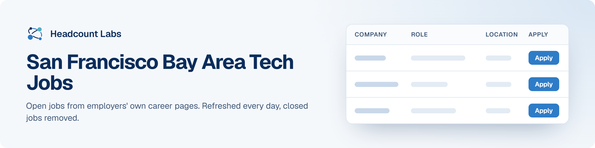

# San Francisco Bay Area Tech Jobs

Software, data, AI, product and design jobs in the San Francisco Bay Area, sorted by field.

**260 open jobs** · 196 new since the last update · 30 removed because they closed or left the employer's board · updated November 24, 2026 at 5:12 AM EST

This list is built and refreshed every day by [Headcount Labs](https://headcountlabs.com/?utm_source=github&utm_medium=job-list&utm_campaign=bay-area-tech-jobs), which reads jobs straight from employers' own career pages and job boards. Every job here was still listed on its source board when we last read that board, within the past 3 days, and was posted in the past 30 days. Copies of the same job are merged into one row, and jobs that close are removed at the next update.

Want this data in your own app or agent? Use the [Headcount Labs jobs API](https://headcountlabs.com/docs/?utm_source=github&utm_medium=job-list&utm_campaign=bay-area-tech-jobs) (free tier), the [MCP server](https://headcountlabs.com/mcp/?utm_source=github&utm_medium=job-list&utm_campaign=bay-area-tech-jobs) for Claude, ChatGPT and other AI assistants, or the [public dataset subsets](https://huggingface.co/HeadcountLabs) on Hugging Face (the full dataset is coming soon).

**Full dataset.** A bigger, one-off snapshot dated 2026-10-19 (all matching jobs, not only the open jobs below) is on Hugging Face: [Tech and software jobs](https://huggingface.co/datasets/HeadcountLabs/tech-jobs). It loads with `datasets.load_dataset` and is under the Open Database License (ODbL) 1.0.

**Jump to:** [Software engineering (150)](#software-engineering) · [Data, AI and machine learning (67)](#data-ai-and-machine-learning) · [Product and design (31)](#product-and-design) · [Hardware and engineering (12)](#hardware-and-engineering)

**Columns.** *Apply* opens the original posting on the employer's site. *Details* opens the job on Headcount Labs, with every posting we found for it. *Remote* shows what the employer states; a dash means the posting doesn't say. *Pay* is the range the employer published.

## Software engineering

| Company | Role | Location | Remote | Pay | Posted | Apply | Details |
| --- | --- | --- | --- | --- | --- | :---: | :---: |
| **Oracle** | Principal Software Engineer, Core Infrastructure | 

3 locations
Santa Clara, CA Seattle, WA Burlington, MA
 | On-site | $115k–$235k/yr | Nov 23 |  | <a href="https://headcountlabs.com/catalog/jobs/65eb5be9-5207-4a5b-b88c-ab5b4a7820d6?utm_source=github&utm_medium=job-list&utm_campaign=bay-area-tech-jobs">via Headcount Labs</a> |
| **Netapp** | Java Backend Developer, Server Side Technologies | San Jose, CA | Hybrid | $148k–$220k/yr | Nov 23 |  | <a href="https://headcountlabs.com/catalog/jobs/a180bfbc-5608-4d04-85cb-469852488b49?utm_source=github&utm_medium=job-list&utm_campaign=bay-area-tech-jobs">via Headcount Labs</a> |
| **Netapp** | Sr. Java Backend Developer, Server Side Technologies | San Jose, CA | Hybrid | $170k–$253k/yr | Nov 23 |  | <a href="https://headcountlabs.com/catalog/jobs/737daa79-caca-403c-9eef-c37013c25dcb?utm_source=github&utm_medium=job-list&utm_campaign=bay-area-tech-jobs">via Headcount Labs</a> |
| **RTX** | Senior Software Engineer | san jose, CA | On-site | — | Nov 20 |  | <a href="https://headcountlabs.com/catalog/jobs/8c91b0c1-6ca9-4011-abee-8e3376a5e20a?utm_source=github&utm_medium=job-list&utm_campaign=bay-area-tech-jobs">via Headcount Labs</a> |
| **Nutanix** | Staff Software Engineer | San Jose, CA | — | $380k/yr | Nov 20 |  | <a href="https://headcountlabs.com/catalog/jobs/ba3cf295-caf1-4d6e-b27a-5784e2d7631b?utm_source=github&utm_medium=job-list&utm_campaign=bay-area-tech-jobs">via Headcount Labs</a> |
| **Honeywell Aerospace** | Principal Software Engineer | San Jose, CA | On-site | $203k–$254k/yr | Nov 20 |  | <a href="https://headcountlabs.com/catalog/jobs/7a398d01-91fb-43d1-9dee-c4d83bfcbcd9?utm_source=github&utm_medium=job-list&utm_campaign=bay-area-tech-jobs">via Headcount Labs</a> |
| **Fiserv** | Staff Backend Server Engineer | Sunnyvale, CA | — | $160k–$240k/yr | Nov 20 |  | <a href="https://headcountlabs.com/catalog/jobs/7a3e5281-0835-4d36-9e97-f1d8290a8677?utm_source=github&utm_medium=job-list&utm_campaign=bay-area-tech-jobs">via Headcount Labs</a> |
| **Compa** | Sr Software Engineer | San Jose, CA | Hybrid | $144k–$213k/yr | Nov 20 |  | <a href="https://headcountlabs.com/catalog/jobs/431e92c8-ceae-44f5-a167-2f8fdda64c62?utm_source=github&utm_medium=job-list&utm_campaign=bay-area-tech-jobs">via Headcount Labs</a> |
| **Compa** | Staff Software Engineer, Backend Python | 

3 locations
San Jose, CA New York, NY Austin, TX
 | On-site | $176k–$262k/yr | Nov 20 |  | <a href="https://headcountlabs.com/catalog/jobs/139d8595-df9a-487a-92ef-03ef3b00b9c4?utm_source=github&utm_medium=job-list&utm_campaign=bay-area-tech-jobs">via Headcount Labs</a> |
| **Advanced Micro Devices, Inc** | Senior Software Engineer - Efficient GenAI Models | San Jose, CA | — | — | Nov 20 |  | <a href="https://headcountlabs.com/catalog/jobs/2c3c7aee-52f0-4a91-81db-6acc1d00d314?utm_source=github&utm_medium=job-list&utm_campaign=bay-area-tech-jobs">via Headcount Labs</a> |
| **Waymo** | Staff Software Engineer, Field Response | Mountain View, CA | — | $251k–$310k/yr | Nov 19 |  | <a href="https://headcountlabs.com/catalog/jobs/dcfe3961-8c12-4474-a871-31e6b7de8a51?utm_source=github&utm_medium=job-list&utm_campaign=bay-area-tech-jobs">via Headcount Labs</a> |
| **Sage** | AI Infrastructure Engineer | San Jose, CA | Hybrid | $120k–$150k/yr | Nov 19 |  | <a href="https://headcountlabs.com/catalog/jobs/cc918dc1-58ca-4c82-b5d9-0191d96ca403?utm_source=github&utm_medium=job-list&utm_campaign=bay-area-tech-jobs">via Headcount Labs</a> |
| **Nutanix** | Sr. Software Engineer - Kernel | San Jose, CA | — | $320k/yr | Nov 19 |  | <a href="https://headcountlabs.com/catalog/jobs/f894f96a-f97a-4155-9c95-69fc72c3428d?utm_source=github&utm_medium=job-list&utm_campaign=bay-area-tech-jobs">via Headcount Labs</a> |
| **Nutanix** | Sr. Software Engineer - Security/Kernel | San Jose, CA | — | — | Nov 19 |  | <a href="https://headcountlabs.com/catalog/jobs/ff05ef37-b0fa-4e3b-9915-68ad1c7e0fab?utm_source=github&utm_medium=job-list&utm_campaign=bay-area-tech-jobs">via Headcount Labs</a> |
| **Coherent Corp.** | Principal Embedded Software Engineer | Santa Clara, CA | On-site | — | Nov 19 |  | <a href="https://headcountlabs.com/catalog/jobs/7d2c3bd1-b6f8-40fe-89e4-7dbdda183814?utm_source=github&utm_medium=job-list&utm_campaign=bay-area-tech-jobs">via Headcount Labs</a> |
| **Clera** | Principal Robotics Software Engineer | San Francisco, CA | On-site | $235k–$305k/yr | Nov 19 |  | <a href="https://headcountlabs.com/catalog/jobs/9828ffb8-546d-4dd5-af62-ee37a5702b57?utm_source=github&utm_medium=job-list&utm_campaign=bay-area-tech-jobs">via Headcount Labs</a> |
| **Clera** | Senior Android Software Engineer | San Francisco, CA | On-site | $160k–$200k/yr | Nov 19 |  | <a href="https://headcountlabs.com/catalog/jobs/7a79aae8-36ae-4930-92bd-49a89a525062?utm_source=github&utm_medium=job-list&utm_campaign=bay-area-tech-jobs">via Headcount Labs</a> |
| **Clera** | Founding Security Software Engineer | San Francisco, CA | On-site | $200k–$330k/yr | Nov 19 |  | <a href="https://headcountlabs.com/catalog/jobs/73043fb1-71e4-469f-aaba-deb10c55b89b?utm_source=github&utm_medium=job-list&utm_campaign=bay-area-tech-jobs">via Headcount Labs</a> |
| **Clera** | Full-Stack Software Engineer, Design | San Francisco, CA | On-site | $130k–$225k/yr | Nov 19 |  | <a href="https://headcountlabs.com/catalog/jobs/167e7047-7512-4f93-a963-f58c51d84c86?utm_source=github&utm_medium=job-list&utm_campaign=bay-area-tech-jobs">via Headcount Labs</a> |
| **Clera** | Senior Backend/Full Stack Engineer | San Francisco, CA | On-site | $100k–$200k/yr | Nov 19 |  | <a href="https://headcountlabs.com/catalog/jobs/1cddf42b-1363-476e-95ae-f516a4d98d52?utm_source=github&utm_medium=job-list&utm_campaign=bay-area-tech-jobs">via Headcount Labs</a> |
| **Cisco** | Software Engineer | 

14 locations
San Jose, CA Fremont, CA Los Altos, CA Milpitas, CA Mountain View, CA Palo Alto, CA Redwood City, CA Roseville, CA San Francisco, CA San Mateo, CA Santa Clara, CA Santa Monica, CA +2 more
 | Hybrid | $155k–$223k/yr | Nov 19 |  | <a href="https://headcountlabs.com/catalog/jobs/513d93b4-583c-463d-b9b0-5561d4f5e566?utm_source=github&utm_medium=job-list&utm_campaign=bay-area-tech-jobs">via Headcount Labs</a> |
| **Cisco** | Executive Communications Leader - AI Software &amp; Platform team | San Jose, CA | Hybrid | $230k–$292k/yr | Nov 19 |  | <a href="https://headcountlabs.com/catalog/jobs/0b789c60-f802-46af-864d-039abf12fc74?utm_source=github&utm_medium=job-list&utm_campaign=bay-area-tech-jobs">via Headcount Labs</a> |
| **Chase-** | Sr Director of Software Engineering- AI Infrastructure Platforms | 

3 locations
Seattle, WA Palo Alto, CA San Francisco, CA
 | Hybrid | — | Nov 19 |  | <a href="https://headcountlabs.com/catalog/jobs/da5223bc-6ca4-4999-a6d0-3015b65b8a93?utm_source=github&utm_medium=job-list&utm_campaign=bay-area-tech-jobs">via Headcount Labs</a> |
| **ATOMS Careers page** | Embedded Software QA Engineer - San Francisco | San Francisco, CA | On-site | $141k–$175k/yr | Nov 19 |  | <a href="https://headcountlabs.com/catalog/jobs/5c892d00-6572-4b11-b93e-881dabb5dc06?utm_source=github&utm_medium=job-list&utm_campaign=bay-area-tech-jobs">via Headcount Labs</a> |
| **Advanced Micro Devices, Inc** | HPC &amp; AI Infrastructure Engineer | San Jose, CA | — | — | Nov 19 |  | <a href="https://headcountlabs.com/catalog/jobs/79d99b59-b100-4ad4-99fb-3837e0838b9f?utm_source=github&utm_medium=job-list&utm_campaign=bay-area-tech-jobs">via Headcount Labs</a> |
| **Advanced Micro Devices, Inc** | Product Application Engineer - AI Networking Systems(RDMA, CCL, NIC) | Santa Clara, CA | — | — | Nov 19 |  | <a href="https://headcountlabs.com/catalog/jobs/4bef434b-d36f-4b2b-9721-7767f05974fe?utm_source=github&utm_medium=job-list&utm_campaign=bay-area-tech-jobs">via Headcount Labs</a> |
| **Zscaler** | Principal Site Reliability Engineer | Santa Clara, CA | Remote | $212k–$265k/yr | Nov 18 |  | <a href="https://headcountlabs.com/catalog/jobs/2e2e35db-2013-4af9-85d5-eaad51501f98?utm_source=github&utm_medium=job-list&utm_campaign=bay-area-tech-jobs">via Headcount Labs</a> |
| **Super Micro Computer** | Staff Data Center Software Developer | San Jose, CA | — | $215k–$245k/yr | Nov 18 |  | <a href="https://headcountlabs.com/catalog/jobs/a3a01590-0499-43b3-babb-9007688234c1?utm_source=github&utm_medium=job-list&utm_campaign=bay-area-tech-jobs">via Headcount Labs</a> |
| **ServiceNow, Inc.** | Senior Software Engineer, Developer Experience - Moveworks | Mountain View, CA | — | $143k–$243k/yr | Nov 18 |  | <a href="https://headcountlabs.com/catalog/jobs/89fe251b-8c49-4089-91a5-3cbb9b6f7c63?utm_source=github&utm_medium=job-list&utm_campaign=bay-area-tech-jobs">via Headcount Labs</a> |
| **RTX** | Senior Software Engineer - Embedded | san jose, CA | — | — | Nov 18 |  | <a href="https://headcountlabs.com/catalog/jobs/491db5e1-db70-4ffc-8163-ec7a4a97f95b?utm_source=github&utm_medium=job-list&utm_campaign=bay-area-tech-jobs">via Headcount Labs</a> |
| **Oracle** | Principal Platform Software Engineer | 

2 locations
United States Santa Clara, CA
 | On-site | $106k–$235k/yr | Nov 18 |  | <a href="https://headcountlabs.com/catalog/jobs/1b8dadd3-3a52-471f-a803-c565d3db6192?utm_source=github&utm_medium=job-list&utm_campaign=bay-area-tech-jobs">via Headcount Labs</a> |
| **IP Infusion US Inc.** | Senior Software Engineer - EVPN VXLAN | Santa Clara, CA | — | $180k–$220k/yr | Nov 18 |  | <a href="https://headcountlabs.com/catalog/jobs/f31b7481-9ae9-45e3-b222-42bd91d52274?utm_source=github&utm_medium=job-list&utm_campaign=bay-area-tech-jobs">via Headcount Labs</a> |
| **Databricks** | Staff Software Engineer - Threat and Abuse Defense | Mountain View, CA | — | $180k–$203k/yr | Nov 18 |  | <a href="https://headcountlabs.com/catalog/jobs/314d7815-c477-4788-b93f-7cd9aebf471c?utm_source=github&utm_medium=job-list&utm_campaign=bay-area-tech-jobs">via Headcount Labs</a> |
| **CompuCom** | Application Developer | Santa Clara, CA | — | $60–$80/hr | Nov 18 |  | <a href="https://headcountlabs.com/catalog/jobs/35e5be7a-0934-40dc-a7d6-c13ccbdcb271?utm_source=github&utm_medium=job-list&utm_campaign=bay-area-tech-jobs">via Headcount Labs</a> |
| **Clera** | Developer Relations | San Francisco, CA | On-site | $130k–$180k/yr | Nov 18 |  | <a href="https://headcountlabs.com/catalog/jobs/7ae3b3d6-4caf-43e4-829b-31cf3de04d68?utm_source=github&utm_medium=job-list&utm_campaign=bay-area-tech-jobs">via Headcount Labs</a> |
| **Cisco** | Principal Software Engineer, Applied AI – Splunk Observability Cloud | 

52 locations
Seattle, WA Boulder, CO Birmingham, AL Juneau, AK Phoenix, AZ Little Rock, AR San Jose, CA Denver, CO Hartford, CT Dover, DE Miami, FL Atlanta, GA +40 more
 | Hybrid | $241k–$323k/yr | Nov 18 |  | <a href="https://headcountlabs.com/catalog/jobs/bf93d925-44c9-444c-ab44-497787c8b3be?utm_source=github&utm_medium=job-list&utm_campaign=bay-area-tech-jobs">via Headcount Labs</a> |
| **Cisco** | Software Engineer - Silicon One SDK | San Jose, CA | Hybrid | $155k–$223k/yr | Nov 18 |  | <a href="https://headcountlabs.com/catalog/jobs/ac2f4a1a-38c5-42ad-9234-6595239fc51f?utm_source=github&utm_medium=job-list&utm_campaign=bay-area-tech-jobs">via Headcount Labs</a> |
| **Cisco** | Silicon Validation Software Engineer | San Jose, CA | On-site | $168k–$245k/yr | Nov 18 |  | <a href="https://headcountlabs.com/catalog/jobs/63b7bcec-10a5-48c5-939e-f647a99b3a60?utm_source=github&utm_medium=job-list&utm_campaign=bay-area-tech-jobs">via Headcount Labs</a> |
| **Airbnb** | Software Engineering Intern (BS/MS) | San Francisco, CA | — | $8k/mo | Nov 18 |  | <a href="https://headcountlabs.com/catalog/jobs/05b3f6f5-27c1-40d0-a638-6a9c663f9cbe?utm_source=github&utm_medium=job-list&utm_campaign=bay-area-tech-jobs">via Headcount Labs</a> |
| **Advanced Micro Devices, Inc** | Staff AI Networking System Test Engineer | Santa Clara, CA | — | — | Nov 18 |  | <a href="https://headcountlabs.com/catalog/jobs/d978b9d5-8229-4272-95ef-4ba873177e6b?utm_source=github&utm_medium=job-list&utm_campaign=bay-area-tech-jobs">via Headcount Labs</a> |
| **Advanced Micro Devices, Inc** | Principal AI Networking System Test Engineer | Santa Clara, CA | — | — | Nov 18 |  | <a href="https://headcountlabs.com/catalog/jobs/9a346088-6c62-4164-80d5-8713dfbc3605?utm_source=github&utm_medium=job-list&utm_campaign=bay-area-tech-jobs">via Headcount Labs</a> |
| **Zscaler** | Principal Software Development Engineer | Santa Clara, CA | Hybrid | $186k–$265k/yr | Nov 17 |  | <a href="https://headcountlabs.com/catalog/jobs/4c7a8958-6687-406a-9b93-a6ce7cadbfa5?utm_source=github&utm_medium=job-list&utm_campaign=bay-area-tech-jobs">via Headcount Labs</a> |
| **Zscaler** | Staff Software Development Engineer- AI Security (Go/Rust/Python) | Santa Clara, CA | Hybrid | $152k–$190k/yr | Nov 17 |  | <a href="https://headcountlabs.com/catalog/jobs/3b050e9f-3051-4c85-b52f-2216bb3dcb48?utm_source=github&utm_medium=job-list&utm_campaign=bay-area-tech-jobs">via Headcount Labs</a> |
| **Waymo** | Senior Software Engineer, Simulator Platform | 

2 locations
Mountain View, CA San Francisco, CA
 | Hybrid | $213k–$263k/yr | Nov 17 |  | <a href="https://headcountlabs.com/catalog/jobs/72886da3-b914-426a-8a6f-bd656561fb9a?utm_source=github&utm_medium=job-list&utm_campaign=bay-area-tech-jobs">via Headcount Labs</a> |
| **Waymo** | Director, Software Engineering - Hardware | Mountain View, CA | Hybrid | $349k–$431k/yr | Nov 17 |  | <a href="https://headcountlabs.com/catalog/jobs/f1130c78-7007-483b-8153-34cbfd28d76c?utm_source=github&utm_medium=job-list&utm_campaign=bay-area-tech-jobs">via Headcount Labs</a> |
| **SpaceXSI** | Software Engineer, Ads Serving | Palo Alto, CA | — | $140k–$225k/yr | Nov 17 |  | <a href="https://headcountlabs.com/catalog/jobs/b6b49ff9-32d5-4e12-ac00-a2ac0a6130a6?utm_source=github&utm_medium=job-list&utm_campaign=bay-area-tech-jobs">via Headcount Labs</a> |
| **SpaceXSI** | Sr. Software Engineer, Safety | Palo Alto, CA | — | $180k–$330k/yr | Nov 17 |  | <a href="https://headcountlabs.com/catalog/jobs/b05c76d7-50e1-45e0-8791-78890774f717?utm_source=github&utm_medium=job-list&utm_campaign=bay-area-tech-jobs">via Headcount Labs</a> |
| **SpaceXSI** | Software Engineer, Safety | Palo Alto, CA | — | $140k–$225k/yr | Nov 17 |  | <a href="https://headcountlabs.com/catalog/jobs/75d1e83d-f8f6-4de4-a89e-48ce0f816266?utm_source=github&utm_medium=job-list&utm_campaign=bay-area-tech-jobs">via Headcount Labs</a> |
| **SpaceXSI** | Sr. Software Engineer, Ads Serving | Palo Alto, CA | — | $180k–$330k/yr | Nov 17 |  | <a href="https://headcountlabs.com/catalog/jobs/44838d64-0b31-4537-820f-8d15bbbf9569?utm_source=github&utm_medium=job-list&utm_campaign=bay-area-tech-jobs">via Headcount Labs</a> |
| **ServiceNow, Inc.** | Senior Software Engineer - Conversational AI | Santa Clara, CA | — | $143k–$243k/yr | Nov 17 |  | <a href="https://headcountlabs.com/catalog/jobs/992eb1a3-c3c8-4f09-b8c3-9331475321b6?utm_source=github&utm_medium=job-list&utm_campaign=bay-area-tech-jobs">via Headcount Labs</a> |
| **ServiceNow, Inc.** | Senior Staff Software Engineer | Santa Clara, CA | — | $191k–$334k/yr | Nov 17 |  | <a href="https://headcountlabs.com/catalog/jobs/425b2488-8c87-4504-80c4-58058f3ebd70?utm_source=github&utm_medium=job-list&utm_campaign=bay-area-tech-jobs">via Headcount Labs</a> |
| **Everpure** | Senior Platform Software Engineer | Santa Clara, CA | On-site | $180k–$270k/yr | Nov 17 |  | <a href="https://headcountlabs.com/catalog/jobs/211f5e89-96cc-406e-969d-84319291efff?utm_source=github&utm_medium=job-list&utm_campaign=bay-area-tech-jobs">via Headcount Labs</a> |
| **Crusoe** | Senior Software Engineer, Platform Networking | 

3 locations
San Francisco, CA Sunnyvale, CA Bellevue, WA
 | On-site | — | Nov 17 |  | <a href="https://headcountlabs.com/catalog/jobs/b247839a-9f26-484b-951d-3e5deb5c4057?utm_source=github&utm_medium=job-list&utm_campaign=bay-area-tech-jobs">via Headcount Labs</a> |
| **Crusoe** | Staff Software Engineer, Networking | 

3 locations
San Francisco, CA Sunnyvale, CA Bellevue, WA
 | On-site | — | Nov 17 |  | <a href="https://headcountlabs.com/catalog/jobs/a534790e-ed8e-4c26-a396-52800e06cd32?utm_source=github&utm_medium=job-list&utm_campaign=bay-area-tech-jobs">via Headcount Labs</a> |
| **COGNIZANT TECH SOLUTIONS A** | Sr. Java Backend Developer | Sunnyvale, CA | Hybrid | $68k–$130k/yr | Nov 17 |  | <a href="https://headcountlabs.com/catalog/jobs/a2eb7a66-7f1f-46ac-bab7-6935a3f92e8f?utm_source=github&utm_medium=job-list&utm_campaign=bay-area-tech-jobs">via Headcount Labs</a> |
| **COGNIZANT TECH SOLUTIONS A** | Senior Java Backend Developer | Sunnyvale, CA | Hybrid | $68k–$110k/yr | Nov 17 |  | <a href="https://headcountlabs.com/catalog/jobs/609407c5-fb0a-4d94-b0c6-7d5ec9d00498?utm_source=github&utm_medium=job-list&utm_campaign=bay-area-tech-jobs">via Headcount Labs</a> |
| **Applied Intuition** | Global Sourcing Manager - Integrated Software | Sunnyvale, CA | On-site | $180k–$215k/yr | Nov 17 |  | <a href="https://headcountlabs.com/catalog/jobs/32ac2e99-4cd0-4186-974a-e15e8911617b?utm_source=github&utm_medium=job-list&utm_campaign=bay-area-tech-jobs">via Headcount Labs</a> |
| **Zscaler** | Staff Security Engineer (Identity &amp; Access Systems) | Santa Clara, CA | Hybrid | $157k–$196k/yr | Nov 16 |  | <a href="https://headcountlabs.com/catalog/jobs/74047e88-4eec-437c-8508-92962dc8865f?utm_source=github&utm_medium=job-list&utm_campaign=bay-area-tech-jobs">via Headcount Labs</a> |
| **Super Micro Computer** | Principal Software Engineer - Switch Design | San Jose, CA | — | $216k–$257k/yr | Nov 16 |  | <a href="https://headcountlabs.com/catalog/jobs/b7104af0-c6d8-4432-903d-e3f6e82c9c04?utm_source=github&utm_medium=job-list&utm_campaign=bay-area-tech-jobs">via Headcount Labs</a> |
| **SpaceXSI** | Software Engineer, Super Intelligence | 

2 locations
Palo Alto, CA Seattle, WA
 | — | $140k–$225k/yr | Nov 16 |  | <a href="https://headcountlabs.com/catalog/jobs/18c2d715-4be3-4c2a-97b3-1e18263a7783?utm_source=github&utm_medium=job-list&utm_campaign=bay-area-tech-jobs">via Headcount Labs</a> |
| **Oracle** | Principal Network Developer | 

6 locations
Seattle, WA Santa Clara, CA Reston, VA Austin, TX Nashville, TN United States
 | On-site | $102k–$210k/yr | Nov 16 |  | <a href="https://headcountlabs.com/catalog/jobs/f130d8ee-7a51-44f6-88bb-a68e8ef5a4a3?utm_source=github&utm_medium=job-list&utm_campaign=bay-area-tech-jobs">via Headcount Labs</a> |
| **Oracle** | Senior Network Developer - Optical | 

6 locations
Seattle, WA Nashville, TN Austin, TX Santa Clara, CA Reston, VA United States
 | On-site | $91k–$187k/yr | Nov 16 |  | <a href="https://headcountlabs.com/catalog/jobs/172cbf93-1038-4e70-ae8b-0fa06620ccb7?utm_source=github&utm_medium=job-list&utm_campaign=bay-area-tech-jobs">via Headcount Labs</a> |
| **Ford Motor Company** | Senior Staff Android Full Stack Developer | Palo Alto, CA | Hybrid | — | Nov 16 |  | <a href="https://headcountlabs.com/catalog/jobs/a46e52ee-5c98-4aa6-9051-dd9d4be1620a?utm_source=github&utm_medium=job-list&utm_campaign=bay-area-tech-jobs">via Headcount Labs</a> |
| **Coherent Corp.** | Lead Embedded Software Engineer | 

2 locations
Santa Clara, CA Horsham, PA
 | On-site | — | Nov 16 |  | <a href="https://headcountlabs.com/catalog/jobs/19f60921-b747-44df-99e2-9c7c5087ad1a?utm_source=github&utm_medium=job-list&utm_campaign=bay-area-tech-jobs">via Headcount Labs</a> |
| **Applied Intuition** | Staff Software Engineer - AI Developer Productivity | Sunnyvale, CA | On-site | $230k–$320k/yr | Nov 16 |  | <a href="https://headcountlabs.com/catalog/jobs/62d4381b-aeaf-4f63-bed0-4f2737bef2cb?utm_source=github&utm_medium=job-list&utm_campaign=bay-area-tech-jobs">via Headcount Labs</a> |
| **Applied Intuition** | Senior Software Engineer - AI Developer Productivity | Sunnyvale, CA | On-site | $195k–$265k/yr | Nov 16 |  | <a href="https://headcountlabs.com/catalog/jobs/511243f0-b668-43a7-8fe5-1b43f46ee102?utm_source=github&utm_medium=job-list&utm_campaign=bay-area-tech-jobs">via Headcount Labs</a> |
| **Oracle** | Senior Network Developer | 

7 locations
Reston, VA Seattle, WA Santa Clara, CA Austin, TX Nashville, TN United States Redwood City, CA
 | On-site | $91k–$187k/yr | Nov 15 |  | <a href="https://headcountlabs.com/catalog/jobs/7357faa9-692e-4841-b53b-afc40d3bd6bb?utm_source=github&utm_medium=job-list&utm_campaign=bay-area-tech-jobs">via Headcount Labs</a> |
| **ServiceNow, Inc.** | Senior Staff Security Engineer, AI Safeguards - Moveworks | Mountain View, CA | — | $201k–$352k/yr | Nov 14 |  | <a href="https://headcountlabs.com/catalog/jobs/715ed297-6452-496f-90ab-9ec892170467?utm_source=github&utm_medium=job-list&utm_campaign=bay-area-tech-jobs">via Headcount Labs</a> |
| **ServiceNow, Inc.** | Senior Software Engineer, Agentic Platform - Moveworks | Mountain View, CA | — | $161k–$274k/yr | Nov 14 |  | <a href="https://headcountlabs.com/catalog/jobs/0f4aa90c-48db-4127-914c-abce38e84048?utm_source=github&utm_medium=job-list&utm_campaign=bay-area-tech-jobs">via Headcount Labs</a> |
| **ServiceNow, Inc.** | Staff Security Engineer (Compliance) - Moveworks | Mountain View, CA | — | $176k–$308k/yr | Nov 14 |  | <a href="https://headcountlabs.com/catalog/jobs/0a4f24cd-44d0-4ddd-bcb2-fdb382d66d74?utm_source=github&utm_medium=job-list&utm_campaign=bay-area-tech-jobs">via Headcount Labs</a> |
| **OKX** | Sr. Software Engineer, Machine Learning &amp; Data Infrastructure | San Jose, CA | Hybrid | $179k–$268k/yr | Nov 14 |  | <a href="https://headcountlabs.com/catalog/jobs/1fc54160-3dc4-4bfb-a2d2-5722098e551f?utm_source=github&utm_medium=job-list&utm_campaign=bay-area-tech-jobs">via Headcount Labs</a> |
| **Zipline** | Senior Full Stack Software Engineer, Data | South San Francisco, CA | On-site | $155k–$210k/yr | Nov 13 |  | <a href="https://headcountlabs.com/catalog/jobs/e5bff865-7d0c-4774-982f-d23d4f071595?utm_source=github&utm_medium=job-list&utm_campaign=bay-area-tech-jobs">via Headcount Labs</a> |
| **Waymo** | Senior Software Engineer, Agentic Test Systems | Mountain View, CA | Hybrid | $213k–$263k/yr | Nov 13 |  | <a href="https://headcountlabs.com/catalog/jobs/cf4e80dd-4f38-4816-aa80-778b2f1b355b?utm_source=github&utm_medium=job-list&utm_campaign=bay-area-tech-jobs">via Headcount Labs</a> |
| **SpaceXSI** | Software Engineer, Consumer Subscriptions | Palo Alto, CA | — | $140k–$225k/yr | Nov 13 |  | <a href="https://headcountlabs.com/catalog/jobs/c007e9e7-1c77-4657-a304-85b8e4e9576d?utm_source=github&utm_medium=job-list&utm_campaign=bay-area-tech-jobs">via Headcount Labs</a> |
| **SpaceXSI** | Government Cloud Security Engineer | 

4 locations
Austin, TX New York, NY Palo Alto, CA Washington, DC
 | — | $100k–$198k/yr | Nov 13 |  | <a href="https://headcountlabs.com/catalog/jobs/7f1d29cb-62e1-4d65-bcc2-35abffa4fffc?utm_source=github&utm_medium=job-list&utm_campaign=bay-area-tech-jobs">via Headcount Labs</a> |
| **Oracle** | Principal Network Developer - Seattle or Bay area | 

4 locations
Seattle, WA Redwood City, CA Santa Clara, CA United States
 | On-site | $102k–$210k/yr | Nov 13 |  | <a href="https://headcountlabs.com/catalog/jobs/a90bd32a-71ab-4bbb-bcc6-32a5ee545a7d?utm_source=github&utm_medium=job-list&utm_campaign=bay-area-tech-jobs">via Headcount Labs</a> |
| **Okta** | Staff Software Engineer - Okta Identity Governance | San Francisco, CA | Hybrid | $194k–$267k/yr | Nov 13 |  | <a href="https://headcountlabs.com/catalog/jobs/5e746220-bf45-4067-b50a-8543981ef6fc?utm_source=github&utm_medium=job-list&utm_campaign=bay-area-tech-jobs">via Headcount Labs</a> |
| **NetApp, Inc.** | Software Engineer - Cloud Engineering (C++) | 

3 locations
Morrisville, NC Waltham, MA San Jose, CA
 | — | $148k–$220k/yr | Nov 13 |  | <a href="https://headcountlabs.com/catalog/jobs/0bc4c4ff-e25b-4b24-b744-859c027f75b1?utm_source=github&utm_medium=job-list&utm_campaign=bay-area-tech-jobs">via Headcount Labs</a> |
| **itD Tech** | Security Engineer (6389) | San Jose, CA | On-site | $44–$45/hr | Nov 13 |  | <a href="https://headcountlabs.com/catalog/jobs/e55bc3f6-a534-477d-b284-bee16fe806ef?utm_source=github&utm_medium=job-list&utm_campaign=bay-area-tech-jobs">via Headcount Labs</a> |
| **Ford Motor Company** | Staff Software Developer in Test – System V&amp;V | Palo Alto, CA | Hybrid | — | Nov 13 |  | <a href="https://headcountlabs.com/catalog/jobs/a2754300-7c34-46fc-ac13-b8373b8ae80e?utm_source=github&utm_medium=job-list&utm_campaign=bay-area-tech-jobs">via Headcount Labs</a> |
| **Ford Motor Company** | Staff Supplier Software Integration Engineer | Palo Alto, CA | Hybrid | — | Nov 13 |  | <a href="https://headcountlabs.com/catalog/jobs/614207c7-fdcd-4c2b-be13-e4412ca4e084?utm_source=github&utm_medium=job-list&utm_campaign=bay-area-tech-jobs">via Headcount Labs</a> |
| **Crusoe** | Staff Software Engineer, (DEM) | 

2 locations
San Francisco, CA Sunnyvale, CA
 | On-site | — | Nov 13 |  | <a href="https://headcountlabs.com/catalog/jobs/0ee27528-7430-4f5a-aed0-14ea6447e496?utm_source=github&utm_medium=job-list&utm_campaign=bay-area-tech-jobs">via Headcount Labs</a> |
| **Capgemini** | Senior Embedded Software Engineer | 

2 locations
Palo Alto, CA Santa Clara, CA
 | On-site | $89k–$166k/yr | Nov 13 |  | <a href="https://headcountlabs.com/catalog/jobs/67ae2611-adf4-42f4-8811-fc274e872279?utm_source=github&utm_medium=job-list&utm_campaign=bay-area-tech-jobs">via Headcount Labs</a> |
| **Anthropic** | Staff+ Software Engineer, Consumer | San Francisco, CA | — | $320k–$405k/yr | Nov 13 |  | <a href="https://headcountlabs.com/catalog/jobs/609535d1-3388-4cca-807e-a68ce4d82966?utm_source=github&utm_medium=job-list&utm_campaign=bay-area-tech-jobs">via Headcount Labs</a> |
| **Zscaler** | Sr. Staff Software Development Engineer | 

2 locations
San Jose, CA Santa Clara, CA
 | Hybrid | $180k–$225k/yr | Nov 12 |  | <a href="https://headcountlabs.com/catalog/jobs/25de0779-a5ca-42a3-bf77-ebca1bbe73f8?utm_source=github&utm_medium=job-list&utm_campaign=bay-area-tech-jobs">via Headcount Labs</a> |
| **SAP** | SAP iXp Intern - Full-Stack Software Engineer | Palo Alto, CA | — | — | Nov 12 |  | <a href="https://headcountlabs.com/catalog/jobs/95784a52-2ca4-43ab-8092-4608feef7b79?utm_source=github&utm_medium=job-list&utm_campaign=bay-area-tech-jobs">via Headcount Labs</a> |
| **SAP** | SAP iXp Intern - AI Developer | Palo Alto, CA | — | — | Nov 12 |  | <a href="https://headcountlabs.com/catalog/jobs/ffa8fb7b-5827-440a-baf4-0df3e6902f36?utm_source=github&utm_medium=job-list&utm_campaign=bay-area-tech-jobs">via Headcount Labs</a> |
| **Rubrik** | Software Engineer - Virtual Platform | Palo Alto, CA | — | $131k–$197k/yr | Nov 12 |  | <a href="https://headcountlabs.com/catalog/jobs/496507a9-5861-4019-bc83-55ac563c75ca?utm_source=github&utm_medium=job-list&utm_campaign=bay-area-tech-jobs">via Headcount Labs</a> |
| **DoorDash USA** | Senior Software Engineer, ML Serving Platform | 

3 locations
San Francisco, CA Sunnyvale, CA Seattle, WA
 | — | $168k–$247k/yr | Nov 12 |  | <a href="https://headcountlabs.com/catalog/jobs/13089c9f-6fd1-429b-9a55-ec80ed72a97a?utm_source=github&utm_medium=job-list&utm_campaign=bay-area-tech-jobs">via Headcount Labs</a> |
| **ATOMS Careers page** | Senior Software Engineer - Transport Infrastructure | San Francisco, CA | On-site | $180k–$220k/yr | Nov 12 |  | <a href="https://headcountlabs.com/catalog/jobs/63b27d50-fa26-4474-98dd-c7705eacc135?utm_source=github&utm_medium=job-list&utm_campaign=bay-area-tech-jobs">via Headcount Labs</a> |
| **Cadence Design Systems, Inc.** | Software Engineer II | San Jose, CA | — | $105k–$195k/yr | Nov 11 |  | <a href="https://headcountlabs.com/catalog/jobs/d9303646-2b73-4537-9146-fa680b3a349e?utm_source=github&utm_medium=job-list&utm_campaign=bay-area-tech-jobs">via Headcount Labs</a> |
| **ATOMS Careers page** | Physical &amp; Facility Security Engineer | San Francisco, CA | On-site | $167k–$230k/yr | Nov 11 |  | <a href="https://headcountlabs.com/catalog/jobs/525c9e29-f502-4f1f-a1ec-34b3876f9957?utm_source=github&utm_medium=job-list&utm_campaign=bay-area-tech-jobs">via Headcount Labs</a> |
| **ATOMS Careers page** | Senior Software Engineer - Cloud &amp; Platform Security | San Francisco, CA | On-site | $167k–$230k/yr | Nov 11 |  | <a href="https://headcountlabs.com/catalog/jobs/466b009a-ad07-4444-9dbd-ca48cb6cce22?utm_source=github&utm_medium=job-list&utm_campaign=bay-area-tech-jobs">via Headcount Labs</a> |
| **Rubrik** | Application Security Engineer | Palo Alto, CA | — | $124k–$186k/yr | Nov 10 |  | <a href="https://headcountlabs.com/catalog/jobs/c45d76fd-6cea-48a2-abc2-15e368eb960b?utm_source=github&utm_medium=job-list&utm_campaign=bay-area-tech-jobs">via Headcount Labs</a> |
| **iSoftStone** | Junior Full Stack Software Engineer | Palo Alto, CA | — | $38–$42/hr | Nov 10 |  | <a href="https://headcountlabs.com/catalog/jobs/a4c44b27-4e6c-4da0-8d00-8b5721d7ef5f?utm_source=github&utm_medium=job-list&utm_campaign=bay-area-tech-jobs">via Headcount Labs</a> |
| **Intuit** | Staff Software Engineer | Mountain View, CA | — | $202k–$274k/yr | Nov 10 |  | <a href="https://headcountlabs.com/catalog/jobs/5e3b3200-638f-4e6a-bce5-378e5357686c?utm_source=github&utm_medium=job-list&utm_campaign=bay-area-tech-jobs">via Headcount Labs</a> |
| **Ford Motor Company** | Staff Android HAL / AIDL Engineer | 

2 locations
Palo Alto, CA Long Beach, CA
 | Hybrid | — | Nov 10 |  | <a href="https://headcountlabs.com/catalog/jobs/fe16f6fe-993b-4b00-93f1-3de774a1b7c3?utm_source=github&utm_medium=job-list&utm_campaign=bay-area-tech-jobs">via Headcount Labs</a> |
| **Applied Intuition** | Software Engineer - Controls | Sunnyvale, CA | On-site | $150k–$250k/yr | Nov 10 |  | <a href="https://headcountlabs.com/catalog/jobs/5b2d80ad-0a51-49d4-80c9-3d123200e610?utm_source=github&utm_medium=job-list&utm_campaign=bay-area-tech-jobs">via Headcount Labs</a> |
| **Zipline** | Senior/Staff Cloud Infrastructure Engineer | South San Francisco, CA | — | $18k–$258k/yr | Nov 9 |  | <a href="https://headcountlabs.com/catalog/jobs/1ecd8487-c491-401d-92fd-c1306fd4fcb6?utm_source=github&utm_medium=job-list&utm_campaign=bay-area-tech-jobs">via Headcount Labs</a> |
| **Veeam** | Senior Software Engineer | San Jose, CA | — | — | Nov 9 |  | <a href="https://headcountlabs.com/catalog/jobs/a40ba5b5-66a6-4955-a539-823b79bb9a0b?utm_source=github&utm_medium=job-list&utm_campaign=bay-area-tech-jobs">via Headcount Labs</a> |
| **Globality, Inc.** | Sr. Software Engineer, Agents | Palo Alto, CA | Hybrid | $150k–$250k/yr | Nov 9 |  | <a href="https://headcountlabs.com/catalog/jobs/1f92aa37-2ee5-486d-971a-8c8f097f1fbe?utm_source=github&utm_medium=job-list&utm_campaign=bay-area-tech-jobs">via Headcount Labs</a> |
| **Crusoe** | Senior Software Engineer, Crusoe Managed Data Transfer | 

2 locations
San Francisco, CA Sunnyvale, CA
 | On-site | — | Nov 9 |  | <a href="https://headcountlabs.com/catalog/jobs/b97099de-8404-4a0d-bc16-ffe37d49b287?utm_source=github&utm_medium=job-list&utm_campaign=bay-area-tech-jobs">via Headcount Labs</a> |
| **Anthropic** | Staff+ Software Engineer, Safeguards Evals | 

3 locations
New York City, NY San Francisco, CA Seattle, WA
 | — | $320k–$485k/yr | Nov 9 |  | <a href="https://headcountlabs.com/catalog/jobs/11fba7a6-5914-4faa-8f85-a1a435c976b3?utm_source=github&utm_medium=job-list&utm_campaign=bay-area-tech-jobs">via Headcount Labs</a> |
| **Capgemini** | Android AOSP Platform Engineer | Santa Clara, CA | — | $82k–$193k/yr | Nov 7 |  | <a href="https://headcountlabs.com/catalog/jobs/dd0f8093-7a49-4b8f-b03a-7645ae5d3d94?utm_source=github&utm_medium=job-list&utm_campaign=bay-area-tech-jobs">via Headcount Labs</a> |
| **SpaceXSI** | Sr. Software Engineer, Training/Inference (C++) | Palo Alto, CA | — | $220k–$357k/yr | Nov 6 |  | <a href="https://headcountlabs.com/catalog/jobs/c4e45661-5994-43e7-b151-406b14a97562?utm_source=github&utm_medium=job-list&utm_campaign=bay-area-tech-jobs">via Headcount Labs</a> |
| **Keysight Technologies, Inc.** | Solutions Engineer Software - Keysight EDA tools | 

3 locations
Santa Clara, CA Colorado Springs, CO Seattle, WA
 | — | $215k–$359k/yr | Nov 6 |  | <a href="https://headcountlabs.com/catalog/jobs/6a7d8694-1523-448a-b43b-c623a32e4a9b?utm_source=github&utm_medium=job-list&utm_campaign=bay-area-tech-jobs">via Headcount Labs</a> |
| **Intuit** | Staff Product Manager, Mobile Growth, TurboTax | 

3 locations
San Francisco, CA San Diego, CA Mountain View, CA
 | — | $188k–$255k/yr | Nov 6 |  | <a href="https://headcountlabs.com/catalog/jobs/f716d555-3a98-471d-962b-2010fcdd4bd6?utm_source=github&utm_medium=job-list&utm_campaign=bay-area-tech-jobs">via Headcount Labs</a> |
| **Crusoe** | Senior Staff Software Engineer, AI Model Lifecycle | 

2 locations
San Francisco, CA Sunnyvale, CA
 | On-site | — | Nov 6 |  | <a href="https://headcountlabs.com/catalog/jobs/b34fbbb8-29f3-4cda-8978-4c5ad0b06b00?utm_source=github&utm_medium=job-list&utm_campaign=bay-area-tech-jobs">via Headcount Labs</a> |
| **Crusoe** | Senior Software Engineer, CAPE | 

2 locations
San Francisco, CA Sunnyvale, CA
 | On-site | — | Nov 6 |  | <a href="https://headcountlabs.com/catalog/jobs/65713b00-6cad-474b-913a-f3488f9d5b8b?utm_source=github&utm_medium=job-list&utm_campaign=bay-area-tech-jobs">via Headcount Labs</a> |
| **Boeing** | Flight Software Engineer (Experienced/Senior) | 

3 locations
El Segundo, CA Mountain View, CA Los Angeles, CA
 | — | $135k–$183k/yr | Nov 6 |  | <a href="https://headcountlabs.com/catalog/jobs/50c6ce5b-5a8e-4d43-a8c8-445b63dfe9bb?utm_source=github&utm_medium=job-list&utm_campaign=bay-area-tech-jobs">via Headcount Labs</a> |
| **Applied Intuition** | Senior Full-Stack Engineer, Defense Autonomy | Sunnyvale, CA | On-site | $160k–$235k/yr | Nov 6 |  | <a href="https://headcountlabs.com/catalog/jobs/e6b294f0-d0e9-4277-a2a8-f718ea64c56e?utm_source=github&utm_medium=job-list&utm_campaign=bay-area-tech-jobs">via Headcount Labs</a> |
| **Nutanix** | Software Engineer 2 – AHV / Linux Kernel | San Jose, CA | — | — | Nov 5 |  | <a href="https://headcountlabs.com/catalog/jobs/f29b276f-4c87-4638-8016-779351a91e6a?utm_source=github&utm_medium=job-list&utm_campaign=bay-area-tech-jobs">via Headcount Labs</a> |
| **Coherent Corp.** | Cybersecurity Engineer | Santa Clara, CA | On-site | — | Nov 5 |  | <a href="https://headcountlabs.com/catalog/jobs/483dda0a-b21d-400c-9c05-6288ab28af36?utm_source=github&utm_medium=job-list&utm_campaign=bay-area-tech-jobs">via Headcount Labs</a> |
| **Zscaler** | Architect, Software Development | Santa Clara, CA | — | $248k–$310k/yr | Nov 4 |  | <a href="https://headcountlabs.com/catalog/jobs/c4cd2f52-8157-447c-88b4-4bda8c0a8f24?utm_source=github&utm_medium=job-list&utm_campaign=bay-area-tech-jobs">via Headcount Labs</a> |
| **Zipline** | AI Tooling Software Engineer - Data Platform, Autonomy | South San Francisco, CA | — | $180k–$250k/yr | Nov 4 |  | <a href="https://headcountlabs.com/catalog/jobs/4d10d977-606e-478d-8ed3-bba7b7ab65b2?utm_source=github&utm_medium=job-list&utm_campaign=bay-area-tech-jobs">via Headcount Labs</a> |
| **Rubrik** | Software Engineer - Orchestrated Application Recovery | Palo Alto, CA | — | $158k–$237k/yr | Nov 4 |  | <a href="https://headcountlabs.com/catalog/jobs/3ec923f0-89cf-43da-b0fa-c6b9f690b1cd?utm_source=github&utm_medium=job-list&utm_campaign=bay-area-tech-jobs">via Headcount Labs</a> |
| **NetApp, Inc.** | Software Engineer, Customer Success | 

2 locations
Cork San Jose, CA
 | — | $88k–$114k/yr | Nov 4 |  | <a href="https://headcountlabs.com/catalog/jobs/3a7d572c-64d6-4780-8482-ff63381d0043?utm_source=github&utm_medium=job-list&utm_campaign=bay-area-tech-jobs">via Headcount Labs</a> |
| **Chase-** | Lead Software Engineer: Frontend Development | 

2 locations
Palo Alto, CA Columbus, OH
 | On-site | $157k–$215k/yr | Nov 4 |  | <a href="https://headcountlabs.com/catalog/jobs/22bd8539-8865-468a-ac70-f5d81d3dbf32?utm_source=github&utm_medium=job-list&utm_campaign=bay-area-tech-jobs">via Headcount Labs</a> |
| **Applied Intuition** | Software Engineer, C++ (Onboard Platform) | Sunnyvale, CA | On-site | $125k–$222k/yr | Nov 4 |  | <a href="https://headcountlabs.com/catalog/jobs/8062b255-eeaa-48e1-b0af-e47652be9c24?utm_source=github&utm_medium=job-list&utm_campaign=bay-area-tech-jobs">via Headcount Labs</a> |
| **Advantest** | Senior Software Engineer | 

2 locations
San Jose, CA Austin, TX
 | — | — | Nov 4 |  | <a href="https://headcountlabs.com/catalog/jobs/b30efbc3-b4d5-4006-88dd-23776ea288a1?utm_source=github&utm_medium=job-list&utm_campaign=bay-area-tech-jobs">via Headcount Labs</a> |
| **SAP** | Senior Developer (Multiple Positions Available) | Palo Alto, CA | Hybrid | $170k–$244k/yr | Nov 3 |  | <a href="https://headcountlabs.com/catalog/jobs/849513c0-bb75-451b-bb6d-2249313501ed?utm_source=github&utm_medium=job-list&utm_campaign=bay-area-tech-jobs">via Headcount Labs</a> |
| **SAP** | DevOps Engineer (Multiple Positions Available) | Palo Alto, CA | Hybrid | $184k–$206k/yr | Nov 3 |  | <a href="https://headcountlabs.com/catalog/jobs/6e1065f7-c133-4f9e-8d6b-e278023dc881?utm_source=github&utm_medium=job-list&utm_campaign=bay-area-tech-jobs">via Headcount Labs</a> |
| **Fluidstack** | Software Engineer, Infrastructure Modelling | 

4 locations
Austin, TX Phoenix, AZ San Francisco, CA Seattle, WA
 | On-site | $224k–$279k/yr | Nov 3 |  | <a href="https://headcountlabs.com/catalog/jobs/f3e9708e-42d4-4d2c-9847-815fdb2e372a?utm_source=github&utm_medium=job-list&utm_campaign=bay-area-tech-jobs">via Headcount Labs</a> |
| **Everpure** | Software Engineer | Santa Clara, CA | On-site | $167k–$329k/yr | Nov 3 |  | <a href="https://headcountlabs.com/catalog/jobs/98074479-9a0d-433f-8b70-911d0beb0d33?utm_source=github&utm_medium=job-list&utm_campaign=bay-area-tech-jobs">via Headcount Labs</a> |
| **Databricks** | Senior Software Engineer, Digital Employee Experience | San Francisco, CA | — | $160k–$220k/yr | Nov 3 |  | <a href="https://headcountlabs.com/catalog/jobs/7385393d-a431-4856-bc74-eae3f5fb32c1?utm_source=github&utm_medium=job-list&utm_campaign=bay-area-tech-jobs">via Headcount Labs</a> |
| **Cadence Design Systems, Inc.** | Lead C++ Software Engineer - Palladium Emulation Platform | San Jose, CA | — | $119k–$221k/yr | Nov 3 |  | <a href="https://headcountlabs.com/catalog/jobs/db0f5be4-b1ed-41c8-8a90-5bc22792695e?utm_source=github&utm_medium=job-list&utm_campaign=bay-area-tech-jobs">via Headcount Labs</a> |
| **Applied Intuition** | Senior Embedded Software Engineer - Firmware | Sunnyvale, CA | On-site | $187k–$253k/yr | Nov 3 |  | <a href="https://headcountlabs.com/catalog/jobs/c6b93a12-3945-44ca-a543-32bcc5e4f918?utm_source=github&utm_medium=job-list&utm_campaign=bay-area-tech-jobs">via Headcount Labs</a> |
| **TinyFish** | HCMC - Senior Software Engineer, Data Infrastructure | 

2 locations
Ho Chi Minh City Palo Alto, CA
 | — | — | Nov 2 |  | <a href="https://headcountlabs.com/catalog/jobs/f51c2671-9497-49b6-97f9-5c21d40bd326?utm_source=github&utm_medium=job-list&utm_campaign=bay-area-tech-jobs">via Headcount Labs</a> |
| **Fortinet** | Early Careers: Embedded Software Developer | Sunnyvale, CA | On-site | $110k–$180k/yr | Nov 2 |  | <a href="https://headcountlabs.com/catalog/jobs/91836c7b-93b3-418a-9f20-477a8904956e?utm_source=github&utm_medium=job-list&utm_campaign=bay-area-tech-jobs">via Headcount Labs</a> |
| **Databricks** | Sr. Staff Software Engineer, Agentic Applications | Mountain View, CA | — | $234k–$322k/yr | Nov 2 |  | <a href="https://headcountlabs.com/catalog/jobs/5e19e8df-6a8a-4d9a-ad10-1a0d75d712a0?utm_source=github&utm_medium=job-list&utm_campaign=bay-area-tech-jobs">via Headcount Labs</a> |
| **Crusoe** | Senior Software Engineer, Developer Experience | 

2 locations
San Francisco, CA Sunnyvale, CA
 | On-site | — | Nov 2 |  | <a href="https://headcountlabs.com/catalog/jobs/8ea94119-4f5c-4d6a-81bc-dfeb170d328c?utm_source=github&utm_medium=job-list&utm_campaign=bay-area-tech-jobs">via Headcount Labs</a> |
| **Airbnb** | Senior Software Engineer, Marketing Technology | San Francisco, CA | — | $196k–$227k/yr | Nov 2 |  | <a href="https://headcountlabs.com/catalog/jobs/5bc145e8-b723-4e53-b2c2-f2226e2baea9?utm_source=github&utm_medium=job-list&utm_campaign=bay-area-tech-jobs">via Headcount Labs</a> |
| **Teradyne** | Software Engineer Embedded Firmware (LitePoint, San Jose, CA) | San Jose, CA | On-site | $146k–$234k/yr | Oct 31 |  | <a href="https://headcountlabs.com/catalog/jobs/a27f5057-e7d6-4e53-950e-43295861bf18?utm_source=github&utm_medium=job-list&utm_campaign=bay-area-tech-jobs">via Headcount Labs</a> |
| **Keysight Technologies, Inc.** | Senior Wireless Software Engineer (5G/6G Protocol Stack) | 

5 locations
Austin, TX Calabasas, CA San Diego, CA Santa Clara, CA Everett, WA
 | — | $139k–$231k/yr | Oct 31 |  | <a href="https://headcountlabs.com/catalog/jobs/29dba20d-708c-4803-ab84-9cde77981067?utm_source=github&utm_medium=job-list&utm_campaign=bay-area-tech-jobs">via Headcount Labs</a> |
| **Zipline** | Software Engineer, Production Test | South San Francisco, CA | — | $125k–$145k/yr | Oct 30 |  | <a href="https://headcountlabs.com/catalog/jobs/8dac86bf-0fc9-48fd-850a-f90270342f53?utm_source=github&utm_medium=job-list&utm_campaign=bay-area-tech-jobs">via Headcount Labs</a> |
| **Teradyne** | Senior Robotics Software Engineer (Integrated System Test, Sunnyvale) | Sunnyvale, CA | — | $167k–$268k/yr | Oct 29 |  | <a href="https://headcountlabs.com/catalog/jobs/83d96480-e579-4760-8741-a0c3503592dd?utm_source=github&utm_medium=job-list&utm_campaign=bay-area-tech-jobs">via Headcount Labs</a> |
| **Stanford Health Care** | Sr. Software Engineer, Integration - Epic Bridges | Palo Alto, CA | Hybrid | $81.59–$108.12/hr | Oct 29 |  | <a href="https://headcountlabs.com/catalog/jobs/d5bb336e-7585-4d89-a9dd-c8562d8857fe?utm_source=github&utm_medium=job-list&utm_campaign=bay-area-tech-jobs">via Headcount Labs</a> |
| **Rubrik** | Software Engineer - Entra ID | Palo Alto, CA | — | $123k–$184k/yr | Oct 29 |  | <a href="https://headcountlabs.com/catalog/jobs/8c6a2f66-eabc-4cee-acd5-037bbae2ff9e?utm_source=github&utm_medium=job-list&utm_campaign=bay-area-tech-jobs">via Headcount Labs</a> |
| **LiveRamp** | Sr. Full-Stack Software Engineer | San Francisco, CA | Hybrid | $130k–$196k/yr | Oct 29 |  | <a href="https://headcountlabs.com/catalog/jobs/4ea405d7-5fd1-475e-bcc4-9ab13fbb97be?utm_source=github&utm_medium=job-list&utm_campaign=bay-area-tech-jobs">via Headcount Labs</a> |
| **Anthropic** | Staff / Senior Data Center Security Engineer | Friendly (Travel Required) &#124; San Francisco, CA | Remote | $320k–$405k/yr | Oct 29 |  | <a href="https://headcountlabs.com/catalog/jobs/f0653ccd-6b38-4720-a241-7c06567afcde?utm_source=github&utm_medium=job-list&utm_campaign=bay-area-tech-jobs">via Headcount Labs</a> |
| **Intuit** | Fintech Futures - Staff Software Engineer | Mountain View, CA | — | $202k–$274k/yr | Oct 28 |  | <a href="https://headcountlabs.com/catalog/jobs/4dcccc0d-e69b-4cb9-b139-79903b57c4cb?utm_source=github&utm_medium=job-list&utm_campaign=bay-area-tech-jobs">via Headcount Labs</a> |
| **Databricks** | Software Engineer, Infrastructure | Mountain View, CA | — | $136k–$187k/yr | Oct 28 |  | <a href="https://headcountlabs.com/catalog/jobs/32b123ae-f6ba-437b-90f1-0ff6b2bdc1b6?utm_source=github&utm_medium=job-list&utm_campaign=bay-area-tech-jobs">via Headcount Labs</a> |
| **Supermicro** | Software Engineer | San Jose, CA | — | — | Oct 27 |  | <a href="https://headcountlabs.com/catalog/jobs/e7ed472c-b3ab-4c71-9a18-75f5ef15a63c?utm_source=github&utm_medium=job-list&utm_campaign=bay-area-tech-jobs">via Headcount Labs</a> |
| **Supermicro** | Information Security Engineer | San Jose, CA | — | — | Oct 27 |  | <a href="https://headcountlabs.com/catalog/jobs/6bbf8dbd-c91b-4caa-b272-ee1e1e07d961?utm_source=github&utm_medium=job-list&utm_campaign=bay-area-tech-jobs">via Headcount Labs</a> |
| **Ford Motor Company** | Software Lead, Manufacturing Infrastructure | 

2 locations
Long Beach, CA Palo Alto, CA
 | Hybrid | — | Oct 27 |  | <a href="https://headcountlabs.com/catalog/jobs/4265a43c-b895-4b90-a0e4-5d1401665626?utm_source=github&utm_medium=job-list&utm_campaign=bay-area-tech-jobs">via Headcount Labs</a> |
| **Everpure** | Director of Software Engineering, CPBU | Santa Clara, CA | On-site | $296k–$362k/yr | Oct 27 |  | <a href="https://headcountlabs.com/catalog/jobs/8bd32dd0-e258-4d04-9c2f-1c85621a15d3?utm_source=github&utm_medium=job-list&utm_campaign=bay-area-tech-jobs">via Headcount Labs</a> |
| **Anthropic** | Autonomous Systems Security Engineer | Friendly (Travel Required) &#124; San Francisco, CA | Remote | $320k–$405k/yr | Oct 27 |  | <a href="https://headcountlabs.com/catalog/jobs/a386a051-1fe8-4a90-919f-66d2c31f7d7d?utm_source=github&utm_medium=job-list&utm_campaign=bay-area-tech-jobs">via Headcount Labs</a> |
| **Stripe** | Software Engineer | 

2 locations
Seattle, WA South San Francisco, CA
 | — | — | Oct 26 |  | <a href="https://headcountlabs.com/catalog/jobs/de097f38-da8e-4ea2-9639-9da696aeda51?utm_source=github&utm_medium=job-list&utm_campaign=bay-area-tech-jobs">via Headcount Labs</a> |
| **Stripe** | Android Engineer, Identity | 

3 locations
Seattle, WA San Francisco, CA New York City, NY
 | — | — | Oct 26 |  | <a href="https://headcountlabs.com/catalog/jobs/5ee58424-27e3-49ff-8973-bcb29036dfe7?utm_source=github&utm_medium=job-list&utm_campaign=bay-area-tech-jobs">via Headcount Labs</a> |
| **Stripe** | iOS Engineer, Identity | 

3 locations
Seattle, WA San Francisco, CA New York City, NY
 | — | — | Oct 26 |  | <a href="https://headcountlabs.com/catalog/jobs/2116a020-e6f0-4640-ba4d-2922383e2eed?utm_source=github&utm_medium=job-list&utm_campaign=bay-area-tech-jobs">via Headcount Labs</a> |

## Data, AI and machine learning

| Company | Role | Location | Remote | Pay | Posted | Apply | Details |
| --- | --- | --- | --- | --- | --- | :---: | :---: |
| **Circana** | AI Principal Engineer&#124; Remote: US | 

4 locations
New York, NY Chicago, IL United States San Francisco, CA
 | Hybrid | $200k/yr | Nov 23 |  | <a href="https://headcountlabs.com/catalog/jobs/f51cb0b4-6351-494b-8987-1b5f2625e56f?utm_source=github&utm_medium=job-list&utm_campaign=bay-area-tech-jobs">via Headcount Labs</a> |
| **Circana** | AI Staff Engineer&#124; Remote | 

4 locations
New York, NY United States Chicago, IL San Francisco, CA
 | Hybrid | $160k/yr | Nov 23 |  | <a href="https://headcountlabs.com/catalog/jobs/d2a97688-3f5c-417e-8ccf-b31a3f993101?utm_source=github&utm_medium=job-list&utm_campaign=bay-area-tech-jobs">via Headcount Labs</a> |
| **Nutanix** | Member of Technical Staff 1- Core Data Path | San Jose, CA | — | $180k/yr | Nov 20 |  | <a href="https://headcountlabs.com/catalog/jobs/d39ecb83-d193-4667-a50c-0ab3eebaba81?utm_source=github&utm_medium=job-list&utm_campaign=bay-area-tech-jobs">via Headcount Labs</a> |
| **Genentech** | Senior Data Center &amp; AI Fabric Network Engineer - RDT Hosting and Infrastructure (HI) | South San Francisco, CA | — | $128k–$237k/yr | Nov 20 |  | <a href="https://headcountlabs.com/catalog/jobs/73f0eada-603c-41e8-9caf-485a9a99f4a9?utm_source=github&utm_medium=job-list&utm_campaign=bay-area-tech-jobs">via Headcount Labs</a> |
| **Ecolab Inc.** | Thermal Mechanical Engineer - Data Center Bay Area | San Jose, CA | Remote | $180k–$275k/yr | Nov 20 |  | <a href="https://headcountlabs.com/catalog/jobs/7db319d7-b57d-4a2d-8748-ed690b2d3db4?utm_source=github&utm_medium=job-list&utm_campaign=bay-area-tech-jobs">via Headcount Labs</a> |
| **Airbnb** | Product Manager, AI Trip Planning | San Francisco, CA | — | $232k–$282k/yr | Nov 20 |  | <a href="https://headcountlabs.com/catalog/jobs/11010a6e-8f63-4c85-9b4b-7a8c4b601e03?utm_source=github&utm_medium=job-list&utm_campaign=bay-area-tech-jobs">via Headcount Labs</a> |
| **Super Micro Computer** | Data Center Network Engineer | San Jose, CA | — | $115k–$130k/yr | Nov 19 |  | <a href="https://headcountlabs.com/catalog/jobs/2506f400-6175-44bb-aeaa-44e4e4acceee?utm_source=github&utm_medium=job-list&utm_campaign=bay-area-tech-jobs">via Headcount Labs</a> |
| **Stanford Health Care** | Product Engineer - AI/ML | Palo Alto, CA | Hybrid | $81.59–$108.12/hr | Nov 19 |  | <a href="https://headcountlabs.com/catalog/jobs/d3725de8-dd0a-46f0-8dd9-0587ce761089?utm_source=github&utm_medium=job-list&utm_campaign=bay-area-tech-jobs">via Headcount Labs</a> |
| **Clera** | Senior ML Engineer, Perception | San Francisco, CA | On-site | $190k–$222k/yr | Nov 19 |  | <a href="https://headcountlabs.com/catalog/jobs/f2cbe845-d5c1-484d-86ba-67d5ce2e1c72?utm_source=github&utm_medium=job-list&utm_campaign=bay-area-tech-jobs">via Headcount Labs</a> |
| **Aspire Public Schools** | Senior Director, AI, Data &amp; Systems Engineering | Oakland, CA | — | $168k–$216k/yr | Nov 19 |  | <a href="https://headcountlabs.com/catalog/jobs/4e465f73-bee6-46ab-8da9-e504849d64d3?utm_source=github&utm_medium=job-list&utm_campaign=bay-area-tech-jobs">via Headcount Labs</a> |
| **ZS** | Strategic Alliances Senior Associate - Data partners | 

4 locations
Chicago, IL New York, NY Bellevue, WA South San Francisco, CA
 | — | — | Nov 18 |  | <a href="https://headcountlabs.com/catalog/jobs/36478d98-ecd2-40fe-9474-fe0c4e509799?utm_source=github&utm_medium=job-list&utm_campaign=bay-area-tech-jobs">via Headcount Labs</a> |
| **Super Micro Computer** | Staff Data Center Systems Product Manager | San Jose, CA | — | $200k–$230k/yr | Nov 18 |  | <a href="https://headcountlabs.com/catalog/jobs/a0b8ce35-1e7d-4a06-bd7e-736ff6dd5a3a?utm_source=github&utm_medium=job-list&utm_campaign=bay-area-tech-jobs">via Headcount Labs</a> |
| **LiveRamp** | Principal Product Manager, Data Platform &amp; Data Catalog | San Francisco, CA | Hybrid | $160k–$234k/yr | Nov 18 |  | <a href="https://headcountlabs.com/catalog/jobs/4df4e5d3-dcd6-4641-a02f-2e20a8faf167?utm_source=github&utm_medium=job-list&utm_campaign=bay-area-tech-jobs">via Headcount Labs</a> |
| **DoorDash USA** | Senior Machine Learning Scientist, Applied Causal Inference | 

3 locations
San Francisco, CA Sunnyvale, CA Seattle, WA
 | — | $137k–$202k/yr | Nov 18 |  | <a href="https://headcountlabs.com/catalog/jobs/0c32a46c-362f-4b32-973e-55b44be1fbd4?utm_source=github&utm_medium=job-list&utm_campaign=bay-area-tech-jobs">via Headcount Labs</a> |
| **Clera** | Founding Engineer, Environments and Data | San Francisco, CA | On-site | $200k–$300k/yr | Nov 18 |  | <a href="https://headcountlabs.com/catalog/jobs/5475c69d-3d1e-47a2-81a3-503d2a562df5?utm_source=github&utm_medium=job-list&utm_campaign=bay-area-tech-jobs">via Headcount Labs</a> |
| **Aspire Public Schools** | Senior Analyst for AI, Data &amp; Systems (People &amp; Resources) | Oakland, CA | — | $85k–$109k/yr | Nov 18 |  | <a href="https://headcountlabs.com/catalog/jobs/afb6dbbd-5243-4216-8e00-539b29c9a053?utm_source=github&utm_medium=job-list&utm_campaign=bay-area-tech-jobs">via Headcount Labs</a> |
| **Aspire Public Schools** | Senior Analyst for AI, Data &amp; Systems (Academics &amp; Teachers) | Oakland, CA | — | $85k–$109k/yr | Nov 18 |  | <a href="https://headcountlabs.com/catalog/jobs/a9e9678a-dd0b-49e3-be35-f299ed4684fb?utm_source=github&utm_medium=job-list&utm_campaign=bay-area-tech-jobs">via Headcount Labs</a> |
| **Aspire Public Schools** | Director, AI, Data &amp; Systems (School Operations &amp; Principals) | Oakland, CA | — | $133k–$171k/yr | Nov 18 |  | <a href="https://headcountlabs.com/catalog/jobs/9c78a197-1d94-4678-8442-ce7f901ea5f2?utm_source=github&utm_medium=job-list&utm_campaign=bay-area-tech-jobs">via Headcount Labs</a> |
| **Aspire Public Schools** | Senior Director, AI, Data &amp; Systems Enablement | Oakland, CA | — | $168k–$216k/yr | Nov 18 |  | <a href="https://headcountlabs.com/catalog/jobs/9ac8abd3-d42a-4b1a-bb44-3118284c9f44?utm_source=github&utm_medium=job-list&utm_campaign=bay-area-tech-jobs">via Headcount Labs</a> |
| **Aspire Public Schools** | Lead Analyst for AI, Data &amp; Systems (People &amp; Resources) | Oakland, CA | — | $91k–$117k/yr | Nov 18 |  | <a href="https://headcountlabs.com/catalog/jobs/80e05601-96d4-4da7-bbf8-0958700ede4e?utm_source=github&utm_medium=job-list&utm_campaign=bay-area-tech-jobs">via Headcount Labs</a> |
| **Aspire Public Schools** | Principal Analyst for AI, Data &amp; Systems (School Operations) | Oakland, CA | — | $102k–$131k/yr | Nov 18 |  | <a href="https://headcountlabs.com/catalog/jobs/7b3b5e5a-4d71-46c6-acb1-efbbd5760d7d?utm_source=github&utm_medium=job-list&utm_campaign=bay-area-tech-jobs">via Headcount Labs</a> |
| **Aspire Public Schools** | Senior Analyst for AI, Data &amp; Systems (School Operations) | Oakland, CA | — | $85k–$109k/yr | Nov 18 |  | <a href="https://headcountlabs.com/catalog/jobs/75519045-2a20-4643-b367-7b59c207e98c?utm_source=github&utm_medium=job-list&utm_campaign=bay-area-tech-jobs">via Headcount Labs</a> |
| **Anthropic** | Applied AI Engineer, Commercial | San Francisco, CA | — | $280k–$320k/yr | Nov 18 |  | <a href="https://headcountlabs.com/catalog/jobs/b85d685e-5fd8-453f-be3c-804d6990eb43?utm_source=github&utm_medium=job-list&utm_campaign=bay-area-tech-jobs">via Headcount Labs</a> |
| **Waymo** | Senior Machine Learning Engineer, Driver Refinement &amp; Validation | 

2 locations
Mountain View, CA San Francisco, CA
 | — | $213k–$263k/yr | Nov 17 |  | <a href="https://headcountlabs.com/catalog/jobs/4f9fc4ca-80d7-4dd4-9eea-d900ed2f1f6a?utm_source=github&utm_medium=job-list&utm_campaign=bay-area-tech-jobs">via Headcount Labs</a> |
| **ServiceNow, Inc.** | Principal Research Engineer/Scientist | Santa Clara, CA | — | $276k–$483k/yr | Nov 17 |  | <a href="https://headcountlabs.com/catalog/jobs/2b87cf22-9056-4840-be57-3dc90fd33696?utm_source=github&utm_medium=job-list&utm_campaign=bay-area-tech-jobs">via Headcount Labs</a> |
| **Autodesk** | Principal Perception and AI Engineer | San Francisco, CA | — | $176k–$315k/yr | Nov 17 |  | <a href="https://headcountlabs.com/catalog/jobs/d873325f-2e72-47fc-86ff-b57b2eca9ec6?utm_source=github&utm_medium=job-list&utm_campaign=bay-area-tech-jobs">via Headcount Labs</a> |
| **Oracle** | NA Sales Representative, Data Platform Healthcare | 

3 locations
San Francisco, CA Los Angeles, CA United States
 | Hybrid | $110k–$194k/yr | Nov 16 |  | <a href="https://headcountlabs.com/catalog/jobs/ebe82bfc-45aa-45d2-a2f5-1742089c7cee?utm_source=github&utm_medium=job-list&utm_campaign=bay-area-tech-jobs">via Headcount Labs</a> |
| **Harvey** | Senior AI Enablement Engineer, GTM | San Francisco, CA | Hybrid | $153k–$210k/yr | Nov 16 |  | <a href="https://headcountlabs.com/catalog/jobs/8663eca9-fefa-4a8d-9fd3-0a5335a4af06?utm_source=github&utm_medium=job-list&utm_campaign=bay-area-tech-jobs">via Headcount Labs</a> |
| **COGNIZANT TECH SOLUTIONS A** | Veeva Solution Architect (Data Lake &amp; AI) | 

2 locations
San Francisco, CA CA-MissionSt, CA
 | Hybrid | $113k–$132k/yr | Nov 16 |  | <a href="https://headcountlabs.com/catalog/jobs/3db0bd76-8125-49c2-bf66-d0239061118a?utm_source=github&utm_medium=job-list&utm_campaign=bay-area-tech-jobs">via Headcount Labs</a> |
| **COGNIZANT TECH SOLUTIONS A** | Sr. Data Modeler | 

2 locations
San Francisco, CA CA-MissionSt, CA
 | Remote | $115k–$130k/yr | Nov 16 |  | <a href="https://headcountlabs.com/catalog/jobs/3a945dd8-56f6-4d40-8503-4b55ce3b259b?utm_source=github&utm_medium=job-list&utm_campaign=bay-area-tech-jobs">via Headcount Labs</a> |
| **Airbnb** | Engineering Manager, Machine Learning | San Francisco, CA | — | $220k–$265k/yr | Nov 16 |  | <a href="https://headcountlabs.com/catalog/jobs/0342555a-c3ae-4a8f-87fd-2fd5512e24ef?utm_source=github&utm_medium=job-list&utm_campaign=bay-area-tech-jobs">via Headcount Labs</a> |
| **ServiceNow, Inc.** | Senior Staff ML Engineer, AI Safeguards - Moveworks | Mountain View, CA | — | $201k–$352k/yr | Nov 14 |  | <a href="https://headcountlabs.com/catalog/jobs/7e4cd25e-068a-4104-9997-3b8f3cbb41f8?utm_source=github&utm_medium=job-list&utm_campaign=bay-area-tech-jobs">via Headcount Labs</a> |
| **Everpure** | Principal Sofware Engineer, Applied AI | Santa Clara, CA | On-site | $203k–$275k/yr | Nov 14 |  | <a href="https://headcountlabs.com/catalog/jobs/c1c34eb6-88f3-474b-86a0-29a788e0ceb9?utm_source=github&utm_medium=job-list&utm_campaign=bay-area-tech-jobs">via Headcount Labs</a> |
| **Super Micro Computer** | Data Center Engineer | San Jose, CA | — | $91k–$134k/yr | Nov 13 |  | <a href="https://headcountlabs.com/catalog/jobs/e5e61cef-3f0d-4ad5-bcff-b86bbfa79745?utm_source=github&utm_medium=job-list&utm_campaign=bay-area-tech-jobs">via Headcount Labs</a> |
| **Supermicro** | Staff Data Center Product Manager | San Jose, CA | — | — | Nov 12 |  | <a href="https://headcountlabs.com/catalog/jobs/0ba6f59d-20e4-467b-b3e6-572a27b5379b?utm_source=github&utm_medium=job-list&utm_campaign=bay-area-tech-jobs">via Headcount Labs</a> |
| **Zscaler** | Principal GenAI Data Engineer | 

2 locations
Bellevue, WA Santa Clara, CA
 | Hybrid | $186k–$265k/yr | Nov 11 |  | <a href="https://headcountlabs.com/catalog/jobs/67a93b43-f793-4dcc-a028-91cb2b935083?utm_source=github&utm_medium=job-list&utm_campaign=bay-area-tech-jobs">via Headcount Labs</a> |
| **Zscaler** | Senior Staff AI Engineer | Santa Clara, CA | Hybrid | $180k–$225k/yr | Nov 11 |  | <a href="https://headcountlabs.com/catalog/jobs/e9bd2355-d100-4a0b-bba5-b0c0f0659739?utm_source=github&utm_medium=job-list&utm_campaign=bay-area-tech-jobs">via Headcount Labs</a> |
| **Zoom** | Senior Product Manager, Analytics and Insights | 

56 locations
Montgomery, AL San Jose, CA Raleigh, NC Carson City, NV Jackson, MS Santa Fe, NM Austin, TX Olympia, WA Harrisburg, PA Sacramento, CA Baton Rouge, LA Springfield, IL +44 more
 | Remote | $124k–$271k/yr | Nov 11 |  | <a href="https://headcountlabs.com/catalog/jobs/ed40fecd-0632-438d-bd50-2a30b4bc9537?utm_source=github&utm_medium=job-list&utm_campaign=bay-area-tech-jobs">via Headcount Labs</a> |
| **OKX** | Staff Machine Learning Engineer — Risk &amp; AI | San Jose, CA | Hybrid | $215k–$322k/yr | Nov 11 |  | <a href="https://headcountlabs.com/catalog/jobs/e148ec2d-220f-4bb7-bfba-556db003b553?utm_source=github&utm_medium=job-list&utm_campaign=bay-area-tech-jobs">via Headcount Labs</a> |
| **Goaly** | Founding Senior Applied AI Engineer | Palo Alto, CA | On-site | — | Nov 10 |  | <a href="https://headcountlabs.com/catalog/jobs/2ea51c8d-dbcf-44d0-b6cc-4cd317d3b2d1?utm_source=github&utm_medium=job-list&utm_campaign=bay-area-tech-jobs">via Headcount Labs</a> |
| **ATOMS Careers page** | Staff Engineer, Infrastructure – HPC &amp; AI Compute | San Francisco, CA | On-site | $224k–$284k/yr | Nov 10 |  | <a href="https://headcountlabs.com/catalog/jobs/c18af975-168e-47b0-8880-aeaa51907c2e?utm_source=github&utm_medium=job-list&utm_campaign=bay-area-tech-jobs">via Headcount Labs</a> |
| **Supermicro** | Staff Data Center Solutions Architect | San Jose, CA | — | — | Nov 9 |  | <a href="https://headcountlabs.com/catalog/jobs/789d9b51-4455-4871-bf8b-465949ffe582?utm_source=github&utm_medium=job-list&utm_campaign=bay-area-tech-jobs">via Headcount Labs</a> |
| **COGNIZANT TECH SOLUTIONS A** | Data Collection Team Manager | Mountain View, CA | On-site | $65k–$86k/yr | Nov 9 |  | <a href="https://headcountlabs.com/catalog/jobs/a47d2341-62ab-44b3-8a78-4fd9a5a5061c?utm_source=github&utm_medium=job-list&utm_campaign=bay-area-tech-jobs">via Headcount Labs</a> |
| **Applied Intuition** | Computer Vision Engineer | Sunnyvale, CA | On-site | $175k–$275k/yr | Nov 9 |  | <a href="https://headcountlabs.com/catalog/jobs/d7cb3d13-e03a-4225-a90e-3dc544f095f2?utm_source=github&utm_medium=job-list&utm_campaign=bay-area-tech-jobs">via Headcount Labs</a> |
| **NetApp, Inc.** | Distinguished Engineer- AI | San Jose, CA | — | $266k–$396k/yr | Nov 8 |  | <a href="https://headcountlabs.com/catalog/jobs/e740b473-4275-49b0-b3f2-00747d6c9532?utm_source=github&utm_medium=job-list&utm_campaign=bay-area-tech-jobs">via Headcount Labs</a> |
| **Globality, Inc.** | Data Product Manager | Palo Alto, CA | Hybrid | $150k–$250k/yr | Nov 6 |  | <a href="https://headcountlabs.com/catalog/jobs/5ba60d76-5b77-44d0-909a-c1845d429240?utm_source=github&utm_medium=job-list&utm_campaign=bay-area-tech-jobs">via Headcount Labs</a> |
| **Globality, Inc.** | AI Product Manager | Palo Alto, CA | Hybrid | $150k–$250k/yr | Nov 6 |  | <a href="https://headcountlabs.com/catalog/jobs/fc52d4b6-8185-4dbf-b3a6-5cce21fd8ebb?utm_source=github&utm_medium=job-list&utm_campaign=bay-area-tech-jobs">via Headcount Labs</a> |
| **Keysight Technologies, Inc.** | Senior Product Manager (AI Datacenter) | 

2 locations
Santa Clara, CA Calabasas, CA
 | — | $194k–$323k/yr | Nov 5 |  | <a href="https://headcountlabs.com/catalog/jobs/f9fd025c-733c-45bf-a2ae-740ea140a005?utm_source=github&utm_medium=job-list&utm_campaign=bay-area-tech-jobs">via Headcount Labs</a> |
| **Comcast** | Lead Data Scientist - Freewheel | 

4 locations
New York, NY Reston, VA Chicago, IL Sunnyvale, CA
 | — | $165k–$247k/yr | Nov 5 |  | <a href="https://headcountlabs.com/catalog/jobs/92a2a960-98af-462c-b3f2-6e2903c2fd4e?utm_source=github&utm_medium=job-list&utm_campaign=bay-area-tech-jobs">via Headcount Labs</a> |
| **TowardJobs** | Work at home Data Entry Clerk - Part Time | Oakland, CA | Remote | — | Nov 4 |  | <a href="https://headcountlabs.com/catalog/jobs/40220018-b194-448a-8d83-dcd6a28ff1d1?utm_source=github&utm_medium=job-list&utm_campaign=bay-area-tech-jobs">via Headcount Labs</a> |
| **Okta** | Senior Product Manager, AI Products (Auth0) | 

5 locations
Chicago, IL New York, NY San Francisco, CA Seattle, WA Washington, DC
 | Hybrid | $189k–$260k/yr | Nov 4 |  | <a href="https://headcountlabs.com/catalog/jobs/f26f938f-a779-4219-8430-3746715a8c7b?utm_source=github&utm_medium=job-list&utm_campaign=bay-area-tech-jobs">via Headcount Labs</a> |
| **Anduril Industries** | Compute Systems Architect - Expeditionary AI/HPC Data Centers | 

2 locations
Mountain View, CA Costa Mesa, CA
 | — | $146k–$222k/yr | Nov 4 |  | <a href="https://headcountlabs.com/catalog/jobs/cffd2c14-f789-489d-ab3c-96ec0bc3745e?utm_source=github&utm_medium=job-list&utm_campaign=bay-area-tech-jobs">via Headcount Labs</a> |
| **Cadence Design Systems, Inc.** | CST Intern - Data Center GTM Intern | San Jose, CA | — | $29–$53/yr | Nov 3 |  | <a href="https://headcountlabs.com/catalog/jobs/58f57af3-6e6d-4f5c-af92-1ca05b17f048?utm_source=github&utm_medium=job-list&utm_campaign=bay-area-tech-jobs">via Headcount Labs</a> |
| **Anthropic** | Machine Learning Data Scientist, Forecasting Platform | San Francisco, CA | — | $270k–$345k/yr | Nov 3 |  | <a href="https://headcountlabs.com/catalog/jobs/63c28694-5332-4eda-a77b-784721a0c5e8?utm_source=github&utm_medium=job-list&utm_campaign=bay-area-tech-jobs">via Headcount Labs</a> |
| **Colliers Engineering &amp; Design** | Architecture Project Manager - Data Centers (Hybrid) | San Francisco, CA | Hybrid | $80k–$152k/yr | Nov 1 |  | <a href="https://headcountlabs.com/catalog/jobs/e8781aa3-5619-4bf7-9186-c9bf457c1f1f?utm_source=github&utm_medium=job-list&utm_campaign=bay-area-tech-jobs">via Headcount Labs</a> |
| **SAP** | Senior Data &amp; Applied Scientist - Ontologies &amp; Semantics | Palo Alto, CA | Hybrid | $149k–$306k/yr | Oct 31 |  | <a href="https://headcountlabs.com/catalog/jobs/48f4b1a9-8608-4ecf-9807-582a70436f01?utm_source=github&utm_medium=job-list&utm_campaign=bay-area-tech-jobs">via Headcount Labs</a> |
| **NetApp, Inc.** | Principal Engineer, Data Path / Metadata / Performance (StorageGRID) | 

3 locations
San Jose, CA Morrisville, NC Vancouver
 | — | $228k–$339k/yr | Oct 31 |  | <a href="https://headcountlabs.com/catalog/jobs/4c2658a8-7f6d-473b-8aa3-220566299b7c?utm_source=github&utm_medium=job-list&utm_campaign=bay-area-tech-jobs">via Headcount Labs</a> |
| **SAP** | Principal Data &amp; Applied Scientist – Ontologies, Knowledge Graphs &amp; AI Research | Palo Alto, CA | Hybrid | — | Oct 30 |  | <a href="https://headcountlabs.com/catalog/jobs/e182e39f-00ae-44d9-b855-76d74d4e71f9?utm_source=github&utm_medium=job-list&utm_campaign=bay-area-tech-jobs">via Headcount Labs</a> |
| **Okta** | Principal Product Manager, Enterprise AI | 

3 locations
Bellevue, WA Chicago, IL San Francisco, CA
 | — | $210k–$289k/yr | Oct 30 |  | <a href="https://headcountlabs.com/catalog/jobs/b8d303b8-a26b-4103-a449-334619a0354b?utm_source=github&utm_medium=job-list&utm_campaign=bay-area-tech-jobs">via Headcount Labs</a> |
| **Zoom** | Machine Learning Engineer | San Jose, CA | Hybrid | $138k–$275k/yr | Oct 29 |  | <a href="https://headcountlabs.com/catalog/jobs/b08f8900-74e5-4ca5-b1ef-4983d859339b?utm_source=github&utm_medium=job-list&utm_campaign=bay-area-tech-jobs">via Headcount Labs</a> |
| **Stanford Health Care** | Data Scientist - AI/ML | Palo Alto, CA | Hybrid | $81.59–$108.12/hr | Oct 29 |  | <a href="https://headcountlabs.com/catalog/jobs/d71eebf9-8b05-4aae-bddc-8d35d6ab8eb0?utm_source=github&utm_medium=job-list&utm_campaign=bay-area-tech-jobs">via Headcount Labs</a> |
| **Proofpoint** | Staff Business Analytics Engineer | Sunnyvale, CA | Hybrid | $166k–$244k/yr | Oct 29 |  | <a href="https://headcountlabs.com/catalog/jobs/c9fffc1d-95d3-4904-a9c8-752a9cce6d88?utm_source=github&utm_medium=job-list&utm_campaign=bay-area-tech-jobs">via Headcount Labs</a> |
| **Intuit** | Principal Engineer, AI Solutions | 

3 locations
San Diego, CA Mountain View, CA Frisco, TX
 | — | $248k–$335k/yr | Oct 29 |  | <a href="https://headcountlabs.com/catalog/jobs/2759d3dd-a846-4752-bc22-1af859439762?utm_source=github&utm_medium=job-list&utm_campaign=bay-area-tech-jobs">via Headcount Labs</a> |
| **Intuit** | Staff Data Scientist, Intuit Customer Success | 

2 locations
San Diego, CA Mountain View, CA
 | — | $186k–$251k/yr | Oct 29 |  | <a href="https://headcountlabs.com/catalog/jobs/20323dee-f65d-4c41-8027-ab342b07496a?utm_source=github&utm_medium=job-list&utm_campaign=bay-area-tech-jobs">via Headcount Labs</a> |
| **Everpure** | AI Enablement Engineer | Santa Clara, CA | On-site | $158k–$192k/yr | Oct 29 |  | <a href="https://headcountlabs.com/catalog/jobs/ccfce401-3789-4124-bba7-67f5287d547a?utm_source=github&utm_medium=job-list&utm_campaign=bay-area-tech-jobs">via Headcount Labs</a> |
| **Capgemini** | Lead Data Scientist | San Francisco, CA | — | $109k–$197k/yr | Oct 27 |  | <a href="https://headcountlabs.com/catalog/jobs/f943ec5f-4da7-4382-843c-d1821c03d176?utm_source=github&utm_medium=job-list&utm_campaign=bay-area-tech-jobs">via Headcount Labs</a> |
| **Anthropic** | Security Data Engineer | Friendly (Travel Required) &#124; San Francisco, CA | Remote | $320k–$405k/yr | Oct 26 |  | <a href="https://headcountlabs.com/catalog/jobs/b5d80316-2a69-49b0-9cb9-0642bfc9f5ce?utm_source=github&utm_medium=job-list&utm_campaign=bay-area-tech-jobs">via Headcount Labs</a> |

## Product and design

| Company | Role | Location | Remote | Pay | Posted | Apply | Details |
| --- | --- | --- | --- | --- | --- | :---: | :---: |
| **Super Micro Computer** | Staff Technical Product Manager (HW Server) | San Jose, CA | — | $185k–$211k/yr | Nov 21 |  | <a href="https://headcountlabs.com/catalog/jobs/7e84df73-cd6c-439b-9dd0-247ddf004c2b?utm_source=github&utm_medium=job-list&utm_campaign=bay-area-tech-jobs">via Headcount Labs</a> |
| **Supermicro** | Sr. Director, Product Management | San Jose, CA | — | — | Nov 20 |  | <a href="https://headcountlabs.com/catalog/jobs/434ec708-349d-4ab3-9051-a0906d0fee62?utm_source=github&utm_medium=job-list&utm_campaign=bay-area-tech-jobs">via Headcount Labs</a> |
| **Super Micro Computer** | Sr. Product Manager (28901) | San Jose, CA | — | $155k–$185k/yr | Nov 20 |  | <a href="https://headcountlabs.com/catalog/jobs/0ecd7e41-8b26-4fad-9e9d-0455dfabd964?utm_source=github&utm_medium=job-list&utm_campaign=bay-area-tech-jobs">via Headcount Labs</a> |
| **Super Micro Computer** | Product Manager - Key Components | San Jose, CA | — | $90k–$105k/yr | Nov 19 |  | <a href="https://headcountlabs.com/catalog/jobs/2a3f099f-4665-4e30-a8aa-800ed5901876?utm_source=github&utm_medium=job-list&utm_campaign=bay-area-tech-jobs">via Headcount Labs</a> |
| **Harvey** | Senior Staff Product Manager, Spaces | San Francisco, CA | Hybrid | $240k–$325k/yr | Nov 18 |  | <a href="https://headcountlabs.com/catalog/jobs/a4d0c2af-371f-4146-8dc6-ee8d02301711?utm_source=github&utm_medium=job-list&utm_campaign=bay-area-tech-jobs">via Headcount Labs</a> |
| **Everpure** | Principal Product Manager, Subscriptions Growth | Santa Clara, CA | On-site | $223k–$273k/yr | Nov 18 |  | <a href="https://headcountlabs.com/catalog/jobs/6c136a9d-aba8-42cb-a4b3-6c7676f84e81?utm_source=github&utm_medium=job-list&utm_campaign=bay-area-tech-jobs">via Headcount Labs</a> |
| **ATOMS Careers page** | Principal Product Manager - Marketplace and Eater Experience | San Francisco, CA | On-site | $224k–$272k/yr | Nov 18 |  | <a href="https://headcountlabs.com/catalog/jobs/dc9d598d-5980-4cd1-b512-95c0241fa8bf?utm_source=github&utm_medium=job-list&utm_campaign=bay-area-tech-jobs">via Headcount Labs</a> |
| **ATOMS Careers page** | Principal Product Manager - Courier Lifecycle | San Francisco, CA | On-site | $224k–$272k/yr | Nov 18 |  | <a href="https://headcountlabs.com/catalog/jobs/e9403fc7-ec32-4ca6-94b9-8240b28537e2?utm_source=github&utm_medium=job-list&utm_campaign=bay-area-tech-jobs">via Headcount Labs</a> |
| **Advanced Micro Devices, Inc** | Director, Product Management &amp; Business Development - Custom Silicon | San Jose, CA | — | — | Nov 18 |  | <a href="https://headcountlabs.com/catalog/jobs/d15178ff-5677-492d-bff2-67e493c9a268?utm_source=github&utm_medium=job-list&utm_campaign=bay-area-tech-jobs">via Headcount Labs</a> |
| **Cisco** | Engineering Product Manager (Hybrid) | 

2 locations
San Jose, CA San Francisco, CA
 | Hybrid | $172k–$245k/yr | Nov 17 |  | <a href="https://headcountlabs.com/catalog/jobs/e6f34154-6671-410d-8065-59c65f959a15?utm_source=github&utm_medium=job-list&utm_campaign=bay-area-tech-jobs">via Headcount Labs</a> |
| **Cisco** | Lead Engineering Product Manager, Application Synthetics -ThousandEyes(Hybrid) | 

3 locations
San Francisco, CA Milpitas, CA Mountain View, CA
 | Hybrid | $172k–$245k/yr | Nov 17 |  | <a href="https://headcountlabs.com/catalog/jobs/674b7d49-7ee0-4ade-96af-5813ae919f86?utm_source=github&utm_medium=job-list&utm_campaign=bay-area-tech-jobs">via Headcount Labs</a> |
| **Advanced Micro Devices, Inc** | Senior Manager, Product Management DCGPU | Santa Clara, CA | — | — | Nov 17 |  | <a href="https://headcountlabs.com/catalog/jobs/fbd3e15d-292e-4396-a5ed-4028d421fadf?utm_source=github&utm_medium=job-list&utm_campaign=bay-area-tech-jobs">via Headcount Labs</a> |
| **Everpure** | Principal Product Manager, Fusion | Santa Clara, CA | On-site | $223k–$273k/yr | Nov 16 |  | <a href="https://headcountlabs.com/catalog/jobs/4bf55c94-69f9-4f50-bd4d-9e9c0b871d7e?utm_source=github&utm_medium=job-list&utm_campaign=bay-area-tech-jobs">via Headcount Labs</a> |
| **Nokia Corporation** | Industrial Designer | 

2 locations
United States Sunnyvale, CA
 | Hybrid | $107k–$161k/yr | Nov 13 |  | <a href="https://headcountlabs.com/catalog/jobs/906cde1c-b4cd-4f96-9848-dea2bd8befee?utm_source=github&utm_medium=job-list&utm_campaign=bay-area-tech-jobs">via Headcount Labs</a> |
| **Stripe** | Staff Product Manager, Custom Objects | San Francisco, CA | — | — | Nov 12 |  | <a href="https://headcountlabs.com/catalog/jobs/85f10ee4-8d82-44ee-ac89-c7407b22f587?utm_source=github&utm_medium=job-list&utm_campaign=bay-area-tech-jobs">via Headcount Labs</a> |
| **NetApp, Inc.** | Sr. Product Manager- StorageGrid | 

3 locations
Morrisville, NC Vancouver San Jose, CA
 | — | $196k–$293k/yr | Nov 12 |  | <a href="https://headcountlabs.com/catalog/jobs/3f05a3b8-48ec-4c34-ad4b-ed2fbd234235?utm_source=github&utm_medium=job-list&utm_campaign=bay-area-tech-jobs">via Headcount Labs</a> |
| **Everpure** | Principal Product Manager, File | Santa Clara, CA | On-site | $223k–$273k/yr | Nov 12 |  | <a href="https://headcountlabs.com/catalog/jobs/409fd71a-3bea-4859-86a5-07634b311c90?utm_source=github&utm_medium=job-list&utm_campaign=bay-area-tech-jobs">via Headcount Labs</a> |
| **Supermicro** | Product Manager | San Jose, CA | — | $88k–$160k/yr | Nov 11 |  | <a href="https://headcountlabs.com/catalog/jobs/73aa760c-2daf-4ddf-b8b6-9dd10bd712fc?utm_source=github&utm_medium=job-list&utm_campaign=bay-area-tech-jobs">via Headcount Labs</a> |
| **Intuit** | Senior Staff Product Manager, Intuit Business Credit Card (Mid-Market) | 

2 locations
Mountain View, CA San Diego, CA
 | — | $206k–$278k/yr | Nov 10 |  | <a href="https://headcountlabs.com/catalog/jobs/4eea8dd1-b2a8-4294-90ca-c5792398ff5f?utm_source=github&utm_medium=job-list&utm_campaign=bay-area-tech-jobs">via Headcount Labs</a> |
| **Supermicro** | Sr. Product Manager | San Jose, CA | — | — | Nov 9 |  | <a href="https://headcountlabs.com/catalog/jobs/9dccd38c-c079-4d29-8789-ffa8fa792451?utm_source=github&utm_medium=job-list&utm_campaign=bay-area-tech-jobs">via Headcount Labs</a> |
| **Zoom** | Senior Product Designer, Zoom Virtual Agent | San Jose, CA | — | $124k–$271k/yr | Nov 5 |  | <a href="https://headcountlabs.com/catalog/jobs/2721033c-031f-4a76-a825-d1c1eeb2dbc1?utm_source=github&utm_medium=job-list&utm_campaign=bay-area-tech-jobs">via Headcount Labs</a> |
| **Keysight Technologies, Inc.** | Sr. Technical Product Manager | 

2 locations
Calabasas, CA Santa Clara, CA
 | — | $153k–$255k/yr | Nov 5 |  | <a href="https://headcountlabs.com/catalog/jobs/d1bb8120-f554-469a-8759-f3c9cecf031e?utm_source=github&utm_medium=job-list&utm_campaign=bay-area-tech-jobs">via Headcount Labs</a> |
| **Intuit** | Senior Staff Product Manager - TurboTax Finish and File | 

2 locations
Mountain View, CA San Diego, CA
 | — | $206k–$278k/yr | Nov 5 |  | <a href="https://headcountlabs.com/catalog/jobs/1da9d900-3576-4bd5-857f-63ff48a266c5?utm_source=github&utm_medium=job-list&utm_campaign=bay-area-tech-jobs">via Headcount Labs</a> |
| **Teradyne** | Technical Segment Product Management Manager (Memory Test Div., San Jose, CA) | San Jose, CA | — | $202k–$323k/yr | Nov 3 |  | <a href="https://headcountlabs.com/catalog/jobs/82d41cd9-c251-4f57-bb23-685a5a52d3d2?utm_source=github&utm_medium=job-list&utm_campaign=bay-area-tech-jobs">via Headcount Labs</a> |
| **Teradyne** | Technical Segment Product Manager (Memory Test Division, San Jose, CA) | San Jose, CA | — | $175k–$280k/yr | Nov 3 |  | <a href="https://headcountlabs.com/catalog/jobs/5bb9cbea-a5ef-4525-8c26-613f5c259633?utm_source=github&utm_medium=job-list&utm_campaign=bay-area-tech-jobs">via Headcount Labs</a> |
| **Supermicro** | Director, Optical Transceiver Engineering &amp; Product Management | San Jose, CA | — | — | Nov 3 |  | <a href="https://headcountlabs.com/catalog/jobs/ffb78b95-4413-4602-a4ba-172cad558044?utm_source=github&utm_medium=job-list&utm_campaign=bay-area-tech-jobs">via Headcount Labs</a> |
| **Benefit Cosmetics** | Junior Packaging Designer | San Francisco, CA | — | $75k–$92k/yr | Oct 31 |  | <a href="https://headcountlabs.com/catalog/jobs/db2f2c26-e19d-497f-b794-c6e2983be3b4?utm_source=github&utm_medium=job-list&utm_campaign=bay-area-tech-jobs">via Headcount Labs</a> |
| **Zipline** | User Experience Designer: Hardware Systems | South San Francisco, CA | — | $153k–$210k/yr | Oct 30 |  | <a href="https://headcountlabs.com/catalog/jobs/d2e6df67-02b1-4919-98c7-ee5e4d9f5d4a?utm_source=github&utm_medium=job-list&utm_campaign=bay-area-tech-jobs">via Headcount Labs</a> |
| **Nutanix** | Principal Product Manager – Modern Storage Platform | San Jose, CA | Hybrid | $391k/yr | Oct 30 |  | <a href="https://headcountlabs.com/catalog/jobs/373da5d1-4a68-4389-aabb-45fc659ef02e?utm_source=github&utm_medium=job-list&utm_campaign=bay-area-tech-jobs">via Headcount Labs</a> |
| **Svix** | Founding Product Manager | San Francisco, CA | On-site | $180k–$230k/yr | Oct 28 |  | <a href="https://headcountlabs.com/catalog/jobs/4f88afe3-60f9-4662-9da0-f2fdb64fc187?utm_source=github&utm_medium=job-list&utm_campaign=bay-area-tech-jobs">via Headcount Labs</a> |
| **Keysight Technologies, Inc.** | Mixed-Signal IC Designer. | Santa Clara, CA | — | $164k–$274k/yr | Oct 27 |  | <a href="https://headcountlabs.com/catalog/jobs/752dd26f-7d0e-4816-9e97-4224347737c8?utm_source=github&utm_medium=job-list&utm_campaign=bay-area-tech-jobs">via Headcount Labs</a> |

## Hardware and engineering

| Company | Role | Location | Remote | Pay | Posted | Apply | Details |
| --- | --- | --- | --- | --- | --- | :---: | :---: |
| **Oracle** | Lead Principal Network Engineer | 

6 locations
Seattle, WA Santa Clara, CA Redwood City, CA Reston, VA Austin, TX Nashville, TN
 | Hybrid | $146k–$306k/yr | Nov 19 |  | <a href="https://headcountlabs.com/catalog/jobs/2c201747-759e-4c50-9f20-07ce8a10ec6b?utm_source=github&utm_medium=job-list&utm_campaign=bay-area-tech-jobs">via Headcount Labs</a> |
| **Advanced Micro Devices, Inc** | Staff Network Engineer | San Jose, CA | — | — | Nov 19 |  | <a href="https://headcountlabs.com/catalog/jobs/6aac6ff2-8f65-49df-a884-bbb6b9ca98b4?utm_source=github&utm_medium=job-list&utm_campaign=bay-area-tech-jobs">via Headcount Labs</a> |
| **Cisco** | Technical Systems Engineer (Hybrid) | 

2 locations
San Jose, CA Research Triangle Park, NC
 | Hybrid | $131k–$166k/yr | Nov 18 |  | <a href="https://headcountlabs.com/catalog/jobs/d2e437c2-1276-46fa-80ac-db68d9351814?utm_source=github&utm_medium=job-list&utm_campaign=bay-area-tech-jobs">via Headcount Labs</a> |
| **ATOMS Careers page** | Senior Network Engineer | San Francisco, CA | On-site | $182k–$214k/yr | Nov 17 |  | <a href="https://headcountlabs.com/catalog/jobs/10a07173-611d-4b5b-83f1-e75bc89823fb?utm_source=github&utm_medium=job-list&utm_campaign=bay-area-tech-jobs">via Headcount Labs</a> |
| **Oracle Cloud Infrastructure** | Senior Network Engineer - DR25 Network Engineering team | 

7 locations
Seattle, WA Santa Clara, CA Redwood City, CA Reston, VA Nashville, TN Austin, TX United States
 | On-site | $102k–$210k/yr | Nov 14 |  | <a href="https://headcountlabs.com/catalog/jobs/e9a3fd8d-9227-4dd2-98e6-cb2b5c982659?utm_source=github&utm_medium=job-list&utm_campaign=bay-area-tech-jobs">via Headcount Labs</a> |
| **Oracle Cloud Infrastructure** | Senior Network Engineer | 

4 locations
Santa Clara, CA Seattle, WA Reston, VA United States
 | On-site | $91k–$187k/yr | Nov 12 |  | <a href="https://headcountlabs.com/catalog/jobs/ce0d90f1-e389-4b93-922d-ac8d3abc64fb?utm_source=github&utm_medium=job-list&utm_campaign=bay-area-tech-jobs">via Headcount Labs</a> |
| **Oracle Cloud Infrastructure** | Principal Network Engineer | 

4 locations
Santa Clara, CA Seattle, WA Reston, VA United States
 | On-site | $115k–$235k/yr | Nov 6 |  | <a href="https://headcountlabs.com/catalog/jobs/f99318d7-31d5-4ebb-a7f6-f359f96eaa2b?utm_source=github&utm_medium=job-list&utm_campaign=bay-area-tech-jobs">via Headcount Labs</a> |
| **Crusoe** | Staff Cloud Hypervisor Engineer, Compute | Sunnyvale, CA | On-site | — | Nov 3 |  | <a href="https://headcountlabs.com/catalog/jobs/f3bcf739-7f33-4048-902b-df0d9c90c3d7?utm_source=github&utm_medium=job-list&utm_campaign=bay-area-tech-jobs">via Headcount Labs</a> |
| **SAP** | Senior Solution Support Engineer - Sovereign Cloud | Palo Alto, CA | Hybrid | $115k–$239k/yr | Oct 30 |  | <a href="https://headcountlabs.com/catalog/jobs/f4a961c6-13ee-4f2e-a4f8-8d4d444c49fc?utm_source=github&utm_medium=job-list&utm_campaign=bay-area-tech-jobs">via Headcount Labs</a> |
| **Fluidstack** | Security Systems Engineer | 

5 locations
United States New York, NY San Francisco, CA Austin, TX Seattle, WA
 | Remote | $224k–$275k/yr | Oct 30 |  | <a href="https://headcountlabs.com/catalog/jobs/5007a334-dbf2-4140-a9f0-b0c19270c560?utm_source=github&utm_medium=job-list&utm_campaign=bay-area-tech-jobs">via Headcount Labs</a> |
| **Ford Motor Company** | Staff Systems Engineer, Multimedia Platforms | Palo Alto, CA | Hybrid | $150k–$284k/yr | Oct 26 |  | <a href="https://headcountlabs.com/catalog/jobs/2a9d9199-f485-4478-889b-5af4fe0f4331?utm_source=github&utm_medium=job-list&utm_campaign=bay-area-tech-jobs">via Headcount Labs</a> |
| **Ford Advanced EV group** | Staff Systems Engineer, Multimedia Platforms | Palo Alto, CA | Hybrid | — | Oct 26 |  | <a href="https://headcountlabs.com/catalog/jobs/c9465d48-e10f-4fe3-8af3-ed7d391ddb10?utm_source=github&utm_medium=job-list&utm_campaign=bay-area-tech-jobs">via Headcount Labs</a> |

## Related data on Headcount Labs

- [Job postings data for California](https://headcountlabs.com/data/job-postings-california-us/)
- [Software engineer salary data from posted pay](https://headcountlabs.com/salary-data/software-engineer/)
- [US job market report: open jobs by state, top employers, pay and remote share](https://headcountlabs.com/reports/us-job-market/)

## More lists from Headcount Labs

[Software Engineering Internships](https://github.com/HeadcountLabs/software-engineering-internships) · [Data Science, AI and Machine Learning Internships](https://github.com/HeadcountLabs/data-science-ai-internships) · [Engineering Internships](https://github.com/HeadcountLabs/engineering-internships) · [Business, Finance and Marketing Internships](https://github.com/HeadcountLabs/business-finance-internships) · [Internships in the US](https://github.com/HeadcountLabs/internships) · [New Grad Software Engineer Jobs](https://github.com/HeadcountLabs/new-grad-software-engineer-jobs) · [Entry-Level and New Grad Jobs](https://github.com/HeadcountLabs/entry-level-jobs) · [Entry-Level Data Analyst Jobs](https://github.com/HeadcountLabs/entry-level-data-analyst-jobs) · [Remote Software Engineer Jobs](https://github.com/HeadcountLabs/remote-software-engineer-jobs) · [Remote Data, AI and Machine Learning Jobs](https://github.com/HeadcountLabs/remote-data-jobs) · [Remote Product Manager Jobs](https://github.com/HeadcountLabs/remote-product-manager-jobs) · [Remote Marketing Jobs](https://github.com/HeadcountLabs/remote-marketing-jobs) · [Remote Sales Jobs](https://github.com/HeadcountLabs/remote-sales-jobs) · [Remote Customer Support and Success Jobs](https://github.com/HeadcountLabs/remote-customer-support-jobs) · [Remote Healthcare Jobs](https://github.com/HeadcountLabs/remote-healthcare-jobs) · [Remote Finance and Accounting Jobs](https://github.com/HeadcountLabs/remote-finance-accounting-jobs) · [Remote Jobs in the US](https://github.com/HeadcountLabs/remote-jobs) · [AI and Machine Learning Engineer Jobs](https://github.com/HeadcountLabs/ai-ml-engineer-jobs) · [Data Engineer Jobs](https://github.com/HeadcountLabs/data-engineer-jobs) · [Cybersecurity Jobs](https://github.com/HeadcountLabs/cybersecurity-jobs) · [Product Manager Jobs](https://github.com/HeadcountLabs/product-manager-jobs) · [Registered Nurse Jobs](https://github.com/HeadcountLabs/registered-nurse-jobs) · [Software Jobs Paying $200k+](https://github.com/HeadcountLabs/high-paying-software-jobs) · [Tech and Software Jobs in the US](https://github.com/HeadcountLabs/tech-jobs) · [Jobs with Salary Listed in the US](https://github.com/HeadcountLabs/pay-transparency-jobs) · [New York City Tech Jobs](https://github.com/HeadcountLabs/new-york-tech-jobs) · [Seattle Tech Jobs](https://github.com/HeadcountLabs/seattle-tech-jobs) · [Austin Tech Jobs](https://github.com/HeadcountLabs/austin-tech-jobs) · [Boston Tech Jobs](https://github.com/HeadcountLabs/boston-tech-jobs) · [Los Angeles Tech Jobs](https://github.com/HeadcountLabs/los-angeles-tech-jobs) · [Washington, DC Tech Jobs](https://github.com/HeadcountLabs/washington-dc-tech-jobs)

## Contributing

This README is generated, so edits to it are overwritten at the next update. If a job is closed, a link is broken or a detail is wrong, [open an issue](../../issues/new) with the link and we'll fix it in the data, which fixes it everywhere. Requests for new lists are welcome too.

## License

The list data is under the [Open Database License (ODbL) 1.0](LICENSE). Our own values in it are under the [Database Contents License (DbCL) 1.0](https://opendatacommons.org/licenses/dbcl/1-0/). Credit "Headcount Labs (https://headcountlabs.com)" when you reuse it. Job description text is the employer's own text and is not licensed by us. Takedown requests: [https://headcountlabs.com/remove/](https://headcountlabs.com/remove/). Location data includes data from OpenStreetMap contributors (ODbL) and Overture Maps. The same rows are in [`data/jobs.csv`](data/jobs.csv).

Generated by Headcount Labs from the jobs API on November 24, 2026 at 5:12 AM EST. At most 8 jobs per employer are shown in each list.
