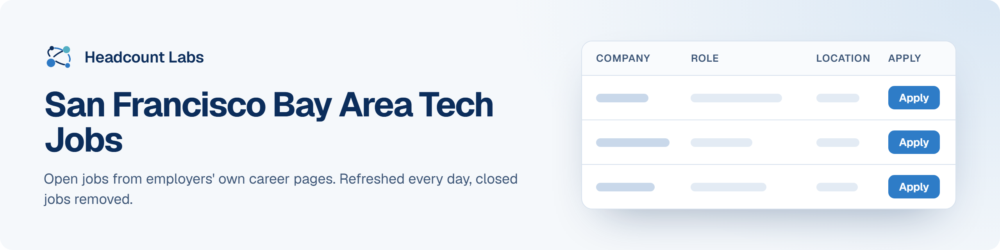

# San Francisco Bay Area Tech Jobs

Software, data, AI, product and design jobs in the San Francisco Bay Area, sorted by field.

**400 open jobs** · 193 new since the last update · 193 removed because they closed or left the employer's board · updated October 19, 2026 at 7:38 PM EDT

This list is built and refreshed every day by [Headcount Labs](https://headcountlabs.com/?utm_source=github&utm_medium=job-list&utm_campaign=bay-area-tech-jobs), which reads jobs straight from employers' own career pages and job boards. Every job here was still listed on its source board when we last read that board, within the past 3 days, and was posted in the past 30 days. Copies of the same job are merged into one row, and jobs that close are removed at the next update.

Want this data in your own app or agent? Use the [Headcount Labs jobs API](https://headcountlabs.com/docs/?utm_source=github&utm_medium=job-list&utm_campaign=bay-area-tech-jobs) (free tier), the [MCP server](https://headcountlabs.com/mcp/?utm_source=github&utm_medium=job-list&utm_campaign=bay-area-tech-jobs) for Claude, ChatGPT and other AI assistants, or the [open dataset](https://huggingface.co/datasets/HeadcountLabs/job-postings) on Hugging Face ([example queries](https://github.com/HeadcountLabs/job-postings)).

**Full dataset.** A bigger, one-off snapshot dated 2026-10-19 (all matching jobs, not only the open jobs below) is on Hugging Face: [Tech and software jobs](https://huggingface.co/datasets/HeadcountLabs/tech-jobs). It loads with `datasets.load_dataset` and is licensed CC BY 4.0.

**Jump to:** [Software engineering (207)](#software-engineering) · [Data, AI and machine learning (106)](#data-ai-and-machine-learning) · [Product and design (69)](#product-and-design) · [Hardware and engineering (17)](#hardware-and-engineering) · [Business, finance and operations (1)](#business-finance-and-operations)

**Columns.** *Apply* opens the original posting on the employer's site. *Details* opens the job on Headcount Labs, with every posting we found for it. *Remote* shows what the employer states; a dash means the posting doesn't say. *Pay* is the range the employer published.

## Software engineering

| Company | Role | Location | Remote | Pay | Posted | Apply | Details |
| --- | --- | --- | --- | --- | --- | :---: | :---: |
| **FlowGen Labs** | Staff Software Engineer | San Francisco, CA | On-site | $225k–$450k/yr | Oct 18 |  | <a href="https://headcountlabs.com/catalog/jobs/e4c3ae8f-7e8f-465d-b606-9c5a7f3863c9?utm_source=github&utm_medium=job-list&utm_campaign=bay-area-tech-jobs">via Headcount Labs</a> |
| **Paramount** | Senior Software Engineer | 

2 locations
Burbank, CA San Francisco, CA
 | — | $124k–$186k/yr | Oct 17 |  | <a href="https://headcountlabs.com/catalog/jobs/dc05ad7e-4b19-4f13-9fbc-d7bebdfc4493?utm_source=github&utm_medium=job-list&utm_campaign=bay-area-tech-jobs">via Headcount Labs</a> |
| **Elorian** | Software Engineer - Core Platform | Palo Alto, CA | Hybrid | — | Oct 17 |  | <a href="https://headcountlabs.com/catalog/jobs/708b4a4d-d6bb-4da0-891e-35c1061debc6?utm_source=github&utm_medium=job-list&utm_campaign=bay-area-tech-jobs">via Headcount Labs</a> |
| **Elicit** | Senior Software Enginer, Data and Integrations | Oakland, CA | Remote | — | Oct 17 |  | <a href="https://headcountlabs.com/catalog/jobs/3a9e488d-d884-4049-9d74-6a85628f06d6?utm_source=github&utm_medium=job-list&utm_campaign=bay-area-tech-jobs">via Headcount Labs</a> |
| **DoorDash USA** | Staff Software Engineer, Data - Experimentation | 

4 locations
California, CA San Francisco, CA Seattle, WA New York, NY
 | — | $194k–$285k/yr | Oct 17 |  | <a href="https://headcountlabs.com/catalog/jobs/add90fd9-d360-4a59-87cd-1b769aa29129?utm_source=github&utm_medium=job-list&utm_campaign=bay-area-tech-jobs">via Headcount Labs</a> |
| **Applied Intuition** | Full-Stack Software Engineer, People Intelligence | Sunnyvale, CA | On-site | $138k–$208k/yr | Oct 17 |  | <a href="https://headcountlabs.com/catalog/jobs/a04f4815-1a9a-4884-ac21-5453283243e9?utm_source=github&utm_medium=job-list&utm_campaign=bay-area-tech-jobs">via Headcount Labs</a> |
| **Veeam** | Senior Software Engineer, Performance Engineering | San Jose, CA | — | — | Oct 16 |  | <a href="https://headcountlabs.com/catalog/jobs/1616c9e1-2680-4692-a68b-dfd61103779c?utm_source=github&utm_medium=job-list&utm_campaign=bay-area-tech-jobs">via Headcount Labs</a> |
| **US00 Agilent Technologies Inc** | Director, Business Finance - Software | Santa Clara, CA | Remote | $136k–$255k/yr | Oct 16 |  | <a href="https://headcountlabs.com/catalog/jobs/5f62288b-a152-4455-8466-8cdcf5ac2011?utm_source=github&utm_medium=job-list&utm_campaign=bay-area-tech-jobs">via Headcount Labs</a> |
| **True Talent Solutions Partners** | Mid-Level Forward Deployed Software Engineer, Tactical Edge | Palo Alto, CA | On-site | — | Oct 16 |  | <a href="https://headcountlabs.com/catalog/jobs/9cd25ebd-1c92-49db-9fa5-e20da14b8252?utm_source=github&utm_medium=job-list&utm_campaign=bay-area-tech-jobs">via Headcount Labs</a> |
| **ServiceNow** | Staff Data Platform Software Engineer - veza | Santa Clara, CA | Hybrid | $176k–$308k/yr | Oct 16 |  | <a href="https://headcountlabs.com/catalog/jobs/22c5c2f2-e5b6-4453-bde0-5394f942ea33?utm_source=github&utm_medium=job-list&utm_campaign=bay-area-tech-jobs">via Headcount Labs</a> |
| **ServiceNow** | Sr Software Engineering Manager - Veza | Santa Clara, CA | — | $191k–$334k/yr | Oct 16 |  | <a href="https://headcountlabs.com/catalog/jobs/68b8b2d7-e309-4448-8f9a-55ba1e6cecab?utm_source=github&utm_medium=job-list&utm_campaign=bay-area-tech-jobs">via Headcount Labs</a> |
| **ServiceNow** | Staff Software Engineer, Platform Cryptography | Santa Clara, CA | Hybrid | $166k–$291k/yr | Oct 16 |  | <a href="https://headcountlabs.com/catalog/jobs/43988679-dba1-49b6-92cb-82bbfcfa75c8?utm_source=github&utm_medium=job-list&utm_campaign=bay-area-tech-jobs">via Headcount Labs</a> |
| **Sentry** | Staff Software Engineer, Platform &amp; Infrastructure | San Francisco, CA | Hybrid | $240k–$400k/yr | Oct 16 |  | <a href="https://headcountlabs.com/catalog/jobs/5a2a255d-4613-4bcc-b149-52b68dee15f6?utm_source=github&utm_medium=job-list&utm_campaign=bay-area-tech-jobs">via Headcount Labs</a> |
| **Salesforce, Inc.** | Distributed Systems Software Engineer - Public Cloud (Mid/Senior/Lead/Principal) | 

6 locations
San Francisco, CA New York Bellevue, WA California - San Francisco New York - New York Washington - Bellevue
 | — | $117k–$314k/yr | Oct 16 |  | <a href="https://headcountlabs.com/catalog/jobs/e3af0fe0-5cbc-41e7-9073-5209d81b039c?utm_source=github&utm_medium=job-list&utm_campaign=bay-area-tech-jobs">via Headcount Labs</a> |
| **Robinhood** | Senior iOS Engineer, Crypto Perpetuals | 

3 locations
Menlo Park, CA New York, NY Toronto
 | — | $196k–$230k/yr | Oct 16 |  | <a href="https://headcountlabs.com/catalog/jobs/14bd5cc8-1306-446f-af2f-458cf8025c69?utm_source=github&utm_medium=job-list&utm_campaign=bay-area-tech-jobs">via Headcount Labs</a> |
| **Reliable Robotics Corporation** | Flight Software Verification Manager | Mountain View, CA | On-site | $190k–$270k/yr | Oct 16 |  | <a href="https://headcountlabs.com/catalog/jobs/d15f7f4a-beb5-4b5f-8e86-67504dcde48d?utm_source=github&utm_medium=job-list&utm_campaign=bay-area-tech-jobs">via Headcount Labs</a> |
| **Reliable Robotics Corporation** | Flight Software Manager | Mountain View, CA | — | $210k–$270k/yr | Oct 16 |  | <a href="https://headcountlabs.com/catalog/jobs/0cb2e944-516d-46b3-a64d-ae863348be41?utm_source=github&utm_medium=job-list&utm_campaign=bay-area-tech-jobs">via Headcount Labs</a> |
| **Palo Alto Networks, Inc.** | Sr Principal DevOps Engineer (Prisma AIRS) | 

2 locations
United States Santa Clara, CA
 | On-site | $178k–$287k/yr | Oct 16 |  | <a href="https://headcountlabs.com/catalog/jobs/8328a309-f431-4bea-a34f-15f09b5fcd78?utm_source=github&utm_medium=job-list&utm_campaign=bay-area-tech-jobs">via Headcount Labs</a> |
| **NVIDIA USA** | Senior Software Engineer — MD Simulation Engineering | Santa Clara, CA | — | $184k–$288k/yr | Oct 16 |  | <a href="https://headcountlabs.com/catalog/jobs/ed4a30bf-ca9a-428e-b589-f510277f774f?utm_source=github&utm_medium=job-list&utm_campaign=bay-area-tech-jobs">via Headcount Labs</a> |
| **NVIDIA USA** | Senior Robotics Software Engineer | Santa Clara, CA | — | $184k–$288k/yr | Oct 16 |  | <a href="https://headcountlabs.com/catalog/jobs/e6e5d4d3-a6cf-422a-8a6c-f0b26c6a117d?utm_source=github&utm_medium=job-list&utm_campaign=bay-area-tech-jobs">via Headcount Labs</a> |
| **NVIDIA USA** | Principal Block and File Storage Software Engineer, Linux - DGX Cloud | Santa Clara, CA | — | $272k–$431k/yr | Oct 16 |  | <a href="https://headcountlabs.com/catalog/jobs/d9e4b5e0-4364-44c2-a53c-7519ea042aee?utm_source=github&utm_medium=job-list&utm_campaign=bay-area-tech-jobs">via Headcount Labs</a> |
| **NVIDIA USA** | Senior Software Engineer, NCCL | Santa Clara, CA | — | $152k–$242k/yr | Oct 16 |  | <a href="https://headcountlabs.com/catalog/jobs/b50386ff-3ee3-4463-b7b0-dd67f23dd25b?utm_source=github&utm_medium=job-list&utm_campaign=bay-area-tech-jobs">via Headcount Labs</a> |
| **Matternet** | Backend Engineer | Mountain View, CA | Hybrid | — | Oct 16 |  | <a href="https://headcountlabs.com/catalog/jobs/d91b8532-6c4a-4c8b-8e6c-242982c9d952?utm_source=github&utm_medium=job-list&utm_campaign=bay-area-tech-jobs">via Headcount Labs</a> |
| **Matternet** | Site Reliability Engineer | Mountain View, CA | Hybrid | — | Oct 16 |  | <a href="https://headcountlabs.com/catalog/jobs/b47d95f3-dcad-4cc2-9e7f-e48b8f042d4f?utm_source=github&utm_medium=job-list&utm_campaign=bay-area-tech-jobs">via Headcount Labs</a> |
| **Matternet** | Senior Software Engineer, Full Stack | Mountain View, CA | Hybrid | — | Oct 16 |  | <a href="https://headcountlabs.com/catalog/jobs/ab814ece-ab23-4785-839b-db465c258b5b?utm_source=github&utm_medium=job-list&utm_campaign=bay-area-tech-jobs">via Headcount Labs</a> |
| **Matternet** | Onboard Software Engineer | Mountain View, CA | On-site | — | Oct 16 |  | <a href="https://headcountlabs.com/catalog/jobs/a719e9bd-c6d7-471f-b097-e2c7561152d5?utm_source=github&utm_medium=job-list&utm_campaign=bay-area-tech-jobs">via Headcount Labs</a> |
| **Lynx Software Technologies, Inc.** | Senior Software Engineer ($10K Sign-on Bonus) | Sunnyvale, CA | On-site | $200k–$240k/yr | Oct 16 |  | <a href="https://headcountlabs.com/catalog/jobs/8b4b1012-5720-4b5f-a514-1f34ae476944?utm_source=github&utm_medium=job-list&utm_campaign=bay-area-tech-jobs">via Headcount Labs</a> |
| **LinkedIn** | Staff Security Engineer | Mountain View, CA | Hybrid | $156k–$255k/yr | Oct 16 |  | <a href="https://headcountlabs.com/catalog/jobs/1dd0e841-8c7a-4304-bc85-358671f7aceb?utm_source=github&utm_medium=job-list&utm_campaign=bay-area-tech-jobs">via Headcount Labs</a> |
| **Intuit** | Senior Staff Software Engineer - Backend | Mountain View, CA | — | $220k–$298k/yr | Oct 16 |  | <a href="https://headcountlabs.com/catalog/jobs/ee2ec894-767b-42c9-b709-f609d9ba9077?utm_source=github&utm_medium=job-list&utm_campaign=bay-area-tech-jobs">via Headcount Labs</a> |
| **Intuit** | Software Engineer 2, Mid Market Intelligence | Mountain View, CA | — | $140k–$190k/yr | Oct 16 |  | <a href="https://headcountlabs.com/catalog/jobs/e02e626f-7c51-4497-9e35-87c8cc5a3d2a?utm_source=github&utm_medium=job-list&utm_campaign=bay-area-tech-jobs">via Headcount Labs</a> |
| **Intuit** | Staff Software Engineer - Backend | Mountain View, CA | — | $202k–$274k/yr | Oct 16 |  | <a href="https://headcountlabs.com/catalog/jobs/d51baf4b-d865-4ca3-966e-a8ace8615f72?utm_source=github&utm_medium=job-list&utm_campaign=bay-area-tech-jobs">via Headcount Labs</a> |
| **Intuit** | Senior Software Engineer, Mid Market Intelligence | Mountain View, CA | — | $171k–$232k/yr | Oct 16 |  | <a href="https://headcountlabs.com/catalog/jobs/b0498c5e-4aac-4dc1-9a88-22bfd9573bad?utm_source=github&utm_medium=job-list&utm_campaign=bay-area-tech-jobs">via Headcount Labs</a> |
| **Intuit** | Staff Software Engineer, Mid Market Intelligence | Mountain View, CA | — | $202k–$274k/yr | Oct 16 |  | <a href="https://headcountlabs.com/catalog/jobs/66e0a6c8-caa1-496f-a1dd-d94b3b2b6959?utm_source=github&utm_medium=job-list&utm_campaign=bay-area-tech-jobs">via Headcount Labs</a> |
| **Intel Corporation** | Senior AI Software Development Engineer | 

3 locations
Folsom, CA Santa Clara, CA Hillsboro, OR
 | Hybrid | $150k–$276k/yr | Oct 16 |  | <a href="https://headcountlabs.com/catalog/jobs/37d9951a-42f2-4028-a2d6-1aeaa6599844?utm_source=github&utm_medium=job-list&utm_campaign=bay-area-tech-jobs">via Headcount Labs</a> |
| **Hewlett Packard Enterprise** | Software Engineer | San Jose, CA | On-site | — | Oct 16 |  | <a href="https://headcountlabs.com/catalog/jobs/70e7cb2e-e56f-498a-8f84-4989039daabc?utm_source=github&utm_medium=job-list&utm_campaign=bay-area-tech-jobs">via Headcount Labs</a> |
| **Hadrian Automation** | Software Engineer, Identity &amp; Access Management | 

3 locations
Los Angeles, CA San Francisco Bay Area, CA Seattle/Bellevue Area, WA
 | On-site | $192k–$274k/yr | Oct 16 |  | <a href="https://headcountlabs.com/catalog/jobs/f4204f9b-dda0-46f1-8213-76e9c5fbcb4c?utm_source=github&utm_medium=job-list&utm_campaign=bay-area-tech-jobs">via Headcount Labs</a> |
| **Fiserv** | Android AOSP Device Software Engineer | Sunnyvale, CA | On-site | $160k–$240k/yr | Oct 16 |  | <a href="https://headcountlabs.com/catalog/jobs/99c7bea1-f34a-4522-aec7-3a67f164a7bf?utm_source=github&utm_medium=job-list&utm_campaign=bay-area-tech-jobs">via Headcount Labs</a> |
| **Eli Lilly and Company** | Senior Software Engineer, TuneLab | 

2 locations
San Francisco CA San Francisco, CA
 | — | $158k–$253k/yr | Oct 16 |  | <a href="https://headcountlabs.com/catalog/jobs/71959f5c-9835-4970-a341-fd5d7bd63d41?utm_source=github&utm_medium=job-list&utm_campaign=bay-area-tech-jobs">via Headcount Labs</a> |
| **Danaher** | Product Management Director, Software | Sunnyvale, CA | On-site | $195k–$215k/yr | Oct 16 |  | <a href="https://headcountlabs.com/catalog/jobs/a2fed624-c7ed-4c5b-b54a-b4a9576b520e?utm_source=github&utm_medium=job-list&utm_campaign=bay-area-tech-jobs">via Headcount Labs</a> |
| **Crusoe** | Staff Software Engineer, Storage | Sunnyvale, CA | On-site | — | Oct 16 |  | <a href="https://headcountlabs.com/catalog/jobs/ef3638fd-858d-4d84-9095-e44502948925?utm_source=github&utm_medium=job-list&utm_campaign=bay-area-tech-jobs">via Headcount Labs</a> |
| **Capital One** | Manager, Cyber Security Product Owner (Cryptography) | 

6 locations
McLean, VA New York, NY Plano, TX Richmond, VA Riverwoods, IL San Jose, CA
 | — | $197k–$225k/yr | Oct 16 |  | <a href="https://headcountlabs.com/catalog/jobs/f9fe74f0-97ae-4078-8479-1c496f8e9f12?utm_source=github&utm_medium=job-list&utm_campaign=bay-area-tech-jobs">via Headcount Labs</a> |
| **Capital One** | Full-stack Engineer 4 | 

6 locations
McLean, VA Chicago, IL New York, NY Plano, TX Richmond, VA San Jose, CA
 | — | $179k–$205k/yr | Oct 16 |  | <a href="https://headcountlabs.com/catalog/jobs/eaa23391-5805-4e8e-9a80-9e96b26efe8d?utm_source=github&utm_medium=job-list&utm_campaign=bay-area-tech-jobs">via Headcount Labs</a> |
| **ASRC Federal Holding Company** | Software Programmer/Developer | Mountain View, CA | — | — | Oct 16 |  | <a href="https://headcountlabs.com/catalog/jobs/e87b0f1f-efa8-4a3a-8c18-6274e5efae1a?utm_source=github&utm_medium=job-list&utm_campaign=bay-area-tech-jobs">via Headcount Labs</a> |
| **Applied Materials** | Software Engineer III | Santa Clara, CA | — | $152k–$208k/yr | Oct 16 |  | <a href="https://headcountlabs.com/catalog/jobs/fb0bcd36-6036-477f-8b8b-b0c93d379f5c?utm_source=github&utm_medium=job-list&utm_campaign=bay-area-tech-jobs">via Headcount Labs</a> |
| **Applied Materials** | Software QA Engineer | Santa Clara, CA | — | $100k–$136k/yr | Oct 16 |  | <a href="https://headcountlabs.com/catalog/jobs/0e2e18a8-4d2b-4f12-9964-0aa474da41dc?utm_source=github&utm_medium=job-list&utm_campaign=bay-area-tech-jobs">via Headcount Labs</a> |
| **AiDASH, Inc.** | Software Engineering Intern, Backend | Palo Alto, CA | Hybrid | — | Oct 16 |  | <a href="https://headcountlabs.com/catalog/jobs/481097f9-4bef-49ae-a3ea-278d3e3678c6?utm_source=github&utm_medium=job-list&utm_campaign=bay-area-tech-jobs">via Headcount Labs</a> |
| **Advanced Micro Devices, Inc** | Sr. Compiler Software Development Engineer | San Jose, CA | — | — | Oct 16 |  | <a href="https://headcountlabs.com/catalog/jobs/f43c8c8c-e561-464a-b204-0a09643b2c00?utm_source=github&utm_medium=job-list&utm_campaign=bay-area-tech-jobs">via Headcount Labs</a> |
| **Advanced Micro Devices, Inc** | Manager Software Development | Santa Clara, CA | — | — | Oct 16 |  | <a href="https://headcountlabs.com/catalog/jobs/3c8d954a-d47a-401b-ac86-63b3cec193cc?utm_source=github&utm_medium=job-list&utm_campaign=bay-area-tech-jobs">via Headcount Labs</a> |
| **31 MSI - (Marvell Semiconductor Inc.) US** | Network Site Reliability Engineer, AI Solutions Lab | Santa Clara, CA | — | $131k–$196k/yr | Oct 16 |  | <a href="https://headcountlabs.com/catalog/jobs/427b720e-9b38-4968-b407-926908e37f44?utm_source=github&utm_medium=job-list&utm_campaign=bay-area-tech-jobs">via Headcount Labs</a> |
| **Zscaler** | Sr. Site Reliability Engineer- Federal | Santa Clara, CA | Hybrid | $118k–$148k/yr | Oct 15 |  | <a href="https://headcountlabs.com/catalog/jobs/7dd80110-fa0e-4a3a-bcc7-bd8bed701c1e?utm_source=github&utm_medium=job-list&utm_campaign=bay-area-tech-jobs">via Headcount Labs</a> |
| **Twist Bioscience** | Sr Staff Program Manager, MES Custom Software Development Transformation | USA - South San Francisco, CA | — | $233k–$271k/yr | Oct 15 |  | <a href="https://headcountlabs.com/catalog/jobs/e626fa42-a1d4-498d-ae9f-e3bf3c222ce1?utm_source=github&utm_medium=job-list&utm_campaign=bay-area-tech-jobs">via Headcount Labs</a> |
| **True Talent Solutions Partners** | Head of Software Architecture, Embodied AI Platform | Santa Clara, CA | On-site | — | Oct 15 |  | <a href="https://headcountlabs.com/catalog/jobs/86744a9f-ac54-4355-96e2-bf124a33a495?utm_source=github&utm_medium=job-list&utm_campaign=bay-area-tech-jobs">via Headcount Labs</a> |
| **TENEX.AI** | Platform Engineer, AI &amp; Security | 

3 locations
San Jose, CA Sarasota, FL Kansas City Metro
 | Hybrid | — | Oct 15 |  | <a href="https://headcountlabs.com/catalog/jobs/44a4efb8-24e9-40ba-aa95-5c117f0702dd?utm_source=github&utm_medium=job-list&utm_campaign=bay-area-tech-jobs">via Headcount Labs</a> |
| **Sprinter Health** | Software Engineer, Platform (Mid-Senior Level) | 

2 locations
San Francisco, CA Menlo Park, CA
 | Hybrid | $175k–$225k/yr | Oct 15 |  | <a href="https://headcountlabs.com/catalog/jobs/68e3ae4f-fef5-4ed0-b79e-30448ba33b45?utm_source=github&utm_medium=job-list&utm_campaign=bay-area-tech-jobs">via Headcount Labs</a> |
| **Snap Inc.** | Software Engineer, ML Infrastructure, ML Platform Level 5 | 

3 locations
Los Angeles, CA Bellevue, WA Palo Alto, CA
 | — | $209k–$313k/yr | Oct 15 |  | <a href="https://headcountlabs.com/catalog/jobs/2f0a7a3d-ed30-4574-9623-6982ff6b5534?utm_source=github&utm_medium=job-list&utm_campaign=bay-area-tech-jobs">via Headcount Labs</a> |
| **Snap Inc.** | Software Engineer, ML infrastructure, Core Inference, Level 4 | 

3 locations
Bellevue, WA Los Angeles, CA Palo Alto, CA
 | On-site | $157k–$235k/yr | Oct 15 |  | <a href="https://headcountlabs.com/catalog/jobs/ebfe2f44-1845-466e-8e6c-91567de478b9?utm_source=github&utm_medium=job-list&utm_campaign=bay-area-tech-jobs">via Headcount Labs</a> |
| **ServiceNow** | Senior Staff AI-Native DevOps Engineer | Santa Clara, CA | Hybrid | $201k–$352k/yr | Oct 15 |  | <a href="https://headcountlabs.com/catalog/jobs/7faa7eff-5d80-4897-afe7-24bcf7011503?utm_source=github&utm_medium=job-list&utm_campaign=bay-area-tech-jobs">via Headcount Labs</a> |
| **ServiceNow** | Staff AI-Native DevOps Engineer | Santa Clara, CA | Hybrid | $176k–$308k/yr | Oct 15 |  | <a href="https://headcountlabs.com/catalog/jobs/1d558e1a-1a11-4973-a6f4-4258a33dd46a?utm_source=github&utm_medium=job-list&utm_campaign=bay-area-tech-jobs">via Headcount Labs</a> |
| **SBT Global, Inc.** | Temporary DevOps/System Engineer (Sr.staff) | San Jose, CA | — | $8k/mo | Oct 15 |  | <a href="https://headcountlabs.com/catalog/jobs/d5580071-1bf4-4fab-9ff9-d240dcc3f6e1?utm_source=github&utm_medium=job-list&utm_campaign=bay-area-tech-jobs">via Headcount Labs</a> |
| **Salesforce, Inc.** | Software Engineering Architect | San Francisco, CA | — | $218k–$365k/yr | Oct 15 |  | <a href="https://headcountlabs.com/catalog/jobs/fd71f35a-72f0-48bf-b698-76fe5c358173?utm_source=github&utm_medium=job-list&utm_campaign=bay-area-tech-jobs">via Headcount Labs</a> |
| **Roku** | Senior AI DevOps Engineer | San Jose, CA | — | $141k–$306k/yr | Oct 15 |  | <a href="https://headcountlabs.com/catalog/jobs/1440de41-e687-4b60-a2f7-f803263ab14b?utm_source=github&utm_medium=job-list&utm_campaign=bay-area-tech-jobs">via Headcount Labs</a> |
| **Rivian** | Software Engineering Intern - Machine Learning Research, Perception (Spring 2027 Co-Op) | Palo Alto, CA | — | $33–$51/hr | Oct 15 |  | <a href="https://headcountlabs.com/catalog/jobs/333dd5b9-9801-4cf5-8c5f-ffc7d9f6aa82?utm_source=github&utm_medium=job-list&utm_campaign=bay-area-tech-jobs">via Headcount Labs</a> |
| **PayPal, Inc.** | Sr Staff Software Engineer | 

2 locations
San Jose, CA Austin, TX
 | — | $196k–$292k/yr | Oct 15 |  | <a href="https://headcountlabs.com/catalog/jobs/88a5f93b-864d-4f10-9ac8-733ae3000cce?utm_source=github&utm_medium=job-list&utm_campaign=bay-area-tech-jobs">via Headcount Labs</a> |
| **Palo Alto Networks, Inc.** | Principal Software Engineer (SaaS Agent Security) | 

2 locations
Santa Clara, CA United States
 | On-site | $156k–$253k/yr | Oct 15 |  | <a href="https://headcountlabs.com/catalog/jobs/c01bd982-a4d7-4b67-8634-c17913be5037?utm_source=github&utm_medium=job-list&utm_campaign=bay-area-tech-jobs">via Headcount Labs</a> |
| **Palo Alto Networks, Inc.** | Principal Software Engineer (Cloud Platform and AI Engineering) | 

2 locations
Santa Clara Santa Clara, CA
 | On-site | $156k–$253k/yr | Oct 15 |  | <a href="https://headcountlabs.com/catalog/jobs/859a0632-c408-4721-982b-68f4ba186fdf?utm_source=github&utm_medium=job-list&utm_campaign=bay-area-tech-jobs">via Headcount Labs</a> |
| **Palo Alto Networks, Inc.** | Principal Software Engineer (AI Posture)) | 

2 locations
Santa Clara, CA United States
 | On-site | $156k–$253k/yr | Oct 15 |  | <a href="https://headcountlabs.com/catalog/jobs/7e5d2a2a-e379-4608-84b6-9acfe7815ed5?utm_source=github&utm_medium=job-list&utm_campaign=bay-area-tech-jobs">via Headcount Labs</a> |
| **Nvidia** | Senior Systems Software Engineer- EDA Infrastructure | 

8 locations
Santa Clara, CA Westford, MA Durham, NC Austin, TX Washington US, CA US US, WA
 | Remote | $184k–$288k/yr | Oct 15 |  | <a href="https://headcountlabs.com/catalog/jobs/6933ee44-8528-4d37-b90b-5c0afeb22ec5?utm_source=github&utm_medium=job-list&utm_campaign=bay-area-tech-jobs">via Headcount Labs</a> |
| **Muon Space** | Senior Software Engineer, Information Systems | San Jose, CA | Hybrid | $196k–$217k/yr | Oct 15 |  | <a href="https://headcountlabs.com/catalog/jobs/83329976-cc4a-4824-a63e-62227bf04331?utm_source=github&utm_medium=job-list&utm_campaign=bay-area-tech-jobs">via Headcount Labs</a> |
| **Muon Space** | Software Engineering Manager, Information Systems | San Jose, CA | Hybrid | $196k–$217k/yr | Oct 15 |  | <a href="https://headcountlabs.com/catalog/jobs/63d551bc-5338-42b5-96ab-45c659ff8d84?utm_source=github&utm_medium=job-list&utm_campaign=bay-area-tech-jobs">via Headcount Labs</a> |
| **Muon Space** | Ground Software Engineering Intern (Summer 2027) | San Jose, CA | — | $40/hr | Oct 15 |  | <a href="https://headcountlabs.com/catalog/jobs/422fd955-0799-4c8f-a434-06c6b340c1c8?utm_source=github&utm_medium=job-list&utm_campaign=bay-area-tech-jobs">via Headcount Labs</a> |
| **Keysight Technologies, Inc.** | R&amp;D Software Engineer | 

3 locations
Santa Rosa, CA Santa Clara, CA Loveland, CO
 | — | $90k–$149k/yr | Oct 15 |  | <a href="https://headcountlabs.com/catalog/jobs/6b81cfea-650b-491a-afcd-06fda0c705a6?utm_source=github&utm_medium=job-list&utm_campaign=bay-area-tech-jobs">via Headcount Labs</a> |
| **Intuit** | Software Engineer 1 | 

5 locations
Mountain View, CA San Diego, CA New York, NY Charlotte, NC Atlanta, GA
 | — | $55.50–$75/hr | Oct 15 |  | <a href="https://headcountlabs.com/catalog/jobs/a9aa2cb3-bc80-4950-b013-8b772e87dd69?utm_source=github&utm_medium=job-list&utm_campaign=bay-area-tech-jobs">via Headcount Labs</a> |
| **Gamma** | Software Engineer, Frontend | San Francisco, CA | On-site | — | Oct 15 |  | <a href="https://headcountlabs.com/catalog/jobs/7a7c4563-94c2-4ef3-a597-878e5319fa81?utm_source=github&utm_medium=job-list&utm_campaign=bay-area-tech-jobs">via Headcount Labs</a> |
| **Gamma** | Software Engineer, Growth | San Francisco, CA | On-site | — | Oct 15 |  | <a href="https://headcountlabs.com/catalog/jobs/610f6c13-7699-48a2-87cd-f0bb7a561940?utm_source=github&utm_medium=job-list&utm_campaign=bay-area-tech-jobs">via Headcount Labs</a> |
| **Gallatin** | Senior Frontend Engineer | 

6 locations
El Segundo, CA Washington, DC Palo Alto, CA San Francisco, CA Austin, TX New York City, NY
 | On-site | $80k–$120k/yr | Oct 15 |  | <a href="https://headcountlabs.com/catalog/jobs/51f9c8a8-3f71-464f-8dc0-4fc37063fcd0?utm_source=github&utm_medium=job-list&utm_campaign=bay-area-tech-jobs">via Headcount Labs</a> |
| **Gallatin** | Fullstack Engineer | 

6 locations
El Segundo, CA Washington, DC Palo Alto, CA San Francisco, CA Austin, TX New York City, NY
 | On-site | $80k–$120k/yr | Oct 15 |  | <a href="https://headcountlabs.com/catalog/jobs/4740093a-9224-4c7c-b05f-923a9f6c5b7b?utm_source=github&utm_medium=job-list&utm_campaign=bay-area-tech-jobs">via Headcount Labs</a> |
| **Fiserv Solutions LLC** | Sr Backend Engineer | 

2 locations
Berkeley Heights, NJ Sunnyvale, CA
 | On-site | $110k–$186k/yr | Oct 15 |  | <a href="https://headcountlabs.com/catalog/jobs/9806c85b-50f7-4bbb-bf15-eb50fb399c72?utm_source=github&utm_medium=job-list&utm_campaign=bay-area-tech-jobs">via Headcount Labs</a> |
| **Fiserv** | Senior iOS Engineer – Payments &amp; Hardware Integrations | Sunnyvale, CA | On-site | $140k–$210k/yr | Oct 15 |  | <a href="https://headcountlabs.com/catalog/jobs/6b458be4-2c7f-4919-97da-e969e7583ebe?utm_source=github&utm_medium=job-list&utm_campaign=bay-area-tech-jobs">via Headcount Labs</a> |
| **Fiserv** | Software Development Engineering - SDET | Sunnyvale, CA | On-site | $140k–$210k/yr | Oct 15 |  | <a href="https://headcountlabs.com/catalog/jobs/33a4de51-4f35-4c4b-9fb3-546747d5f606?utm_source=github&utm_medium=job-list&utm_campaign=bay-area-tech-jobs">via Headcount Labs</a> |
| **Fiserv** | Android Application Framework Developer - Device Engineering | Sunnyvale, CA | On-site | $124k–$186k/yr | Oct 15 |  | <a href="https://headcountlabs.com/catalog/jobs/2bef1dc7-bc5e-4a1b-bcf8-1e680a6e8681?utm_source=github&utm_medium=job-list&utm_campaign=bay-area-tech-jobs">via Headcount Labs</a> |
| **Fiserv** | Sr Backend Engineer | 

2 locations
Berkeley Heights, NJ Sunnyvale, CA
 | — | $110k–$186k/yr | Oct 15 |  | <a href="https://headcountlabs.com/catalog/jobs/8205acf9-6de7-4f1a-86de-82c8f94d8263?utm_source=github&utm_medium=job-list&utm_campaign=bay-area-tech-jobs">via Headcount Labs</a> |
| **Everpure** | Senior Software Engineer, Hyperscale Build Infrastructure | Santa Clara, CA | On-site | $217k–$326k/yr | Oct 15 |  | <a href="https://headcountlabs.com/catalog/jobs/d18d174a-54b0-4d82-a50b-31a2bda90bb5?utm_source=github&utm_medium=job-list&utm_campaign=bay-area-tech-jobs">via Headcount Labs</a> |
| **DoorDash USA** | Software Engineer, ML Infrastructure (MDX) | 

3 locations
San Francisco, CA Sunnyvale, CA Seattle, WA
 | — | $131k–$192k/yr | Oct 15 |  | <a href="https://headcountlabs.com/catalog/jobs/a22a9dc6-4ad9-4a5b-b26a-cd9b959635cb?utm_source=github&utm_medium=job-list&utm_campaign=bay-area-tech-jobs">via Headcount Labs</a> |
| **d-Matrix** | Director, Software Quality Engineering | Santa Clara, CA | Hybrid | $195k–$330k/yr | Oct 15 |  | <a href="https://headcountlabs.com/catalog/jobs/f3a9a12c-7679-42fa-8f73-3637ccde497f?utm_source=github&utm_medium=job-list&utm_campaign=bay-area-tech-jobs">via Headcount Labs</a> |
| **Crusoe** | Senior Staff Software Engineer, Storage | Sunnyvale, CA | On-site | — | Oct 15 |  | <a href="https://headcountlabs.com/catalog/jobs/2fe892eb-20ac-4054-b669-9c4a8c50ee04?utm_source=github&utm_medium=job-list&utm_campaign=bay-area-tech-jobs">via Headcount Labs</a> |
| **CrowdStrike, Inc.** | Sr. Software Engineer II, AI on Sensor – Mac, Linux, or Windows (Hybrid) | 

5 locations
Sunnyvale, CA Toronto Austin, TX New York, NY Redmond, WA
 | Hybrid | $160k–$250k/yr | Oct 15 |  | <a href="https://headcountlabs.com/catalog/jobs/a2b60f07-e49b-440c-9701-2e40b609951a?utm_source=github&utm_medium=job-list&utm_campaign=bay-area-tech-jobs">via Headcount Labs</a> |
| **CoreWeave** | Senior Software Engineer II, ML Workflows - W&amp;B | Livingston, NJ / New York, NY / Sunnyvale, CA / Bellevue, WA / San Francisco, CA | — | $182k–$242k/yr | Oct 15 |  | <a href="https://headcountlabs.com/catalog/jobs/a81db9d3-89c2-4735-8bc3-2cedef193b4a?utm_source=github&utm_medium=job-list&utm_campaign=bay-area-tech-jobs">via Headcount Labs</a> |
| **Commure** | Senior Software Engineer, Network Infrastructure | 

3 locations
Mountain View, CA Los Angeles, CA San Francisco, CA
 | Hybrid | $180k–$230k/yr | Oct 15 |  | <a href="https://headcountlabs.com/catalog/jobs/8e362058-1b60-4c47-90db-867cb9a202fa?utm_source=github&utm_medium=job-list&utm_campaign=bay-area-tech-jobs">via Headcount Labs</a> |
| **ASRC Federal** | Software Programmer/Developer | Mountain View, CA | On-site | — | Oct 15 |  | <a href="https://headcountlabs.com/catalog/jobs/60e40e55-8f20-48d6-87d3-336703dc1e82?utm_source=github&utm_medium=job-list&utm_campaign=bay-area-tech-jobs">via Headcount Labs</a> |
| **Zscaler** | Sr. Staff Software Development Engineer - Go Dataplane (SD-WAN) | Santa Clara, CA | Hybrid | $180k–$225k/yr | Oct 14 |  | <a href="https://headcountlabs.com/catalog/jobs/fea05c86-edd8-4f02-85f4-d07290cce7ba?utm_source=github&utm_medium=job-list&utm_campaign=bay-area-tech-jobs">via Headcount Labs</a> |
| **True Talent Solutions Partners** | Senior Backend Software Engineer | Mountain View, CA | On-site | — | Oct 14 |  | <a href="https://headcountlabs.com/catalog/jobs/4c982789-fdb5-4444-8af5-6ad023cc6243?utm_source=github&utm_medium=job-list&utm_campaign=bay-area-tech-jobs">via Headcount Labs</a> |
| **SAP** | Developer (Multiple Positions Available) | Palo Alto, CA | Hybrid | $172k–$206k/yr | Oct 14 |  | <a href="https://headcountlabs.com/catalog/jobs/20825407-b8d1-4637-aeb9-dda2dcbc74f2?utm_source=github&utm_medium=job-list&utm_campaign=bay-area-tech-jobs">via Headcount Labs</a> |
| **Salesforce, Inc.** | Senior Software Engineering Manager - Full Stack (Slack) | 

8 locations
Atlanta, GA San Francisco, CA New York Bellevue, WA Seattle, WA Georgia - Atlanta California - San Francisco New York - New York
 | — | $172k–$260k/yr | Oct 14 |  | <a href="https://headcountlabs.com/catalog/jobs/556c7e54-bafe-4799-b059-8423cb7c7c57?utm_source=github&utm_medium=job-list&utm_campaign=bay-area-tech-jobs">via Headcount Labs</a> |
| **Salesforce, Inc.** | Offensive Security Engineer - Red Team | 

2 locations
San Francisco, CA Bellevue, WA
 | — | $117k–$224k/yr | Oct 14 |  | <a href="https://headcountlabs.com/catalog/jobs/a09df66f-3726-4ff2-97ec-9bce6980aa75?utm_source=github&utm_medium=job-list&utm_campaign=bay-area-tech-jobs">via Headcount Labs</a> |
| **Salesforce, Inc.** | Software Engineering LMTS | San Francisco, CA | — | $172k–$260k/yr | Oct 14 |  | <a href="https://headcountlabs.com/catalog/jobs/2cb8e677-bbe9-4b78-b6b7-4b6269ea5ebd?utm_source=github&utm_medium=job-list&utm_campaign=bay-area-tech-jobs">via Headcount Labs</a> |
| **Robinhood** | Senior Software Engineer, International | 

3 locations
Menlo Park, CA New York, NY Toronto
 | — | $196k–$230k/yr | Oct 14 |  | <a href="https://headcountlabs.com/catalog/jobs/aa4170ef-f857-4fae-baf8-d257ada86a03?utm_source=github&utm_medium=job-list&utm_campaign=bay-area-tech-jobs">via Headcount Labs</a> |
| **Rivian and Volkswagen Group Technologies** | Sr. Embedded Software Engineer | Palo Alto, CA | Hybrid | $147k–$220k/yr | Oct 14 |  | <a href="https://headcountlabs.com/catalog/jobs/55538a03-67f5-4ca8-9745-18f5bafd25d3?utm_source=github&utm_medium=job-list&utm_campaign=bay-area-tech-jobs">via Headcount Labs</a> |
| **Rivian** | Sr. Audio Software Quality Assurance Engineer | Palo Alto, CA | — | $117k–$146k/yr | Oct 14 |  | <a href="https://headcountlabs.com/catalog/jobs/f248fa8a-b850-4cf8-8491-8d816b570236?utm_source=github&utm_medium=job-list&utm_campaign=bay-area-tech-jobs">via Headcount Labs</a> |
| **PG&amp;E Corporation** | Data Platform Engineer | Oakland, CA | Hybrid | $49.04–$77.88/hr | Oct 14 |  | <a href="https://headcountlabs.com/catalog/jobs/0b65e1f9-bd8c-4234-b1da-45c82b270b08?utm_source=github&utm_medium=job-list&utm_campaign=bay-area-tech-jobs">via Headcount Labs</a> |
| **Omnissa, LLC** | Software Engineer C/C++ - (Windows Internals/ Drivers / Graphics) | Mountain View, CA | Hybrid | $151k–$225k/yr | Oct 14 |  | <a href="https://headcountlabs.com/catalog/jobs/2a3c84b4-109f-4250-813c-016bb6400d28?utm_source=github&utm_medium=job-list&utm_campaign=bay-area-tech-jobs">via Headcount Labs</a> |
| **Intel Corporation** | AI Developer Relations - Docs and Learning Experience | 

3 locations
Phoenix, AZ Santa Clara, CA Hillsboro, OR
 | Hybrid | $150k–$276k/yr | Oct 14 |  | <a href="https://headcountlabs.com/catalog/jobs/b4e65e5b-7248-4ea2-b47f-833e33bb88c7?utm_source=github&utm_medium=job-list&utm_campaign=bay-area-tech-jobs">via Headcount Labs</a> |
| **Intel Corporation** | Senior AI Developer Relations Advocate — Rack Scale | 

3 locations
Phoenix, AZ Santa Clara, CA Hillsboro, OR
 | Hybrid | $170k–$315k/yr | Oct 14 |  | <a href="https://headcountlabs.com/catalog/jobs/795d5f4f-b069-45a7-8734-0e58ef4b1093?utm_source=github&utm_medium=job-list&utm_campaign=bay-area-tech-jobs">via Headcount Labs</a> |
| **Intel Corporation** | Senior AI Developer Relations Advocate - Agentic Applications | 

3 locations
Phoenix, AZ Santa Clara, CA Hillsboro, OR
 | Hybrid | $170k–$315k/yr | Oct 14 |  | <a href="https://headcountlabs.com/catalog/jobs/50af8aef-4637-416d-8617-536643f82641?utm_source=github&utm_medium=job-list&utm_campaign=bay-area-tech-jobs">via Headcount Labs</a> |
| **HPE** | System / Software engineer II | Sunnyvale, CA | On-site | — | Oct 14 |  | <a href="https://headcountlabs.com/catalog/jobs/6dcaefd7-f2b0-4444-8605-1e50d77d0308?utm_source=github&utm_medium=job-list&utm_campaign=bay-area-tech-jobs">via Headcount Labs</a> |
| **Guardant Health, Inc.** | Senior Software Engineer, Bioinformatics | Palo Alto, CA | On-site | $150k–$207k/yr | Oct 14 |  | <a href="https://headcountlabs.com/catalog/jobs/a008ee17-a803-4163-9fdd-6c50f5c88818?utm_source=github&utm_medium=job-list&utm_campaign=bay-area-tech-jobs">via Headcount Labs</a> |
| **Generac Power Systems Inc** | Senior Full-Stack Engineer | 

3 locations
Oakland, CA North Billerica, MA Waukesha, WI
 | On-site | $121k–$158k/yr | Oct 14 |  | <a href="https://headcountlabs.com/catalog/jobs/6712f883-2e38-40a3-a8d8-dc956f19e1f6?utm_source=github&utm_medium=job-list&utm_campaign=bay-area-tech-jobs">via Headcount Labs</a> |
| **Fiserv** | Senior Web Engineer | Sunnyvale, CA | Remote | $160k–$240k/yr | Oct 14 |  | <a href="https://headcountlabs.com/catalog/jobs/e11da652-6ba8-4322-b30a-7c57a93e1af6?utm_source=github&utm_medium=job-list&utm_campaign=bay-area-tech-jobs">via Headcount Labs</a> |
| **Fiserv** | Sr Fullstack Engineer | Sunnyvale, CA | On-site | $140k–$210k/yr | Oct 14 |  | <a href="https://headcountlabs.com/catalog/jobs/56526507-bfd6-4f49-abf0-2444a6227402?utm_source=github&utm_medium=job-list&utm_campaign=bay-area-tech-jobs">via Headcount Labs</a> |
| **Figure** | Embedded Software Engineering Intern [Winter 2027] | San Jose, CA | — | $40–$45/hr | Oct 14 |  | <a href="https://headcountlabs.com/catalog/jobs/b15cdf8a-d49b-46c0-a40e-82ddfcc755cd?utm_source=github&utm_medium=job-list&utm_campaign=bay-area-tech-jobs">via Headcount Labs</a> |
| **ElevenLabs** | Forward Deployed Engineer - Software Engineer - USA | 

3 locations
San Francisco, CA United States New York
 | Remote | — | Oct 14 |  | <a href="https://headcountlabs.com/catalog/jobs/dd9f6941-fcb5-4210-ae83-5eb37589676f?utm_source=github&utm_medium=job-list&utm_campaign=bay-area-tech-jobs">via Headcount Labs</a> |
| **Docker** | Senior Software Engineer, AI Developer Tools | 

2 locations
San Francisco, CA Seattle, WA
 | Remote | — | Oct 14 |  | <a href="https://headcountlabs.com/catalog/jobs/bab0d3ae-4970-493c-b26f-e3fdf98bec23?utm_source=github&utm_medium=job-list&utm_campaign=bay-area-tech-jobs">via Headcount Labs</a> |
| **Docker** | Staff Software Engineer, AI Developer Tools | 

2 locations
San Francisco, CA Seattle, WA
 | Remote | — | Oct 14 |  | <a href="https://headcountlabs.com/catalog/jobs/66496dfb-a52c-4f7f-8c9f-a89faf85428c?utm_source=github&utm_medium=job-list&utm_campaign=bay-area-tech-jobs">via Headcount Labs</a> |
| **Dentsply Sirona, Inc** | Senior Security Engineer, PKI &amp; Network Edge | 

15 locations
Charlotte, NC Waltham, MA Farmington, CT York, PA Santa Monica, CA Mississauga, Ont. Braselton, GA Tulsa, OK San Jose, CA, CA Johnson City, TN Woodbridge, Ont. Milford, DE +3 more
 | — | $187k–$198k/yr | Oct 14 |  | <a href="https://headcountlabs.com/catalog/jobs/bddc09e3-eb35-496a-b78f-514d50f4cff4?utm_source=github&utm_medium=job-list&utm_campaign=bay-area-tech-jobs">via Headcount Labs</a> |
| **CrowdStrike, Inc.** | Sr. Backend Engineer II, AutoScaling &amp; Balancing, NG-SIEM (Hybrid) | 

4 locations
Austin, TX New York, NY Redmond, WA Sunnyvale, CA
 | Hybrid | $160k–$250k/yr | Oct 14 |  | <a href="https://headcountlabs.com/catalog/jobs/d0f64c1b-c812-4594-872d-89527fad1034?utm_source=github&utm_medium=job-list&utm_campaign=bay-area-tech-jobs">via Headcount Labs</a> |
| **Advanced Micro Devices, Inc** | Software Design Engineer - GPU Kernel Optimization | San Jose, CA | — | — | Oct 14 |  | <a href="https://headcountlabs.com/catalog/jobs/8d564df2-3201-4e83-9472-d28b3a93911d?utm_source=github&utm_medium=job-list&utm_campaign=bay-area-tech-jobs">via Headcount Labs</a> |
| **Veeam Software** | Senior Software Engineer, Performance Engineering | San Jose, CA | — | $235k–$436k/yr | Oct 13 |  | <a href="https://headcountlabs.com/catalog/jobs/371a295a-dbc2-4586-bca3-311aa2f268e0?utm_source=github&utm_medium=job-list&utm_campaign=bay-area-tech-jobs">via Headcount Labs</a> |
| **Taara** | Product Manager- Software Products | Sunnyvale, CA | Hybrid | — | Oct 13 |  | <a href="https://headcountlabs.com/catalog/jobs/07e643ee-2ee4-400c-bf91-6004231146a6?utm_source=github&utm_medium=job-list&utm_campaign=bay-area-tech-jobs">via Headcount Labs</a> |
| **Sentry** | Senior Software Engineer, Foundational Storage | San Francisco, CA | Hybrid | $190k–$400k/yr | Oct 13 |  | <a href="https://headcountlabs.com/catalog/jobs/d333cd19-f115-4a80-8f1c-6f6bd36c3064?utm_source=github&utm_medium=job-list&utm_campaign=bay-area-tech-jobs">via Headcount Labs</a> |
| **Rivian and Volkswagen Group Technologies** | Staff Embedded Software Engineer, Infotainment Connectivity | Palo Alto, CA | Hybrid | $186k–$256k/yr | Oct 13 |  | <a href="https://headcountlabs.com/catalog/jobs/b8cb2748-1296-42c6-a21e-aabc3ebbdc13?utm_source=github&utm_medium=job-list&utm_campaign=bay-area-tech-jobs">via Headcount Labs</a> |
| **Rivian and Volkswagen Group Technologies** | Staff Software Engineer - Multimedia (Video Pipeline) | Palo Alto, CA | Hybrid | $186k–$256k/yr | Oct 13 |  | <a href="https://headcountlabs.com/catalog/jobs/5b3dcde7-7aeb-4611-8121-06770b4b271e?utm_source=github&utm_medium=job-list&utm_campaign=bay-area-tech-jobs">via Headcount Labs</a> |
| **Reliable Robotics Corporation** | Sr. Flight Software Engineer | Mountain View, CA | Remote | $215k–$300k/yr | Oct 13 |  | <a href="https://headcountlabs.com/catalog/jobs/64670952-c4df-4f9e-8a33-3613661d5022?utm_source=github&utm_medium=job-list&utm_campaign=bay-area-tech-jobs">via Headcount Labs</a> |
| **Qualified Health PBC** | Principal Backend Engineer | Palo Alto, CA | Hybrid | — | Oct 13 |  | <a href="https://headcountlabs.com/catalog/jobs/ed19ea95-4160-4866-be28-c305322877dc?utm_source=github&utm_medium=job-list&utm_campaign=bay-area-tech-jobs">via Headcount Labs</a> |
| **Pramaana Labs** | Software Engineer, Product | 

2 locations
Palo Alto, CA Bengaluru
 | On-site | — | Oct 13 |  | <a href="https://headcountlabs.com/catalog/jobs/11a3de99-ee29-41c0-adb9-e855dbf1dbce?utm_source=github&utm_medium=job-list&utm_campaign=bay-area-tech-jobs">via Headcount Labs</a> |
| **PayJoy** | Senior Software Engineer | San Francisco, CA | Hybrid | $268k–$275k/yr | Oct 13 |  | <a href="https://headcountlabs.com/catalog/jobs/14ed4dc6-b3bb-4027-8ff4-4d2b2b155774?utm_source=github&utm_medium=job-list&utm_campaign=bay-area-tech-jobs">via Headcount Labs</a> |
| **Palo Alto Networks** | Senior Staff Software Engineer (L7 Security) | Santa Clara, CA | — | $150k–$250k/yr | Oct 13 |  | <a href="https://headcountlabs.com/catalog/jobs/9f63d933-a808-4a98-8060-501fef522d04?utm_source=github&utm_medium=job-list&utm_campaign=bay-area-tech-jobs">via Headcount Labs</a> |
| **HPE** | Software Engineer II - Network Test Engineer | Sunnyvale, CA | Hybrid | — | Oct 13 |  | <a href="https://headcountlabs.com/catalog/jobs/4ecce9c0-54c0-4a9e-9de9-cfb7a3724db9?utm_source=github&utm_medium=job-list&utm_campaign=bay-area-tech-jobs">via Headcount Labs</a> |
| **GRAIL** | Senior Software Engineer - Commercial - #4978 | Sunnyvale, CA | Hybrid | $169k–$180k/yr | Oct 13 |  | <a href="https://headcountlabs.com/catalog/jobs/6e022a3e-d865-4872-9a14-cc8fe12ea4b8?utm_source=github&utm_medium=job-list&utm_campaign=bay-area-tech-jobs">via Headcount Labs</a> |
| **fal** | Software Engineer, Applied Machine Learning | San Francisco, CA | — | $180k–$230k/yr | Oct 13 |  | <a href="https://headcountlabs.com/catalog/jobs/dd1f5764-29ef-4df7-9fb6-0892204644aa?utm_source=github&utm_medium=job-list&utm_campaign=bay-area-tech-jobs">via Headcount Labs</a> |
| **DoorDash USA** | Senior Software Engineer, Data Engineering | 

3 locations
San Francisco, CA Sunnyvale, CA Seattle, WA
 | Hybrid | $144k–$212k/yr | Oct 13 |  | <a href="https://headcountlabs.com/catalog/jobs/feabd4f9-2c3e-49fe-afdd-a80510ebba03?utm_source=github&utm_medium=job-list&utm_campaign=bay-area-tech-jobs">via Headcount Labs</a> |
| **DoorDash USA** | Senior Software Engineer, Machine Learning | 

3 locations
San Francisco, CA New York, NY Seattle, WA
 | Hybrid | $168k–$247k/yr | Oct 13 |  | <a href="https://headcountlabs.com/catalog/jobs/d82c1c9d-7a87-444e-a5ad-201555522f52?utm_source=github&utm_medium=job-list&utm_campaign=bay-area-tech-jobs">via Headcount Labs</a> |
| **DoorDash USA** | Senior Software Engineer, Backend (All Teams) | 

4 locations
San Francisco, CA New York City, NY Sunnyvale, CA Seattle, WA
 | Hybrid | $160k–$235k/yr | Oct 13 |  | <a href="https://headcountlabs.com/catalog/jobs/d2d3d1d7-961c-4720-832c-469e79c81123?utm_source=github&utm_medium=job-list&utm_campaign=bay-area-tech-jobs">via Headcount Labs</a> |
| **Advanced Micro Devices, Inc** | Software Development Engineer - C++, Networking | Santa Clara, CA | — | — | Oct 13 |  | <a href="https://headcountlabs.com/catalog/jobs/b738f4ef-f5c7-46ff-8fef-7f04c6a79589?utm_source=github&utm_medium=job-list&utm_campaign=bay-area-tech-jobs">via Headcount Labs</a> |
| **Yoh** | Senior Vehicle Software Integration Engineer | Palo Alto, CA | — | $60–$85/hr | Oct 12 |  | <a href="https://headcountlabs.com/catalog/jobs/c4e18ea0-46e4-48de-99df-a5285596c96e?utm_source=github&utm_medium=job-list&utm_campaign=bay-area-tech-jobs">via Headcount Labs</a> |
| **Yoh** | Software Test Automation Engineer (Kotlin/Python, CI/CD, Android/iOS) | Mountain View, CA | — | $40–$70/hr | Oct 12 |  | <a href="https://headcountlabs.com/catalog/jobs/e5fce47a-65c0-4eac-a293-c0c32090bd64?utm_source=github&utm_medium=job-list&utm_campaign=bay-area-tech-jobs">via Headcount Labs</a> |
| **Rivian and Volkswagen Group Technologies** | Senior Staff Software Engineer, AI Platform | Palo Alto, CA | Hybrid | $265k–$351k/yr | Oct 12 |  | <a href="https://headcountlabs.com/catalog/jobs/80c82500-03fe-43c4-8732-2b71bddc2703?utm_source=github&utm_medium=job-list&utm_campaign=bay-area-tech-jobs">via Headcount Labs</a> |
| **Nvidia** | Senior Cloud Software Engineer, Developer Tools | Santa Clara, CA | — | $224k–$356k/yr | Oct 12 |  | <a href="https://headcountlabs.com/catalog/jobs/3cf69214-bc48-40d0-8e4b-d052ea55abdc?utm_source=github&utm_medium=job-list&utm_campaign=bay-area-tech-jobs">via Headcount Labs</a> |
| **Expedia, Inc.** | Software Development Engineering Intern - 2027 - Austin, San Jose, Seattle | 

3 locations
Washington United States San Jose, CA
 | — | — | Oct 12 |  | <a href="https://headcountlabs.com/catalog/jobs/dcb6d40f-bd74-400a-b861-e4859ccc6bba?utm_source=github&utm_medium=job-list&utm_campaign=bay-area-tech-jobs">via Headcount Labs</a> |
| **Cursor** | Software Engineer, RL Data | San Francisco, CA | On-site | — | Oct 12 |  | <a href="https://headcountlabs.com/catalog/jobs/0826752c-e6cc-4512-b8cc-53e8f6d650d3?utm_source=github&utm_medium=job-list&utm_campaign=bay-area-tech-jobs">via Headcount Labs</a> |
| **Astera Labs Early Career - North America 2027** | CyberSecurity Engineer Intern | San Jose, CA | — | $35–$55/hr | Oct 12 |  | <a href="https://headcountlabs.com/catalog/jobs/a76cc10a-1a26-4fb3-94dd-47e64d1e5ae8?utm_source=github&utm_medium=job-list&utm_campaign=bay-area-tech-jobs">via Headcount Labs</a> |
| **Altera Corporation** | Endpoint and Data Security Engineer | San Jose, CA | — | $133k–$193k/yr | Oct 12 |  | <a href="https://headcountlabs.com/catalog/jobs/ddac98e1-0a9d-431e-8eca-20e0ad815987?utm_source=github&utm_medium=job-list&utm_campaign=bay-area-tech-jobs">via Headcount Labs</a> |
| **Altera Corporation** | Identity and Data Cyber Defense Lead | San Jose, CA | — | $149k–$216k/yr | Oct 12 |  | <a href="https://headcountlabs.com/catalog/jobs/43322824-f32c-4364-aef2-46f793ccc22d?utm_source=github&utm_medium=job-list&utm_campaign=bay-area-tech-jobs">via Headcount Labs</a> |
| **AiDASH, Inc.** | Staff Engineer - Backend | Palo Alto, CA | — | $230k–$270k/yr | Oct 12 |  | <a href="https://headcountlabs.com/catalog/jobs/98c9b6a8-4744-4fac-a9b5-9e7fba0dc0be?utm_source=github&utm_medium=job-list&utm_campaign=bay-area-tech-jobs">via Headcount Labs</a> |
| **ACTIVISION BLIZZARD MEDIA LLC.** | Principal Software Engineer &#124; Xbox Media (San Francisco, CA) | San Francisco, CA | — | $171k–$317k/yr | Oct 12 |  | <a href="https://headcountlabs.com/catalog/jobs/04e36b60-e579-4e7a-8324-07a248f0d12e?utm_source=github&utm_medium=job-list&utm_campaign=bay-area-tech-jobs">via Headcount Labs</a> |
| **Tencent America LLC** | Senior AI Infrastructure Engineer | Palo Alto, CA | On-site | $125k–$284k/yr | Oct 11 |  | <a href="https://headcountlabs.com/catalog/jobs/6d44bd4c-5dff-4ea6-9ead-b6c0b740190f?utm_source=github&utm_medium=job-list&utm_campaign=bay-area-tech-jobs">via Headcount Labs</a> |
| **Reliable Robotics Corporation** | Sr. Embedded Software Engineer | Mountain View, CA | — | $210k–$280k/yr | Oct 10 |  | <a href="https://headcountlabs.com/catalog/jobs/8c9cccb8-a4b9-4ae4-9fb0-6708a91e8e6c?utm_source=github&utm_medium=job-list&utm_campaign=bay-area-tech-jobs">via Headcount Labs</a> |
| **Plaud** | Backend Engineer - Concumer &amp; Commerce | 

3 locations
Palo Alto, CA Seattle San Francisco, CA
 | — | — | Oct 10 |  | <a href="https://headcountlabs.com/catalog/jobs/33335097-e7ed-4959-96b2-d30dbb7b51c3?utm_source=github&utm_medium=job-list&utm_campaign=bay-area-tech-jobs">via Headcount Labs</a> |
| **Applied Materials** | Software Engineering Summer Intern (Masters - Santa Clara, CA) | Santa Clara, CA | — | — | Oct 10 |  | <a href="https://headcountlabs.com/catalog/jobs/e3d2da59-0219-4ab9-8ccd-0c04bcbb38a9?utm_source=github&utm_medium=job-list&utm_campaign=bay-area-tech-jobs">via Headcount Labs</a> |
| **WEXWEXUS** | Staff Data Platform Engineer | 

9 locations
Portland, ME California Boston, MA Chicago, IL Dallas, TX San Francisco, CA Seattle, WA Maine Bay Area, CA
 | Remote | $141k–$173k/yr | Oct 9 |  | <a href="https://headcountlabs.com/catalog/jobs/e6da638b-5e92-4b19-beb1-551ef4473d08?utm_source=github&utm_medium=job-list&utm_campaign=bay-area-tech-jobs">via Headcount Labs</a> |
| **Snap-on Inc** | Diagnostics Sales Developer | San Jose, CA | — | $68k/yr | Oct 9 |  | <a href="https://headcountlabs.com/catalog/jobs/c94d477f-05f7-4fb4-bbec-f686fc23b0a5?utm_source=github&utm_medium=job-list&utm_campaign=bay-area-tech-jobs">via Headcount Labs</a> |
| **Sift Stack, Inc.** | Senior Software Engineer, Full Stack | San Francisco, CA | Hybrid | $180k–$230k/yr | Oct 9 |  | <a href="https://headcountlabs.com/catalog/jobs/8389f7d1-d0e4-4709-8ece-811ee4b8ca76?utm_source=github&utm_medium=job-list&utm_campaign=bay-area-tech-jobs">via Headcount Labs</a> |
| **Sift Stack, Inc.** | Software Engineer, Full Stack | San Francisco, CA | Hybrid | $160k–$200k/yr | Oct 9 |  | <a href="https://headcountlabs.com/catalog/jobs/460b8857-7515-4b09-bc4e-f41d79e965ca?utm_source=github&utm_medium=job-list&utm_campaign=bay-area-tech-jobs">via Headcount Labs</a> |
| **Sentry** | Senior Software Engineer, Developer Infrastructure | San Francisco, CA | Hybrid | $190k–$400k/yr | Oct 9 |  | <a href="https://headcountlabs.com/catalog/jobs/de6b949d-6864-4727-bc75-718510eeb375?utm_source=github&utm_medium=job-list&utm_campaign=bay-area-tech-jobs">via Headcount Labs</a> |
| **Sentry** | Software Engineer, Streaming Platform | San Francisco, CA | Hybrid | $155k–$190k/yr | Oct 9 |  | <a href="https://headcountlabs.com/catalog/jobs/ab0f405a-8879-4383-a500-d7590ec57dc2?utm_source=github&utm_medium=job-list&utm_campaign=bay-area-tech-jobs">via Headcount Labs</a> |
| **Sentry** | Senior Software Engineer, Billing Platform | San Francisco, CA | Hybrid | $215k–$400k/yr | Oct 9 |  | <a href="https://headcountlabs.com/catalog/jobs/171cbf78-6ef8-406e-af72-3324fa2a65d4?utm_source=github&utm_medium=job-list&utm_campaign=bay-area-tech-jobs">via Headcount Labs</a> |
| **Rivian** | Staff Software AI Engineer | Palo Alto, CA | — | $206k–$258k/yr | Oct 9 |  | <a href="https://headcountlabs.com/catalog/jobs/390fc647-f7d4-4d16-9808-e648e0dccf2e?utm_source=github&utm_medium=job-list&utm_campaign=bay-area-tech-jobs">via Headcount Labs</a> |
| **Rivian** | Electrical &amp; Software Systems - Summer 2027 Internships | 

3 locations
Palo Alto, CA Irvine, CA Torrance, CA
 | — | $33–$51/hr | Oct 9 |  | <a href="https://headcountlabs.com/catalog/jobs/832df95d-2154-4292-9b40-0190cab6b15d?utm_source=github&utm_medium=job-list&utm_campaign=bay-area-tech-jobs">via Headcount Labs</a> |
| **Rivian** | Computer Vision Software - Summer 2027 Internships | 

5 locations
Palo Alto, CA Irvine, CA Plymouth, MI Atlanta, GA Normal, IL
 | — | $33–$51/hr | Oct 9 |  | <a href="https://headcountlabs.com/catalog/jobs/b6b7c592-42f9-41b0-af31-1e1bc41fb001?utm_source=github&utm_medium=job-list&utm_campaign=bay-area-tech-jobs">via Headcount Labs</a> |
| **Rivian** | Controls, Automation &amp; Embedded Software - Summer 2027 Internships | 

2 locations
Palo Alto, CA Irvine, CA
 | — | $33–$51/hr | Oct 9 |  | <a href="https://headcountlabs.com/catalog/jobs/7c00b221-d04c-41a5-900b-d3ae73c6d994?utm_source=github&utm_medium=job-list&utm_campaign=bay-area-tech-jobs">via Headcount Labs</a> |
| **Rivian** | Software Engineering - Summer 2027 Internships | 

5 locations
Palo Alto, CA Atlanta, GA Irvine, CA Normal, IL Plymouth, MI
 | — | $33–$51/hr | Oct 9 |  | <a href="https://headcountlabs.com/catalog/jobs/7d965c38-7c34-43d3-a06d-87683454203c?utm_source=github&utm_medium=job-list&utm_campaign=bay-area-tech-jobs">via Headcount Labs</a> |
| **Mainspring Energy** | Senior Staff Software Test &amp; Automation Engineer | Menlo Park, CA | On-site | $160k–$190k/yr | Oct 9 |  | <a href="https://headcountlabs.com/catalog/jobs/a4522793-363a-4a8b-a98b-f22364c40939?utm_source=github&utm_medium=job-list&utm_campaign=bay-area-tech-jobs">via Headcount Labs</a> |
| **Lyten, Inc.** | Battery Management System (BMS) software Engineer | San Jose, CA | — | $117k–$175k/yr | Oct 9 |  | <a href="https://headcountlabs.com/catalog/jobs/f2c148da-cffb-4b3d-addd-aba76ce88434?utm_source=github&utm_medium=job-list&utm_campaign=bay-area-tech-jobs">via Headcount Labs</a> |
| **LinkedIn** | Senior Software Engineer, Identity Development | Mountain View, CA | Hybrid | $175k–$236k/yr | Oct 9 |  | <a href="https://headcountlabs.com/catalog/jobs/d3183d7f-8c66-4840-8d5a-952eb0de3d5b?utm_source=github&utm_medium=job-list&utm_campaign=bay-area-tech-jobs">via Headcount Labs</a> |
| **LE130 Unity Technologies SF** | Staff iOS SDK Engineer, Unity Ads | 

3 locations
New York, NY Mountain View, CA San Francisco, CA
 | — | $200k–$260k/yr | Oct 9 |  | <a href="https://headcountlabs.com/catalog/jobs/11c86623-567f-4411-97b7-2b1aedece1ef?utm_source=github&utm_medium=job-list&utm_campaign=bay-area-tech-jobs">via Headcount Labs</a> |
| **Intel Americas, Inc.** | Sales Application Engineer - Data Center | 

2 locations
Santa Clara, CA Folsom, CA
 | Hybrid | $183k–$302k/yr | Oct 9 |  | <a href="https://headcountlabs.com/catalog/jobs/a2d328d1-caeb-4df6-981c-459ea39c0f19?utm_source=github&utm_medium=job-list&utm_campaign=bay-area-tech-jobs">via Headcount Labs</a> |
| **HPE** | DevOps Engineer - HPE Networking (Hybrid - California) | 

2 locations
San Jose, CA Sunnyvale, CA
 | Hybrid | — | Oct 9 |  | <a href="https://headcountlabs.com/catalog/jobs/ceff82cc-f4b0-4e1e-bbf2-e088e421b09f?utm_source=github&utm_medium=job-list&utm_campaign=bay-area-tech-jobs">via Headcount Labs</a> |
| **Gallatin** | AI Software Engineer | 

6 locations
El Segundo, CA Washington, DC Palo Alto, CA San Francisco, CA Austin, TX New York City, NY
 | On-site | $80k–$120k/yr | Oct 9 |  | <a href="https://headcountlabs.com/catalog/jobs/ce9cdf29-b12a-4bd4-ba95-ca9cbb8a0eef?utm_source=github&utm_medium=job-list&utm_campaign=bay-area-tech-jobs">via Headcount Labs</a> |
| **Gallatin** | Backend Engineer | 

6 locations
El Segundo, CA Washington, DC Palo Alto, CA San Francisco, CA Austin, TX New York City, NY
 | On-site | $80k–$120k/yr | Oct 9 |  | <a href="https://headcountlabs.com/catalog/jobs/0af22584-2754-4669-9ac9-92b0a1b330b7?utm_source=github&utm_medium=job-list&utm_campaign=bay-area-tech-jobs">via Headcount Labs</a> |
| **Ford Motor Company** | Manager, System Software Validation &amp; Verification | Palo Alto, CA | Hybrid | $150k–$284k/yr | Oct 9 |  | <a href="https://headcountlabs.com/catalog/jobs/a9fa7c8c-a434-40d4-a43e-2ea542f930ea?utm_source=github&utm_medium=job-list&utm_campaign=bay-area-tech-jobs">via Headcount Labs</a> |
| **Flow Engineering** | Staff Software Engineer - Security | San Francisco, CA | On-site | $240k–$300k/yr | Oct 9 |  | <a href="https://headcountlabs.com/catalog/jobs/ca3ac104-d5b0-46be-95ac-5c42de9cecf8?utm_source=github&utm_medium=job-list&utm_campaign=bay-area-tech-jobs">via Headcount Labs</a> |
| **fal** | Software Engineer, Machine Learning-Backend | San Francisco, CA | — | $150k–$200k/yr | Oct 9 |  | <a href="https://headcountlabs.com/catalog/jobs/4352e07e-ef74-4ce9-a174-d8384f8c0ae5?utm_source=github&utm_medium=job-list&utm_campaign=bay-area-tech-jobs">via Headcount Labs</a> |
| **Dell Technologies** | Senior Software Engineer - Data Protection Software Engineering (C, C++) | Santa Clara, CA | On-site | $162k–$223k/yr | Oct 9 |  | <a href="https://headcountlabs.com/catalog/jobs/a760df1a-6bf4-426f-aba9-2d7a60a8c061?utm_source=github&utm_medium=job-list&utm_campaign=bay-area-tech-jobs">via Headcount Labs</a> |
| **Dell Inc.** | Senior Software Engineer - Data Protection Software Engineering (C, C++) | Santa Clara, CA | On-site | — | Oct 9 |  | <a href="https://headcountlabs.com/catalog/jobs/903cacac-0ca8-400a-b70f-ad8414a7b01b?utm_source=github&utm_medium=job-list&utm_campaign=bay-area-tech-jobs">via Headcount Labs</a> |
| **d-Matrix** | Staff Software Engineer, Developer Automation - Bazel | Santa Clara, CA | Hybrid | $155k–$235k/yr | Oct 9 |  | <a href="https://headcountlabs.com/catalog/jobs/cb3a57e9-168b-476d-9f95-de92b5ea0133?utm_source=github&utm_medium=job-list&utm_campaign=bay-area-tech-jobs">via Headcount Labs</a> |
| **Cursor** | Software Engineer, Grok Connectors | Palo Alto, CA | On-site | — | Oct 9 |  | <a href="https://headcountlabs.com/catalog/jobs/2f897a26-de8b-4240-aa0f-59364bdaa165?utm_source=github&utm_medium=job-list&utm_campaign=bay-area-tech-jobs">via Headcount Labs</a> |
| **CrowdStrike, Inc.** | Sr. Software Engineer - Sensor - Cloud Runtime Protection (Hybrid) | Sunnyvale, CA | Hybrid | $140k–$215k/yr | Oct 9 |  | <a href="https://headcountlabs.com/catalog/jobs/e99b0833-60d3-4702-83a4-0db4c2d40ee7?utm_source=github&utm_medium=job-list&utm_campaign=bay-area-tech-jobs">via Headcount Labs</a> |
| **Zscaler** | Staff Software Development Engineer (Microservices) | Santa Clara, CA | Hybrid | $133k–$190k/yr | Oct 8 |  | <a href="https://headcountlabs.com/catalog/jobs/4c273bdf-f594-4b7a-bf85-ff3fbe5a41b3?utm_source=github&utm_medium=job-list&utm_campaign=bay-area-tech-jobs">via Headcount Labs</a> |
| **Yoh** | Software Technical Program Manager – Powertrain | Palo Alto, CA | — | $60–$95/hr | Oct 8 |  | <a href="https://headcountlabs.com/catalog/jobs/f52d52dd-9899-4b0b-b760-a696764233c1?utm_source=github&utm_medium=job-list&utm_campaign=bay-area-tech-jobs">via Headcount Labs</a> |
| **LinkedIn** | Sr. Staff Software Engineer, Systems Infrastructure | Mountain View, CA | Hybrid | $198k–$326k/yr | Oct 8 |  | <a href="https://headcountlabs.com/catalog/jobs/1964741d-6ad6-4a2f-b2f4-216a1df9615c?utm_source=github&utm_medium=job-list&utm_campaign=bay-area-tech-jobs">via Headcount Labs</a> |
| **HPE** | Platform Software Engineer | 

2 locations
Sunnyvale, CA Westford, MA
 | Hybrid | — | Oct 8 |  | <a href="https://headcountlabs.com/catalog/jobs/302939bf-75f5-47c9-a36e-5fcf53fcf340?utm_source=github&utm_medium=job-list&utm_campaign=bay-area-tech-jobs">via Headcount Labs</a> |
| **CrowdStrike, Inc.** | Software Engineer III, Cloud - Falcon Asset Manager Platform (Hybrid) | Sunnyvale, CA | Hybrid | $120k–$180k/yr | Oct 8 |  | <a href="https://headcountlabs.com/catalog/jobs/4efb26fd-1348-4796-be64-f7cb17e48adc?utm_source=github&utm_medium=job-list&utm_campaign=bay-area-tech-jobs">via Headcount Labs</a> |
| **BitGo** | Senior Software Engineer - Accounting &amp; Ledger Systems | 

2 locations
Toronto Palo Alto, CA
 | — | — | Oct 8 |  | <a href="https://headcountlabs.com/catalog/jobs/1d2fa175-5e69-4ee5-82b0-ed2b2e44f001?utm_source=github&utm_medium=job-list&utm_campaign=bay-area-tech-jobs">via Headcount Labs</a> |
| **BillionToOne** | Senior Director, Software Product Management and Product Engineering | Menlo Park, CA | — | $261k–$305k/yr | Oct 8 |  | <a href="https://headcountlabs.com/catalog/jobs/13fa6852-6d60-41c9-b4c4-68137ca52c29?utm_source=github&utm_medium=job-list&utm_campaign=bay-area-tech-jobs">via Headcount Labs</a> |
| **Axion** | Senior/Staff Software Engineer, AI Insights | 

2 locations
San Francisco, CA New York, NY
 | Hybrid | $220k–$280k/yr | Oct 8 |  | <a href="https://headcountlabs.com/catalog/jobs/59679a06-54b6-4b4f-a048-a89abce11cf7?utm_source=github&utm_medium=job-list&utm_campaign=bay-area-tech-jobs">via Headcount Labs</a> |
| **Tonal** | Senior Manager, Software Engineering (Experiences) | San Francisco, CA | Remote | $230k–$275k/yr | Oct 7 |  | <a href="https://headcountlabs.com/catalog/jobs/ee76361e-2df6-4e2f-b0f3-1e3047b3786a?utm_source=github&utm_medium=job-list&utm_campaign=bay-area-tech-jobs">via Headcount Labs</a> |
| **Tonal** | Principal/Architect Software Engineer | San Francisco, CA | Remote | $275k–$320k/yr | Oct 7 |  | <a href="https://headcountlabs.com/catalog/jobs/31255728-32a0-4fe7-84b0-018e41666432?utm_source=github&utm_medium=job-list&utm_campaign=bay-area-tech-jobs">via Headcount Labs</a> |
| **Snap Inc.** | Senior Principal Software Engineer, Ads Quality | 

2 locations
Palo Alto, CA Bellevue, WA
 | On-site | $334k–$500k/yr | Oct 7 |  | <a href="https://headcountlabs.com/catalog/jobs/39a352e1-9323-431b-95e6-80f910b3f565?utm_source=github&utm_medium=job-list&utm_campaign=bay-area-tech-jobs">via Headcount Labs</a> |
| **Serval** | Security Engineer, Corporate | San Francisco, CA | On-site | $200k–$325k/yr | Oct 7 |  | <a href="https://headcountlabs.com/catalog/jobs/c9aaf4a5-8ecd-41b6-b811-c1ccc01b70d6?utm_source=github&utm_medium=job-list&utm_campaign=bay-area-tech-jobs">via Headcount Labs</a> |
| **Serval** | Security Engineer, Detection and Response | San Francisco, CA | On-site | $200k–$325k/yr | Oct 7 |  | <a href="https://headcountlabs.com/catalog/jobs/855b7874-13ac-4e01-836b-9b8462989fc1?utm_source=github&utm_medium=job-list&utm_campaign=bay-area-tech-jobs">via Headcount Labs</a> |
| **PayPal, Inc.** | Software Engineer - Android | 

2 locations
San Jose, CA Austin, TX
 | — | $116k–$173k/yr | Oct 7 |  | <a href="https://headcountlabs.com/catalog/jobs/96d75b96-f6e3-4c77-8f15-457de65e0626?utm_source=github&utm_medium=job-list&utm_campaign=bay-area-tech-jobs">via Headcount Labs</a> |
| **LinkedIn** | Manager, Software Engineering, Systems Infrastructure - Agentic Testing Platform | Mountain View, CA | Hybrid | $175k–$287k/yr | Oct 7 |  | <a href="https://headcountlabs.com/catalog/jobs/fd9b52ba-da79-4caa-bd59-dae2584c2c41?utm_source=github&utm_medium=job-list&utm_campaign=bay-area-tech-jobs">via Headcount Labs</a> |
| **LinkedIn** | Principal Staff Software Engineer, Regulatory &amp; Compliance | Mountain View, CA | Hybrid | $215k–$352k/yr | Oct 7 |  | <a href="https://headcountlabs.com/catalog/jobs/8d35471a-b04c-49f3-8da6-8a152253ba92?utm_source=github&utm_medium=job-list&utm_campaign=bay-area-tech-jobs">via Headcount Labs</a> |
| **Front** | Software Engineer, Core Product | San Francisco, CA | — | $180k–$205k/yr | Oct 7 |  | <a href="https://headcountlabs.com/catalog/jobs/474917df-2276-4af5-8683-78ead5e1fd0b?utm_source=github&utm_medium=job-list&utm_campaign=bay-area-tech-jobs">via Headcount Labs</a> |
| **Crusoe** | Senior Staff Software Engineer, Cloud Availability Platform | 

3 locations
San Francisco, CA Sunnyvale, CA Bellevue, WA
 | On-site | — | Oct 7 |  | <a href="https://headcountlabs.com/catalog/jobs/7243495c-e2a9-4bd7-a589-22a8b6dcc615?utm_source=github&utm_medium=job-list&utm_campaign=bay-area-tech-jobs">via Headcount Labs</a> |
| **Crusoe** | Senior Engineering Manager, Developer Experience | Sunnyvale, CA | On-site | — | Oct 7 |  | <a href="https://headcountlabs.com/catalog/jobs/ea796b3f-3469-4a0b-bf1e-6a4886020bb0?utm_source=github&utm_medium=job-list&utm_campaign=bay-area-tech-jobs">via Headcount Labs</a> |
| **Chime Financial, Inc** | Senior Staff / Staff Software Engineer, Trust &amp; Safety | 

2 locations
Chicago, IL San Francisco, CA
 | Hybrid | $223k–$373k/yr | Oct 7 |  | <a href="https://headcountlabs.com/catalog/jobs/f7ed3648-00c7-4298-b0be-00619606eed3?utm_source=github&utm_medium=job-list&utm_campaign=bay-area-tech-jobs">via Headcount Labs</a> |
| **Chime Financial, Inc** | Software Engineer, Trust &amp; Safety | 

2 locations
Chicago, IL San Francisco, CA
 | Hybrid | $117k–$184k/yr | Oct 7 |  | <a href="https://headcountlabs.com/catalog/jobs/ea22dc0b-43fb-4da9-8222-d82533b7a40c?utm_source=github&utm_medium=job-list&utm_campaign=bay-area-tech-jobs">via Headcount Labs</a> |
| **Alkira** | Principal Software Engineer, Forwarding Plane | San Jose, CA | Hybrid | $167k–$279k/yr | Oct 7 |  | <a href="https://headcountlabs.com/catalog/jobs/27e57359-2df7-4af0-b4aa-8266058e51f4?utm_source=github&utm_medium=job-list&utm_campaign=bay-area-tech-jobs">via Headcount Labs</a> |
| **Waymo** | 2027 Summer Intern, MS, PhD, Software Engineer | Mountain View, CA | — | $70/hr | Oct 6 |  | <a href="https://headcountlabs.com/catalog/jobs/ca4a6fe4-0735-4ca9-81a9-928914df7b0b?utm_source=github&utm_medium=job-list&utm_campaign=bay-area-tech-jobs">via Headcount Labs</a> |
| **Usul** | Technical Staff: DevOps Engineer | San Francisco, CA | On-site | $160k–$240k/yr | Oct 6 |  | <a href="https://headcountlabs.com/catalog/jobs/54bd9487-0f9f-4d76-8dfc-85e5d1ac7950?utm_source=github&utm_medium=job-list&utm_campaign=bay-area-tech-jobs">via Headcount Labs</a> |
| **Usul** | Technical Staff: Full Stack Engineer | San Francisco, CA | On-site | $160k–$240k/yr | Oct 6 |  | <a href="https://headcountlabs.com/catalog/jobs/0417efc5-a720-4a34-95fa-112ee1445622?utm_source=github&utm_medium=job-list&utm_campaign=bay-area-tech-jobs">via Headcount Labs</a> |
| **US00 Agilent Technologies Inc** | Software Product Manager, LC/MS | Santa Clara, CA | — | $167k–$261k/yr | Oct 6 |  | <a href="https://headcountlabs.com/catalog/jobs/9f45447e-e052-475a-af7f-2ef4262d888f?utm_source=github&utm_medium=job-list&utm_campaign=bay-area-tech-jobs">via Headcount Labs</a> |
| **United States - Genesys Cloud Services, Inc.** | Lead Software Engineer – Media Services Group | Menlo Park, CA | — | $214k–$224k/yr | Oct 6 |  | <a href="https://headcountlabs.com/catalog/jobs/add2cfa7-920e-4479-b326-207e985a4f28?utm_source=github&utm_medium=job-list&utm_campaign=bay-area-tech-jobs">via Headcount Labs</a> |
| **Scribd, Inc.** | Staff Cloud Security Engineer | 

11 locations
San Francisco, CA Toronto Los Angeles, CA Denver, CO Chicago, IL New York City, NY Vancouver Seattle, WA Austin, TX Boston, MA Dallas, TX
 | — | — | Oct 6 |  | <a href="https://headcountlabs.com/catalog/jobs/f706c7f3-86ca-4993-b3d1-e0b22d8a5667?utm_source=github&utm_medium=job-list&utm_campaign=bay-area-tech-jobs">via Headcount Labs</a> |
| **Rivian and Volkswagen Group Technologies** | Sr. Staff Technical Program Manager - Software Systems Architecture | Palo Alto, CA | Hybrid | $213k–$293k/yr | Oct 6 |  | <a href="https://headcountlabs.com/catalog/jobs/feb16838-389c-4cb0-97dd-8cf1e22c6009?utm_source=github&utm_medium=job-list&utm_campaign=bay-area-tech-jobs">via Headcount Labs</a> |
| **Reducto** | Software Engineer, Platform | San Francisco, CA | On-site | $200k–$325k/yr | Oct 6 |  | <a href="https://headcountlabs.com/catalog/jobs/5db72305-8687-429d-b2e2-7050bb4a0887?utm_source=github&utm_medium=job-list&utm_campaign=bay-area-tech-jobs">via Headcount Labs</a> |
| **Patch** | Software Engineer - Market Intelligence | San Francisco, CA | Hybrid | $170k–$220k/yr | Oct 6 |  | <a href="https://headcountlabs.com/catalog/jobs/91bc0f3a-d994-4edb-ac68-47235a281b7e?utm_source=github&utm_medium=job-list&utm_campaign=bay-area-tech-jobs">via Headcount Labs</a> |
| **Nuna** | Lead Software Engineer | San Francisco, CA | Hybrid | $184k–$230k/yr | Oct 6 |  | <a href="https://headcountlabs.com/catalog/jobs/db101e68-efd7-41bc-95c6-6af2bae23b4b?utm_source=github&utm_medium=job-list&utm_campaign=bay-area-tech-jobs">via Headcount Labs</a> |

## Data, AI and machine learning

| Company | Role | Location | Remote | Pay | Posted | Apply | Details |
| --- | --- | --- | --- | --- | --- | :---: | :---: |
| **SLAC** | Controls &amp; AI Systems Engineer | Menlo Park, CA | Hybrid | — | Oct 17 |  | <a href="https://headcountlabs.com/catalog/jobs/c5918823-79d5-4ce3-97c1-9b1ebf4d53e9?utm_source=github&utm_medium=job-list&utm_campaign=bay-area-tech-jobs">via Headcount Labs</a> |
| **ServiceNow** | Staff Machine Learning Engineer | Santa Clara, CA | Hybrid | $176k–$308k/yr | Oct 16 |  | <a href="https://headcountlabs.com/catalog/jobs/63546a82-8c62-4f02-afd9-41e1c7a4478e?utm_source=github&utm_medium=job-list&utm_campaign=bay-area-tech-jobs">via Headcount Labs</a> |
| **ServiceNow** | Senior Machine Learning Engineer_Linguistics and Speech | Santa Clara, CA | — | $161k–$274k/yr | Oct 16 |  | <a href="https://headcountlabs.com/catalog/jobs/a4fa8cd5-724b-4f11-9540-b5a5ac2dfb11?utm_source=github&utm_medium=job-list&utm_campaign=bay-area-tech-jobs">via Headcount Labs</a> |
| **SAP** | Product Manager, Consumer Industries, Industry AI | Palo Alto, CA | — | $198k–$420k/yr | Oct 16 |  | <a href="https://headcountlabs.com/catalog/jobs/695f3a29-fbcf-46d6-a1df-e8f4ba01a7c1?utm_source=github&utm_medium=job-list&utm_campaign=bay-area-tech-jobs">via Headcount Labs</a> |
| **Salesforce, Inc.** | Data Analytics Lead | 

6 locations
San Francisco, CA Atlanta Metro, GA Chicago Metro, IL New York City Metro, NY Austin Metro, TX Dallas Metro, TX
 | Remote | $123k–$186k/yr | Oct 16 |  | <a href="https://headcountlabs.com/catalog/jobs/e34b21b7-830e-4fc8-a819-4682eb87cac3?utm_source=github&utm_medium=job-list&utm_campaign=bay-area-tech-jobs">via Headcount Labs</a> |
| **RM Staffing B.V.** | Data Center Technician - United States of America | 

17 locations
Richmond, VA Ashburn, VA Charleston WV, WV Manassas, VA Reston, VA Sterling, VA Chantilly, VA Herndon, VA New York City, NY Newark, NJ Jersey City, NJ Piscataway, NJ +5 more
 | On-site | — | Oct 16 |  | <a href="https://headcountlabs.com/catalog/jobs/98af8eb5-703c-4327-95c6-cc2ebf53ce69?utm_source=github&utm_medium=job-list&utm_campaign=bay-area-tech-jobs">via Headcount Labs</a> |
| **Reflection** | Human Data Operations Manager | 

2 locations
New York, NY San Francisco, CA
 | On-site | — | Oct 16 |  | <a href="https://headcountlabs.com/catalog/jobs/eec607fe-ef5f-40b6-a5a1-d2fa64a77de0?utm_source=github&utm_medium=job-list&utm_campaign=bay-area-tech-jobs">via Headcount Labs</a> |
| **Provectus** | Senior Product Owner &#124; Forward Deployed AI Delivery (SF and NYC) | 

3 locations
New York San Francisco Bay Area, CA Connecticut
 | Hybrid | $140k–$180k/yr | Oct 16 |  | <a href="https://headcountlabs.com/catalog/jobs/1a1c2612-77d2-4e15-83fb-8f6157ed28e2?utm_source=github&utm_medium=job-list&utm_campaign=bay-area-tech-jobs">via Headcount Labs</a> |
| **Pinterest** | Staff Machine Learning Engineer, Ads Conversion Core Modeling | 

3 locations
San Francisco, CA Palo Alto, CA Seattle, WA
 | Hybrid | $223k–$390k/yr | Oct 16 |  | <a href="https://headcountlabs.com/catalog/jobs/d8972565-96c1-40e4-970d-7fa80f10d3a1?utm_source=github&utm_medium=job-list&utm_campaign=bay-area-tech-jobs">via Headcount Labs</a> |
| **Persimmons** | Senior ASIC Design Verification Engineer (AI Compute) | San Jose, CA | Hybrid | — | Oct 16 |  | <a href="https://headcountlabs.com/catalog/jobs/879eee3d-2f21-400e-a39b-e5a7739eb468?utm_source=github&utm_medium=job-list&utm_campaign=bay-area-tech-jobs">via Headcount Labs</a> |
| **PayPal, Inc.** | Lead Product Manager, Risk Decisioning Platform – Data | 

3 locations
San Jose, CA Austin, TX Chicago, IL
 | — | $176k–$300k/yr | Oct 16 |  | <a href="https://headcountlabs.com/catalog/jobs/1f7c862a-5d5b-45cb-95dd-1f4b087a851a?utm_source=github&utm_medium=job-list&utm_campaign=bay-area-tech-jobs">via Headcount Labs</a> |
| **Paramount** | Data Engineer Self Service Analytics and Real Time Data Platforms | 

2 locations
Burbank, CA San Francisco, CA
 | — | $98k–$148k/yr | Oct 16 |  | <a href="https://headcountlabs.com/catalog/jobs/e0117faa-f9ef-4bbe-9db9-d81d245f2cff?utm_source=github&utm_medium=job-list&utm_campaign=bay-area-tech-jobs">via Headcount Labs</a> |
| **NVIDIA USA** | Senior Architect - Data Processing Systems, Analytics and Data Intelligence | 

2 locations
Santa Clara, CA New York
 | Remote | $184k–$288k/yr | Oct 16 |  | <a href="https://headcountlabs.com/catalog/jobs/e765d4ba-ed66-4581-b071-4de2bd636e3a?utm_source=github&utm_medium=job-list&utm_campaign=bay-area-tech-jobs">via Headcount Labs</a> |
| **NVIDIA USA** | Senior Machine Learning Engineer, Prediction - Autonomous Driving | 

2 locations
Santa Clara, CA California
 | Remote | $224k–$356k/yr | Oct 16 |  | <a href="https://headcountlabs.com/catalog/jobs/da2cc596-60e3-4f82-b362-6fa415bf4af9?utm_source=github&utm_medium=job-list&utm_campaign=bay-area-tech-jobs">via Headcount Labs</a> |
| **NVIDIA USA** | Machine Learning Engineer, GeForce G-Assist | Santa Clara, CA | — | $152k–$242k/yr | Oct 16 |  | <a href="https://headcountlabs.com/catalog/jobs/c4a41e4a-3c9a-4824-adc3-e177b56a07fd?utm_source=github&utm_medium=job-list&utm_campaign=bay-area-tech-jobs">via Headcount Labs</a> |
| **NVIDIA USA** | Senior Systems Engineer -- Agentic AI | 

3 locations
Austin, TX California Santa Clara, CA
 | Remote | $224k–$356k/yr | Oct 16 |  | <a href="https://headcountlabs.com/catalog/jobs/a9f8cff6-6bff-4d51-965d-6e97b1798f1f?utm_source=github&utm_medium=job-list&utm_campaign=bay-area-tech-jobs">via Headcount Labs</a> |
| **Kaiser Permanente** | Data Reporting and Analytics Consultant IV, Programming | 

10 locations
Oakland, CA Pasadena, CA Portland, OR Honolulu, HI Atlanta, GA Aurora, CO Washington Hyattsville, MD Alexandria, VA Renton, WA
 | Remote | — | Oct 16 |  | <a href="https://headcountlabs.com/catalog/jobs/44b77df8-e9c5-4c9f-af5c-5a3256e63c3f?utm_source=github&utm_medium=job-list&utm_campaign=bay-area-tech-jobs">via Headcount Labs</a> |
| **Intel Corporation** | Business Analyst- Data Center Systems | 

2 locations
Hillsboro, OR Santa Clara, CA
 | Hybrid | $98k–$164k/yr | Oct 16 |  | <a href="https://headcountlabs.com/catalog/jobs/13fd3e6c-7bad-4a3c-8cf1-96c4e14a7314?utm_source=github&utm_medium=job-list&utm_campaign=bay-area-tech-jobs">via Headcount Labs</a> |
| **Hippocratic AI** | Technical Program Manager - Frontier AI Data Labeling | Menlo Park, CA | On-site | — | Oct 16 |  | <a href="https://headcountlabs.com/catalog/jobs/b570c8fb-6e8a-493a-98ef-e968cff6ff62?utm_source=github&utm_medium=job-list&utm_campaign=bay-area-tech-jobs">via Headcount Labs</a> |
| **Hippocratic AI** | Lead Product Data Analyst | Menlo Park, CA | On-site | — | Oct 16 |  | <a href="https://headcountlabs.com/catalog/jobs/6558177f-f486-4e38-a840-a48a82f229ae?utm_source=github&utm_medium=job-list&utm_campaign=bay-area-tech-jobs">via Headcount Labs</a> |
| **Glean** | Machine Learning Engineer, Enterprise Brain | Mountain View, CA | Hybrid | $200k–$280k/yr | Oct 16 |  | <a href="https://headcountlabs.com/catalog/jobs/9a832b84-f6f8-492f-aa80-e66e90096015?utm_source=github&utm_medium=job-list&utm_campaign=bay-area-tech-jobs">via Headcount Labs</a> |
| **Figure** | Material Planning Manager, Human Data Collect | San Jose, CA | — | $120k–$200k/yr | Oct 16 |  | <a href="https://headcountlabs.com/catalog/jobs/a6952c5b-6804-40f0-b935-702f099a6e37?utm_source=github&utm_medium=job-list&utm_campaign=bay-area-tech-jobs">via Headcount Labs</a> |
| **Expedia, Inc.** | Principal AI Forward Deployed Engineer | 

4 locations
Washington - Seattle Campus USA - California - San Jose Washington San Jose, CA
 | — | $231k–$324k/yr | Oct 16 |  | <a href="https://headcountlabs.com/catalog/jobs/9fff8adc-fbc8-47e1-9954-9f649dcba810?utm_source=github&utm_medium=job-list&utm_campaign=bay-area-tech-jobs">via Headcount Labs</a> |
| **Expedia Group** | Senior Machine Learning Scientist - Agentic Experience | 

6 locations
USA - California - San Jose Austin Domain 11 - HomeAway Washington - Seattle Campus San Jose, CA United States Washington
 | — | $187k–$262k/yr | Oct 16 |  | <a href="https://headcountlabs.com/catalog/jobs/a6781b52-1131-4ab4-85d7-baa713999afd?utm_source=github&utm_medium=job-list&utm_campaign=bay-area-tech-jobs">via Headcount Labs</a> |
| **Crowe Advisory LLC** | Senior Data Architect - Associate Director | 

40 locations
Indianapolis United States Indianapolis, IN Atlanta, GA Austin, TX Boca Raton, FL Boston, MA Burlington, VT Charlotte, NC Chicago, IL Cleveland, OH Columbus, OH +28 more
 | On-site | $151k–$319k/yr | Oct 16 |  | <a href="https://headcountlabs.com/catalog/jobs/f17227ea-1add-4d8e-aa25-e598711e1c01?utm_source=github&utm_medium=job-list&utm_campaign=bay-area-tech-jobs">via Headcount Labs</a> |
| **Capital One** | AI Engineer 5 (Gen AI SDK: Agentic AI, Guardrails, Evaluation) | 

5 locations
New York, NY Cambridge, MA McLean, VA San Francisco, CA San Jose, CA
 | — | $230k–$262k/yr | Oct 16 |  | <a href="https://headcountlabs.com/catalog/jobs/ebae6700-ccb5-4bcc-aa58-3c505a999caa?utm_source=github&utm_medium=job-list&utm_campaign=bay-area-tech-jobs">via Headcount Labs</a> |
| **Capital One** | AI Engineer 5 (MLX, Agentic AI, Gen AI platform Services) | 

5 locations
San Jose, CA Cambridge, MA McLean, VA New York, NY San Francisco, CA
 | — | $230k–$262k/yr | Oct 16 |  | <a href="https://headcountlabs.com/catalog/jobs/7ce35e7f-9c10-4a06-bbf7-31931f4baffa?utm_source=github&utm_medium=job-list&utm_campaign=bay-area-tech-jobs">via Headcount Labs</a> |
| **ASRC Federal Holding Company** | Research Scientist/Engineer | Mountain View, CA | — | — | Oct 16 |  | <a href="https://headcountlabs.com/catalog/jobs/ec891288-9cd3-4af2-96a7-dc2c2ec70bf0?utm_source=github&utm_medium=job-list&utm_campaign=bay-area-tech-jobs">via Headcount Labs</a> |
| **Anvilogic Inc** | Senior Data Operations Engineer | Palo Alto, CA | Remote | — | Oct 16 |  | <a href="https://headcountlabs.com/catalog/jobs/7921871f-caad-42d3-97e3-732dfff149ca?utm_source=github&utm_medium=job-list&utm_campaign=bay-area-tech-jobs">via Headcount Labs</a> |
| **Advanced Micro Devices, Inc** | Generative AI Engineer - Graphics | San Jose, CA | — | — | Oct 16 |  | <a href="https://headcountlabs.com/catalog/jobs/54b61660-b3d1-48b3-861d-01c6b6fa683b?utm_source=github&utm_medium=job-list&utm_campaign=bay-area-tech-jobs">via Headcount Labs</a> |
| **31 MSI - (Marvell Semiconductor Inc.) US** | Systems Performance Engineer, AI Solutions Lab | Santa Clara, CA | — | $187k–$275k/yr | Oct 16 |  | <a href="https://headcountlabs.com/catalog/jobs/ad898f74-a836-43bc-ab71-44c773f2adb0?utm_source=github&utm_medium=job-list&utm_campaign=bay-area-tech-jobs">via Headcount Labs</a> |
| **31 MSI - (Marvell Semiconductor Inc.) US** | Network Engineer/AI Fabrics Architect, AI Solutions Lab | Santa Clara, CA | — | $155k–$232k/yr | Oct 16 |  | <a href="https://headcountlabs.com/catalog/jobs/30933fc2-0296-465f-81c9-5affda780246?utm_source=github&utm_medium=job-list&utm_campaign=bay-area-tech-jobs">via Headcount Labs</a> |
| **Sage** | Principal AI Engineer | San Jose, CA | Hybrid | — | Oct 15 |  | <a href="https://headcountlabs.com/catalog/jobs/6a82d576-ec69-444a-bf42-5577ef31590a?utm_source=github&utm_medium=job-list&utm_campaign=bay-area-tech-jobs">via Headcount Labs</a> |
| **Plenful** | Staff Machine Learning Engineer | San Francisco, CA | Hybrid | — | Oct 15 |  | <a href="https://headcountlabs.com/catalog/jobs/fc11d12b-9b39-4ea1-bbfc-f1e423e9ca2c?utm_source=github&utm_medium=job-list&utm_campaign=bay-area-tech-jobs">via Headcount Labs</a> |
| **Panasonic** | AI Research Engineer | Mountain View, CA | — | $130k–$145k/yr | Oct 15 |  | <a href="https://headcountlabs.com/catalog/jobs/d2f2798e-c5a1-4a60-8c8b-52d59d22791e?utm_source=github&utm_medium=job-list&utm_campaign=bay-area-tech-jobs">via Headcount Labs</a> |
| **Palo Alto Networks, Inc.** | Sr. Director of Product Management - (AI Security Platform) | 

2 locations
United States Santa Clara, CA
 | On-site | $268k–$368k/yr | Oct 15 |  | <a href="https://headcountlabs.com/catalog/jobs/b342540d-173b-4a31-9c49-166badf269bf?utm_source=github&utm_medium=job-list&utm_campaign=bay-area-tech-jobs">via Headcount Labs</a> |
| **Nvidia** | Senior Technical Program Manager, Data Center - Engineering Operations | 

2 locations
Santa Clara, CA Hillsboro, OR
 | — | $168k–$259k/yr | Oct 15 |  | <a href="https://headcountlabs.com/catalog/jobs/a9522bb1-49ab-4c07-b4a9-083bfedd0cb8?utm_source=github&utm_medium=job-list&utm_campaign=bay-area-tech-jobs">via Headcount Labs</a> |
| **Mudflap** | Staff Data Engineer, Tech Lead | Palo Alto, CA | Hybrid | $257k–$285k/yr | Oct 15 |  | <a href="https://headcountlabs.com/catalog/jobs/a23bedd3-4f5b-4fc5-b3a8-20b81b8969e0?utm_source=github&utm_medium=job-list&utm_campaign=bay-area-tech-jobs">via Headcount Labs</a> |
| **Matroid** | Deep Learning Engineer, Multimodal Vision Platform | Palo Alto, CA | On-site | $200k–$350k/yr | Oct 15 |  | <a href="https://headcountlabs.com/catalog/jobs/ee69ba7b-2fca-4b58-a0c9-fc39658ceaad?utm_source=github&utm_medium=job-list&utm_campaign=bay-area-tech-jobs">via Headcount Labs</a> |
| **Intuit** | Distinguished Engineer - Intuit Intelligence, ML &amp; AI | Mountain View, CA | — | $316k–$427k/yr | Oct 15 |  | <a href="https://headcountlabs.com/catalog/jobs/86f4642a-e831-46d2-b5ab-9b1578076229?utm_source=github&utm_medium=job-list&utm_campaign=bay-area-tech-jobs">via Headcount Labs</a> |
| **Intuit** | Staff Business Data Analyst - Quality Management System | 

3 locations
San Diego, CA Mountain View, CA Atlanta, GA
 | — | $151k–$204k/yr | Oct 15 |  | <a href="https://headcountlabs.com/catalog/jobs/5867d9ec-bb12-4a4e-969f-098375f903ca?utm_source=github&utm_medium=job-list&utm_campaign=bay-area-tech-jobs">via Headcount Labs</a> |
| **Intel Corporation** | AI Model Optimization Engineer | Santa Clara, CA | Hybrid | $150k–$276k/yr | Oct 15 |  | <a href="https://headcountlabs.com/catalog/jobs/9ebd62ac-aa7d-4a52-ae66-6e76dfee1264?utm_source=github&utm_medium=job-list&utm_campaign=bay-area-tech-jobs">via Headcount Labs</a> |
| **Intel Corporation** | Microarchitecture and Design Engineer - AI SoC | 

2 locations
Santa Clara, CA Folsom, CA
 | Hybrid | $106k–$173k/yr | Oct 15 |  | <a href="https://headcountlabs.com/catalog/jobs/25b09fe9-8630-49e1-8912-13b70d5b89d1?utm_source=github&utm_medium=job-list&utm_campaign=bay-area-tech-jobs">via Headcount Labs</a> |
| **Hewlett Packard Enterprise** | Product Manager – AI Observability | San Jose, CA | Hybrid | — | Oct 15 |  | <a href="https://headcountlabs.com/catalog/jobs/0ad5ad97-be19-489f-a798-37a4c8a9f576?utm_source=github&utm_medium=job-list&utm_campaign=bay-area-tech-jobs">via Headcount Labs</a> |
| **Hewlett Packard Enterprise** | Senior Principal AI &amp; Machine Learning Engineer | 

2 locations
Spring, TX Sunnyvale, CA
 | On-site | — | Oct 15 |  | <a href="https://headcountlabs.com/catalog/jobs/28dfb957-b14e-43ec-b978-e2866d2b3a11?utm_source=github&utm_medium=job-list&utm_campaign=bay-area-tech-jobs">via Headcount Labs</a> |
| **Expedia, Inc.** | Principal Data &amp; AI Engineer, Reporting and Insights | 

2 locations
San Jose, CA USA - California - San Jose
 | — | $249k–$348k/yr | Oct 15 |  | <a href="https://headcountlabs.com/catalog/jobs/09d83952-c730-460a-925c-ce6bb0b54acd?utm_source=github&utm_medium=job-list&utm_campaign=bay-area-tech-jobs">via Headcount Labs</a> |
| **Databricks** | Product Finance Director, AI Products &amp; GPU Investment Strategy | 

3 locations
Mountain View, CA San Francisco, CA Seattle, WA
 | — | $224k–$308k/yr | Oct 15 |  | <a href="https://headcountlabs.com/catalog/jobs/5a52d05d-492c-403a-a828-ef118cfb3dab?utm_source=github&utm_medium=job-list&utm_campaign=bay-area-tech-jobs">via Headcount Labs</a> |
| **Chime Financial, Inc** | Staff AI/ML Engineer | San Francisco, CA | — | $246k–$340k/yr | Oct 15 |  | <a href="https://headcountlabs.com/catalog/jobs/eb0065ef-90fb-4abf-869a-03632535f56e?utm_source=github&utm_medium=job-list&utm_campaign=bay-area-tech-jobs">via Headcount Labs</a> |
| **Capital One** | AI Engineer 5 | 

4 locations
New York, NY Cambridge, MA McLean, VA San Jose, CA
 | — | $230k–$262k/yr | Oct 15 |  | <a href="https://headcountlabs.com/catalog/jobs/9662fc05-9a40-4f76-a668-09f886b2c6f9?utm_source=github&utm_medium=job-list&utm_campaign=bay-area-tech-jobs">via Headcount Labs</a> |
| **ASRC Federal** | Research Scientist/Engineer | Mountain View, CA | On-site | — | Oct 15 |  | <a href="https://headcountlabs.com/catalog/jobs/38f074b5-5049-4de0-afdd-a760ded8922b?utm_source=github&utm_medium=job-list&utm_campaign=bay-area-tech-jobs">via Headcount Labs</a> |
| **American Express** | Director-Digital Product Mgmt - Enterprise AI Platforms | 

4 locations
Sunnyvale, CA Sunrise, FL Phoenix, AZ New York, NY
 | Hybrid | $144k–$256k/yr | Oct 15 |  | <a href="https://headcountlabs.com/catalog/jobs/92b9a37b-4acf-4e47-8278-16673f781c5c?utm_source=github&utm_medium=job-list&utm_campaign=bay-area-tech-jobs">via Headcount Labs</a> |
| **SAP** | Principal Machine Learning Engineer | Palo Alto, CA | — | $198k–$420k/yr | Oct 14 |  | <a href="https://headcountlabs.com/catalog/jobs/b3e65eb8-d1dd-4457-b477-1d7ade703f37?utm_source=github&utm_medium=job-list&utm_campaign=bay-area-tech-jobs">via Headcount Labs</a> |
| **SAP** | Senior Machine Learning Engineer (multiple positions available) | Palo Alto, CA | Hybrid | $175k–$222k/yr | Oct 14 |  | <a href="https://headcountlabs.com/catalog/jobs/39264a9e-607a-4450-85bb-3d82b44ef801?utm_source=github&utm_medium=job-list&utm_campaign=bay-area-tech-jobs">via Headcount Labs</a> |
| **Expedia, Inc.** | Lead Product Designer – Personalization &amp; AI Experiences | 

3 locations
United States San Jose, CA Washington
 | — | $173k–$242k/yr | Oct 14 |  | <a href="https://headcountlabs.com/catalog/jobs/94132c37-01d0-4c9d-9aab-6102d5d7c8db?utm_source=github&utm_medium=job-list&utm_campaign=bay-area-tech-jobs">via Headcount Labs</a> |
| **CrowdStrike, Inc.** | Sr Engineer, Cloud Native - AI Detection and Response (AIDR) (HYBRID) | 

2 locations
Sunnyvale, CA Redmond, WA
 | Hybrid | $140k–$215k/yr | Oct 14 |  | <a href="https://headcountlabs.com/catalog/jobs/2dfb4c4b-9efc-4e96-9310-1cc984fae5eb?utm_source=github&utm_medium=job-list&utm_campaign=bay-area-tech-jobs">via Headcount Labs</a> |
| **Broadcom Corporation** | Infrastructure AI/ML Engineer for Memory Design, Characterization, and Yield Optimization | 

3 locations
Austin, TX United States San Jose, CA
 | — | — | Oct 14 |  | <a href="https://headcountlabs.com/catalog/jobs/40a74dde-7e2c-4030-b52d-601e4d5c6719?utm_source=github&utm_medium=job-list&utm_campaign=bay-area-tech-jobs">via Headcount Labs</a> |
| **American Express** | Senior Manager - Digital Product Management - AI Enterprise Platforms | 

2 locations
Sunnyvale, CA New York, NY
 | Hybrid | $123k–$215k/yr | Oct 14 |  | <a href="https://headcountlabs.com/catalog/jobs/47ebdd37-9e66-4dae-b1a1-a39593553370?utm_source=github&utm_medium=job-list&utm_campaign=bay-area-tech-jobs">via Headcount Labs</a> |
| **Advanced Micro Devices, Inc** | Data Engineering Manager | Santa Clara, CA | — | — | Oct 14 |  | <a href="https://headcountlabs.com/catalog/jobs/b3974890-fc56-40a4-a469-019709de507f?utm_source=github&utm_medium=job-list&utm_campaign=bay-area-tech-jobs">via Headcount Labs</a> |
| **Waymo** | 2027 Summer Intern, MS/PhD, Machine Learning, Planning/Prediction | Mountain View, CA | — | $70/hr | Oct 13 |  | <a href="https://headcountlabs.com/catalog/jobs/ccbdaa0e-8c8d-4056-8a62-406bd7f42375?utm_source=github&utm_medium=job-list&utm_campaign=bay-area-tech-jobs">via Headcount Labs</a> |
| **PG&amp;E Corporation** | FinOps AI Data Engineer, Principal | Oakland, CA | Hybrid | — | Oct 13 |  | <a href="https://headcountlabs.com/catalog/jobs/cb7cb511-396f-4be2-be73-33122609ce24?utm_source=github&utm_medium=job-list&utm_campaign=bay-area-tech-jobs">via Headcount Labs</a> |
| **PG&amp;E Corporation** | Agentic AI Engineer, Expert | Oakland, CA | Hybrid | $140k–$189k/yr | Oct 13 |  | <a href="https://headcountlabs.com/catalog/jobs/094f62a7-04c0-4ef7-9217-2a146ee502d9?utm_source=github&utm_medium=job-list&utm_campaign=bay-area-tech-jobs">via Headcount Labs</a> |
| **Intel Corporation** | Data Center SoC Power Architect | Santa Clara, CA | On-site | $164k–$269k/yr | Oct 13 |  | <a href="https://headcountlabs.com/catalog/jobs/3c02d1ba-05eb-4801-9a76-ad4604c7a645?utm_source=github&utm_medium=job-list&utm_campaign=bay-area-tech-jobs">via Headcount Labs</a> |
| **Expedia, Inc.** | Senior Machine Learning Scientist - Personalization | 

2 locations
San Jose, CA Washington
 | — | $187k–$262k/yr | Oct 13 |  | <a href="https://headcountlabs.com/catalog/jobs/581f1219-80de-4dfc-9517-00a65392f643?utm_source=github&utm_medium=job-list&utm_campaign=bay-area-tech-jobs">via Headcount Labs</a> |
| **Etched** | Facilities Engineering Operations Lead, Data Center | San Jose, CA | On-site | — | Oct 13 |  | <a href="https://headcountlabs.com/catalog/jobs/abcb83a1-9988-4a1c-b0f2-97bbb0214550?utm_source=github&utm_medium=job-list&utm_campaign=bay-area-tech-jobs">via Headcount Labs</a> |
| **DoorDash USA** | Senior Machine Learning Engineer, Drive | 

3 locations
San Francisco, CA Sunnyvale, CA Seattle, WA
 | — | $137k–$202k/yr | Oct 13 |  | <a href="https://headcountlabs.com/catalog/jobs/777459ac-3c85-4167-9fd9-f571c6f54838?utm_source=github&utm_medium=job-list&utm_campaign=bay-area-tech-jobs">via Headcount Labs</a> |
| **DoorDash USA** | Senior Machine Learning Engineer, New Verticals Agentic Foundations | 

4 locations
San Francisco, CA Sunnyvale, CA Seattle, WA NewYork, NY
 | — | $168k–$247k/yr | Oct 13 |  | <a href="https://headcountlabs.com/catalog/jobs/05f2ab8b-9b54-401c-b519-ca01fdbe1b12?utm_source=github&utm_medium=job-list&utm_campaign=bay-area-tech-jobs">via Headcount Labs</a> |
| **Databook Labs, Inc.** | Director, AI Product Development | Palo Alto, CA | Hybrid | $160k–$240k/yr | Oct 13 |  | <a href="https://headcountlabs.com/catalog/jobs/fcf44eb8-0d2b-4bcb-89ed-ef88359f8f65?utm_source=github&utm_medium=job-list&utm_campaign=bay-area-tech-jobs">via Headcount Labs</a> |
| **CrowdStrike, Inc.** | Sr. Product Manager, Red Teaming AI – AIDR (HYBRID) | 

2 locations
Sunnyvale, CA Redmond, WA
 | Hybrid | $140k–$215k/yr | Oct 13 |  | <a href="https://headcountlabs.com/catalog/jobs/42692ca0-5876-4c1b-a3c5-39e53f3e2a01?utm_source=github&utm_medium=job-list&utm_campaign=bay-area-tech-jobs">via Headcount Labs</a> |
| **Chime Financial, Inc** | Lead Data Scientist, Credit Risk | 

2 locations
Chicago, IL San Francisco, CA
 | — | $152k–$210k/yr | Oct 13 |  | <a href="https://headcountlabs.com/catalog/jobs/61c5d721-b373-4c18-80d3-164a0f32cbed?utm_source=github&utm_medium=job-list&utm_campaign=bay-area-tech-jobs">via Headcount Labs</a> |
| **Bitdeer Technologies Group** | Security Operations &amp; Detection Engineer (SecOps) – AI Cloud | San Jose, CA | On-site | $150k–$200k/yr | Oct 13 |  | <a href="https://headcountlabs.com/catalog/jobs/8e28ae8e-2000-47bf-8976-9a853d725e5a?utm_source=github&utm_medium=job-list&utm_campaign=bay-area-tech-jobs">via Headcount Labs</a> |
| **Applied Materials** | Director, Product AI Platform Architect | Santa Clara, CA | — | $218k–$300k/yr | Oct 13 |  | <a href="https://headcountlabs.com/catalog/jobs/e894a00f-7dc8-4f14-bc10-1a82b07c775b?utm_source=github&utm_medium=job-list&utm_campaign=bay-area-tech-jobs">via Headcount Labs</a> |
| **Amgen** | Data Science Sr Director, Research Data Domain Lead | 

2 locations
Thousand Oaks, CA South San Francisco, CA
 | On-site | — | Oct 13 |  | <a href="https://headcountlabs.com/catalog/jobs/add2d49d-c88f-40b4-9528-de1600140147?utm_source=github&utm_medium=job-list&utm_campaign=bay-area-tech-jobs">via Headcount Labs</a> |
| **American Express** | Senior AI Engineer II - Forward Deployed Engineer - Enterprise AI Platforms | 

3 locations
New York, NY Sunnyvale, CA Phoenix, AZ
 | Hybrid | $123k–$215k/yr | Oct 13 |  | <a href="https://headcountlabs.com/catalog/jobs/dcbcc18f-d563-4810-a3fc-6f1b55a05311?utm_source=github&utm_medium=job-list&utm_campaign=bay-area-tech-jobs">via Headcount Labs</a> |
| **American Express** | AI Engineer III - Forward Deployed Engineer - Enterprise AI Platforms | 

3 locations
New York, NY Phoenix, AZ Sunnyvale, CA
 | Hybrid | $104k–$175k/yr | Oct 13 |  | <a href="https://headcountlabs.com/catalog/jobs/a985f0ab-8d9a-48f0-b9de-8fd923de5b49?utm_source=github&utm_medium=job-list&utm_campaign=bay-area-tech-jobs">via Headcount Labs</a> |
| **American Express** | Senior AI Engineer II - Forward Deployment Engineer - Enterprise AI Platforms | 

3 locations
Sunnyvale, CA New York, NY Sunrise, FL
 | Hybrid | $123k–$215k/yr | Oct 13 |  | <a href="https://headcountlabs.com/catalog/jobs/7e8b74c8-179a-4265-a0ce-0727a42231d0?utm_source=github&utm_medium=job-list&utm_campaign=bay-area-tech-jobs">via Headcount Labs</a> |
| **Synopsys** | Sr. AI Engineer – Enterprise Agentic AI | Sunnyvale, CA | — | — | Oct 12 |  | <a href="https://headcountlabs.com/catalog/jobs/fea328b0-e495-47b7-b3a4-073450e08bc6?utm_source=github&utm_medium=job-list&utm_campaign=bay-area-tech-jobs">via Headcount Labs</a> |
| **Rubrik Job Board** | Senior AI Engineer, Agentic Systems | Palo Alto, CA | — | $188k–$283k/yr | Oct 12 |  | <a href="https://headcountlabs.com/catalog/jobs/eb7f44b4-c1b2-4876-85de-f4385b85b351?utm_source=github&utm_medium=job-list&utm_campaign=bay-area-tech-jobs">via Headcount Labs</a> |
| **Rad AI** | Senior Data Engineer | 

2 locations
San Francisco, CA United States
 | On-site | $145k–$200k/yr | Oct 12 |  | <a href="https://headcountlabs.com/catalog/jobs/74f143a3-c77b-4b72-b9f2-03c16dfdc7c3?utm_source=github&utm_medium=job-list&utm_campaign=bay-area-tech-jobs">via Headcount Labs</a> |
| **Nectar Social** | Founding Data Scientist | 

2 locations
Palo Alto, CA New York City, NY
 | Hybrid | $200k–$250k/yr | Oct 12 |  | <a href="https://headcountlabs.com/catalog/jobs/39f40d05-7d52-47bd-95cb-54980f127307?utm_source=github&utm_medium=job-list&utm_campaign=bay-area-tech-jobs">via Headcount Labs</a> |
| **Kepler Labs** | Junior Member of Technical Staff - Pilots &amp; Data Quality | San Francisco, CA | — | $120k–$150k/yr | Oct 12 |  | <a href="https://headcountlabs.com/catalog/jobs/e658444a-f4f7-40a3-8db9-c1e2a7db6624?utm_source=github&utm_medium=job-list&utm_campaign=bay-area-tech-jobs">via Headcount Labs</a> |
| **Haley &amp; Aldrich, Inc.** | Principal, Resilience Engineer or Scientist | 

5 locations
Oakland, CA San Jose, CA Walnut Creek, CA Seattle, WA Portland, OR
 | — | $175k–$240k/yr | Oct 12 |  | <a href="https://headcountlabs.com/catalog/jobs/a7addb45-cd0c-4b7f-975c-3e8b1ae69088?utm_source=github&utm_medium=job-list&utm_campaign=bay-area-tech-jobs">via Headcount Labs</a> |
| **Delta Dental Insurance Company** | Senior Data Program Consultant | 

4 locations
Oakland, CA Rancho Cordova, CA San Francisco, CA United States
 | Hybrid | $92k–$200k/yr | Oct 12 |  | <a href="https://headcountlabs.com/catalog/jobs/90df407e-93d0-48a2-aa70-dc3eef53b2dc?utm_source=github&utm_medium=job-list&utm_campaign=bay-area-tech-jobs">via Headcount Labs</a> |
| **Advanced Micro Devices, Inc** | ML Systems Research Engineer, RL / Inference / Agent Systems | Santa Clara, CA | — | — | Oct 12 |  | <a href="https://headcountlabs.com/catalog/jobs/c4fef174-6dd4-44c1-a412-6c9eae176b0e?utm_source=github&utm_medium=job-list&utm_campaign=bay-area-tech-jobs">via Headcount Labs</a> |
| **Rivian** | Artificial Intelligence, Machine Learning, &amp; Data - Summer 2027 Internships | 

5 locations
Palo Alto, CA Irvine, CA Atlanta, GA Normal, IL Plymouth, MI
 | — | $33–$51/hr | Oct 9 |  | <a href="https://headcountlabs.com/catalog/jobs/1b2d6ff6-3f07-4eff-83d9-9f4f7162e9b8?utm_source=github&utm_medium=job-list&utm_campaign=bay-area-tech-jobs">via Headcount Labs</a> |
| **Maxinsights** | Applied Scientist / Research Engineer — Data Quality &amp; Evaluation | Santa Clara, CA | On-site | — | Oct 9 |  | <a href="https://headcountlabs.com/catalog/jobs/cc9e0d0c-eb3d-40a2-a679-80a8b2dce520?utm_source=github&utm_medium=job-list&utm_campaign=bay-area-tech-jobs">via Headcount Labs</a> |
| **Maxinsights** | Robotics Research Engineer / Scientist — Robot Learning | Santa Clara, CA | On-site | — | Oct 9 |  | <a href="https://headcountlabs.com/catalog/jobs/7291637d-b864-4513-b35d-203f6940d566?utm_source=github&utm_medium=job-list&utm_campaign=bay-area-tech-jobs">via Headcount Labs</a> |
| **HPE** | Technical Chief of Staff, Data Center Engineering — HPE Networking | Sunnyvale, CA | Hybrid | — | Oct 9 |  | <a href="https://headcountlabs.com/catalog/jobs/caed89e8-bb4a-47aa-9cfd-7852f284d137?utm_source=github&utm_medium=job-list&utm_campaign=bay-area-tech-jobs">via Headcount Labs</a> |
| **Grindr** | Senior Data Engineer, Analytics | 

3 locations
Chicago, IL San Francisco, CA Palo Alto, CA
 | Hybrid | $128k–$170k/yr | Oct 9 |  | <a href="https://headcountlabs.com/catalog/jobs/ae5941e1-f953-451b-aa9a-1fc519e74ab6?utm_source=github&utm_medium=job-list&utm_campaign=bay-area-tech-jobs">via Headcount Labs</a> |
| **CrowdStrike, Inc.** | Sr. Engineer, Cloud Native - AI Detection and Response (AIDR) (Hybrid, Sunnyvale) | 

6 locations
Sunnyvale, CA Austin, TX Redmond, WA USA - Sunnyvale, CA USA - Austin, TX USA - Redmond, WA
 | Hybrid | $140k–$215k/yr | Oct 9 |  | <a href="https://headcountlabs.com/catalog/jobs/b4324c87-3a14-4485-a9a9-3178379d0df0?utm_source=github&utm_medium=job-list&utm_campaign=bay-area-tech-jobs">via Headcount Labs</a> |
| **Ceribell, Inc** | Director, Research &amp; Data | Sunnyvale, CA | Remote | $222k–$242k/yr | Oct 9 |  | <a href="https://headcountlabs.com/catalog/jobs/05105e44-a697-40e4-8f76-4134ac6e9fe5?utm_source=github&utm_medium=job-list&utm_campaign=bay-area-tech-jobs">via Headcount Labs</a> |
| **Broadcom Corporation** | AI Systems Performance Engineer | 

2 locations
USA-CA San Jose Innovation Drive San Jose Innovation Drive, CA
 | — | — | Oct 9 |  | <a href="https://headcountlabs.com/catalog/jobs/b6bfcab4-1a68-4b77-a015-57e72ebfc042?utm_source=github&utm_medium=job-list&utm_campaign=bay-area-tech-jobs">via Headcount Labs</a> |
| **BitGo** | Senior Data Engineer | 

3 locations
Palo Alto, CA Toronto New York
 | — | — | Oct 9 |  | <a href="https://headcountlabs.com/catalog/jobs/cf92edf9-5f5a-4e27-a890-77520464126e?utm_source=github&utm_medium=job-list&utm_campaign=bay-area-tech-jobs">via Headcount Labs</a> |
| **Waymo** | 2027 Summer Intern, PhD, Machine Learning, Planning/Prediction | Mountain View, CA | — | $85/hr | Oct 8 |  | <a href="https://headcountlabs.com/catalog/jobs/de8262e8-8eb1-49a5-a4be-8d11dd27b4e1?utm_source=github&utm_medium=job-list&utm_campaign=bay-area-tech-jobs">via Headcount Labs</a> |
| **Lyten, Inc.** | Data Scientist, Sensors | San Jose, CA | — | $128k–$192k/yr | Oct 8 |  | <a href="https://headcountlabs.com/catalog/jobs/4e73b006-2c40-480c-936f-7fd4938cb17a?utm_source=github&utm_medium=job-list&utm_campaign=bay-area-tech-jobs">via Headcount Labs</a> |
| **Capital One** | Sr. Manager, AI Engineer (Gen AI Platform Services: Agentic AI, Guardrails, Evaluation) | 

5 locations
New York, NY Cambridge, MA McLean, VA San Francisco, CA San Jose, CA
 | — | $230k–$262k/yr | Oct 8 |  | <a href="https://headcountlabs.com/catalog/jobs/4eef28b1-5644-4065-a478-175d277759d3?utm_source=github&utm_medium=job-list&utm_campaign=bay-area-tech-jobs">via Headcount Labs</a> |
| **Woven by Toyota** | Senior Machine Learning Engineer, Vehicle Perception | Palo Alto, CA | Hybrid | $140k–$230k/yr | Oct 7 |  | <a href="https://headcountlabs.com/catalog/jobs/46010753-2d60-4d6f-b9fc-3dae3083110e?utm_source=github&utm_medium=job-list&utm_campaign=bay-area-tech-jobs">via Headcount Labs</a> |
| **US: Mastercard International Incor** | Senior Principal AI Engineer- AI Center of Excellence | 

8 locations
San Francisco, CA Atlanta, GA Boston, MA Miami, FL New York City, NY O'Fallon, MO Purchase, NY Seattle, WA
 | Remote | $254k–$407k/yr | Oct 7 |  | <a href="https://headcountlabs.com/catalog/jobs/f5e5b294-887a-4982-9461-77be191e7418?utm_source=github&utm_medium=job-list&utm_campaign=bay-area-tech-jobs">via Headcount Labs</a> |
| **Planted** | Growth Lead - Data Center Power | Oakland, CA | On-site | $170k–$210k/yr | Oct 7 |  | <a href="https://headcountlabs.com/catalog/jobs/b5529ec9-e693-44ca-a130-e2b69541d84a?utm_source=github&utm_medium=job-list&utm_campaign=bay-area-tech-jobs">via Headcount Labs</a> |
| **Maxinsights** | Embodied AI / VLA Research Engineer | Santa Clara, CA | On-site | — | Oct 7 |  | <a href="https://headcountlabs.com/catalog/jobs/fc71b05e-5dc0-4f90-b32b-6b2366ca324b?utm_source=github&utm_medium=job-list&utm_campaign=bay-area-tech-jobs">via Headcount Labs</a> |
| **FocusKPI Inc.** | Data Engineer | San Francisco, CA | Remote | $45–$55/hr | Oct 7 |  | <a href="https://headcountlabs.com/catalog/jobs/20d1049c-9202-4787-ba22-03a67970cdf7?utm_source=github&utm_medium=job-list&utm_campaign=bay-area-tech-jobs">via Headcount Labs</a> |
| **Cerebras Systems** | Senior ASIC RTL Design Engineer, AI Hardware | Sunnyvale, CA | Hybrid | — | Oct 7 |  | <a href="https://headcountlabs.com/catalog/jobs/7e4a9535-f1ef-4007-8862-fc79e49c99d2?utm_source=github&utm_medium=job-list&utm_campaign=bay-area-tech-jobs">via Headcount Labs</a> |
| **Capital One** | AI Engineer 4 (MLX, Agentic AI, Gen AI platform Services) | 

5 locations
San Jose, CA Cambridge, MA McLean, VA New York, NY San Francisco, CA
 | — | $197k–$225k/yr | Oct 7 |  | <a href="https://headcountlabs.com/catalog/jobs/8944e6be-f3b0-4947-9b46-b9e81bc47439?utm_source=github&utm_medium=job-list&utm_campaign=bay-area-tech-jobs">via Headcount Labs</a> |
| **PG&amp;E Corporation** | Expert, Operations Data Analyst - Maintenance Asset Strategy (Flexible location) | Oakland, CA | Hybrid | — | Oct 6 |  | <a href="https://headcountlabs.com/catalog/jobs/4ed2a63b-f7b8-4a7e-a14b-f697eda599fd?utm_source=github&utm_medium=job-list&utm_campaign=bay-area-tech-jobs">via Headcount Labs</a> |
| **Paratus** | Founding AI Engineer | San Francisco, CA | — | $170k–$210k/yr | Oct 6 |  | <a href="https://headcountlabs.com/catalog/jobs/80fb80c1-db4f-4e83-ad50-c1c2c745f09f?utm_source=github&utm_medium=job-list&utm_campaign=bay-area-tech-jobs">via Headcount Labs</a> |
| **Nvidia** | Senior Machine Learning Engineer, AI Safety | 

2 locations
Santa Clara, CA California
 | Remote | $184k–$288k/yr | Oct 6 |  | <a href="https://headcountlabs.com/catalog/jobs/2f816215-8be0-449e-8a5e-98e92a2d94a4?utm_source=github&utm_medium=job-list&utm_campaign=bay-area-tech-jobs">via Headcount Labs</a> |
| **Nvidia** | Machine Learning Engineer, AI Safety | 

2 locations
Santa Clara, CA California
 | Remote | $124k–$196k/yr | Oct 6 |  | <a href="https://headcountlabs.com/catalog/jobs/0e6674a5-43d0-4fb0-bb73-0a511ed03af8?utm_source=github&utm_medium=job-list&utm_campaign=bay-area-tech-jobs">via Headcount Labs</a> |

## Product and design

| Company | Role | Location | Remote | Pay | Posted | Apply | Details |
| --- | --- | --- | --- | --- | --- | :---: | :---: |
| **Spring Health** | Senior Product Designer, Complex Care | 

3 locations
New York, NY San Francisco, CA Seattle, WA
 | Hybrid | $150k–$202k/yr | Oct 19 |  | <a href="https://headcountlabs.com/catalog/jobs/4fcfdd2c-1cdb-458e-a914-21ee9cf6593c?utm_source=github&utm_medium=job-list&utm_campaign=bay-area-tech-jobs">via Headcount Labs</a> |
| **Zscaler** | Principal Product Manager | San Jose, CA | Hybrid | $172k–$245k/yr | Oct 16 |  | <a href="https://headcountlabs.com/catalog/jobs/edb502e4-99e8-49ff-91cf-b52c169fd387?utm_source=github&utm_medium=job-list&utm_campaign=bay-area-tech-jobs">via Headcount Labs</a> |
| **Wing** | Senior Staff UX Designer | Palo Alto, CA | Remote | $274k–$291k/yr | Oct 16 |  | <a href="https://headcountlabs.com/catalog/jobs/0d7f8681-4f91-4090-8dcd-36056d371237?utm_source=github&utm_medium=job-list&utm_campaign=bay-area-tech-jobs">via Headcount Labs</a> |
| **Waymo** | Senior Product Manager, New Platform Discovery and Validation | 

2 locations
Mountain View, CA San Francisco, CA
 | Hybrid | $241k–$297k/yr | Oct 16 |  | <a href="https://headcountlabs.com/catalog/jobs/33b6a69b-9feb-4eba-a91c-9ced38382255?utm_source=github&utm_medium=job-list&utm_campaign=bay-area-tech-jobs">via Headcount Labs</a> |
| **Veeam** | Principal Product Manager, Graph &amp; Reporting | San Jose, CA | — | — | Oct 16 |  | <a href="https://headcountlabs.com/catalog/jobs/e17bb6f3-d2f8-4b9a-8759-e47f84ef78ed?utm_source=github&utm_medium=job-list&utm_campaign=bay-area-tech-jobs">via Headcount Labs</a> |
| **Synopsys** | Director, Product Management – Hardware‑Assisted Verification Projects | Sunnyvale, CA | — | — | Oct 16 |  | <a href="https://headcountlabs.com/catalog/jobs/eab255f6-7406-4ab2-b87d-1ec1bd9f1569?utm_source=github&utm_medium=job-list&utm_campaign=bay-area-tech-jobs">via Headcount Labs</a> |
| **ServiceNow** | Staff Outbound Product Manager - GTM | Santa Clara, CA | Hybrid | $166k–$291k/yr | Oct 16 |  | <a href="https://headcountlabs.com/catalog/jobs/0273a7f9-50b4-407e-a8a6-6c168177a745?utm_source=github&utm_medium=job-list&utm_campaign=bay-area-tech-jobs">via Headcount Labs</a> |
| **Pebl** | Associate Product Manager Intern | Palo Alto, CA | Hybrid | $28–$40/hr | Oct 16 |  | <a href="https://headcountlabs.com/catalog/jobs/91eb7869-0eed-437c-a569-79bd1260c052?utm_source=github&utm_medium=job-list&utm_campaign=bay-area-tech-jobs">via Headcount Labs</a> |
| **PayPal, Inc.** | Senior Lead Product Manager, Risk Decisioning Platform | 

3 locations
San Jose, CA Austin, TX Chicago, IL
 | — | $196k–$334k/yr | Oct 16 |  | <a href="https://headcountlabs.com/catalog/jobs/01d60a37-6e9a-42af-ad3f-86f4ac1a0deb?utm_source=github&utm_medium=job-list&utm_campaign=bay-area-tech-jobs">via Headcount Labs</a> |
| **Palo Alto Networks, Inc.** | Sr. Product Manager (PAN-OS Product Security) | 

6 locations
Santa Clara, CA San Francisco, CA San Jose, CA Santa Clara San Francisco San Jose
 | On-site | $153k–$248k/yr | Oct 16 |  | <a href="https://headcountlabs.com/catalog/jobs/f1bba669-8bc7-4d9d-971b-0b4ac04617af?utm_source=github&utm_medium=job-list&utm_campaign=bay-area-tech-jobs">via Headcount Labs</a> |
| **Palo Alto Networks, Inc.** | Motion Graphics Designer - Creative Services Marketing | 

4 locations
United States New York Santa Clara, CA New York, NY
 | On-site | $122k–$198k/yr | Oct 16 |  | <a href="https://headcountlabs.com/catalog/jobs/e3a7c048-046a-408c-8008-a805f1c52bfb?utm_source=github&utm_medium=job-list&utm_campaign=bay-area-tech-jobs">via Headcount Labs</a> |
| **Nectar Social** | Senior Product Designer, Agent Products | Palo Alto, CA | Hybrid | $175k–$230k/yr | Oct 16 |  | <a href="https://headcountlabs.com/catalog/jobs/a872a5a2-59b2-4248-abef-4b06f6b4f108?utm_source=github&utm_medium=job-list&utm_campaign=bay-area-tech-jobs">via Headcount Labs</a> |
| **DoorDash USA** | Product Manager Airspace &amp; Autonomy - DoorDash Air | San Francisco, CA | — | $194k–$285k/yr | Oct 16 |  | <a href="https://headcountlabs.com/catalog/jobs/ffaeb33c-1579-46ed-95cc-324bd0e2995f?utm_source=github&utm_medium=job-list&utm_campaign=bay-area-tech-jobs">via Headcount Labs</a> |
| **Digital Realty** | Sr. UX Designer | 

7 locations
Dallas, TX Austin, TX San Francisco, CA Denver, CO New York, NY Ashburn, VA Chicago
 | Remote | $125k–$145k/yr | Oct 16 |  | <a href="https://headcountlabs.com/catalog/jobs/762d2558-a238-4378-bfd3-62fa404ef66d?utm_source=github&utm_medium=job-list&utm_campaign=bay-area-tech-jobs">via Headcount Labs</a> |
| **Danaher** | Sr. Commercial Product Manager | 

4 locations
Boulder, CO Coralville, IA San Diego, CA Sunnyvale, CA
 | On-site | — | Oct 16 |  | <a href="https://headcountlabs.com/catalog/jobs/b657b299-ab85-4bdf-a0cc-7d60aecaabcf?utm_source=github&utm_medium=job-list&utm_campaign=bay-area-tech-jobs">via Headcount Labs</a> |
| **Cobot** | Industrial Designer | Santa Clara, CA | On-site | — | Oct 16 |  | <a href="https://headcountlabs.com/catalog/jobs/d9d9f250-fae4-4ce7-9370-9cfeac223fec?utm_source=github&utm_medium=job-list&utm_campaign=bay-area-tech-jobs">via Headcount Labs</a> |
| **Capital One** | Senior Director, Product Management (Infra) | 

5 locations
McLean, VA New York, NY Plano, TX San Francisco, CA San Jose, CA
 | Remote | $245k–$280k/yr | Oct 16 |  | <a href="https://headcountlabs.com/catalog/jobs/2c7f7c4a-2f9e-4678-bb90-7da6094b00cc?utm_source=github&utm_medium=job-list&utm_campaign=bay-area-tech-jobs">via Headcount Labs</a> |
| **Ascendiun** | Director, Product Management, Personalization | 

3 locations
Oakland, CA Long Beach, CA El Dorado Hills, CA
 | Hybrid | $182k–$273k/yr | Oct 16 |  | <a href="https://headcountlabs.com/catalog/jobs/989875b0-8237-4859-b4b3-e53adcd7f4d2?utm_source=github&utm_medium=job-list&utm_campaign=bay-area-tech-jobs">via Headcount Labs</a> |
| **Applied Materials** | Product Management II New College Grad- Master's (Santa Clara, CA) | Santa Clara, CA | — | $100k–$136k/yr | Oct 16 |  | <a href="https://headcountlabs.com/catalog/jobs/f39bd9ff-113c-4e9d-af9b-a483eeb3b254?utm_source=github&utm_medium=job-list&utm_campaign=bay-area-tech-jobs">via Headcount Labs</a> |
| **31 MSI - (Marvell Semiconductor Inc.) US** | Principal Product Manager - Platforms | Santa Clara, CA | — | $163k–$244k/yr | Oct 16 |  | <a href="https://headcountlabs.com/catalog/jobs/93aae20e-6d24-49c3-b0ca-59e1fd73c7a2?utm_source=github&utm_medium=job-list&utm_campaign=bay-area-tech-jobs">via Headcount Labs</a> |
| **SambaNova** | Principal Product Manager | San Jose, CA | — | $190k–$230k/yr | Oct 15 |  | <a href="https://headcountlabs.com/catalog/jobs/33f642cf-bf61-4921-9391-34a95f8ff4f9?utm_source=github&utm_medium=job-list&utm_campaign=bay-area-tech-jobs">via Headcount Labs</a> |
| **Salesforce, Inc.** | Senior Product Designer, Sales Cloud | 

4 locations
San Francisco, CA Palo Alto, CA Bellevue, WA Seattle, WA
 | — | $99k–$150k/yr | Oct 15 |  | <a href="https://headcountlabs.com/catalog/jobs/2fd1571b-0a3e-48e7-84ff-1bbde9167dff?utm_source=github&utm_medium=job-list&utm_campaign=bay-area-tech-jobs">via Headcount Labs</a> |
| **NewsBreak** | Senior Product Manager, ReelBee Consumer App | Mountain View, CA | — | $170k–$220k/yr | Oct 15 |  | <a href="https://headcountlabs.com/catalog/jobs/457ec200-9574-495a-a857-4f080c9e9b75?utm_source=github&utm_medium=job-list&utm_campaign=bay-area-tech-jobs">via Headcount Labs</a> |
| **LE130 Unity Technologies SF** | Staff Product Manager, Vector | 

2 locations
Mountain View, CA Bellevue, WA
 | — | $200k–$260k/yr | Oct 15 |  | <a href="https://headcountlabs.com/catalog/jobs/c113df20-728a-4a8b-8a3b-3b26af0125e7?utm_source=github&utm_medium=job-list&utm_campaign=bay-area-tech-jobs">via Headcount Labs</a> |
| **Fiserv** | Director, Product Management, Card Not Present Payments | Sunnyvale, CA | On-site | $163k–$245k/yr | Oct 15 |  | <a href="https://headcountlabs.com/catalog/jobs/3449b779-9cde-43a7-8625-dd50adb6979b?utm_source=github&utm_medium=job-list&utm_campaign=bay-area-tech-jobs">via Headcount Labs</a> |
| **Expedia, Inc.** | Director, Product Management, Communications and CRM | 

2 locations
Washington San Jose, CA
 | — | $224k–$314k/yr | Oct 15 |  | <a href="https://headcountlabs.com/catalog/jobs/5966c3d0-ab47-4cfb-81bc-79f02a648301?utm_source=github&utm_medium=job-list&utm_campaign=bay-area-tech-jobs">via Headcount Labs</a> |
| **Advanced Micro Devices, Inc** | Sr. Manager, Product Management | Santa Clara, CA | — | — | Oct 15 |  | <a href="https://headcountlabs.com/catalog/jobs/76edb939-0ef0-410b-929e-81ca46248e76?utm_source=github&utm_medium=job-list&utm_campaign=bay-area-tech-jobs">via Headcount Labs</a> |
| **Taara** | Director of Product Management - Hardware | Sunnyvale, CA | Hybrid | — | Oct 14 |  | <a href="https://headcountlabs.com/catalog/jobs/6399a1fd-4d52-4f90-b624-60e2aee507ad?utm_source=github&utm_medium=job-list&utm_campaign=bay-area-tech-jobs">via Headcount Labs</a> |
| **Salesforce, Inc.** | Product Management Specialist | 

2 locations
San Francisco, CA New York
 | — | $115k–$127k/yr | Oct 14 |  | <a href="https://headcountlabs.com/catalog/jobs/73925729-95d0-498f-a8e9-d9a588cc752b?utm_source=github&utm_medium=job-list&utm_campaign=bay-area-tech-jobs">via Headcount Labs</a> |
| **NewsBreak** | Senior Product Manager, Local Ads and Monetization | 

2 locations
Bellevue, WA Mountain View, CA
 | — | $175k–$215k/yr | Oct 14 |  | <a href="https://headcountlabs.com/catalog/jobs/0faaa78b-b1b5-4f4b-a61f-da1ba88d32be?utm_source=github&utm_medium=job-list&utm_campaign=bay-area-tech-jobs">via Headcount Labs</a> |
| **Cursor** | Senior Brand Designer | 

2 locations
San Francisco, CA New York, NY
 | On-site | — | Oct 14 |  | <a href="https://headcountlabs.com/catalog/jobs/c3f32ac5-52d9-4ffc-afb6-263a87c2ae8c?utm_source=github&utm_medium=job-list&utm_campaign=bay-area-tech-jobs">via Headcount Labs</a> |
| **Applied Intuition** | Hardware Product Manager | Sunnyvale, CA | On-site | $190k–$252k/yr | Oct 14 |  | <a href="https://headcountlabs.com/catalog/jobs/641468d5-3b9c-4782-9104-ac2e3cbd7d72?utm_source=github&utm_medium=job-list&utm_campaign=bay-area-tech-jobs">via Headcount Labs</a> |
| **Prelim** | Product Designer | 

8 locations
New York, NY Chicago, IL San Francisco, CA Los Angeles, CA Seattle, WA Atlanta, GA Austin, TX Boston, MA
 | Remote | $120k–$130k/yr | Oct 13 |  | <a href="https://headcountlabs.com/catalog/jobs/fc199061-f374-4c78-95ef-c8866c4f0759?utm_source=github&utm_medium=job-list&utm_campaign=bay-area-tech-jobs">via Headcount Labs</a> |
| **Pramaana Labs** | Product Designer | 

2 locations
Palo Alto, CA Bengaluru
 | On-site | — | Oct 13 |  | <a href="https://headcountlabs.com/catalog/jobs/d92df790-0642-48f9-8d1b-9bb0efd302eb?utm_source=github&utm_medium=job-list&utm_campaign=bay-area-tech-jobs">via Headcount Labs</a> |
| **PayPal, Inc.** | Lead Product Manager, Venmo Credit Card and Lending | 

3 locations
New York City, NY Chicago, IL San Jose, CA
 | — | $176k–$262k/yr | Oct 13 |  | <a href="https://headcountlabs.com/catalog/jobs/91188a2c-e314-4023-bc42-d7860dffcd96?utm_source=github&utm_medium=job-list&utm_campaign=bay-area-tech-jobs">via Headcount Labs</a> |
| **PayPal, Inc.** | Sr Product Manager | San Jose, CA | — | $144k–$213k/yr | Oct 13 |  | <a href="https://headcountlabs.com/catalog/jobs/e9bc697d-b83c-4a1c-9a42-3bd6c82ef70c?utm_source=github&utm_medium=job-list&utm_campaign=bay-area-tech-jobs">via Headcount Labs</a> |
| **LPA, Inc.** | Structural Designer | San Jose, CA | Hybrid | $83k–$109k/yr | Oct 13 |  | <a href="https://headcountlabs.com/catalog/jobs/aea9ed30-0329-4799-8ade-c0c0a920b128?utm_source=github&utm_medium=job-list&utm_campaign=bay-area-tech-jobs">via Headcount Labs</a> |
| **LPA, Inc.** | Interior Designer | San Jose, CA | Hybrid | $68k–$98k/yr | Oct 13 |  | <a href="https://headcountlabs.com/catalog/jobs/7d61d8bc-8b0e-4a26-af02-0b3bdd4b87a8?utm_source=github&utm_medium=job-list&utm_campaign=bay-area-tech-jobs">via Headcount Labs</a> |
| **Expedia, Inc.** | Principal Product Manager, Comms &amp; Intelligence | 

2 locations
San Jose, CA Washington
 | — | $242k–$338k/yr | Oct 13 |  | <a href="https://headcountlabs.com/catalog/jobs/f36d45a5-4b75-4f5e-9941-19b9cb63a477?utm_source=github&utm_medium=job-list&utm_campaign=bay-area-tech-jobs">via Headcount Labs</a> |
| **Embedding VC** | Product Designer | Mountain View, CA | Hybrid | — | Oct 13 |  | <a href="https://headcountlabs.com/catalog/jobs/b76bef20-e1bd-4204-91bf-2a009c00afaf?utm_source=github&utm_medium=job-list&utm_campaign=bay-area-tech-jobs">via Headcount Labs</a> |
| **Disney Entertainment &amp; Sports LLC** | Product Manager II – Audience Targeting &amp; Measurement | 

4 locations
Glendale, CA New York, NY San Francisco, CA Santa Monica, CA
 | Hybrid | $119k–$160k/yr | Oct 11 |  | <a href="https://headcountlabs.com/catalog/jobs/d4717a33-73f7-4c4b-a481-c510cca3bbaa?utm_source=github&utm_medium=job-list&utm_campaign=bay-area-tech-jobs">via Headcount Labs</a> |
| **Applied Materials** | Product Management V | Santa Clara, CA | — | $163k–$224k/yr | Oct 10 |  | <a href="https://headcountlabs.com/catalog/jobs/7f4b4202-7082-4df9-92b6-13fdb7c1ff5a?utm_source=github&utm_medium=job-list&utm_campaign=bay-area-tech-jobs">via Headcount Labs</a> |
| **WorkWhile** | Product Manager | San Francisco, CA | Hybrid | $145k–$180k/yr | Oct 9 |  | <a href="https://headcountlabs.com/catalog/jobs/fd5995a5-75b9-4ce0-9133-6a1ae42e2a22?utm_source=github&utm_medium=job-list&utm_campaign=bay-area-tech-jobs">via Headcount Labs</a> |
| **Spring Health** | Lead Product Manager, Care Experience | 

3 locations
New York, NY San Francisco, CA Seattle, WA
 | Hybrid | $182k–$242k/yr | Oct 9 |  | <a href="https://headcountlabs.com/catalog/jobs/f6df0197-f986-49c6-a276-fc0ac2a9e1b2?utm_source=github&utm_medium=job-list&utm_campaign=bay-area-tech-jobs">via Headcount Labs</a> |
| **Mudflap** | Senior Product Manager, Freight | Palo Alto, CA | Hybrid | $180k–$235k/yr | Oct 9 |  | <a href="https://headcountlabs.com/catalog/jobs/74005d69-f875-4314-9634-a94f093fd3cd?utm_source=github&utm_medium=job-list&utm_campaign=bay-area-tech-jobs">via Headcount Labs</a> |
| **Mudflap** | Senior Product Manager, Growth &amp; Experience | Palo Alto, CA | Hybrid | $180k–$235k/yr | Oct 9 |  | <a href="https://headcountlabs.com/catalog/jobs/1fb18959-9c1f-489a-babf-a18a9b2ca87b?utm_source=github&utm_medium=job-list&utm_campaign=bay-area-tech-jobs">via Headcount Labs</a> |
| **INTEGRATION APPLIANCE, INC.** | VP, Product Management, Profitability | 

3 locations
New York Charlotte, NC Palo Alto, CA
 | Hybrid | — | Oct 9 |  | <a href="https://headcountlabs.com/catalog/jobs/1ceaea72-b8df-4628-b03b-7b070d64e160?utm_source=github&utm_medium=job-list&utm_campaign=bay-area-tech-jobs">via Headcount Labs</a> |
| **Expedia, Inc.** | Director / Principal Motion Designer, Expedia Design | 

5 locations
San Francisco, CA United States West Hollywood, CA New York Washington
 | — | $242k–$338k/yr | Oct 9 |  | <a href="https://headcountlabs.com/catalog/jobs/82869bce-6d46-4e8b-9aa5-ac9001448a61?utm_source=github&utm_medium=job-list&utm_campaign=bay-area-tech-jobs">via Headcount Labs</a> |
| **Cupertino Electric** | Electrical Designer | San Jose, CA | — | $112k–$140k/yr | Oct 9 |  | <a href="https://headcountlabs.com/catalog/jobs/44370ad0-09a9-42e4-985b-040be0ec3edd?utm_source=github&utm_medium=job-list&utm_campaign=bay-area-tech-jobs">via Headcount Labs</a> |
| **CB2** | Designer | San Jose, CA | — | — | Oct 9 |  | <a href="https://headcountlabs.com/catalog/jobs/dc68242c-2e3f-4074-a55c-d1801abbc600?utm_source=github&utm_medium=job-list&utm_campaign=bay-area-tech-jobs">via Headcount Labs</a> |
| **Abbott Cardiovascular Sys Inc** | Global Product Manager, Coronary Physiology | Santa Clara, CA | — | $114k–$228k/yr | Oct 9 |  | <a href="https://headcountlabs.com/catalog/jobs/fc9ac456-490d-4f93-9bc9-2781917d1093?utm_source=github&utm_medium=job-list&utm_campaign=bay-area-tech-jobs">via Headcount Labs</a> |
| **Waabi** | Lead Product Manager, Hardware Platform | 

4 locations
San Francisco, CA Toronto Pittsburgh, PA US &amp; Canada
 | Hybrid | $190k–$270k/yr | Oct 8 |  | <a href="https://headcountlabs.com/catalog/jobs/a0d88a15-d85b-4743-b4c8-832970532656?utm_source=github&utm_medium=job-list&utm_campaign=bay-area-tech-jobs">via Headcount Labs</a> |
| **Unlearn** | Product Manager | San Francisco, CA | — | $156k–$235k/yr | Oct 8 |  | <a href="https://headcountlabs.com/catalog/jobs/eda1945b-9841-44aa-bc39-3868b57f4cdb?utm_source=github&utm_medium=job-list&utm_campaign=bay-area-tech-jobs">via Headcount Labs</a> |
| **Robinhood** | Senior Product Manager, Trading Tools | 

2 locations
Menlo Park, CA New York, NY
 | — | $166k–$195k/yr | Oct 8 |  | <a href="https://headcountlabs.com/catalog/jobs/5977d40f-d270-41c9-8179-26913c887fab?utm_source=github&utm_medium=job-list&utm_campaign=bay-area-tech-jobs">via Headcount Labs</a> |
| **Rezdy** | Associate Product Manager | San Francisco, CA | On-site | $85k–$100k/yr | Oct 8 |  | <a href="https://headcountlabs.com/catalog/jobs/c28d694a-a763-4eab-952f-617fb3c2e5ae?utm_source=github&utm_medium=job-list&utm_campaign=bay-area-tech-jobs">via Headcount Labs</a> |
| **INTEGRATION APPLIANCE, INC.** | Sr. Director, Product Management – DealCloud for Legal | 

3 locations
New York Charlotte, NC Palo Alto, CA
 | Hybrid | — | Oct 8 |  | <a href="https://headcountlabs.com/catalog/jobs/2b4786de-78f0-490e-be7c-ab7af57d42a1?utm_source=github&utm_medium=job-list&utm_campaign=bay-area-tech-jobs">via Headcount Labs</a> |
| **HED ENGINEERING, PLLC** | Architectural Designer IV - PreK-12 | San Francisco, CA | — | $115k–$155k/yr | Oct 8 |  | <a href="https://headcountlabs.com/catalog/jobs/3fdf67d3-1ced-47a7-9508-58690e7361d5?utm_source=github&utm_medium=job-list&utm_campaign=bay-area-tech-jobs">via Headcount Labs</a> |
| **Autodesk Inc.** | Director, Product Management, Forma Preconstruction | 

5 locations
San Francisco, CA Atlanta, GA Boston, MA Denver, CO Portland, OR
 | — | $180k–$322k/yr | Oct 8 |  | <a href="https://headcountlabs.com/catalog/jobs/eb7400d3-d399-4efd-b540-81c71e1dd56b?utm_source=github&utm_medium=job-list&utm_campaign=bay-area-tech-jobs">via Headcount Labs</a> |
| **Applied Materials** | Product Manager II, New College Grad- Master's (Santa Clara, CA) | Santa Clara, CA | — | $100k–$136k/yr | Oct 8 |  | <a href="https://headcountlabs.com/catalog/jobs/29c9d5e2-79f4-4ca3-8347-8f56bd36188b?utm_source=github&utm_medium=job-list&utm_campaign=bay-area-tech-jobs">via Headcount Labs</a> |
| **Pebl** | Senior Product Manager | Palo Alto, CA | Hybrid | $182k–$220k/yr | Oct 7 |  | <a href="https://headcountlabs.com/catalog/jobs/b6562125-b42f-47a9-a418-887c0679e5a9?utm_source=github&utm_medium=job-list&utm_campaign=bay-area-tech-jobs">via Headcount Labs</a> |
| **PayPal, Inc.** | Sr Lead Product Manager | 

3 locations
San Jose, CA Austin, TX Chicago, IL
 | — | $196k–$292k/yr | Oct 7 |  | <a href="https://headcountlabs.com/catalog/jobs/877a604e-e0d3-4108-835c-ac2c4f987379?utm_source=github&utm_medium=job-list&utm_campaign=bay-area-tech-jobs">via Headcount Labs</a> |
| **HED ENGINEERING, PLLC** | Architectural Designer III - PreK-12 | San Francisco, CA | — | $90k–$135k/yr | Oct 7 |  | <a href="https://headcountlabs.com/catalog/jobs/aa570f68-7095-428f-9621-f6e2f05c061d?utm_source=github&utm_medium=job-list&utm_campaign=bay-area-tech-jobs">via Headcount Labs</a> |
| **HED ENGINEERING, PLLC** | Architectural Designer II - PreK-12 | San Francisco, CA | — | $38.45–$50/hr | Oct 7 |  | <a href="https://headcountlabs.com/catalog/jobs/9d39a129-0d39-4ed7-b181-190b46d2b129?utm_source=github&utm_medium=job-list&utm_campaign=bay-area-tech-jobs">via Headcount Labs</a> |
| **Figma** | Early Career, Associate Product Manager (2027) | San Francisco, CA | — | $140k/yr | Oct 7 |  | <a href="https://headcountlabs.com/catalog/jobs/d09c6e63-bfa6-425d-babe-dfe184969689?utm_source=github&utm_medium=job-list&utm_campaign=bay-area-tech-jobs">via Headcount Labs</a> |
| **Factory** | Product Manager, Growth | San Francisco, CA | — | — | Oct 7 |  | <a href="https://headcountlabs.com/catalog/jobs/67fe15db-0b0e-47ea-80b3-82532599b32a?utm_source=github&utm_medium=job-list&utm_campaign=bay-area-tech-jobs">via Headcount Labs</a> |
| **Citizens** | Private Bank, Deposit/Liquidity Product Manager | 

5 locations
United States Boston, MA New York, NY San Francisco, CA Westwood, MA
 | On-site | $128k–$150k/yr | Oct 7 |  | <a href="https://headcountlabs.com/catalog/jobs/db01104b-12ce-4549-b870-9ecf8c2de6a1?utm_source=github&utm_medium=job-list&utm_campaign=bay-area-tech-jobs">via Headcount Labs</a> |
| **Vistance Networks** | Director, Product Management | Sunnyvale, CA | Hybrid | $160k–$220k/yr | Oct 6 |  | <a href="https://headcountlabs.com/catalog/jobs/1c75f1a2-ea64-4d9d-a6f6-87059fe06f8f?utm_source=github&utm_medium=job-list&utm_campaign=bay-area-tech-jobs">via Headcount Labs</a> |
| **Tensec** | Product Manager- Logistics | 

3 locations
Palo Alto, CA New York City Miami, FL
 | Hybrid | $180k–$225k/yr | Oct 6 |  | <a href="https://headcountlabs.com/catalog/jobs/570429d2-cc61-483f-8b17-d21d3bf9d26e?utm_source=github&utm_medium=job-list&utm_campaign=bay-area-tech-jobs">via Headcount Labs</a> |
| **Ramp** | Product Manager &#124; Growth | 

2 locations
New York San Francisco, CA
 | On-site | $230k–$325k/yr | Oct 6 |  | <a href="https://headcountlabs.com/catalog/jobs/f465a14d-08d6-42ec-8f03-7900e6232ddb?utm_source=github&utm_medium=job-list&utm_campaign=bay-area-tech-jobs">via Headcount Labs</a> |

## Hardware and engineering

| Company | Role | Location | Remote | Pay | Posted | Apply | Details |
| --- | --- | --- | --- | --- | --- | :---: | :---: |
| **Palo Alto Networks, Inc.** | Senior Technical Support Engineer ( CNGFW / Cloud Security ) | 

4 locations
Texas United States Plano, TX Santa Clara, CA
 | On-site | $106k–$172k/yr | Oct 16 |  | <a href="https://headcountlabs.com/catalog/jobs/b5c2175d-f601-47cb-b1ce-95da3ff6b9e9?utm_source=github&utm_medium=job-list&utm_campaign=bay-area-tech-jobs">via Headcount Labs</a> |
| **Nutanix** | Cloud Automation &amp; Governance Engineer | San Jose, CA | Hybrid | — | Oct 16 |  | <a href="https://headcountlabs.com/catalog/jobs/55c76d0d-3ba7-47bb-a431-e43a17aacdf8?utm_source=github&utm_medium=job-list&utm_campaign=bay-area-tech-jobs">via Headcount Labs</a> |
| **Matternet** | Embedded Systems Engineer | Mountain View, CA | On-site | — | Oct 16 |  | <a href="https://headcountlabs.com/catalog/jobs/eee2f084-ba66-4387-91f8-a9837894407f?utm_source=github&utm_medium=job-list&utm_campaign=bay-area-tech-jobs">via Headcount Labs</a> |
| **Grantek Systems Integration** | Systems Engineer | San Jose, CA | Hybrid | $95k–$120k/yr | Oct 16 |  | <a href="https://headcountlabs.com/catalog/jobs/fd3c0c6f-df69-4ab9-b904-8c5ae812ea52?utm_source=github&utm_medium=job-list&utm_campaign=bay-area-tech-jobs">via Headcount Labs</a> |
| **BKF** | Systems Engineer - Mergers &amp; Acquisitions Integration | 

4 locations
Pleasanton, CA Redwood City, CA San Jose, CA Walnut Creek, CA
 | Hybrid | — | Oct 16 |  | <a href="https://headcountlabs.com/catalog/jobs/f5e11a12-67aa-4946-930e-5a6399079927?utm_source=github&utm_medium=job-list&utm_campaign=bay-area-tech-jobs">via Headcount Labs</a> |
| **Archer** | Sr. Systems Engineer | San Jose, CA | — | $145k–$190k/yr | Oct 16 |  | <a href="https://headcountlabs.com/catalog/jobs/a9daccc4-9b10-4e9c-8511-81295fb06426?utm_source=github&utm_medium=job-list&utm_campaign=bay-area-tech-jobs">via Headcount Labs</a> |
| **PG&amp;E Corporation** | IT Systems Engineer, Senior | Oakland, CA | Hybrid | $114k–$148k/yr | Oct 15 |  | <a href="https://headcountlabs.com/catalog/jobs/51027577-8800-44ee-9959-e8a96eb86a49?utm_source=github&utm_medium=job-list&utm_campaign=bay-area-tech-jobs">via Headcount Labs</a> |
| **d-Matrix** | Staff Test &amp; Release Engineer, Inference Cloud | Santa Clara, CA | Hybrid | $155k–$235k/yr | Oct 15 |  | <a href="https://headcountlabs.com/catalog/jobs/60c376ab-a87c-4c40-9f9f-c804b6b65e58?utm_source=github&utm_medium=job-list&utm_campaign=bay-area-tech-jobs">via Headcount Labs</a> |
| **Morrison &amp; Foerster, LLP** | Senior Cloud Systems Engineer | 

8 locations
San Francisco, CA Los Angeles, CA Austin, TX New York, NY Palo Alto, CA Boston, MA Washington, DC San Diego, CA
 | — | $140k–$185k/yr | Oct 14 |  | <a href="https://headcountlabs.com/catalog/jobs/e82e6147-4b6b-4a4e-8db5-c2aecf9c4fc1?utm_source=github&utm_medium=job-list&utm_campaign=bay-area-tech-jobs">via Headcount Labs</a> |
| **HPE** | Senior Presales, Systems Engineer | Sunnyvale, CA | On-site | — | Oct 14 |  | <a href="https://headcountlabs.com/catalog/jobs/d1a8da81-e3fc-4934-9f50-682a3c455394?utm_source=github&utm_medium=job-list&utm_campaign=bay-area-tech-jobs">via Headcount Labs</a> |
| **01 Calix North America** | Principal Engineer - Calix Cloud | San Jose, CA | Remote | $183k–$310k/yr | Oct 14 |  | <a href="https://headcountlabs.com/catalog/jobs/6eec0004-9be7-4002-887f-bd172f8a9626?utm_source=github&utm_medium=job-list&utm_campaign=bay-area-tech-jobs">via Headcount Labs</a> |
| **CrowdStrike, Inc.** | Sr. Engineer Engineer – Cloud, Core API (Hybrid) | Sunnyvale, CA | Hybrid | $140k–$215k/yr | Oct 12 |  | <a href="https://headcountlabs.com/catalog/jobs/d747cbfa-b708-4846-808e-8c0227df10ae?utm_source=github&utm_medium=job-list&utm_campaign=bay-area-tech-jobs">via Headcount Labs</a> |
| **Applied Materials** | Systems Engineer, New College Grad- Bachelor's/Master's (Santa Clara, CA) | Santa Clara, CA | — | $110k–$152k/yr | Oct 10 |  | <a href="https://headcountlabs.com/catalog/jobs/c38df294-4562-4d81-952d-1ffeb4c2024f?utm_source=github&utm_medium=job-list&utm_campaign=bay-area-tech-jobs">via Headcount Labs</a> |
| **Unisys Corporation** | Network Engineer - Santa Clara, CA | Santa Clara, CA | — | $90k–$120k/yr | Oct 9 |  | <a href="https://headcountlabs.com/catalog/jobs/7df11474-74d3-4f54-b302-2bfc0bc3e4d1?utm_source=github&utm_medium=job-list&utm_campaign=bay-area-tech-jobs">via Headcount Labs</a> |
| **MongoDB** | Cloud Operations Engineer | Palo Alto, CA | — | — | Oct 8 |  | <a href="https://headcountlabs.com/catalog/jobs/f5678c5a-198a-4a3c-a0a5-e2c96ecf86d9?utm_source=github&utm_medium=job-list&utm_campaign=bay-area-tech-jobs">via Headcount Labs</a> |
| **Crusoe** | Staff Network Engineer, Storage | Sunnyvale, CA | On-site | — | Oct 8 |  | <a href="https://headcountlabs.com/catalog/jobs/b796b0a0-a2aa-4c2f-bb03-cea5f82dcecb?utm_source=github&utm_medium=job-list&utm_campaign=bay-area-tech-jobs">via Headcount Labs</a> |
| **Pacific Biosciences of California, Inc.** | Staff/Senior Staff/Principal Electrical Systems Engineer | Menlo Park, CA | — | $148k–$294k/yr | Oct 6 |  | <a href="https://headcountlabs.com/catalog/jobs/a95ae416-71cd-4715-b705-8e6ea15e2a0b?utm_source=github&utm_medium=job-list&utm_campaign=bay-area-tech-jobs">via Headcount Labs</a> |

## Business, finance and operations

| Company | Role | Location | Remote | Pay | Posted | Apply | Details |
| --- | --- | --- | --- | --- | --- | :---: | :---: |
| **Databricks** | Product Finance Senior Manager, Cloud Platform Costs &amp; Operations | 

3 locations
Mountain View, CA San Francisco, CA Seattle, WA
 | — | $216k–$297k/yr | Oct 16 |  | <a href="https://headcountlabs.com/catalog/jobs/cf4ac456-e3a4-427e-a262-0488ad3bee74?utm_source=github&utm_medium=job-list&utm_campaign=bay-area-tech-jobs">via Headcount Labs</a> |

## Related data on Headcount Labs

- [Job postings data for California](https://headcountlabs.com/data/job-postings-california-us/)
- [Software engineer salary data from posted pay](https://headcountlabs.com/salary-data/software-engineer/)
- [US job market report: open jobs by state, top employers, pay and remote share](https://headcountlabs.com/reports/us-job-market/)

## More lists from Headcount Labs

[Software Engineering Internships](https://github.com/HeadcountLabs/software-engineering-internships) · [Data Science, AI and Machine Learning Internships](https://github.com/HeadcountLabs/data-science-ai-internships) · [Engineering Internships](https://github.com/HeadcountLabs/engineering-internships) · [Business, Finance and Marketing Internships](https://github.com/HeadcountLabs/business-finance-internships) · [Internships in the US](https://github.com/HeadcountLabs/internships) · [New Grad Software Engineer Jobs](https://github.com/HeadcountLabs/new-grad-software-engineer-jobs) · [Entry-Level and New Grad Jobs](https://github.com/HeadcountLabs/entry-level-jobs) · [Entry-Level Data Analyst Jobs](https://github.com/HeadcountLabs/entry-level-data-analyst-jobs) · [Remote Software Engineer Jobs](https://github.com/HeadcountLabs/remote-software-engineer-jobs) · [Remote Data, AI and Machine Learning Jobs](https://github.com/HeadcountLabs/remote-data-jobs) · [Remote Product Manager Jobs](https://github.com/HeadcountLabs/remote-product-manager-jobs) · [Remote Marketing Jobs](https://github.com/HeadcountLabs/remote-marketing-jobs) · [Remote Sales Jobs](https://github.com/HeadcountLabs/remote-sales-jobs) · [Remote Customer Support and Success Jobs](https://github.com/HeadcountLabs/remote-customer-support-jobs) · [Remote Healthcare Jobs](https://github.com/HeadcountLabs/remote-healthcare-jobs) · [Remote Finance and Accounting Jobs](https://github.com/HeadcountLabs/remote-finance-accounting-jobs) · [Remote Jobs in the US](https://github.com/HeadcountLabs/remote-jobs) · [AI and Machine Learning Engineer Jobs](https://github.com/HeadcountLabs/ai-ml-engineer-jobs) · [Data Engineer Jobs](https://github.com/HeadcountLabs/data-engineer-jobs) · [Cybersecurity Jobs](https://github.com/HeadcountLabs/cybersecurity-jobs) · [Product Manager Jobs](https://github.com/HeadcountLabs/product-manager-jobs) · [Registered Nurse Jobs](https://github.com/HeadcountLabs/registered-nurse-jobs) · [Software Jobs Paying $200k+](https://github.com/HeadcountLabs/high-paying-software-jobs) · [Tech and Software Jobs in the US](https://github.com/HeadcountLabs/tech-jobs) · [Jobs with Salary Listed in the US](https://github.com/HeadcountLabs/pay-transparency-jobs) · [New York City Tech Jobs](https://github.com/HeadcountLabs/new-york-tech-jobs) · [Seattle Tech Jobs](https://github.com/HeadcountLabs/seattle-tech-jobs) · [Austin Tech Jobs](https://github.com/HeadcountLabs/austin-tech-jobs) · [Boston Tech Jobs](https://github.com/HeadcountLabs/boston-tech-jobs) · [Los Angeles Tech Jobs](https://github.com/HeadcountLabs/los-angeles-tech-jobs) · [Washington, DC Tech Jobs](https://github.com/HeadcountLabs/washington-dc-tech-jobs)

## Contributing

This README is generated, so edits to it are overwritten at the next update. If a job is closed, a link is broken or a detail is wrong, [open an issue](../../issues/new) with the link and we'll fix it in the data, which fixes it everywhere. Requests for new lists are welcome too.

## License

The list data is licensed under [CC BY 4.0](LICENSE). Credit "Headcount Labs (https://headcountlabs.com)" when you reuse it. Job postings belong to the employers that published them. The same rows are in [`data/jobs.csv`](data/jobs.csv).

Generated by Headcount Labs from the jobs API on October 19, 2026 at 7:38 PM EDT. At most 8 jobs per employer are shown in each list.
